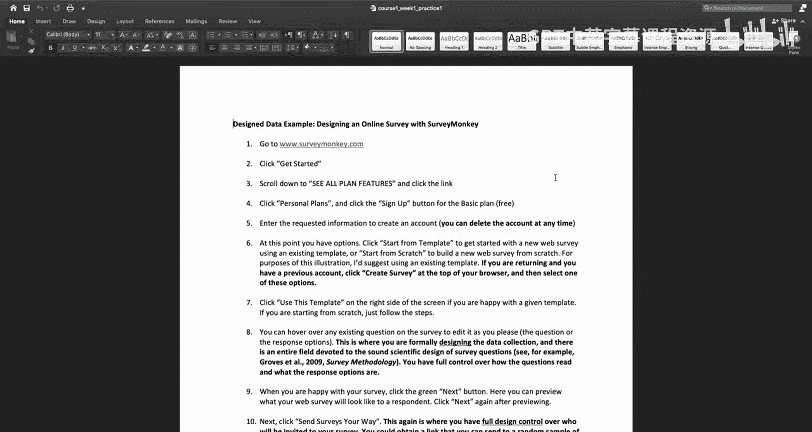
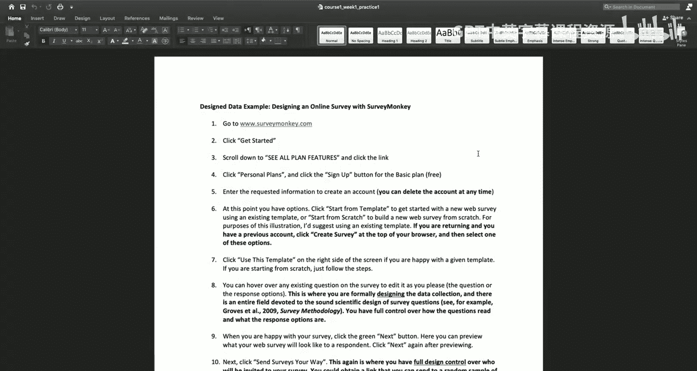
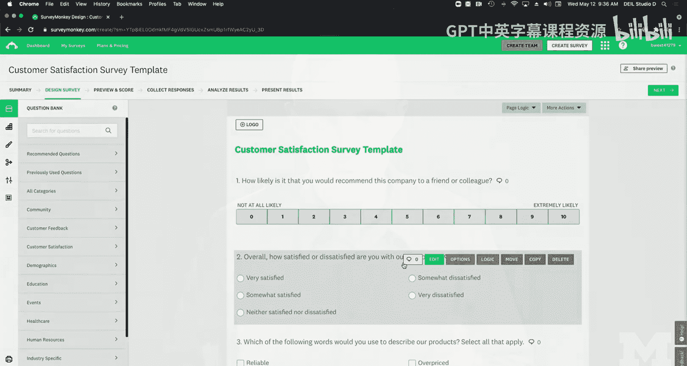
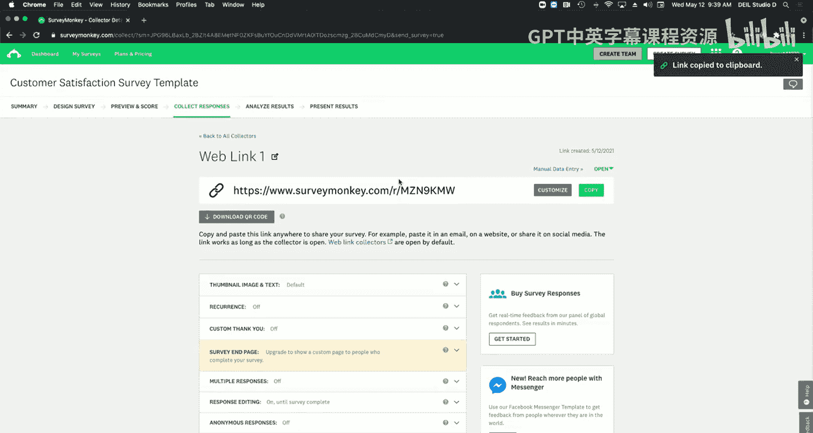
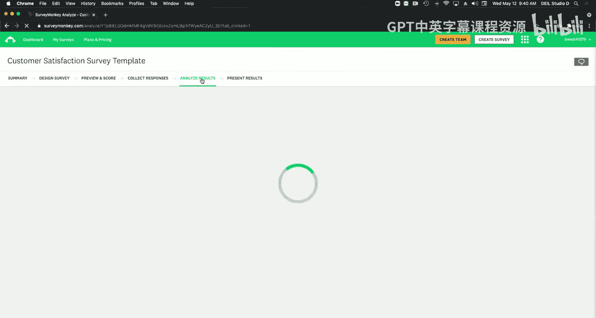
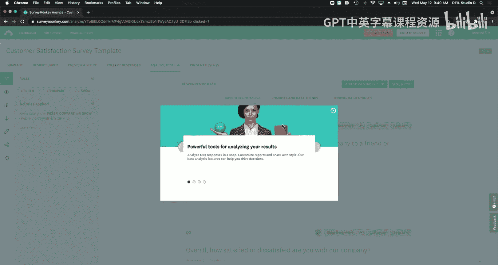
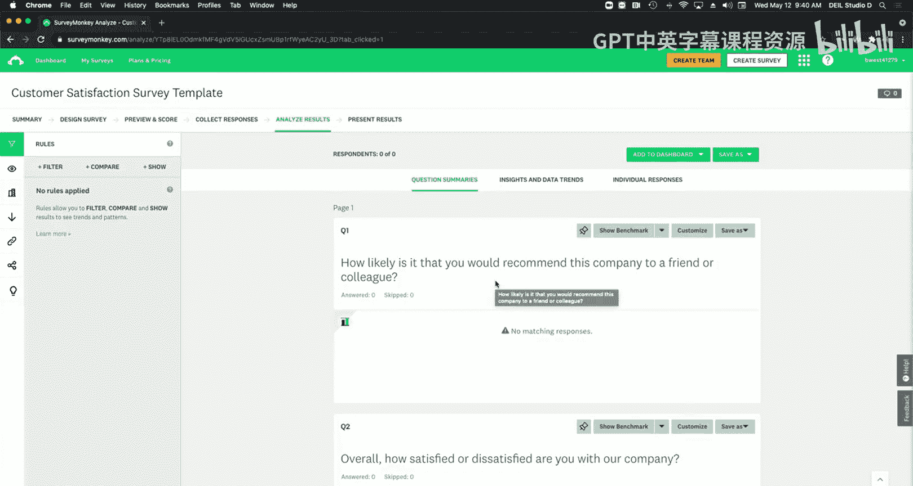
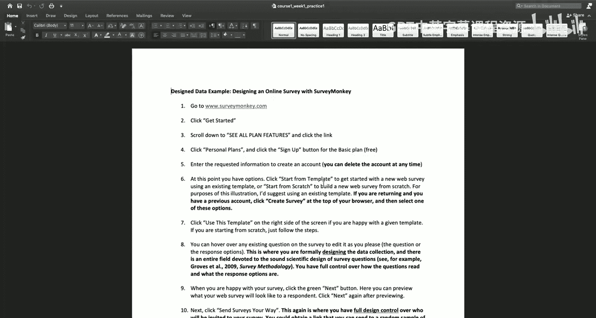
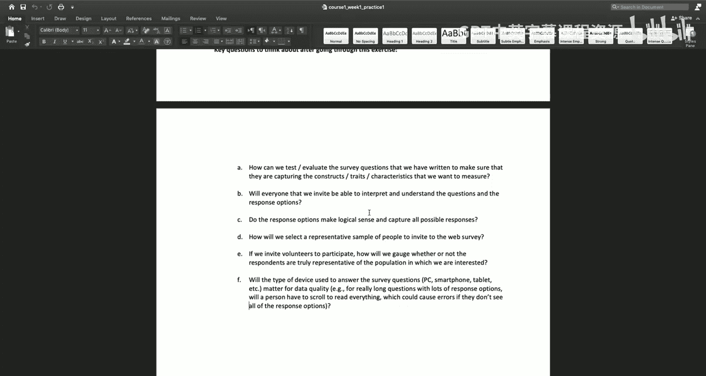

# 03：使用SurveyMonkey开发在线问卷 📝

在本节课中，我们将学习如何通过设计在线问卷来创建设计数据。我们将以SurveyMonkey这一流行的在线工具为例，演示从创建账户、设计问卷到收集和分析响应的完整流程。

## 概述

我们将逐步演示如何使用SurveyMonkey创建一个在线调查。这个过程包括注册账户、选择或创建问卷模板、编辑问题、预览问卷、分发问卷链接以及最终分析收集到的数据。通过这个示例，你将亲身体验如何通过在线调查收集设计数据。

## 创建账户与开始设计

首先，访问SurveyMonkey官网 `www.surveymonkey.com`。进入网站后，点击绿色的“Get Started”按钮开始。

接下来，你会看到多种不同的订阅计划。对于个人使用或初次尝试，选择“Basic”免费计划即可。点击页面右上角的“Sign Up”按钮，使用你的邮箱和密码创建一个新账户。

完成账户创建和验证后，你将进入开始页面。这里有两个主要选项：“Start from template”（从模板开始）和“Start from scratch”（从零开始）。为了快速上手并了解问卷结构，我们建议从模板开始。

以下是可用的模板类型示例：
*   **客户满意度调查**
*   **冠状病毒领导力检查**
*   **市场调研问卷**

在本演示中，我们将选择“客户满意度调查”模板。点击该模板后，你可以预览其样式和预设问题。如果满意，点击右下角的“Use this template”按钮即可使用。

## 编辑与设计问卷问题

使用模板后，你将进入问卷设计窗口。在这里，你可以轻松修改模板中的任何问题或创建新问题。

要编辑一个问题，只需点击该问题，然后选择“Edit”。你可以更改问题的文本、调整多选题的选项，甚至改变问题的类型。例如，你可以将单选题改为多选题或评分题。

完成编辑后，点击“Save”保存更改。你可以对问卷中的每一个问题进行类似的编辑，确保它们符合你的研究目标和测量需求。问卷设计本身是一门科学，涉及如何最佳地措辞和设置选项以获得高质量的数据，我们将在课程后续部分深入探讨。

当你对所有问题的编辑都感到满意后，就可以进入下一步了。

## 预览与分发问卷

上一节我们完成了问卷的设计，本节中我们来看看如何预览并分发它。

点击页面右上角的“Next”按钮，进入预览步骤。在这里，你可以像一名真实的受访者一样，从头到尾填写一遍问卷。这有助于你检查问卷的流程是否顺畅、问题是否清晰、选项是否合理。

预览满意后，再次点击“Next”。现在，你将看到收集调查响应的多种选项。

我们建议点击“Send surveys your way”。分发问卷的常用方式包括：
*   **通过电子邮件发送**：手动输入收件人的邮箱地址。
*   **分享调查链接**：生成一个唯一的网页链接，你可以将其粘贴到邮件、信件或社交媒体中。
*   **发送短信**或**在社交媒体上发布**。

为了演示的灵活性，我们选择“Share a survey link”。SurveyMonkey会立即生成一个专属的网页链接。点击“Copy”复制该链接。

现在，你可以通过电子邮件、邮寄信件或任何其他方式将这个链接分发给你的目标受访者（例如朋友、同事或研究样本）。当人们点击这个链接时，他们就可以参与调查并回答问题。

SurveyMonkey会自动收集所有回复，并实时更新回复数量，让你随时掌握数据收集的进度。

## 分析收集到的数据

当问卷收集到足够的回复后，你就可以开始分析数据了。点击“Analyze results”进入分析页面。

SurveyMonkey提供了内置的分析工具，可以自动为每个问题生成图表和频率表，帮助你直观地了解数据分布。

如果你希望进行更深入的分析，也可以选择下载原始数据。数据通常可以导出为 `CSV` 或 `Excel` 格式，方便你使用其他统计软件（如SPSS, R, Python）进行处理。

此外，SurveyMonkey还提供了多种结果呈现选项，方便你制作报告或演示。

## 关于数据质量的思考

完成上述步骤后，你已经体验了在线调查数据收集的全过程。然而，从总体数据质量框架的角度，我们还需要思考一些更深层次的问题。以下是几个供你反思的关键点：

1.  **效度评估**：我们如何测试或评估所设计的问题，以确保它们能准确测量我们想要测量的构念、特质或特征？这关系到数据的**效度**。
2.  **问题可理解性**：所有被邀请的受访者是否都能正确理解和解释问题及选项？这强调了问卷设计在数据起源阶段的重要性。
3.  **选项的逻辑性与完备性**：设置的答案选项是否逻辑合理，并且涵盖了受访者所有可能的回答？
4.  **样本代表性**：我们将如何选择有代表性的样本人群来邀请参与调查？这涉及到**数据源**和**数据可及性**。
5.  **志愿者偏差**：如果我们邀请的是志愿者，如何判断受访者是否能真正代表我们感兴趣的目标总体？这同样关乎样本的代表性。
6.  **设备效应**：用于回答问卷的设备类型（如PC、智能手机、平板电脑）是否会影响数据质量？不同的设备体验是否会引入测量误差？

思考这些问题，能帮助你在设计数据收集方案时，更全面地考量数据质量的各个方面。

## 总结

本节课中，我们一起学习了使用SurveyMonkey创建和分发在线问卷的完整流程。我们从注册账户开始，经历了选择模板、编辑问题、预览问卷、分发链接以及分析数据等关键步骤。更重要的是，我们结合总体数据质量框架，对问卷设计、样本选择和数据收集过程中可能影响数据质量的因素进行了初步的思考。你可以根据本教程的步骤，尝试创建自己的问卷并收集一些数据，以获得更直接的体验。