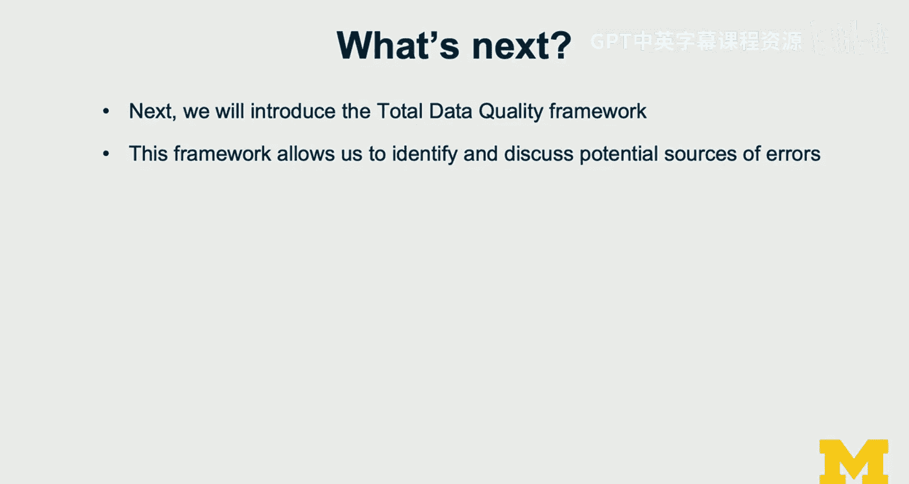

# 06：混合型数据：设计与采集的结合 📊

在本节课中，我们将要学习**混合型数据**。混合型数据是指将**设计型数据**与**采集型数据**相结合的数据集。我们将探讨其定义、优势、劣势以及两种主要的创建方式，并通过实例来加深理解。

---

## 混合型数据的定义与背景

上一节我们介绍了设计型数据与采集型数据的区别。混合型数据正是将这两种类型的数据结合起来。

*   **设计型数据**：研究者为特定目的主动设计并收集的数据，例如问卷调查。其优势在于研究者能控制数据质量，并确保数据与感兴趣的概念高度一致（即**效度**）。劣势在于收集成本通常较高。
*   **采集型数据**：并非为特定研究目的而主动收集，但可被用于分析的数据，例如行政记录、社交媒体数据和网络爬虫数据。其优势在于数据量通常很大，且收集成本相对较低。劣势在于它们可能与研究者的目标概念不完全匹配，可能只是接近，并且可能需要额外的标注等处理才能使用。

混合型数据结合了两种数据类型的优势，旨在取长补短。

---

## 创建混合型数据的两种主要方式

混合型数据主要有两种创建路径：一种是为采集型数据添加设计型数据，另一种是为设计型数据添加采集型数据。

### 方式一：为设计型数据添加采集型数据

这种方式通常是为了**丰富或拓宽**原有的设计型数据集。

一个典型的例子是，在问卷调查中请求受访者允许将其**行政记录**（如税务记录）链接到他们的调查数据上。这样做有几个目的：

1.  **部分验证**：可以用税务记录来部分验证受访者在调查中自我报告的收入信息。
2.  **补充细节**：税务记录可能包含受访者难以回忆或需要查阅文件才能提供的详细信息。

然而，这种方式也存在挑战：

*   **同意偏差**：并非所有受访者都会同意链接其行政记录。如果某一特定群体（例如高收入人群）更倾向于拒绝，那么最终的数据集就可能出现**代表性偏差**，无法很好地代表总体人口，从而扭曲研究推断。
*   **概念不匹配与测量误差**：行政记录（如税务记录）本身可能并未测量所有收入（例如未申报收入），并且自身也可能存在测量误差。因此，它并非调查报告的完美验证工具。

### 方式二：为采集型数据添加设计型数据

这种方式通常是为了**创建训练数据**，以用于机器学习等任务。

一个常见的例子是为一组图像**添加人工标签**。这些带标签的数据（设计型数据）被用来训练一个算法模型，该模型随后可以自动标注新的、未标记的图像（采集型数据）。

这个过程同样面临测量误差的挑战，我们称之为**嘈杂的人工标注**。以下是可能影响标签一致性的因素：

*   **标签模糊性**：一张图片中的物体可能对应多个合理标签（例如，“足球”还是“英式足球”？“狗”还是“小狗”？）。
*   **任务相关性**：标签的详细程度取决于任务目标。如果任务是按品种分类狗，那么“金毛寻回犬”就比笼统的“狗”更有用。
*   **文化或个体差异**：来自不同地区或背景的标注者可能使用不同的术语。

这些差异会导致标签不一致，进而可能影响最终训练出的算法性能。

---

## 总结与前瞻

本节课中，我们一起学习了混合型数据。我们了解到，混合型数据通过结合设计型数据（控制质量、概念匹配度高）和采集型数据（量大、成本低）来发挥各自优势。我们重点探讨了两种创建方式：**用采集型数据丰富设计型数据**（可能引入同意偏差）和**用设计型数据标注采集型数据**（面临标签噪声的挑战）。

接下来，我们将引入**总体数据质量框架**。这个框架将帮助我们系统性地识别和讨论数据中潜在的各种误差来源，并为我们提供一种思路，去思考如何最大化我们所用数据的质量。