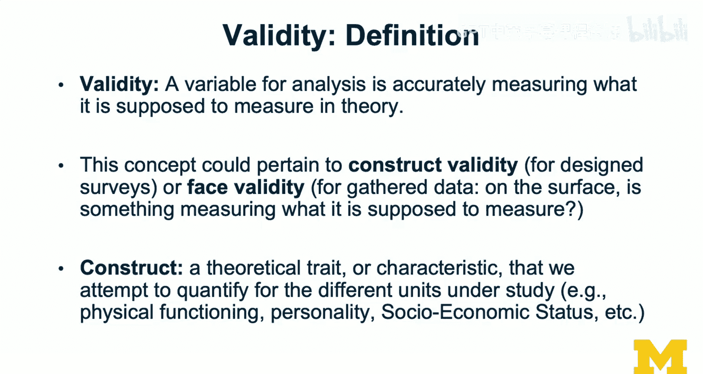
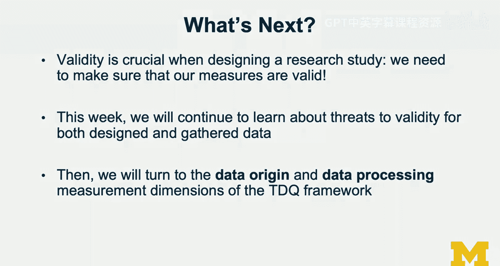

# 09：效度的定义与内涵 📊

在本节课中，我们将学习总体数据质量框架中一个关键的测量维度——效度。我们将明确效度的定义，并通过实例理解其核心内涵。

上一周我们介绍了总体数据质量框架的宏观结构，它包含测量维度和表征维度。本节中，我们将从测量维度中的“效度”开始探讨。

## 效度的定义

效度是指，用于分析的变量能够准确地测量它在理论上应该测量的内容。

这意味着，我们首先有一个想要测量的理论构念，然后选择一个变量来捕捉该构念的测量值。一个变量的效度越高，它就越能准确地测量其理论目标。

效度的概念可以涉及设计调查时的**构念效度**，也可以指收集现有数据时的**表面效度**。

## 理解“构念”

构念是我们试图为研究的不同单元进行量化的理论特质或特征。

以下是构念的一些可能例子：
*   **身体机能**
*   **人格**
*   **社会经济地位**

我们尝试用不同的变量或字段来测量这些构念，具体取决于我们是在设计数据框架中收集数据，还是从现有数据源中获取数据。

效度的核心问题在于，我们实际使用的变量是否为感兴趣的构念（如身体机能或人格）提供了有效的测量。

## 设计数据示例

假设我们通过调查问卷收集数据，并希望测量“社会经济地位”这一构念。

我们可能会使用调查中测量的其他变量，例如：
*   **家庭收入**
*   **教育年限**
*   **家庭财富**

我们可以将这些变量以某种方式组合，得出一个总体的社会经济地位测量值。效度所提出的问题是：通过这种方式得出的测量值，是否准确地反映了“社会经济地位”这一构念？

在概念上，社会经济地位是一个**潜变量**或**未观测变量**，它驱动着家庭收入、教育年限和家庭财富这些**观测变量**的值。我们需要确保这些观测变量都是社会经济地位的有效指标。

## 收集数据示例

假设我们收集关于推文的数据，并希望研究推特用户的“心理健康”状况。

我们可能会对一组关于疫情期间心理健康困难的推文进行文本定性分析。问题是：这种分析是否为具有特定特征的推特用户的“心理健康”提供了有效的测量？

例如，某人可能发推文说：“这次疫情真的让我感到忧郁。”我们需要判断，将这条推文编码为“此人正在与心理健康问题作斗争”的指标，是否是一个有效的指标？这同样是效度问题。

## 一个警示性案例

下图展示了过去两位总统上任头100天内的COVID-19死亡人数对比。

如果一项研究旨在比较两位总统的“执政表现”，并决定使用“上任头100天内的COVID-19死亡人数”作为衡量标准，那么这是一个有效的“表现”测量吗？

显然，这不是一个公平的比较。这个变量受到许多其他背景因素（如疫情发展阶段、病毒变种、检测能力等）的驱动，而不仅仅是总统的表现本身。因此，它并非“总统表现”这一构念的有效测量指标。

## 本节总结

本节课中，我们一起学习了效度的核心定义与内涵。效度要求我们选择的变量必须能有效测量我们真正感兴趣的理论构念。这对于设计研究至关重要，我们需要确保测量工具是有效的。

在接下来的课程中，我们将继续学习针对设计数据和收集数据的效度威胁，然后转向总体数据质量框架中的“数据来源”和“数据处理”这两个测量维度。