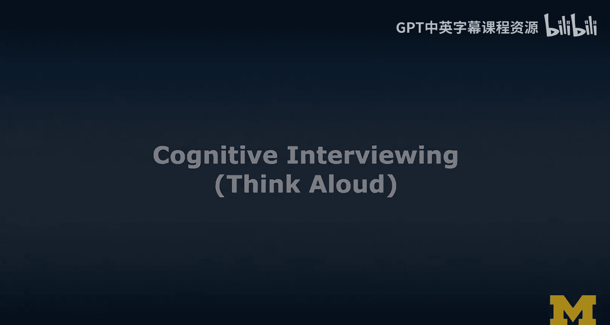

# 11：认知访谈法：有声思维技术应用 🧠




在本节课中，我们将学习一种评估调查问题有效性的重要工具——认知访谈法。我们将通过一个由专家演示的真实案例，了解其核心流程、关键技巧以及如何通过“有声思维”技术揭示受访者回答问题的真实思考过程。

---

## 概述

认知访谈是一种定性研究方法，旨在通过深入访谈来理解受访者如何解读和回答调查问题。其核心目标是评估问题的有效性，确保不同背景的受访者对问题有一致的理解，从而收集到高质量、有意义的数据。本节课将通过密歇根大学课程中的专家演示，详细拆解这一过程。

## 访谈演示与流程解析

上一节我们介绍了认知访谈的目标，本节中我们来看看一次标准的认知访谈是如何进行的。我们将跟随专家安德鲁的演示，逐步解析每个环节。

### 访谈开场与引导

访谈开始时，访谈员需要向受访者清晰地介绍流程和目标，以引导其进入“有声思维”的状态。

**访谈员开场白示例：**
```
“您好，您今天来这里是为了帮助我们进行一项卫生部的研究。卫生部正在编制一份关于健康行为和态度的调查，未来将由全国数千人回答。在研究开始前，我们需要确保调查问题易于回答且能按预期工作。今天，我们将请您回答调查中的一些问题，并分享您对问题的反应。我们关注的问题包括：问题是否容易回答、是否有模糊或令人困惑的地方，或者是否有您不愿意回答的问题。您的反馈没有对错之分，问题也不是我编写的，所以如果您有任何负面意见，请不必顾虑。您的反馈，连同其他类似访谈的反馈，将用于确保调查在全国开展前能良好运行。”
```

紧接着，访谈员会引入“有声思维”的核心指令：

**有声思维指令：**
```
“接下来，我将开始阅读调查问题。请您像在家回答调查一样正常回答问题。同时，请您在回答问题过程中‘大声思考’，也就是说，请大声说出您在听到问题后以及决定答案时的所有想法。在调查过程中，我也会不时停下来，问一些关于您对问题反应的后续问题。”
```

这个引导至关重要，它设定了访谈的基调，鼓励受访者分享其内在的认知过程，而不仅仅是给出最终答案。

### 核心技巧：提问与探查

在受访者回答问题后，访谈员会使用多种探查技巧来深入了解其思考过程。以下是一些关键技巧及其应用场景：

以下是常用的探查问题类型：

1.  **意义理解探查**：用于了解受访者对问题中特定术语或概念的个人解读。
    *   **示例问题**：“**用您自己的话说**，当您听到‘补充、替代或非常规疗法’这个短语时，您会想到什么？”
    *   **目的**：评估问题中的关键概念是否被正确且一致地理解。

2.  **答案理由探查**：用于探究受访者选择某个答案的具体原因和决策逻辑。
    *   **示例问题**：“您选择了‘有些不同意’。**能多说一点您是如何决定这个答案的吗？**”
    *   **目的**：验证答案是否真实反映了受访者的经历或态度，而不是随意猜测或误解。

3.  **假设情境探查**：用于澄清受访者对问题边界或条件的理解。
    *   **示例问题**：“**如果**把在线医疗咨询算进去，您的答案会改变吗？”
    *   **目的**：发现问题中可能存在的模糊之处，例如哪些情况应该包含或排除。

4.  **难度评估探查**：用于了解受访者回答问题的认知负担。
    *   **示例问题**：“**总的来说，回答这个问题对您来说是容易还是困难？**”
    *   **目的**：评估问题的复杂性和对受访者的友好程度。

### 访谈实例分析

让我们通过演示中的两个具体问题，来看访谈员如何应用这些技巧。

**问题A（行为事实类）：** “在过去12个月中，不计急诊次数，您为了自己看病去了多少次医生、护士或其他健康专业人员那里？”

*   **受访者思考过程**：受访者立即确认了“不计急诊”这一条件，并提出了一个关键疑问——**在线医疗咨询**是否应算作“去看”医生。这导致他给出了两个可能的答案：算上在线咨询是10-15次，不算则是5-6次。
*   **访谈员洞察**：这个问题本身可能并非测试重点，但受访者的反馈揭示了重要问题：在当今（尤其是后疫情）时代，问题的措辞“go to a doctor”（去看医生）可能无法涵盖**远程医疗**这种普遍形式，从而会导致数据收集不完整。访谈员需要将此记录，建议研究人员澄清或增加相关问题。

**问题B（态度观点类）：** “癌症最常是由个人的行为或生活方式引起的。您是非常同意、有些同意、有些不同意还是非常不同意？”

*   **受访者思考过程**：受访者（布拉迪教授）选择了“有些不同意”。他的“有声思维”解释是，他认为癌症风险部分由遗传（先天）决定，部分由生活方式（后天）影响。他将“最常”理解为“超过50%的情况”，而他认为遗传因素占比很大，因此该陈述未超过50%这条线。
*   **访谈员分析与探查**：
    *   由于受访者在“有声思维”时已经清晰解释了理由（先天 vs. 后天），访谈员判断无需再问“答案理由探查”。
    *   但访谈员随后进行了**意义理解探查**：“当您听到‘最常是由……引起’这个短语时，您在想什么？”这确认了受访者使用了量化的“50%”作为判断阈值。
    *   **关键洞察**：访谈员指出，对于教育水平较低或不了解“先天与后天”区别的受访者，他们可能无法进行这样的复杂推理。他们的答案可能基于完全不同的理解，这就会导致**有效性**问题——我们无法确定答案差异是源于态度的真实差异，还是对问题理解的差异。

### 认知访谈的挑战与艺术

通过演示可以看出，认知访谈并非机械的问答，而是一门需要灵活应变的艺术。

*   **平衡的艺术**：访谈员需在**预设探查计划**与**即兴跟进**之间取得平衡。当受访者说出意想不到但重要的内容时，必须能够灵活追问。
*   **避免引导**：访谈员不能将自己的观点强加给受访者。目标是倾听和理解受访者的**自然思考过程**，而不是让他们猜测“正确”答案或符合研究者的意图。
*   **处理“专家型”受访者**：演示中的受访者是调查方法学家，他能进行深刻的自我剖析并提供方法学见解。然而，大多数普通受访者无法做到这一点。访谈员需要调整策略，用更通俗的方式引导不同背景的受访者表达其想法。
*   **样本多样性至关重要**：为了全面评估问题，必须**有目的地招募**能代表目标人群多样性的受访者（如不同年龄、教育背景、文化、健康状况）。仅采访方法学家或研究人员无法发现面向大众的问题中存在的所有潜在误解。

## 总结

本节课中，我们一起学习了认知访谈法的核心应用。我们了解到，认知访谈通过“有声思维”技术和一系列探查问题，深入挖掘受访者回答调查问题时的认知过程。这种方法对于评估问题的**有效性**至关重要，它能帮助我们发现：
*   问题术语的模糊或歧义。
*   问题未能涵盖的现实情境（如远程医疗）。
*   不同亚群体对问题的理解差异。
*   问题本身给受访者带来的认知负担。


最终，基于从一系列具有多样性的访谈中获得的定性反馈，研究人员可以优化问题措辞、调整选项或增加说明，从而在正式开展大规模调查前，最大限度地提升调查工具的数据质量。认知访谈是连接研究者意图与公众理解之间桥梁的关键施工阶段。