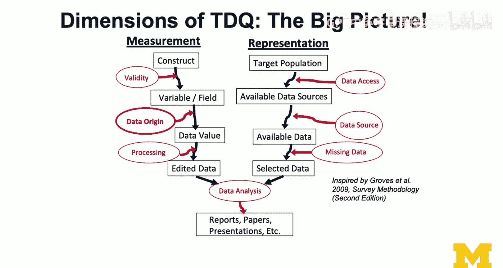
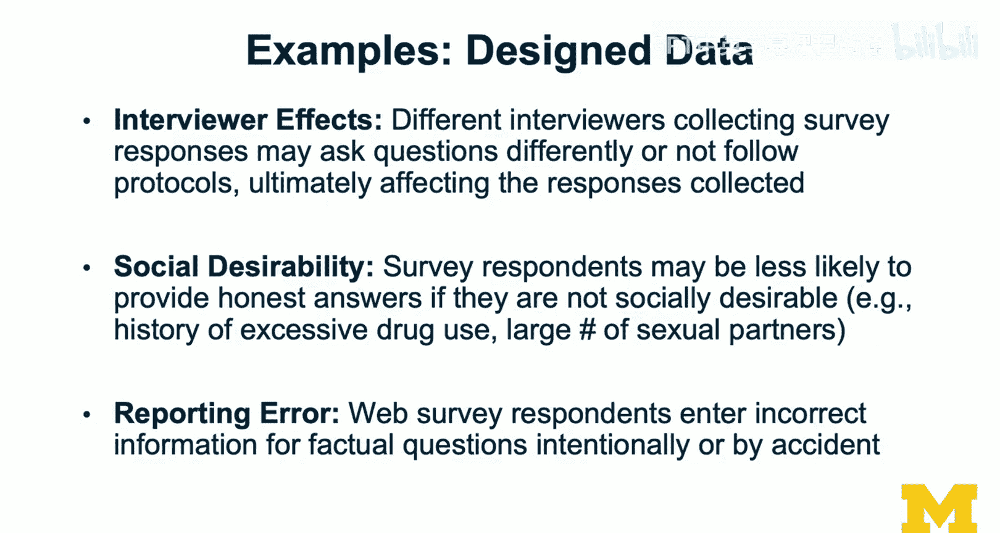
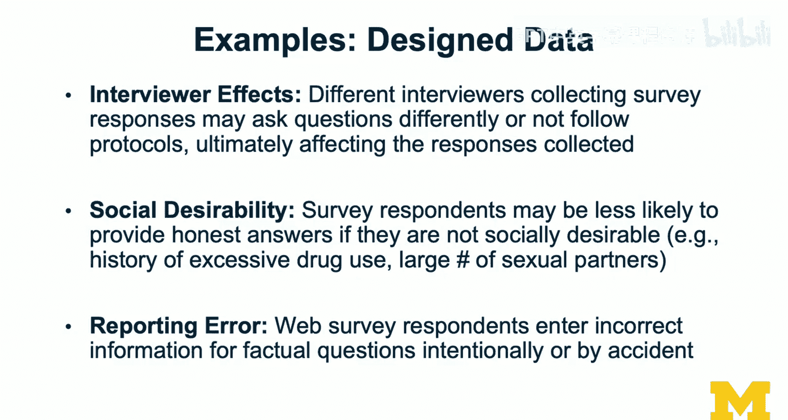
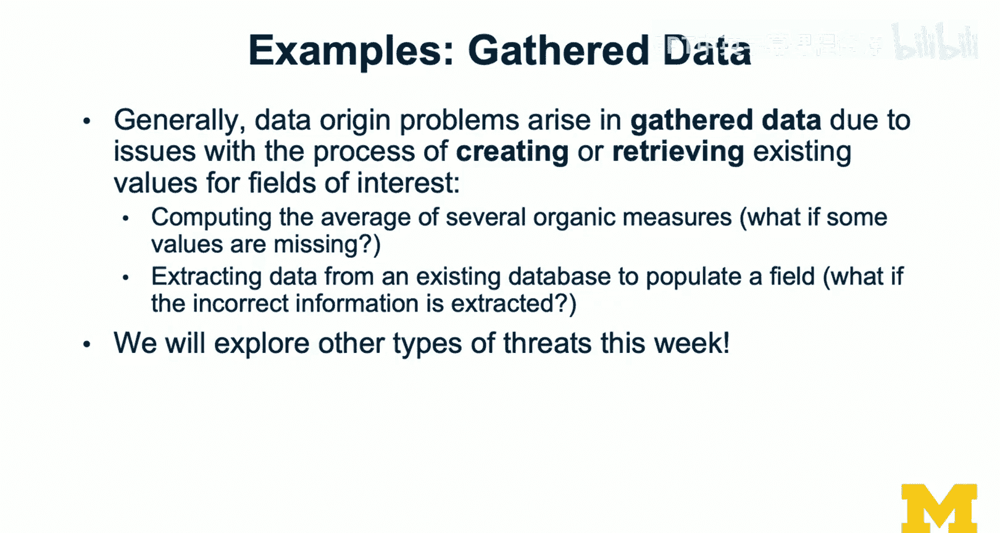
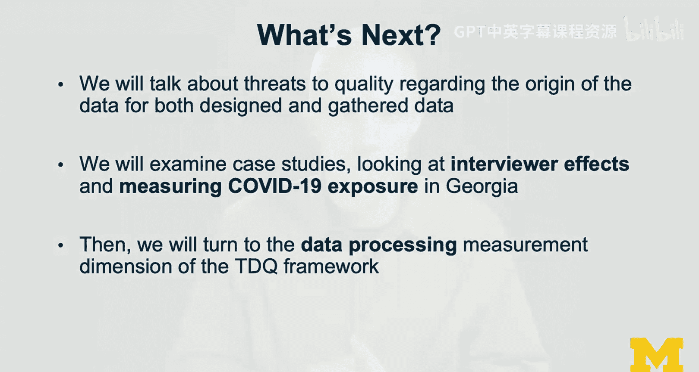

# 14：数据溯源的定义与范畴 📊

在本节课中，我们将学习总体数据质量框架中的第二个度量维度——数据溯源。我们将明确数据溯源的定义，并探讨其范畴，包括在设计和采集数据过程中可能出现的质量问题。

---

上一节我们介绍了**效度**，它关注从理论构念到具体问题、变量或字段的映射。本节中，我们将把注意力转向**数据溯源**。数据溯源关注的是，我们如何为感兴趣的变量、字段或问题获取具体的数据值。简单来说，它回答“数据从何而来”的问题，并审视在数据产生过程中是否存在影响最终分析质量的潜在威胁。

## 数据溯源的定义

数据溯源指的是，针对给定变量或字段，其个体数值或数据点是如何为分析单元**记录、捕获、收集、计算或表示**的。其核心是探究特定数据的确切来源和产生机制，并评估该来源过程的质量。

在总体数据质量框架中，我们关心的是：在获取这些数据值（无论是来自调查问题还是其他变量）的过程中，**是否存在任何错误**。

## 数据溯源中的质量问题示例

以下是数据溯源在不同数据背景下可能出现的一些质量问题。

### 设计数据中的问题

在通过设计（如调查）获取数据的背景下，常见的数据溯源问题包括：

*   **访问员效应**：不同的访问员在收集调查回答时，可能以不同的方式提问或未严格遵循协议，这最终会影响所收集回答的性质。例如，一名访问员可能持续错误地提问，导致收集到有偏见的回答。
*   **社会期望偏差**：当被问到敏感问题时（例如，药物滥用史或性伴侣数量），受访者可能因为希望给访问员留下好印象，而过滤自己的真实回答，提供不完全真实的答案。这是一个数据溯源问题，因为数据生成过程本身受到了干扰。
*   **报告错误**：例如，网络调查的受访者可能有意或无意地为事实性问题输入错误信息。他们可能浏览调查过快、没有查阅记录，或者只是凭记忆回答，导致提供的数据值不准确。

### 采集数据中的问题

在通过采集现有数据（如从数据库提取）的背景下，数据溯源问题通常源于为感兴趣的字段**创建或检索现有值的过程**。例如：

*   **计算平均值时的缺失值问题**：如果我们通过计算几个测量值的平均值来创建一个新变量，但部分输入值恰好缺失，这时应如何处理？在这种情况下计算平均值是否仍有意义？
*   **从现有数据库提取数据时的错误**：如果我们为了填充目标字段，不小心从现有数据库中提取了错误的信息（例如提取了错误的观测记录），这同样构成了该字段数据溯源上的问题。

---

本节课中，我们一起学习了数据溯源的定义及其核心关注点。我们了解到，数据溯源关乎数据值的产生过程，并探讨了在设计和采集数据中常见的威胁，如访问员效应、社会期望偏差、报告错误以及数据处理逻辑错误。

接下来，我们将继续深入探讨数据溯源方面的其他威胁类型，并分析一些具体案例（例如，访问员效应对佐治亚州COVID-19暴露测量的影响）。之后，我们将转向总体数据质量框架中的下一个度量维度——**数据处理**。