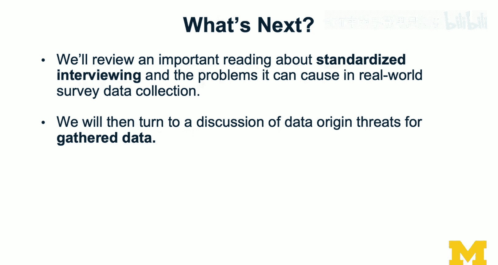

# 15：设计型数据溯源威胁因素 📊

在本节课中，我们将学习总体数据质量框架中“数据溯源”维度的具体内容，特别是针对**设计型数据**（如通过问卷、调查收集的数据）的威胁因素。我们将探讨在数据设计阶段，哪些问题会影响数据的来源和质量。

---

上一节我们定义了总体数据质量中的数据溯源维度。本节中，我们来看看在设计数据收集过程中，具体存在哪些威胁数据溯源质量的因素。

## 设计型数据溯源的主要威胁

设计型数据通常指通过主动设计（如问卷调查）从目标群体收集的信息。在这一过程中，从问题设计到最终回答的每个环节都可能引入误差。

以下是设计型数据收集过程中常见的溯源威胁：

### 1. 回答问卷的心理过程困难
当受访者回答调查问题时，其内部心理过程包括：**理解问题**、**从记忆中检索相关信息**、**在回答前编辑信息**。这个过程中的任何中断都可能导致低质量的回答。

### 2. 访问员效应
在由访问员执行的数据收集中，访问员会对收集到的回答产生影响。这些效应可能源于访问员的**可观察特征**或**行为**（如偏离脚本、与受访者互动的方式不同），从而给调查估计值带来偏差和方差。

### 3. 数据聚合或变量计算错误
这通常指基于调查回答计算新量表或聚合变量时出现的错误。例如，由于编码错误或错误地组合了变量，导致最终用于分析的变量未能正确创建。

### 4. 模式效应
不同的数据收集模式（如面对面访谈、电话访问、网络问卷、邮件问卷、智能手机作答）可能引发不同的回答行为，从而影响目标变量的回答分布。

### 5. 问卷设计问题
这包括**措辞不当的问题**、**令人困惑或过于复杂的问题**、**不恰当或不正确的回答选项**，以及**问题在不同设备上显示不一致**。这些问题都会影响受访者对问题的理解和回答。

### 6. 受访者行为问题
受访者可能采取**满足行为**，即付出最小的认知努力来回答问题；可能出现**默许倾向**，即倾向于同意所有陈述；或者在网络调查中**过快作答**。这些行为都会损害回答的理解和检索质量。

## 文献中的威胁实例

为了更具体地理解这些威胁，以下是一些来自研究文献的实例：

*   **敏感内容低报**：在一项关于家庭增长的全国性调查中，受访者倾向于低报“是否曾进行过人工流产”等敏感行为，尤其是在访问员在场时，他们会提供更符合社会期望的回答。
*   **访问员技巧的影响**：研究表明，与严格的标准化的访谈相比，采用更灵活的、对话式的访谈技巧可以提高回答质量，且不会引入过多的访问员间差异。
*   **访问员特征与行为**：访问员的**可观察特征**、**提问技巧**和**具体行为**都会以不同方式影响调查报告的质量。
*   **回答偏差的证据**：通过使用行政记录数据验证调查报告，研究发现存在回答偏差的证据。例如，大学生在调查中倾向于误报“是否挂过科”或“是否有过校园危险行为”等敏感结果。
*   **回答倾向与报告误差的复杂关系**：研究发现，受访者是否愿意参与调查与其报告中的误差之间存在复杂关系，且这种误差因变量类型而异。

---

本节课中，我们一起学习了影响设计型数据溯源质量的多种威胁因素，包括回答过程的心理中断、访问员效应、计算错误、数据收集模式差异、问卷设计缺陷以及受访者行为问题。理解这些威胁是设计和实施高质量数据收集方案的第一步。

接下来，我们将通过阅读Suchman和Jordan关于标准化访谈的重要文献，深入探讨这种访谈技巧在现实世界中可能引发的问题。之后，我们将转向讨论**采集型数据**的溯源威胁，看看它与设计型数据在此方面有何不同。