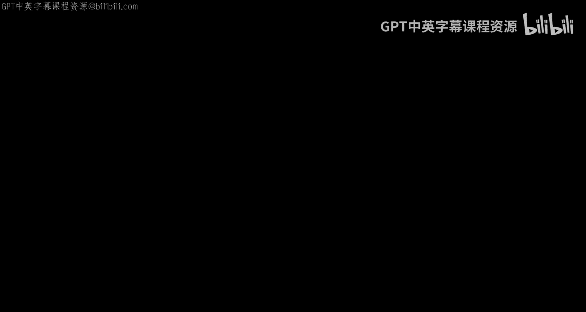
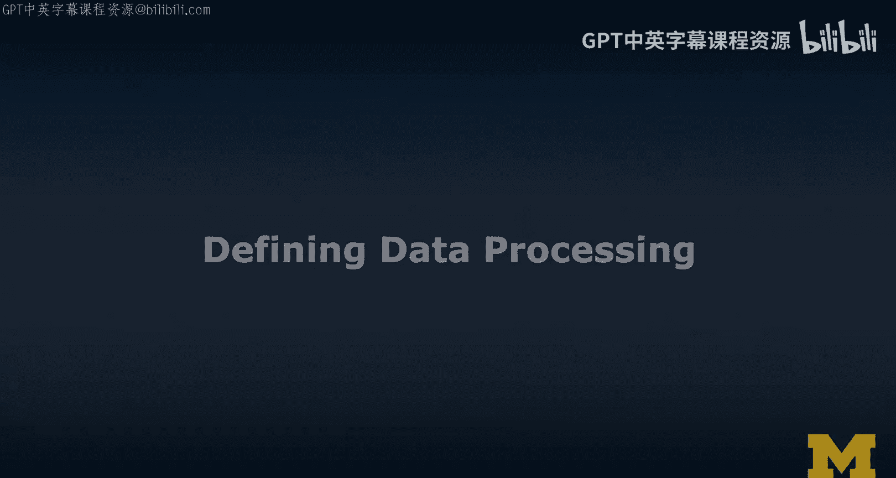
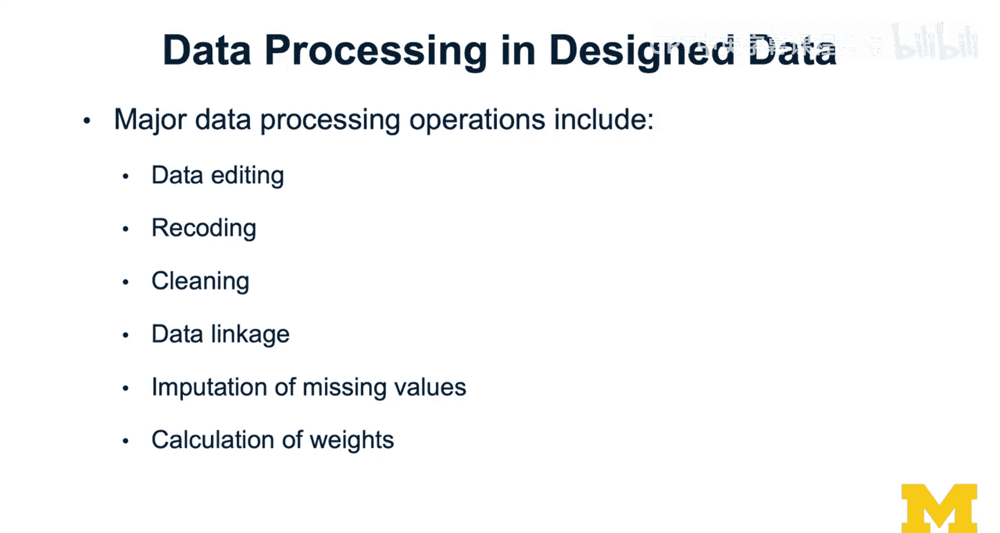
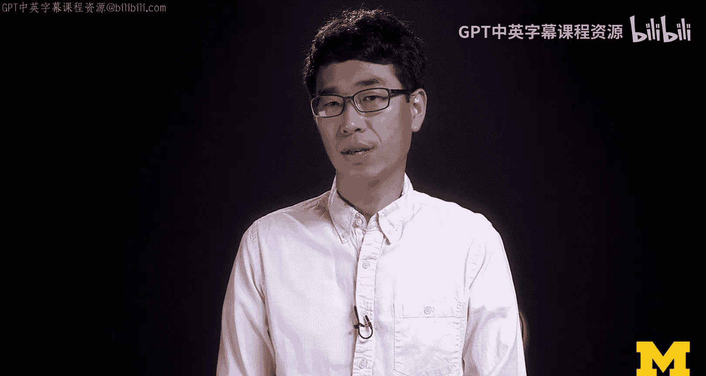
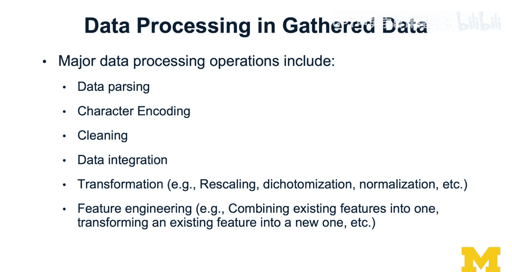
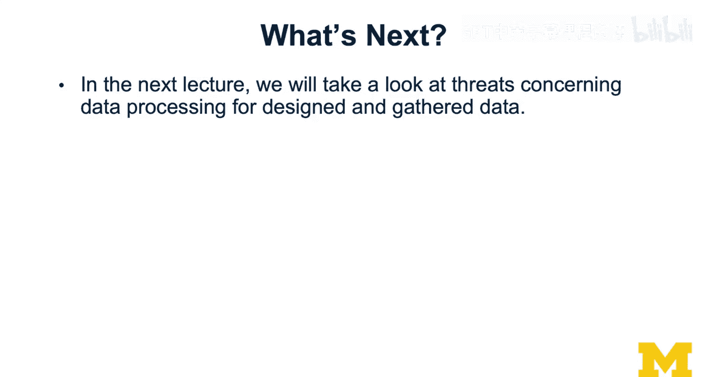
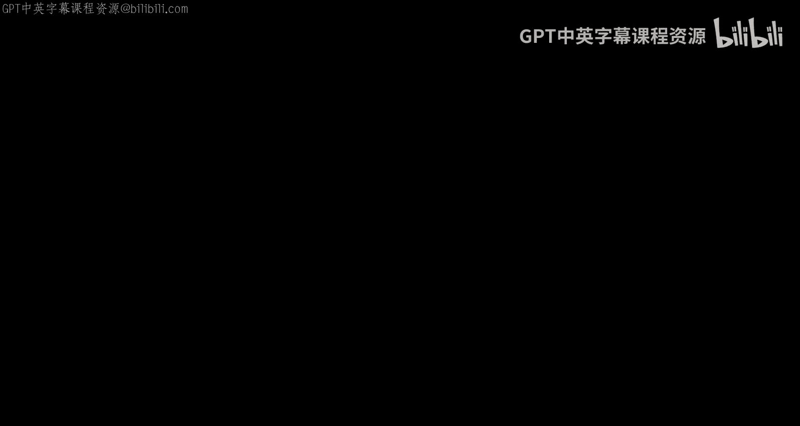

# 17：数据处理的定义与流程 📊

在本节课中，我们将学习数据处理的定义、它在总体数据质量框架中的位置，以及针对设计数据与采集数据的不同处理类型。

## 概述

首先，让我们回顾一下总体框架。在之前的章节中，我们已经探讨了数据有效性和数据来源。本节中，我们将聚焦于**数据处理**。在数据处理环节，我们接收数据值，对其进行编辑，并生成可用于数据分析的编辑后数据。这是总体数据质量框架中的第三个测量维度。

## 数据处理的定义

数据处理是指一系列操作，旨在收集、转换和操纵数据，使其成为可用于提取有意义信息的格式。

从广义上讲，我们可以将数据分析也视为数据处理的一种类型。这是因为在数据分析阶段，你可能会合并和转换数据值以进行分析。但通常，**数据处理**特指数据收集与数据分析之间的早期阶段。

此外，在计算机和信息科学领域，你或许听说过**数据预处理**这个术语。数据预处理与数据处理通常可以互换使用。

## 设计数据的数据处理类型

以下是针对设计数据的几种数据处理类型：

*   **数据编辑、记录、清洗**：修正数据中的错误、不一致和异常值。
*   **数据链接**：合并来自不同来源的数据集。
*   **缺失值插补**：预测并填补设计数据集中的缺失值。
*   **权重或变量计算**：计算用于对更大总体进行统计推断的权重或新变量。

## 采集数据的数据处理类型

另一方面，针对采集数据，数据处理可以包括以下类型：

*   **数据解析**：从非结构化或半结构化数据（如日志、文本）中提取结构化信息。
*   **字符编码**：确保文本数据以正确的字符集（如UTF-8）进行编码和解码，避免乱码。
*   **数据清洗**：处理采集数据中的噪声、重复项和不一致问题。
*   **数据集成**：将来自多个来源的数据组合成一个一致的数据存储。
*   **数据转换**：这可能包括：
    *   **重新缩放**：`新值 = (原值 - 最小值) / (最大值 - 最小值)`
    *   **去相关化**
    *   **归一化**
*   **特征工程**：从采集数据的现有变量中计算新的、更有信息量的变量。

## 总结

本节课中，我们一起学习了数据处理的定义，并了解了针对设计数据和采集数据的不同处理类型示例。下一讲，我们将探讨与设计和采集数据处理相关的潜在问题与挑战。

