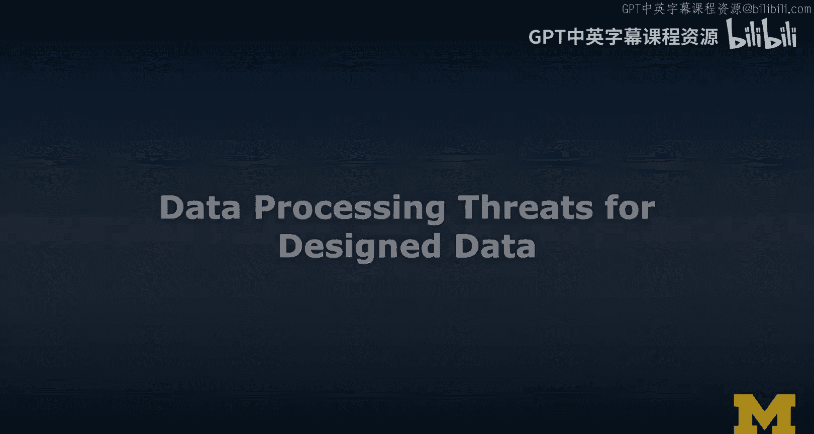
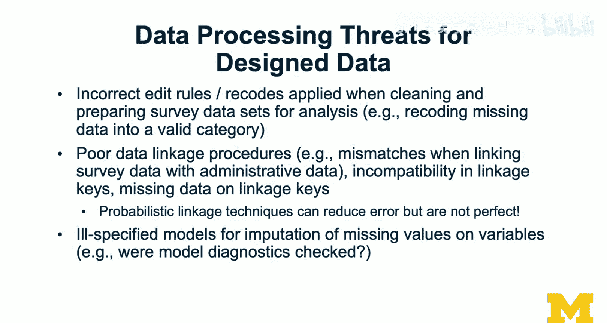
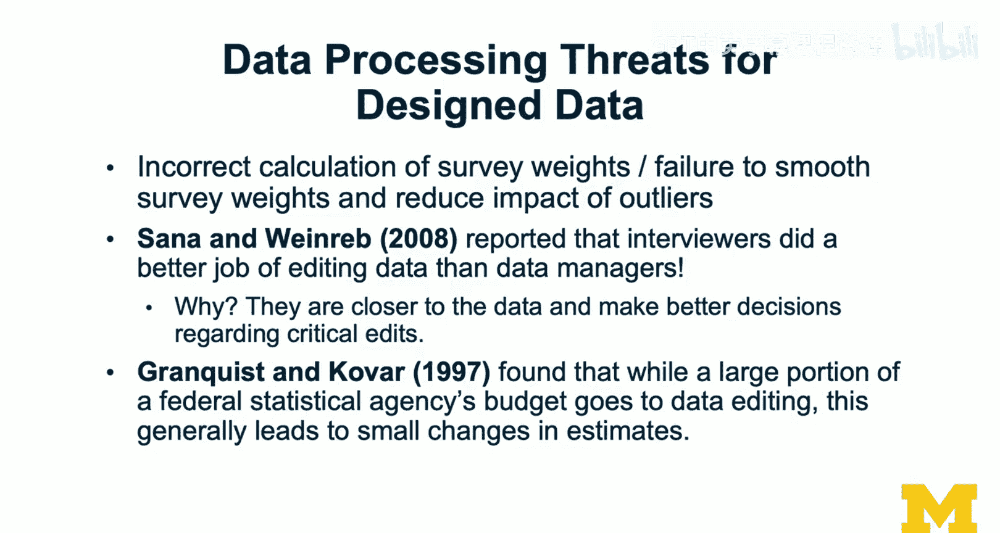
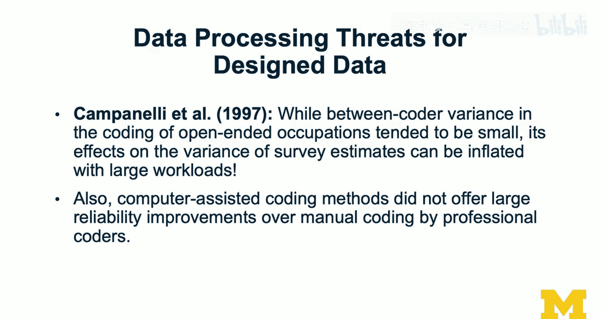
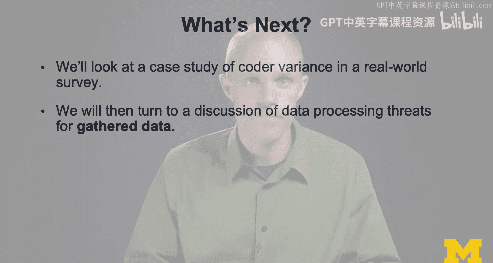
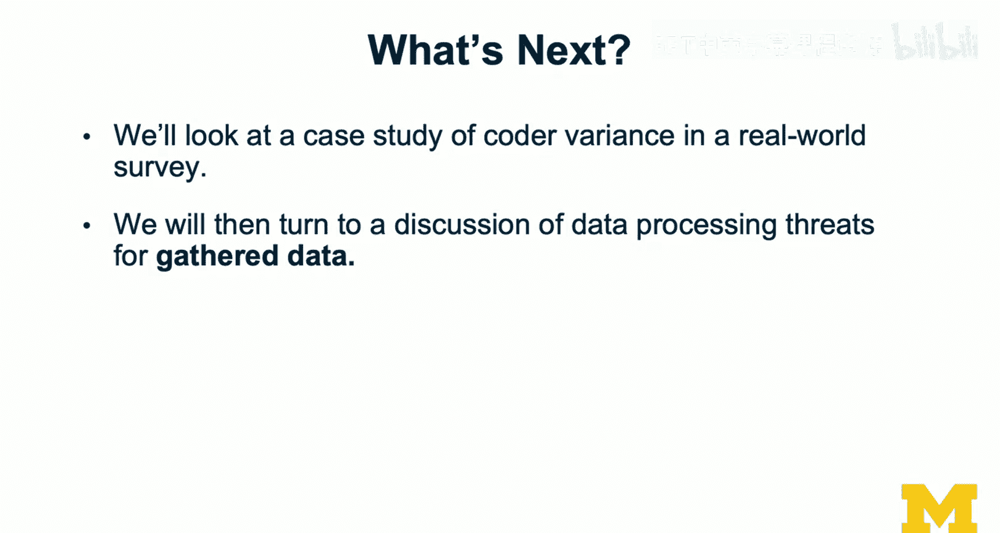

# 18：设计型数据处理威胁因素 📊

在本节课中，我们将要学习总体数据质量框架中的第三个测量维度——数据处理。具体来说，我们将聚焦于**设计型数据**在从原始收集值到最终分析数据的处理过程中，可能面临的各种威胁因素。

上一节我们介绍了数据处理在总体数据质量框架中的位置。本节中，我们来看看在清理和准备调查数据集以供分析时，可能遇到哪些特定的数据处理威胁。

以下是设计型数据处理过程中可能遇到的主要威胁：

*   **应用错误的编辑或重编码规则**：在清理数据时，可能因疏忽而错误地应用规则。例如，在编写用于清理数据的代码时，可能不慎将变量中的缺失值重编码为有效值。
*   **数据链接程序不佳**：当尝试将收集的调查数据与其他行政数据链接时，可能出现不匹配的情况。
*   **链接键不兼容**：用于合并不同数据集的ID变量可能格式不同（如字符数不一致），导致链接失败。
*   **链接键存在缺失值**：一个数据集中的某个案例在链接键上有有效值，但另一个数据集中对应ID的值缺失，导致无法链接。
*   **缺失值插补模型设定不当**：插补是一种预测变量缺失值的方法。如果用于预测的统计模型不合适或拟合不佳，则生成的预测值可能不准确。
*   **调查权重计算错误或未做平滑处理**：在基于设计的调查中，调查权重对于总体分析至关重要。数据生产者必须确保权重的计算正确，并处理异常权重以减少其影响。

此外，研究还揭示了一些关于数据处理的有趣发现。Sanna和Weinreb（2008）发现，访谈员在编辑调查回答时通常比后端数据管理员做得更好，因为他们更接近数据收集现场，能对非常规回答做出更合理的判断。因此，许多调查允许访谈员在记录回答时进行编辑。

Grantquist和Kovar（1997）指出，尽管联邦统计机构将大量预算用于数据编辑步骤，但这些编辑通常对最终估计值的影响较小。这表明数据处理威胁虽然存在，但其影响可能小于我们讨论过的其他测量维度（如设计、收集）中的问题。

另一个关于开放式问题编码的研究（Pam Campanelli等，1997）发现：
*   不同编码员在对开放式职业回答进行编码时，其编码结果的差异通常较小。
*   然而，如果分配给编码员的工作量过大，这种编码员间的差异对调查估计值变异性的影响会被放大。
*   研究还发现，计算机辅助编码方法相比专业编码员的人工编码，并未带来显著的可靠性提升。

本节课中，我们一起学习了设计型数据在加工处理阶段可能面临的多种威胁，包括错误的编辑规则、数据链接问题、不当的插补模型以及权重计算错误等。同时，我们也了解到，尽管数据处理需要投入大量精力，但其对最终估计值的改变可能有限，并且在某些环节（如编码）中，人力与自动化工具需要谨慎权衡。

接下来，我们将通过一个真实调查的案例研究，具体探讨编码员间差异的问题。之后，我们将把讨论转向**采集型数据**所面临的数据处理威胁。