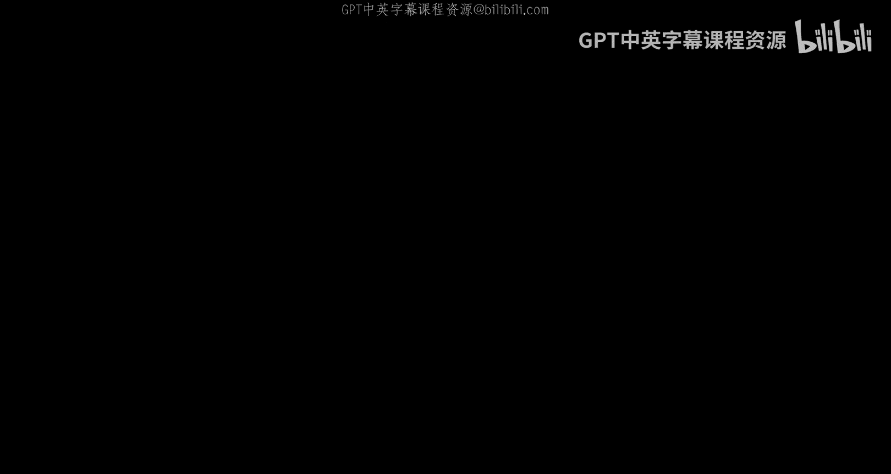
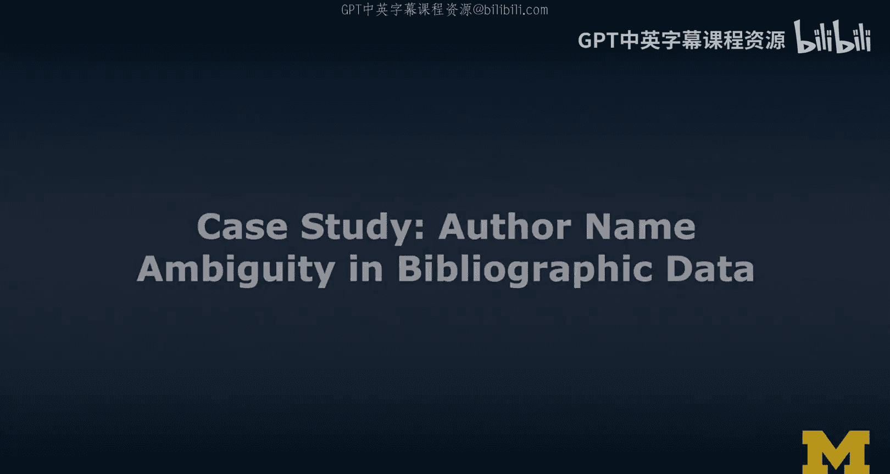
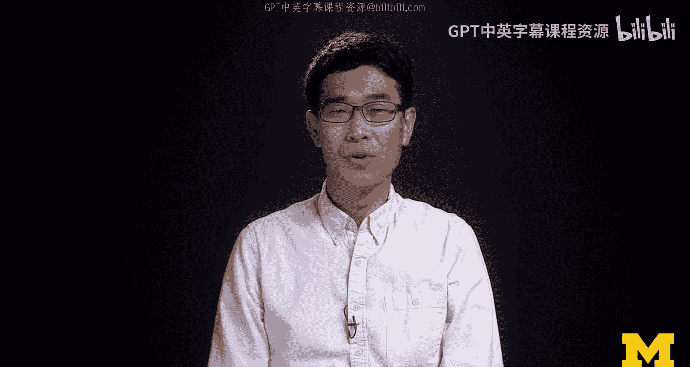
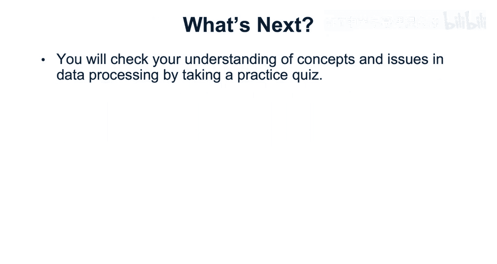
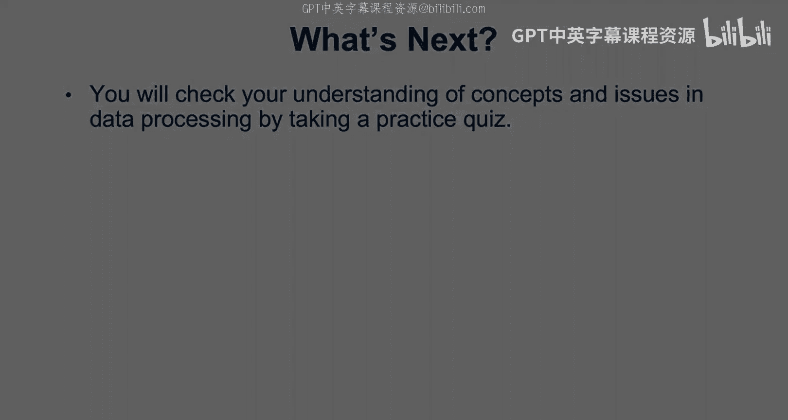
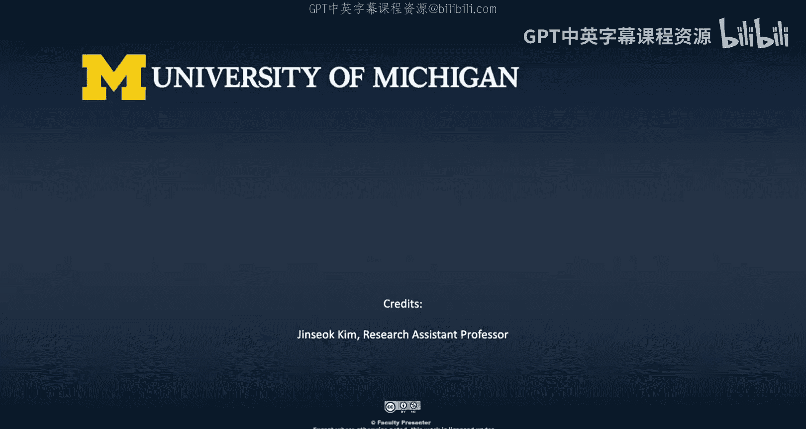

# 22：案例研究：文献数据中的作者名歧义问题 📚

在本节课中，我们将通过一个具体的案例——文献数据中的作者名歧义问题，来深入学习数据处理流程及其挑战。

## 概述

文献数据包含了关于出版物的元数据，例如作者姓名、标题、出版年份、发表场所和关键词。多个大规模的文献数据库可供研究和商业用途，例如全球最大的生物医学数字图书馆PubMed每月发布的**Medline**数据库，它包含了数百万条出版物记录。

研究人员和公司通过收集和分析这些数据，以理解科研产出与合作的模式和结构，并据此开发学术智能服务。

## 文献数据中的数据质量问题

在使用文献数据时，会遇到多种数据质量问题。

以下是几个常见的问题：

1.  **数据格式问题**：数据通常以XML格式发布，需要正确解析。
2.  **字符编码问题**：作者姓名和所属机构可能以多种语言记录，需要正确处理字符编码。
3.  **信息缺失**：例如，所属机构信息经常缺失。
4.  **重复记录**：这在文献数据中很常见。
5.  **规模带来的挑战**：数据可能包含数百万条记录，使得隐藏在其中的处理错误难以被发现。
6.  **作者身份识别问题**：最严重的问题是，由于文献数据通常不包含作者的唯一标识符，很难区分不同的作者。

## 作者名歧义问题详解

上一节我们列举了文献数据中的常见问题，本节中我们重点来看其中最核心的挑战：作者名歧义。

以Medline为例，和许多其他开放出版物记录一样，它不包含作者的唯一标识符。因此，数据使用者只能依赖姓名字符串来判断作者身份。但这种方法存在两个主要问题：

*   **同名问题**：拼写相同的名字可能指向不同的作者。例如，Medline中有超过300个不同的“Wei Wang”。
*   **别名问题**：同一作者可能使用不同的姓名变体。例如，“M. Newman”、“Mark Newman”、“Mark E. Newman”和“M.E.J. Newman”都可能指代密歇根大学物理系的同一位教授。

## 现有的解决方案及其缺陷

为了解决作者名歧义问题，学者和实践者通常采用算法方法为Medline中的作者名分配唯一标识符。但最主流的做法是使用一种简单的启发式规则。

以下是该规则的具体内容：

*   **规则一**：所有名首字母和完整姓氏都匹配的两个或多个姓名字符串，被假定为同一作者。例如，“M. E. Newman”和“Mark E. Newman”被认为是同一人。
*   **规则二**：有时仅使用第一个名的首字母和完整姓氏。根据此规则，“M. Newman”、“Mark Newman”和“M.E.J. Newman”都被认为是同一作者。

这种简单但广泛使用的方法，导致了出版物记录中作者标识符的不准确。

## 不准确标识符带来的影响

不准确的作者标识符会扭曲我们从聚合数据中获得的关于科研产出的理解。

以下是两个具体的影响示例：

1.  **扭曲高产作者列表**：你经常会发现成千上万个“J. Zhang”，这使得中国姓名在高产作者列表中占据主导地位，但这可能并非事实。
2.  **错误建模合作模式**：研究发现科研合作遵循类似幂律的模式，即少数研究者拥有不成比例的大量合作者，而大多数人只有很少的合作者。然而，最近关于聚合出版物数据质量的研究表明，观察到的这种模式，很大程度上是因为多个实体被错误地合并成了“人造作者”，这些“人造作者”被误认为拥有巨大的合作网络。

有一篇研究论文详细探讨了出版物记录中的歧义问题。该文章论证了，在大规模文献数据中不准确地识别作者姓名，如何导致我们对科研产出和合作模式产生错误理解。

## 总结

本节课中，我们一起学习了文献数据处理中的一个核心挑战——作者名歧义问题。我们了解了其产生的原因（缺乏唯一标识符、同名和别名现象），探讨了当前主流的简单启发式解决方案及其缺陷，并认识到不准确的标识符会如何严重扭曲数据分析的结果（如高产作者统计和合作网络分析）。这凸显了在数据处理的每个环节保证数据质量的重要性。

我们的课后练习将帮助你检查对数据处理中这些概念和问题的理解。