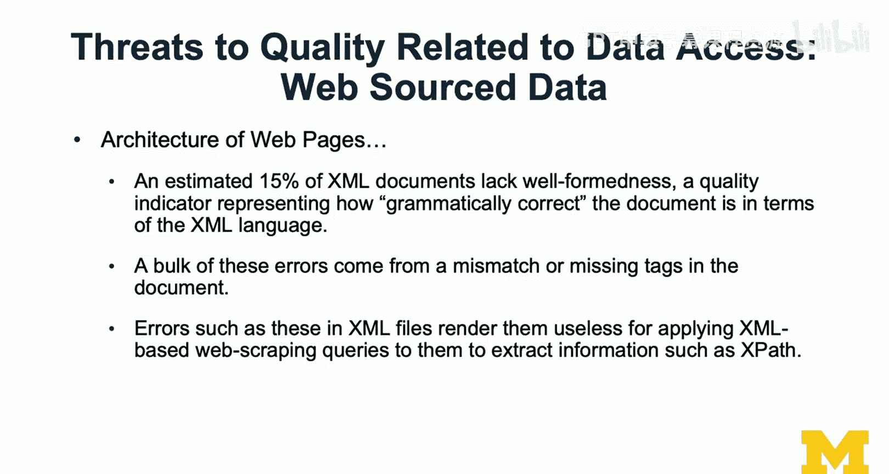
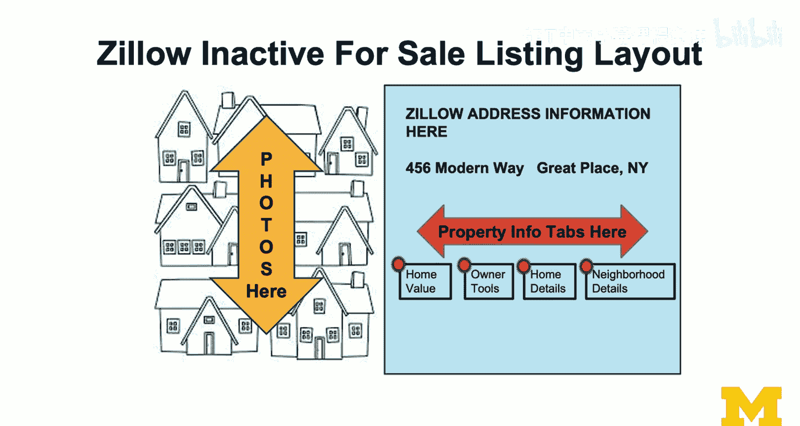
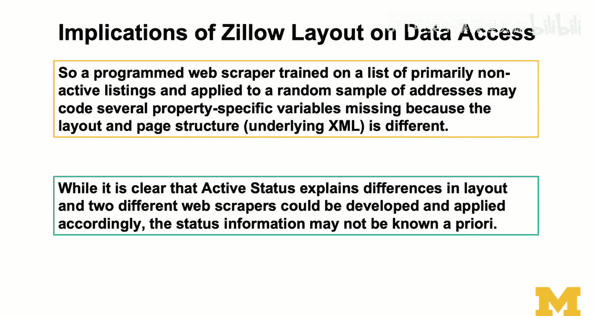
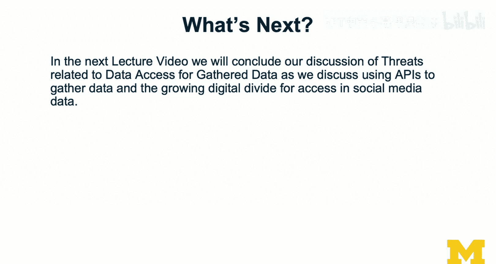

# 24：采集型数据访问威胁因素（第一部分）

在本节课中，我们将学习与采集型数据访问相关的质量威胁。我们将重点关注网络数据源，特别是网页结构和格式如何影响数据抓取的质量，并可能导致数据缺失或错误。

---

上一节我们介绍了数据质量框架的测量和表示两个方面。本节中，我们将聚焦于表示方面，具体探讨与**数据访问**相关的威胁。

与数据访问相关的质量威胁有多种。其中一种特别涉及**网络数据源**，它与网页的创建方式或页面架构有关。

例如，当你尝试使用网络爬虫方法从互联网上获取信息时，比如从维基百科或其他网络开放数据源获取你感兴趣的数据，网页通常使用一种称为**可扩展标记语言**的结构。

**XML** 是一种标记语言，它定义了一套规则，用于创建、编码或组织在线文档，使其既能被人阅读，也能被机器阅读。据估计，互联网上约60%的网页是使用这种标记语言创建的。

这一点很重要，因为其中大约15%的XML文档缺乏所谓的**格式良好性**。这本质上是一个衡量文档在XML语言语法上正确性的质量指标。

为什么这很重要？如果页面语法不正确，而你试图抓取它，你的网络爬虫可能会遇到错误。如果遇到错误，它可能无法提取你预期提取的信息，从而导致你收集的数据出现复杂问题。这是一个数据访问问题，因为如果你尝试重新收集这类数据，你很可能会产生类似的错误，你收集到的数据将不符合预期。

这对于试图**自动化**数据捕获、数据处理和数据分析的过程尤其重要。你可能不知道数据缺失，或者不知道缺失的原因。你可能会认为信息不可用，但实际上，信息不可用可能是因为网页在抓取时，由于语法结构不正确，爬虫去了错误的部分。

据估计，约15%的网络文档存在此问题。因此，这是考虑网络爬虫为何可能失效或无法生成预期字段时的一个实际问题。

---

网页的格式及其内容也可能构成威胁。网络数据源可能根据其他变量，以不同格式显示相似的信息，而这些变量在研究者设计网络爬虫时可能并不知晓。

以Zillow.com为例。该网站会根据房产的状态优化其显示方式。当你访问一个**活跃**的待售或待租房产页面时，其网页架构与你访问一个**非活跃**房产（即当前不出售或不出租的房产）的页面是不同的。后者的布局会有所不同。

这一点之所以重要，是因为如果你只设计一个网络爬虫，并以一个活跃房源作为原型或框架设计练习，你了解了该网页的组织方式。但当你将这个爬虫应用于一个非活跃房源时，你可能会在爬虫中生成**数据缺失**。这不是因为网页格式不好，而是因为它的结构不同。你预期会有数据字段的地方，实际上没有，因为网页的设计不同。

这是一个活跃房源（当前待售或待租）的Zillow网页模拟图。在左侧，你会看到一些房产照片。在右侧，你会看到房产信息，包括地址，以及一些信息标签，例如“概览”、“事实与特征”、“房屋价值”等。“事实与特征”标签包含房屋本身的信息，如面积、卧室数量等，这些可能是你在收集住房单元信息时感兴趣的。

这是一个非活跃房源的Zillow网页模拟图。同样，左侧是照片。但请注意右侧的“房产信息”标签。这些标签与之前活跃房源的不同。这里你会看到“房屋价值”、“业主工具”、“房屋详情”等标签。在“房屋详情”标签下，你可以找到关于房产的信息，包括面积、卧室数量等。

因此，相同的信息包含在这个网页上，但它与Zillow活跃房源网页上的位置或标签名称不同。在设计网络爬虫来收集这些信息时，这是一个重要的考虑因素。

---

以下是几个原因说明为何这很重要：
如果你编写的网络爬虫仅基于活跃房源进行训练，那么当你将其应用于Zillow的非活跃房源网页时，它很可能在“事实与特征”信息上生成缺失数据，因为非活跃房源网页上没有“事实与特征”标签。这将导致卧室数量、面积等数据的缺失。

解决此问题的一种方法是生成**两个不同的网络爬虫**：一个针对活跃房源进行训练，另一个针对非活跃房源进行训练。然后，对遇到的每个房产都运行这两个爬虫。这样做的原因是，我们不一定能事先知道从一个随机地址样本中，哪些房源是活跃的，哪些是非活跃的。没有这些先验信息，我就无法将房产分类到对应的爬虫。因此，我会在整个列表上同时运行两者。

这是一个可能的解决方案。我们将在课程的第二部分讨论如何解决这些数据质量威胁，特别是数据访问威胁的方法。这只是对未来内容的一个小小预告。

---

我想以对下一讲内容的预告来结束本部分。我们将结束关于采集型数据访问威胁的讨论。下一讲，我们将讨论使用**API**收集数据，以及访问社交媒体数据时日益扩大的**数字鸿沟**问题。我会解释我所说的“数字鸿沟”的含义，它可能和你想的不一样。下次回来，我们将详细讨论这些内容。

---

本节课中，我们一起学习了采集型数据访问威胁的第一部分。我们了解到，网页的**XML格式良好性**以及**信息展示格式的差异**（如Zillow上活跃与非活跃房源的不同页面结构）都可能对网络爬虫的数据收集质量构成威胁，导致数据缺失或错误。理解这些威胁是设计更健壮数据采集流程的第一步。