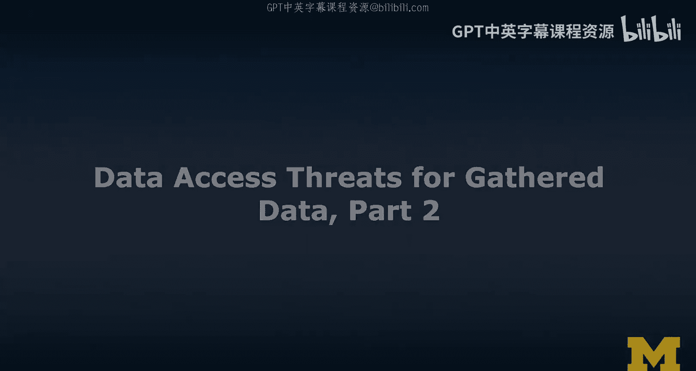
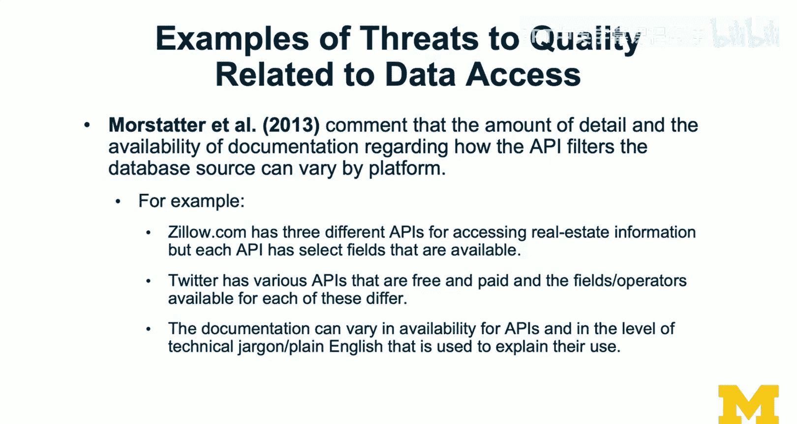
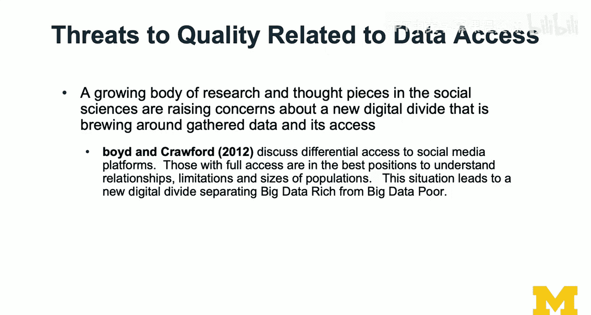
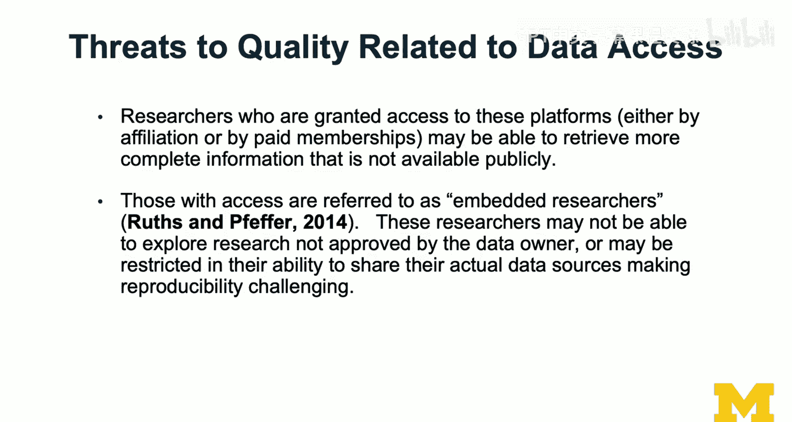
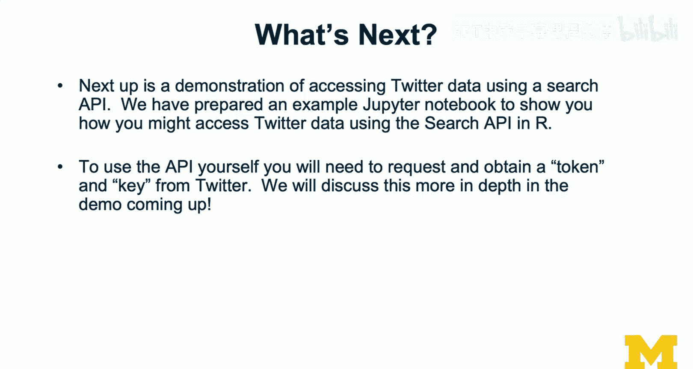
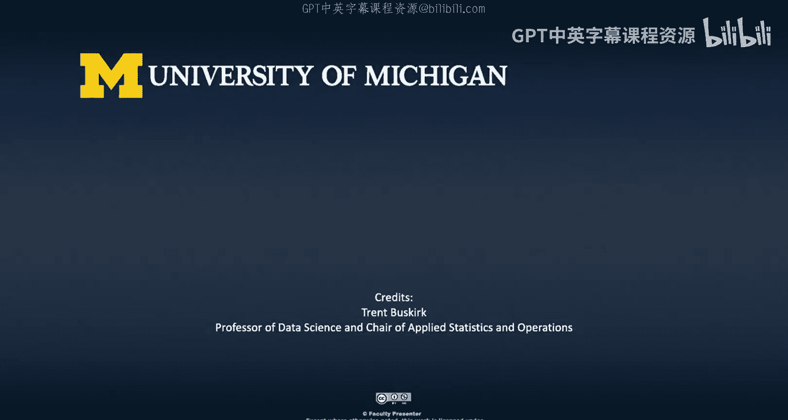

# 25：采集型数据访问威胁因素（第二部分）🔍

在本节课中，我们将继续探讨采集型数据在访问环节面临的威胁。我们将重点关注平台API的差异、新兴的“数字鸿沟”问题以及平台自身设置的各种限制。理解这些威胁对于评估和确保数据质量至关重要。

上一节我们介绍了数据访问的基本概念，本节中我们来看看在通过API等工具获取数据时，可能遇到的具体挑战和威胁。

## 平台API的差异与“按现状提供”条款

当通过应用程序编程接口（API）从不同平台获取数据时，数据质量面临的首要威胁与平台及其API的条款和特性有关。

以下是几个关键点：

*   **“按现状提供”条款**：许多平台，如Zillow，在其服务条款中声明，其提供的数据、API和品牌链接是“按现状提供，包含所有缺陷，且按可用状态提供”。这意味着数据使用者需要自行承担数据中可能存在的质量问题和不足。
*   **API结果不一致**：研究表明，即使访问同一信息库，使用不同的API也可能得到不同的结果。例如，使用Twitter的搜索API、流式API或Firehose API收集相同主题标签下的推文，其结果集可能存在差异。这影响了研究的可重复性。
*   **文档的差异与复杂性**：不同平台的API文档在完整性和清晰度上差异很大。例如，Zillow.com有三个不同的API用于访问房地产信息，每个API可选的字段各不相同。Twitter的各种API（免费版与付费版）在可用字段、过滤操作符和搜索能力上也有区别。这些文档通常使用技术术语，而非通俗英语。

## 新的“数字鸿沟”：平台访问权限差异

除了技术条款，数据访问还受到社会性因素的影响，即所谓的“新数字鸿沟”。

这个概念并非指简单的互联网接入，而是指**对社交媒体平台数据的差异化访问权限**。

*   **嵌入式研究者**：一些研究者因其所属机构（如大学或公司）与社交媒体数据提供商有特定合作关系，或购买了高级API访问权限，从而能获得更深层次的数据过滤和更丰富的变量集。他们被称为“嵌入式研究者”。
*   **研究可重复性挑战**：这种差异化的访问权限带来了研究伦理和可重复性的困境。拥有全权限的研究者能更全面地理解变量与总体之间的关系，而权限受限的研究者则可能成为“大数据贫困者”。此外，嵌入式研究者可能无法探索数据所有者未批准的研究方向，或在分享研究成果时受到限制，这使得独立验证其研究结果变得困难。

## 平台自身设置的限制

数据访问的另一个重大威胁直接来自平台为管理流量和资源而设置的硬性限制。

以下是Twitter平台限制的具体示例：

*   **速率限制**：Twitter对其搜索API设有**速率限制**，例如，每15分钟时间窗口内最多允许450次查询请求。这个限制由平台设定，可能随时变更，用户无法控制。
*   **存档推文数量限制**：Twitter限制每个用户公开存档的推文数量为最近的**3200条**。这是一个硬性规定。
*   **限制产生的影响**：
    1.  **影响数据完整性**：如果一个用户发布的推文超过3200条，那么通过标准API只能获取其最近的3200条。例如，若一个用户在2016年后发布了大量推文，导致其2016年的推文不在最近的3200条之内，那么针对2016年的研究将无法通过API获取到该用户的任何推文。
    2.  **影响访问方法选择**：根据研究目标是最大化获取推文数量还是特定关键词的推文，可能需要选择不同的API或访问策略。
    3.  **影响研究可重复性**：由于速率限制和存档限制是动态且强制的，在不同时间点执行相同的查询可能因触及限制而得到不同的结果，这挑战了研究的可重复性。

## 总结与预告

本节课我们一起学习了采集型数据在访问阶段面临的几类主要威胁：**平台API的差异性与不透明条款**、**由访问权限不平等造成的“新数字鸿沟”**，以及**平台施加的硬性限制（如速率限制和存档限制）**。这些因素都可能影响获取数据的完整性、一致性和研究的可重复性，是评估数据质量时必须考虑的风险点。

在接下来的演示中，我们将实际操作，展示如何使用R软件包和Twitter搜索API来访问数据，并讨论如何申请和使用API密钥与令牌。请继续关注。