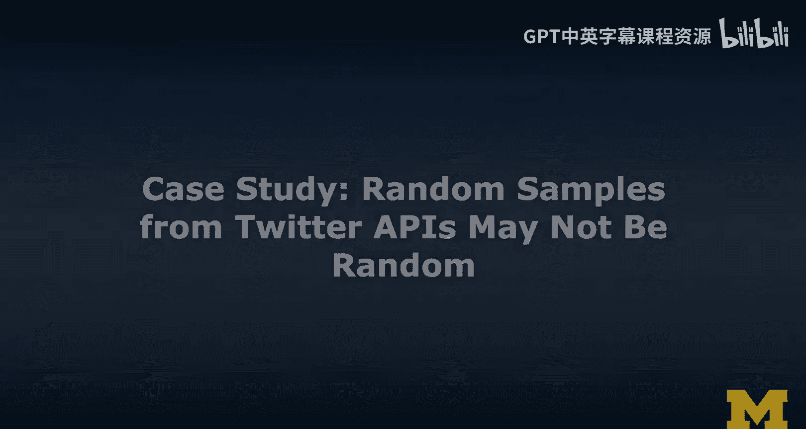
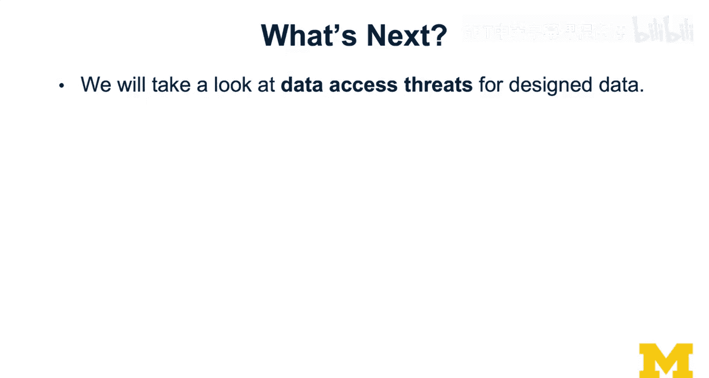

# 26：Twitter API随机抽样的非随机性问题 🐦

在本节课中，我们将通过一个收集Twitter数据的例子，来探讨数据获取环节中可能存在的威胁。我们将了解，即使是通过官方API获取的“随机”样本数据，也可能无法完全代表整体用户群体，从而影响研究的可靠性。

## 概述：Twitter数据与研究

Twitter数据被广泛用于建模社交媒体用户行为以及社交网络上的信息传播。关于用户资料和活动的数据可以通过Twitter API下载。

## Twitter API的类型

以下是三种主要的Twitter API类型：

*   **免费流式或搜索API**：免费使用，但对可收集的推文和数据量有限制。
*   **高级API**：需要付费，但能提供比免费API更大规模的数据。
*   **企业级API**：通常需要支付高额费用，但保证能访问丰富的Twitter数据源。

通常，许多研究型大学可以访问10%的实时Twitter随机样本，这被称为**Decahose API**。此外还有**Firehose API**，允许用户近乎实时地访问所有推文。

然而在许多情况下，即使拥有对Twitter数据的完全访问权限，获取到的数据规模、信息类型和时间跨度也会因所选API的不同（例如，搜索API与流式API）而有所差异。

## 核心问题：样本的代表性质疑

这里有一个关键警告：Twitter并未披露其如何创建推文随机样本的细节。因此，一个自然产生的问题是：我们的Twitter样本数据具有代表性吗？如果没有，我们如何知道基于Twitter数据的研究是可靠的？

上一节我们介绍了获取Twitter数据的各种途径，本节中我们来看看研究者们如何通过实证研究来回答关于数据代表性的问题。

## 案例研究一：用户中心性偏差

一项2014年由Gonalez-Bailen及其同事进行的研究，通过搜索API和流式API收集了三组Twitter样本数据集。搜索API收集过去七天的推文样本，而流式API则实时收集所有推文的1%。

收集数据后，他们比较了这些数据集中Twitter用户的相似性或差异性。首先，理解一个基本概念：在Twitter用户的网络分析中，如果一个用户在交流流中被@提及或转发的次数更多，则称该用户是**中心用户**。

该研究的关键发现是：**较小的样本并非较大样本的随机子集**。具体来说，较小的样本不能很好地代表在转发和提及网络中不处于中心位置的用户的活动。

根据该研究，提及网络的偏差更大，因为经常被提及的用户不一定在转发方面活跃。

## 案例研究二：话题流行度偏差

另一项由Morstatter及其同事在2013年进行的类似研究，他们使用Firehose流式API和一个普通流式API收集Twitter数据。如前所述，Firehose流式API允许访问100%的所有公开推文。

他们首先比较了两个数据集之间热门话题的相关性，然后比较了流式API样本数据与Firehose数据的100个随机样本之间的相关性。

根据该研究，来自流式API的样本数据能够较好地估计Firehose数据中带有高频标签的流行话题，但对于非热门话题的估计则不佳。有时，流式API产生的数据在流行话题上与Firehose数据甚至呈负相关，而随机样本中的热门话题则与Firehose数据高度相关。

这些发现表明，流式API产生的数据可能无法代表Twitter用户群体及其活动的总体情况。

## 总结与启示

本节课中，我们一起学习了关于Twitter API数据代表性的两个重要案例研究。核心结论是：通过API（尤其是免费或受限的流式API）获取的“随机”样本数据，可能在**用户中心性**和**话题流行度**上存在系统性偏差，并非总体的完美随机子集。这提醒我们，在研究设计阶段选择数据源时，必须审慎考虑数据获取方式可能带来的**数据访问威胁**，并对基于此类样本数据得出的结论保持警惕。理解数据的局限性是确保研究质量的第一步。