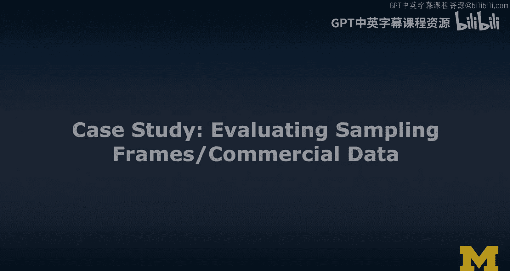
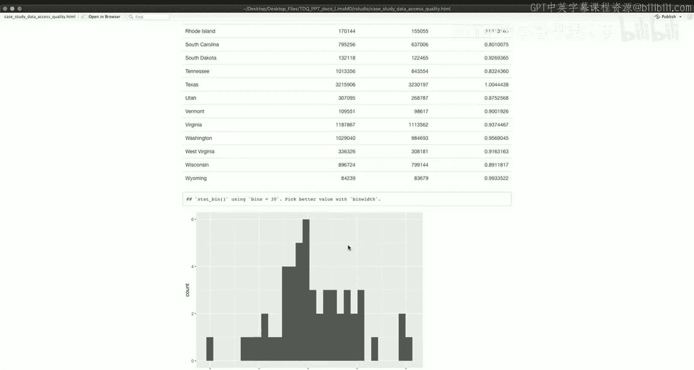
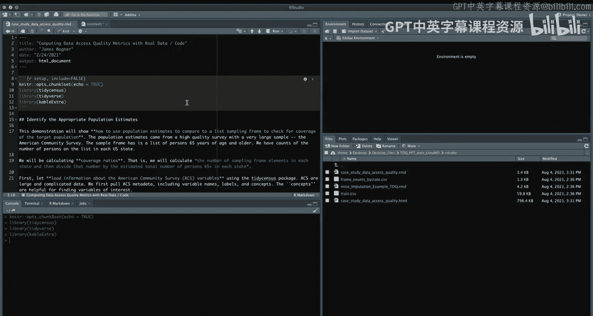
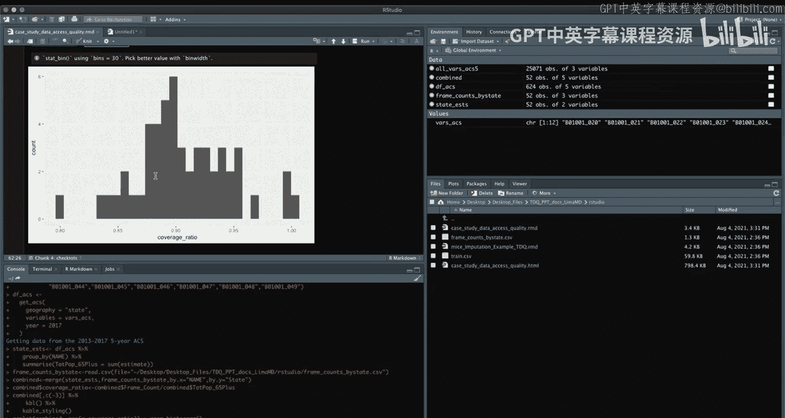
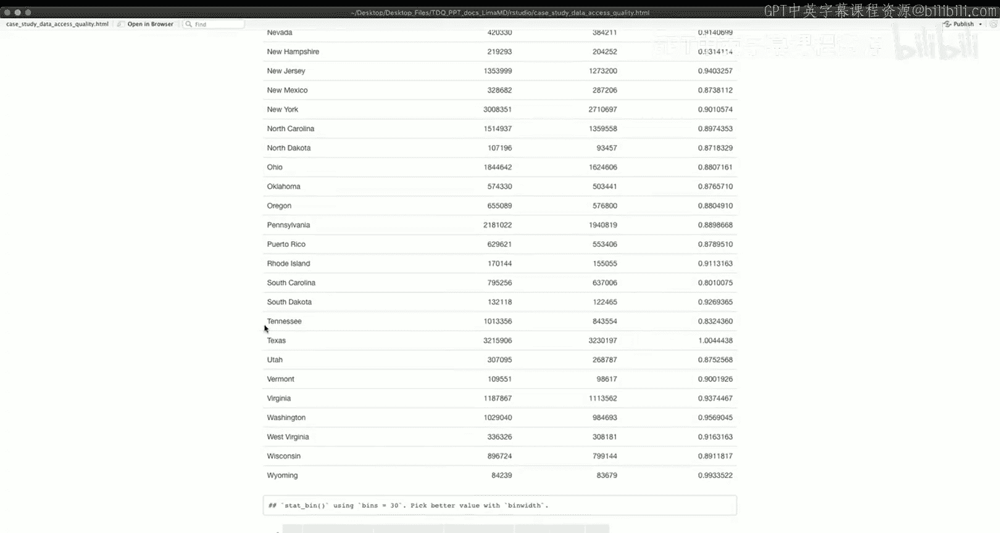

# 29：商业数据抽样框架评估 📊

在本节课中，我们将学习如何计算数据访问质量指标。我们将使用真实数据和代码来完成一个演示项目，通过比较抽样框架与基准人口数据，评估框架的覆盖完整性。

首先，我们将概览最终要生成的报告。之后，我们将进入程序，逐步查看完成此演示项目所需的步骤。

## 概述与方法 🎯

我们的目标是确定合适的人口估计值，以便与我们的抽样框架进行比较。我们将把这些人口估计值作为基准，视其为我们的目标总体。然后，我们会统计抽样框架上的案例或元素数量，并与该总体进行比较。

如果抽样框架列表上的元素数量少于总体数量，则意味着存在覆盖误差，即我们的抽样框架未能包含总体中的所有案例。我们将在最终报告部分详细讨论这一点。

我们将计算的是**覆盖比率**。其计算方法是：用每个州的抽样框架元素数量（在我们的案例中），除以该州65岁及以上人口的估计总数。

**覆盖比率公式**：
`覆盖比率 = (抽样框架中某州的元素数量) / (ACS估计的该州65岁及以上人口总数)`

如前所述，如果该比率小于1，则表明抽样框架未能完全覆盖总体。但此方法并非完美。可能存在列表重复、或包含不符合条件的单元（即不属于总体但出现在列表中的案例）。因此，我们可能会发现某些覆盖比率实际上大于1，这同样表明框架存在缺陷。不过，我们通常用它来判断是否具有足够的覆盖率，即抽样框架是否包含了很大比例的总体人口。

## 第一步：加载基准数据 📥

进行此分析的第一步是加载之前提到的基准信息。该基准信息来自**美国社区调查**。

美国社区调查是一项大型调查，每年访问约300万户家庭。正是这项调查使我们能够按州估算人口总数。该调查响应率很高，非常准确，是一个很好（尽管并非完美）的基准工具。

在代码部分，我们将展示如何从美国社区调查加载信息，以及如何识别我们感兴趣的数据元素（变量）。

## 第二步：识别与提取变量 🔍

一旦确定了我们感兴趣的变量，我们就会将这些变量提取到程序中。我们将使用R语言进行分析，然后将抽样框架的计数与这些基准数据进行比较。

以下是提取和准备基准数据的关键步骤：

1.  使用 `tidy census` 包通过API访问ACS数据。
2.  在后台，你需要从人口普查网站获取一个API密钥。
3.  首先查找包含年龄信息的变量，特别是“65岁及以上”的类别。
4.  提取感兴趣的变量（按州统计的特定年龄组人口数）。
5.  将这些年龄组汇总为我们需要的变量，例如 `total_pop_65_plus`（各州65岁及以上人口总数）。

## 第三步：计算与报告覆盖比率 📈

获得基准数据后，下一步是计算并报告覆盖比率。

以下是计算覆盖比率的具体流程：

1.  **获取框架计数**：加载包含各州抽样框架中人员数量的文件。
2.  **合并数据**：将抽样框架计数与从ACS获取的基准人口数据按州合并。
3.  **计算比率**：使用公式计算每个州的覆盖比率。
4.  **生成报告**：将结果以清晰的表格和直方图形式呈现。

在报告中，你会看到类似第一行（阿拉巴马州）的数据：ACS估计该州有762,032名65岁以上人口，而抽样框架中有706,853人，因此覆盖比率约为93%。我们将对每个州进行此计算，以评估其覆盖质量。

观察数据，你会发现许多州的比率在0.87到0.94之间。但可能会注意到像德克萨斯州这样的州，比率略高于1。这可能意味着该州的抽样框架中存在许多重复项或许多不符合条件的人员（例如，年龄未满65岁）。

最后，我们将创建一个直方图来展示这些覆盖比率的分布。这样，我们可以直观地查看覆盖率的整体情况，而无需逐一阅读所有数字。从直方图可以看出，最低的比率约为0.8，有一个比率超过1，其余大部分集中在0.89或0.9左右。

## 代码实现演示 💻

我们使用R Studio作为R程序的接口，它可以创建我们刚才看到的可编译的R Markdown报告。

程序开头需要加载一些R包来支持分析。关键的包是 `tidycensus`，它允许我们通过API访问美国社区调查数据。

以下是核心代码步骤的概述：

1.  **加载必要包**：包括 `tidycensus`, `dplyr`, `ggplot2` 等。
2.  **设置API密钥**：访问ACS数据所必需。
3.  **探索并选择变量**：使用 `tidycensus` 函数查找与“性别 by 年龄”相关的变量，筛选出代表65岁及以上年龄组的变量代码。
4.  **获取基准数据**：使用 `get_acs` 函数提取各州65岁及以上人口的估计值。
5.  **加载框架数据**：读入包含各州抽样框架计数的文件。
6.  **计算覆盖比率**：将框架计数与ACS基准数据合并，并计算比率。
7.  **生成表格与图形**：使用 `kable` 生成结果表格，使用 `ggplot2` 绘制覆盖比率分布直方图。

通过运行这些代码块，我们可以生成包含详细数据和直观图表的最终报告，从而评估抽样框架的数据访问质量。

## 总结 ✨

本节课中，我们一起学习了如何通过计算**覆盖比率**来量化评估数据访问质量。我们以美国各州65岁及以上人口的商业抽样框架为例，演示了完整的流程：

1.  明确了使用美国社区调查作为高质量基准数据源。
2.  利用R语言的 `tidycensus` 包获取并处理基准人口数据。
3.  将抽样框架数据与基准数据结合，计算每个州的覆盖比率。
4.  通过表格和直方图对结果进行分析和可视化，直观地识别出覆盖良好或可能存在问题的区域。

这种方法帮助我们判断抽样框架在多大程度上完整覆盖了目标总体，是评估和改进数据质量的重要实践步骤。