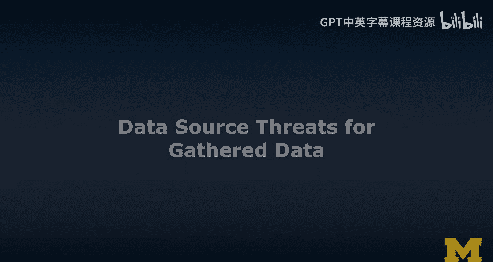
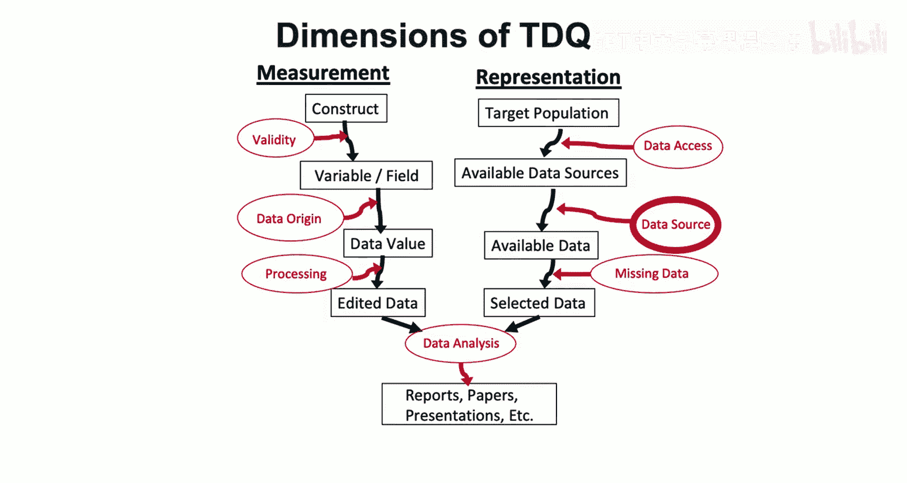
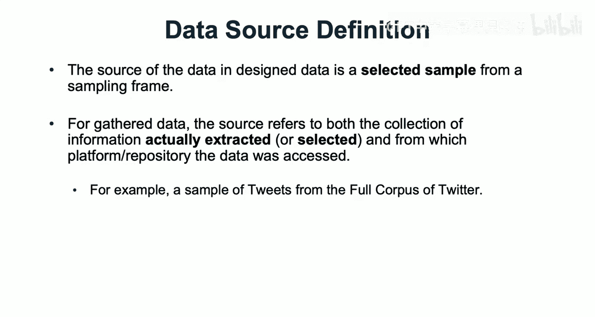
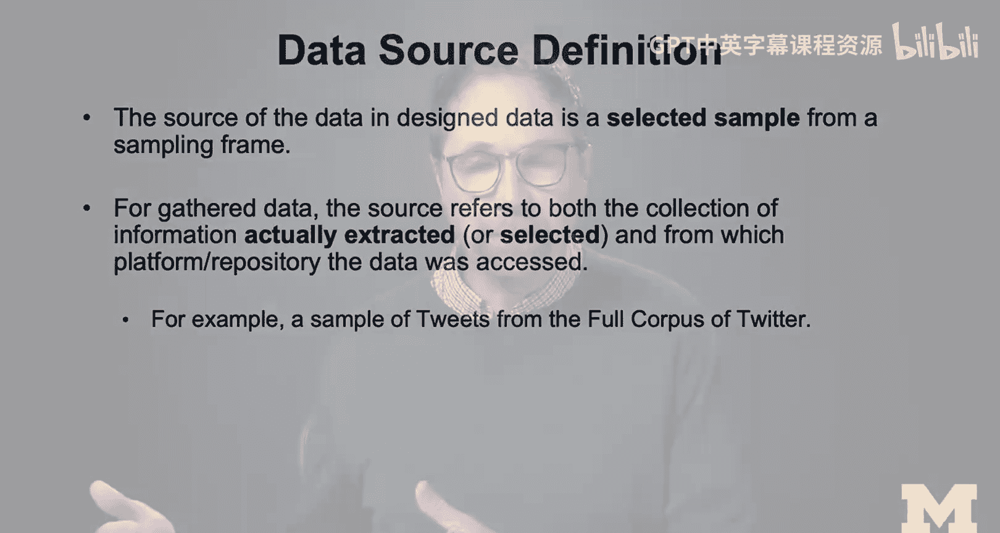
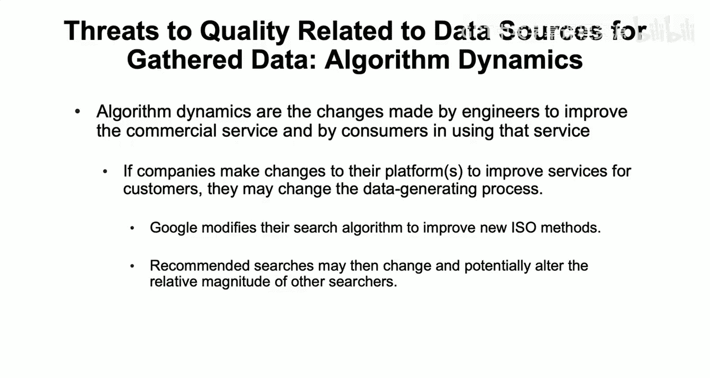
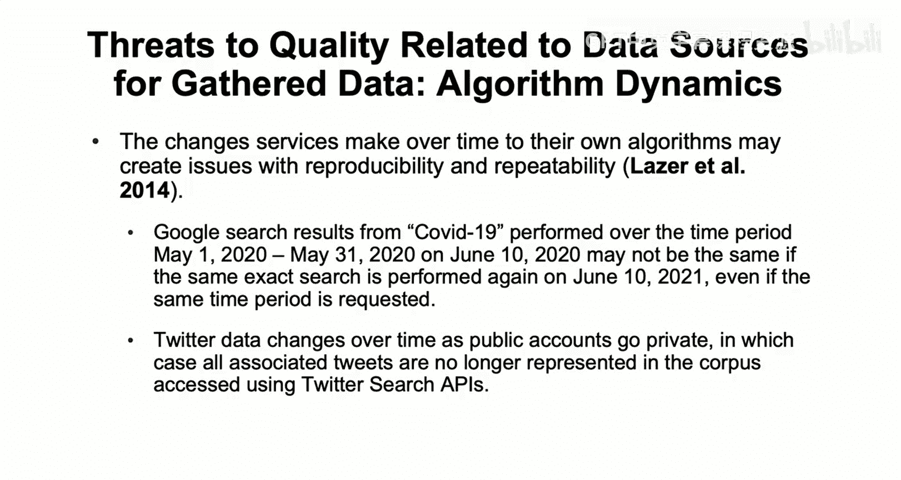
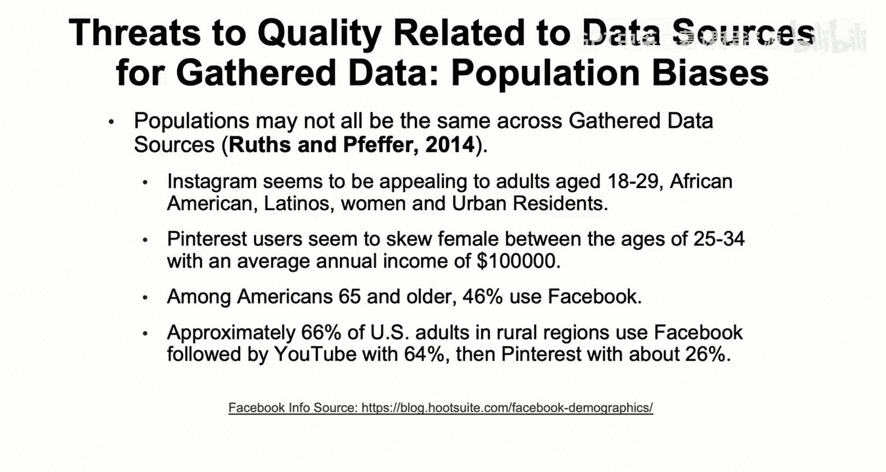
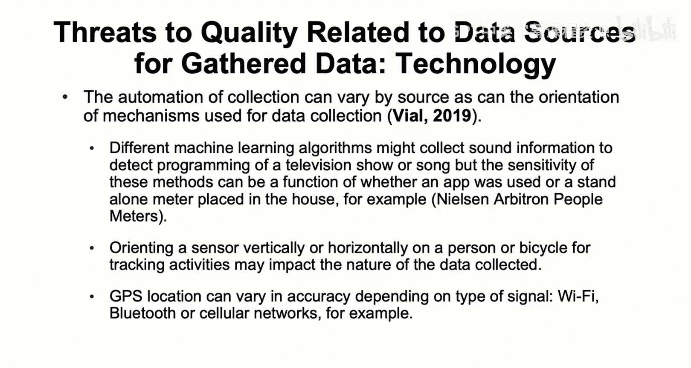
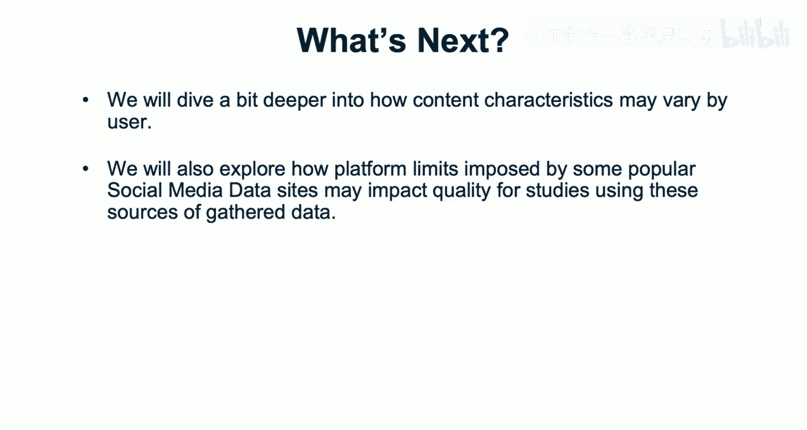

# 31：采集型数据源威胁因素 📊

在本节课中，我们将学习采集型数据源所面临的主要威胁因素。理解这些威胁对于评估和确保数据质量至关重要。

---

## 课程概述

我们目前处于总体数据质量框架的“表示”环节。本节将聚焦于“数据源威胁”，即存在于**可用数据源**与**实际可检索数据**之间的潜在问题。我们将详细探讨几种关键威胁，并理解它们如何影响数据的可靠性和可用性。

---

## 数据源定义辨析

在深入探讨威胁之前，明确“数据源”在采集型数据中的定义非常重要。这与设计型数据有所不同。

*   **设计型数据**的数据源是：从抽样框中选出的样本。
*   **采集型数据**的数据源则包含两层含义：
    1.  你实际提取或选择的信息集合。
    2.  访问这些数据所依赖的**平台或存储库**。

我们强调平台或存储库作为限定词，是为了更清晰地界定数据来源。例如：
*   从推特（Twitter）全量语料库中抽取的推文样本。
*   通过推特搜索API获取的推文样本。

推特和Zillow是不同的平台，因此明确平台信息对于理解数据背景至关重要。

---

## 算法动态性威胁 🔄

我们将讨论的第一个威胁是**算法动态性**。这指的是平台工程师为改进商业服务，以及用户使用服务的方式，对算法进行的持续更新和修改。

例如，谷歌（Google）不断改进其搜索算法以提供更好的搜索结果。这种改进可能会改变推荐搜索的结果，从而影响其他搜索的相对量级。

算法动态性构成威胁的核心在于其影响了数据的**可重复性**和**可再现性**。作为终端用户，我们通常不完全知晓这些变化的日程安排或具体改进幅度，因此难以追踪它们对我们获取的结果产生了何种影响。

**示例：**
1.  **谷歌搜索**：在2020年6月10日和2021年6月10日，使用完全相同的关键词（如“Covid 19”）和时间范围（2020年5月1日至31日）进行搜索，由于算法在此期间已更新，两次搜索结果可能不同。
2.  **推特隐私设置**：用户可随时将其账户设为私密。即使使用相同的API、关键词和时间窗口（如过去一周）进行搜索，间隔一周后，由于部分用户在此期间将账户转为私密，搜索结果也可能不同。
3.  **推特机器人检测**：推特不断改进其检测和移除机器人账户的算法。因此，针对相同关键词和时间窗口的搜索，在后期可能包含更少的机器人账户，导致结果差异。

---

## 代理群体错配威胁 👥

接下来，我们看看**代理群体错配**的威胁。不同平台聚集着不同特征的用户群体。

代理效应是指：基于自我报告身份进行识别和研究的群体，可能与更广泛的人群不相似。例如，在推特或脸书上自我标识为共和党人的用户，可能与那些不在社交媒体上标识身份的共和党人不同。

关键点在于，你在推特上能找到的共和党人，可能无法代表所有共和党人（包括使用和不使用推特的人）。

此外，根据平台的使用条款，这些聚集的群体数据通常**不易被共享、存档或供其他研究人员重新评估**。虽然推特等平台已为学术研究放宽了部分限制，但在使用前核查开发者网站的最新条款仍然非常重要。

---

## 群体偏见威胁 🎯

与代理群体错配紧密相关的是**群体偏见**。某些平台天然地吸引特定 demographic（人口统计特征）的用户。

以下是几个平台的用户特征示例：
*   **Instagram**：更吸引18-29岁的成年人、非裔美国人、拉丁裔、女性以及城市居民。
*   **Pinterest**：用户多为25-34岁的女性，收入略高于平均水平。
*   **Facebook**：在美国65岁及以上人群中，46%使用；在美国农村地区成年人中，约66%使用。

了解这些偏见至关重要。如果你试图使用Instagram的数据来推断整个人口的情况，可能会很困难，因为其用户群体年龄相对集中。然而，如果你的目标正是接触18-29岁的成年人，那么Instagram可能是一个理想的起点。

因此，在考虑从这些数据源进行**总体推断**时，必须思考你所采集的数据在多大程度上能代表整个总体。

---

## 平台限制威胁 ⚠️

某些数据源或采集工具会对每个用户可获取的信息量施加限制，这构成了**平台限制**威胁。

**示例：**
*   **推特**：对每月可采集和存储的推文总数设有上限；限制特定时间间隔内的API调用次数；将每个用户存档的推文数量限制在3200条。
*   **网络爬虫平台**：通常采用分级系统，限制每月可爬取的页面数量或爬取深度。

这些限制本身会限制你可捕获的数据量。如果被捕获的数据能很好地代表其余数据，威胁相对较小。但如果限制导致你只能获取前X条数据（例如最早或最热门的推文），而无法获取剩余部分，且这两部分数据存在系统性差异，那么这种限制就会严重影响数据质量，削弱其效用。

因此，在使用平台前，仔细查阅其开发者页面上的限制条款是非常重要的准备工作。

---

## 技术差异威胁 📡

最后，我们探讨**技术差异**带来的威胁。数据收集的自动化程度和所采用机制的“方向”可能因数据源而异，从而影响数据质量。

**示例：**
1.  **声音收集**：用于检测电视节目或歌曲的机器学习算法，其灵敏度可能受以下因素影响：使用的是手机应用还是独立设备、环境背景噪音大小、设备与声源的距离。
2.  **传感器方向**：用于日常活动跟踪的传感器，佩戴在脚上、髋部，或是放在自行车篮子里，检测到的运动模式会不同，这可能导致后端数据分析时出现质量问题。
3.  **GPS定位精度**：根据信号类型（Wi-Fi、蓝牙或蜂窝网络），GPS定位精度差异显著，可能在50到100米之间波动。

---

## 总结与预告

本节课中，我们一起学习了影响采集型数据质量的五大主要数据源威胁：
1.  **算法动态性**：影响数据的可重复性。
2.  **代理群体错配**：线上样本无法代表线下总体。
3.  **群体偏见**：平台用户 demographic 分布不均。
4.  **平台限制**：API调用、数据量获取限制。
5.  **技术差异**：收集方法、设备、设置影响数据一致性。

理解这些威胁是设计稳健数据采集策略、正确解读数据结果的第一步。

在接下来的课程中，我们将更深入地探讨平台上的**内容特征**如何因用户而异，并进一步分析社交媒体数据网站的**平台限制**如何影响基于这些采集数据的研究质量。敬请关注。