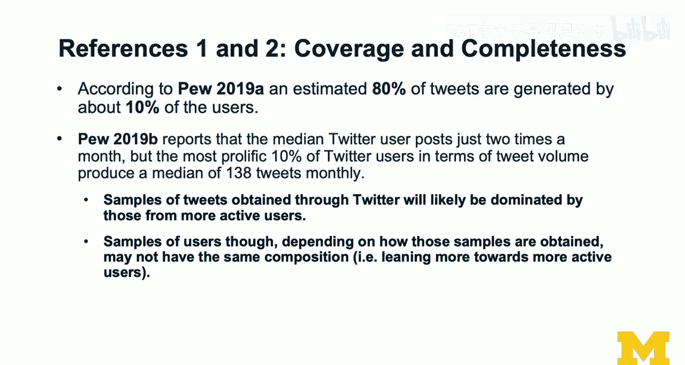
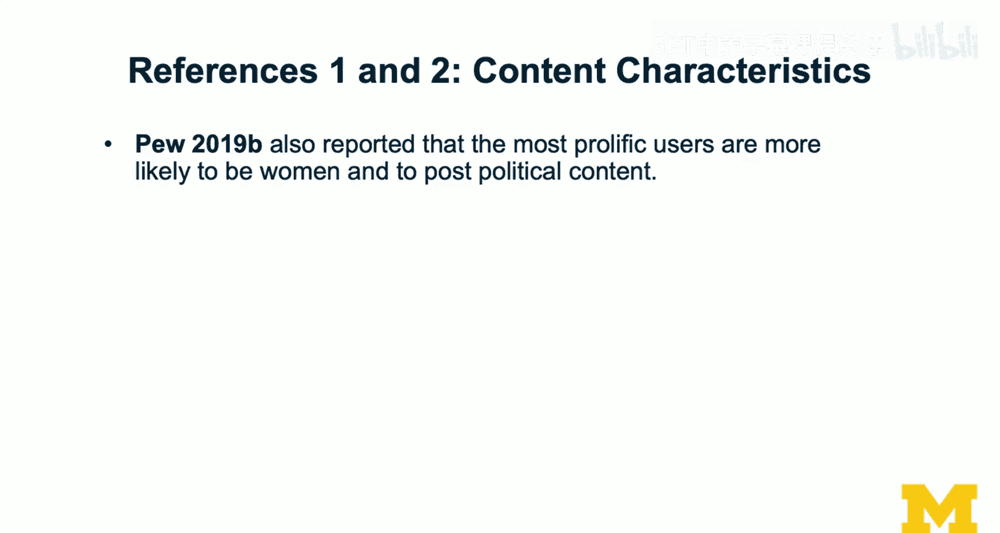
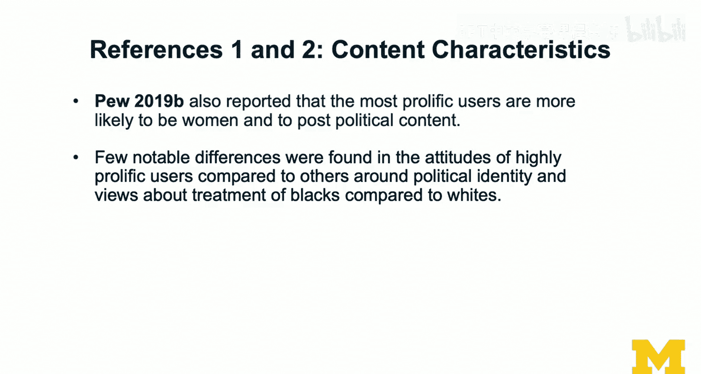
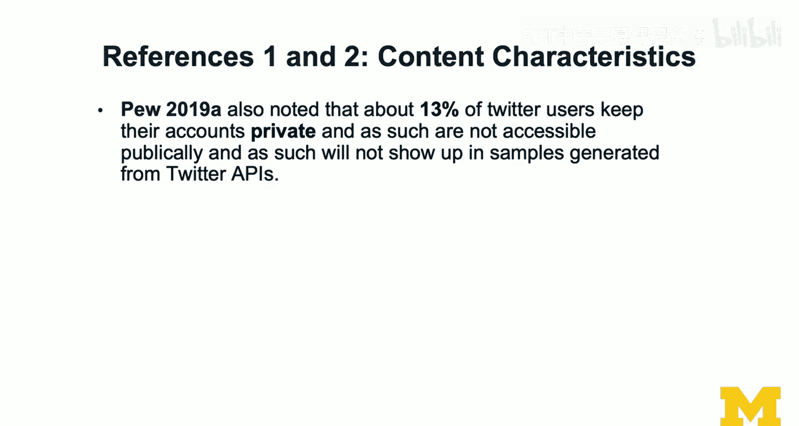
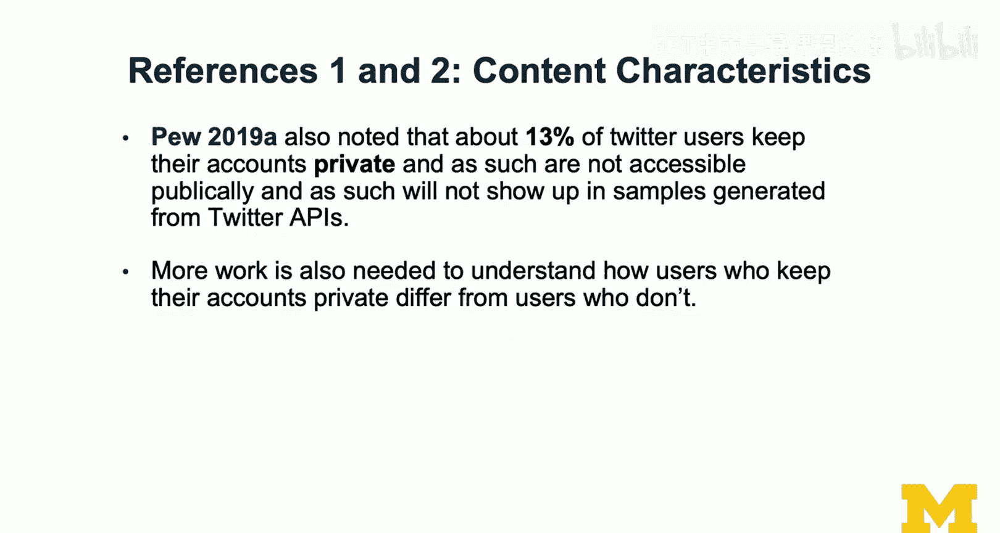
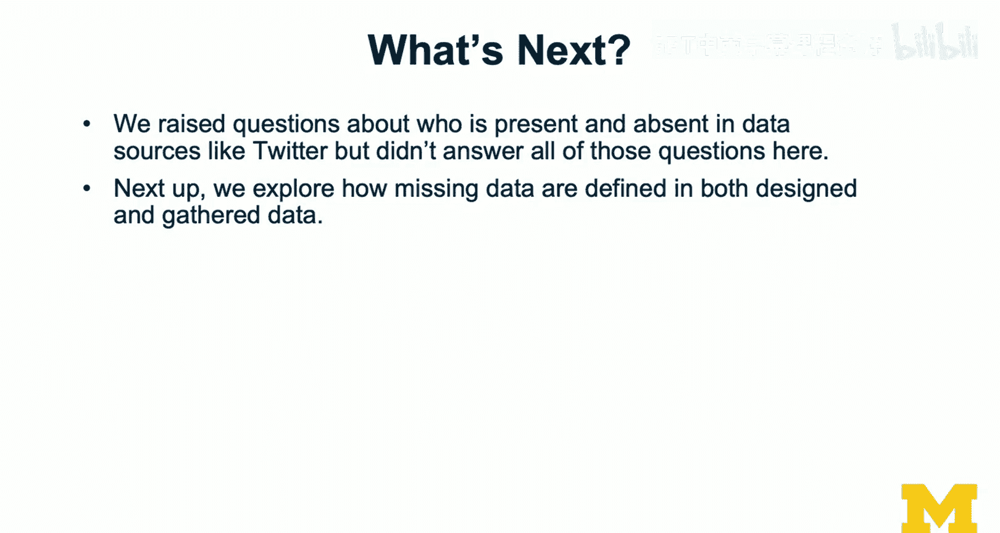

# 32：内容与用户特征对采集质量的影响 📊

在本案例研究中，我们将探讨社交媒体平台（以Twitter为例）的内容特征和用户特征如何影响我们采集到的数据质量。我们将重点关注**覆盖率**、**完整性**和**潜在偏差**，并理解这些因素如何影响基于此类数据得出的结论。

---

## 案例研究材料与问题

本案例研究基于一份可下载的课程材料文档。文档中包含若干参考资料，并提出了几个关键问题供我们思考。随着本节的深入，我们将详细讨论这些问题。

以下是参考资料中提出的核心问题：
*   样本构成如何因数据采集方式（基于推文 vs. 基于用户）而不同？
*   活跃用户与非活跃用户在人口统计学特征和观点上是否存在系统性差异？
*   平台隐私设置（如私密账户）如何影响数据的可获取性和代表性？
*   用户元数据（如个人简介、地理位置）的缺失如何影响数据分析？

---

## 用户活跃度对样本构成的影响

上一节我们提到了案例材料，现在我们来具体看看第一份Pew研究报告的发现。这份报告主要揭示了用户活跃度的高度不均衡性，这直接关系到数据的**覆盖率**与**完整性**。

根据Pew的报告：
*   大约**80%的推文**是由**10%的用户**生成的。
*   普通（中位数）Twitter用户每月仅发布**2次**推文。
*   而最活跃的**10%的用户**，每月发布推文数量的中位数约为**138条**。

**核心影响：**
通过Twitter API采集**推文样本**时，样本很可能会被这些高度活跃的用户所主导。然而，如果采集的是**用户样本**（例如随机抽取用户ID），其构成可能不同，不会过度偏向活跃用户。

**公式化理解：**
设 *T* 为推文集合，*U* 为用户集合。通过推文采样函数 *S_t(T)* 得到的用户集合 *U_t*，与通过用户采样函数 *S_u(U)* 得到的用户集合 *U_u*，其活跃度分布很可能不同，即：
*Distribution(Activity | U_t) ≠ Distribution(Activity | U_u)*

这意味着，平台的固有构成以及你采集数据的具体方式，会显著影响从这些数据源获得的数据集的覆盖范围和完整性。

---

## 活跃用户的特征与潜在偏差

在了解了活跃度的影响后，我们进一步探讨：这些高度活跃的用户本身是否具有特殊性？第二份Pew研究报告指出，活跃用户不仅在数量上突出，在特征上也与非活跃用户存在差异。

Pew报告指出，最活跃的Twitter用户更有可能是**女性**，并且更倾向于发布**政治性内容**。

**研究重要性：**
这项研究揭示了平台使用行为与**人口统计学变量**（如性别）以及**发布内容类型**之间可能存在的关联。这一点至关重要。

**潜在偏差示例：**
假设你正在基于推文内容招募研究参与者。如果你的招募策略依赖于发布特定内容（如政治话题），那么你最终招募到的样本可能会系统性过度代表女性用户，因为她们在该平台上更活跃。这是在考虑数据**覆盖率**和**潜在偏差**时必须注意的重要因素。

---

## 观点差异与参与偏差

除了人口统计学特征，活跃用户在观点上是否也有不同？Pew研究报告还指出了另一层差异，这引出了对**参与偏差**的担忧。

Pew报告显示，高度活跃的用户在**政治身份认同**以及对“黑人与白人待遇对比”的看法上，与普通用户存在显著差异。

**核心考虑：**
这同样是一个重要的考量。如果你基于推文内容进行招募，那么高度活跃的用户更有可能被招募到研究中。在这种情况下，就可能围绕你试图研究的**态度或观点**产生参与偏差。

**与传统研究设计的类比：**
这种现象也存在于设计型数据中，例如我们担心的**无应答偏差**或**自选择偏差**。其核心威胁在于：我们研究中招募到的人，可能与我们关心但未纳入研究的总体人群存在**系统性差异**。

---

## 隐私设置对数据可及性的限制

前面我们讨论了可见用户中的偏差，但还有一部分用户是完全“隐形”的。第一份Pew研究报告提到了一个影响数据**可及性**的关键因素：账户隐私设置。

Pew指出，大约**13%的Twitter用户**将其账户设置为私密账户。

**关键影响：**
私密账户的内容无法公开访问，也不会出现在任何Twitter API（包括完整的“Firehose”数据流）生成的样本中。

**偏差风险：**
如果你进行的研究关注某个特定话题，而私密账户持有者与非私密账户持有者在该话题上的观点不同，那么仅通过常规API使用Twitter数据，你可能会缺失一部分重要的观点。如果这些缺失的观点是系统性的，那么你对整个Twitter用户群体做出的**总体推断**就可能产生偏差。

**动态性与研究挑战：**
显然，需要更多研究来理解私密账户用户与非私密账户用户有何不同，以及这种设置的动态变化。用户可以随时将账户转为私密或转回公开，这种信息流的波动也可能影响研究数据的质量。

---

## 用户元数据的可用性与缺口

到目前为止，我们主要关注了“谁在平台上”以及“他们发布了什么”的问题。现在，我们将视角转向第三份参考资料，探讨**用户元数据**的可用性。这些元数据对于处理和理解从平台获取的数据非常有用。

除了参与平台的用户特征，从这些用户可获得的**元数据**也存在显著缺口。

以下是关于Twitter用户元数据可用性的发现：
*   约 **69%** 的Twitter用户在个人资料中提供了**个人简介**。简介中可能包含重要的人口统计学信息和地理位置。
*   约 **73%** 的用户提供了某种形式的**位置信息**。

**元数据的用途：**
这些信息有助于理解内容变量与人口统计学因素之间的关联，也可用于按地理区域筛选用户（例如，确保样本包含来自芝加哥和纽约的用户）。

**挑战与当前工作：**
如果要将Twitter简介或位置信息用作样本的**加权**或**调整因子**（就像我们在设计型数据中常做的那样，以控制潜在偏差），首先需要填补当前这些元数据中存在的缺口。已有一些研究尝试解决此问题，但成功率各异。例如，Hs和Joinson在2018年报告称，预测Twitter用户的**性别**比预测其**政治身份**要容易得多。

---

## 总结与下节预告

在本案例研究中，我们一起探讨了从社交媒体平台（如Twitter）采集数据时，内容与用户特征如何影响数据质量。我们了解到：

1.  **采样方式决定样本构成**：基于“推文”采样与基于“用户”采样会产生不同活跃度分布的样本。
2.  **活跃用户具有特殊性**：他们在性别、发布内容类型乃至政治观点上可能与普通用户存在系统性差异，这引入了**参与偏差**的风险。
3.  **隐私设置限制数据覆盖**：私密账户使一部分用户数据完全不可及，可能造成**覆盖偏差**。
4.  **元数据存在缺口**：用户个人简介和位置等元数据的大量缺失，为利用这些数据进行加权调整或深入分析带来了挑战。

我们已经提出了关于数据源中“谁在场、谁缺席”的重要问题，但并未在此完全解答。在接下来的章节中，我们将探索如何在**设计型数据**和**采集型数据**的语境中定义**缺失数据**，以便开始理解如何解决或缓解这些问题。