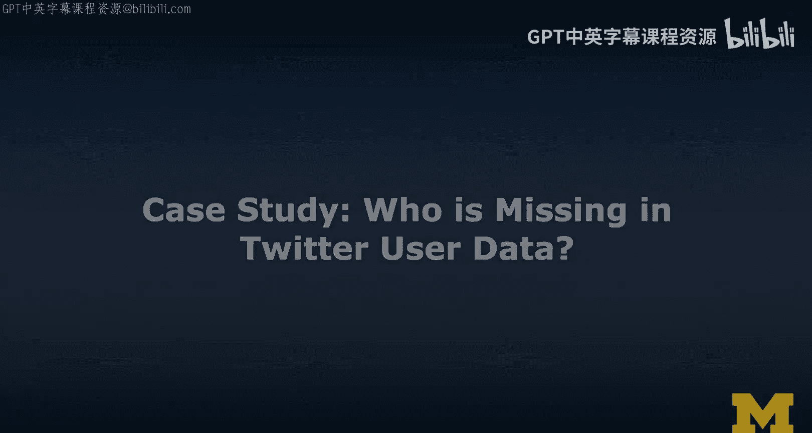
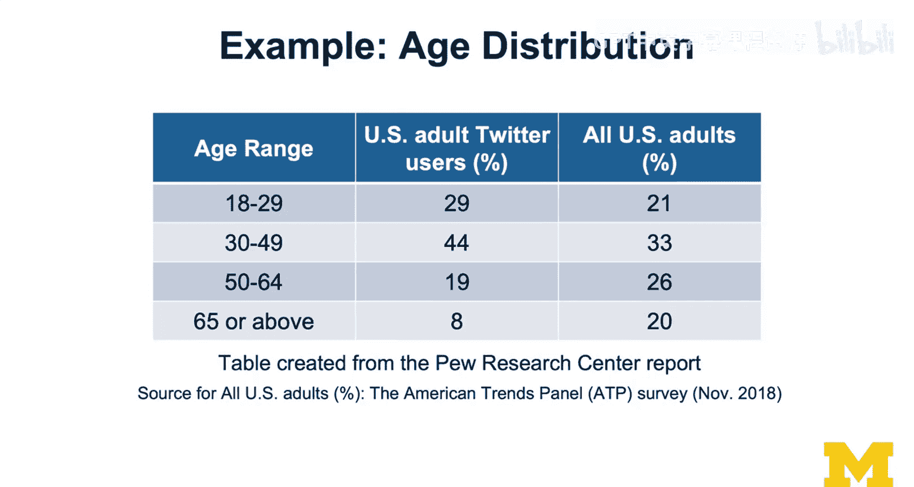
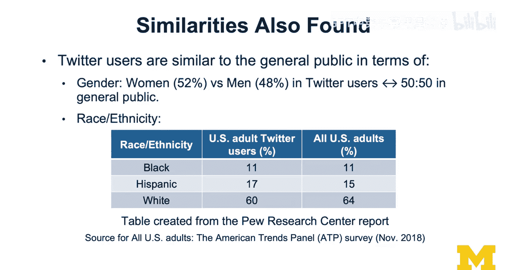

# 33：Twitter用户数据中的缺失群体

在本节课中，我们将通过一个具体案例来探讨数据源威胁中的一个重要概念——**群体偏差**。我们将分析皮尤研究中心2019年的一份报告，了解Twitter用户群体与美国普通成年人群体的差异，并理解这种差异如何导致数据质量问题。

## 案例背景与数据来源

上一节我们介绍了数据源威胁的概念，本节中我们来看看一个关于社交媒体数据的实际案例。

本次分析基于皮尤研究中心2019年发布的报告《Sizing Up Twitter Users》。报告试图回答的核心问题是：**Twitter用户与普通公众相比有何不同？**

为了回答这个问题，研究者从一个基于概率抽样的美国成年人线上样本库中，选取了2,700名Twitter用户进行了调查。

## 核心发现：Twitter用户的代表性

以下是报告中的一些重要观察结果：

首先，**只有22%的美国成年Twitter用户能够代表更广泛的人群**。

其次，与普通公众相比，**Twitter用户更年轻、受教育程度更高，且更可能是民主党支持者**。

换句话说，**年龄较大、受教育程度较低、更可能是共和党支持者的人群在Twitter数据中代表性不足**。因此，在收集Twitter数据时，关于这些群体的信息很可能缺失。这正是我们在之前课程中学习过的**群体偏差**的一个实例。

## 详细数据分析：年龄与教育程度

为了更详细地了解差异，让我们看一下根据皮尤报告创建的表格。请注意，关于所有美国成年人的信息来自2018年美国社区调查。

**年龄分布差异**
下表显示了不同年龄段在美国成年Twitter用户和所有美国成年人中所占的比例：

| 年龄组 | 美国成年Twitter用户占比 | 所有美国成年人占比 |
| :--- | :--- | :--- |
| 18-29岁 | 29% | 21% |
| 30-49岁 | 44% | 34% |
| 50-64岁 | 19% | 26% |
| 65岁及以上 | 8% | 19% |

根据表格，年龄在18-29岁的Twitter用户占被调查用户的29%，而所有美国成年人中该年龄段仅占21%。对于50-64岁和65岁及以上这两个年龄段，Twitter用户的比例则远低于所有美国成年人。这些观察表明，**Twitter用户群体比普通公众更年轻**。

**教育程度差异**
那么教育程度方面呢？

根据皮尤报告，**42%的Twitter用户拥有大学学历，而所有美国成年人中这一比例仅为31%**。这意味着**Twitter用户的平均受教育水平高于所有美国成年人**。

## 其他人口特征比较

尽管Twitter用户和美国成年人在年龄分布和教育程度上存在显著差异，但在其他人口特征上的差异则不那么明显。

例如，**Twitter用户和美国成年人在性别构成、种族和民族方面是相似的**。

## 总结与启示

本节课中我们一起学习了这个关于Twitter数据的案例研究。

主要结论是：**Twitter用户在年龄、教育程度和政治派别方面可能与普通公众存在差异**。这就是我们讨论过的、作为数据收集过程中一种数据源威胁的**群体偏差**实例。

因此，当我们试图从社交媒体平台收集的数据中推断普通公众的特征时，**需要特别注意这种群体偏差**。忽略这种偏差可能导致基于有缺陷数据得出错误结论，影响数据分析的质量和决策的有效性。