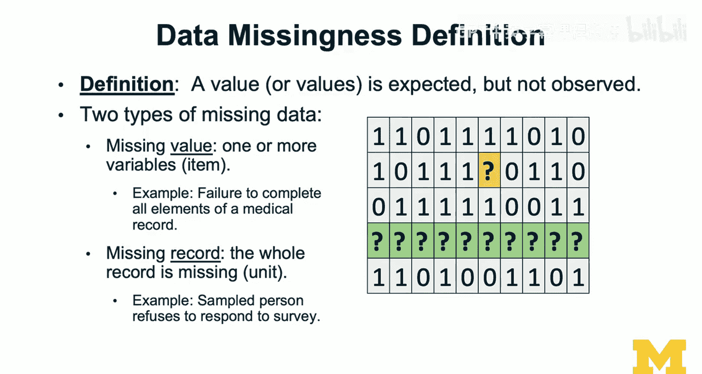
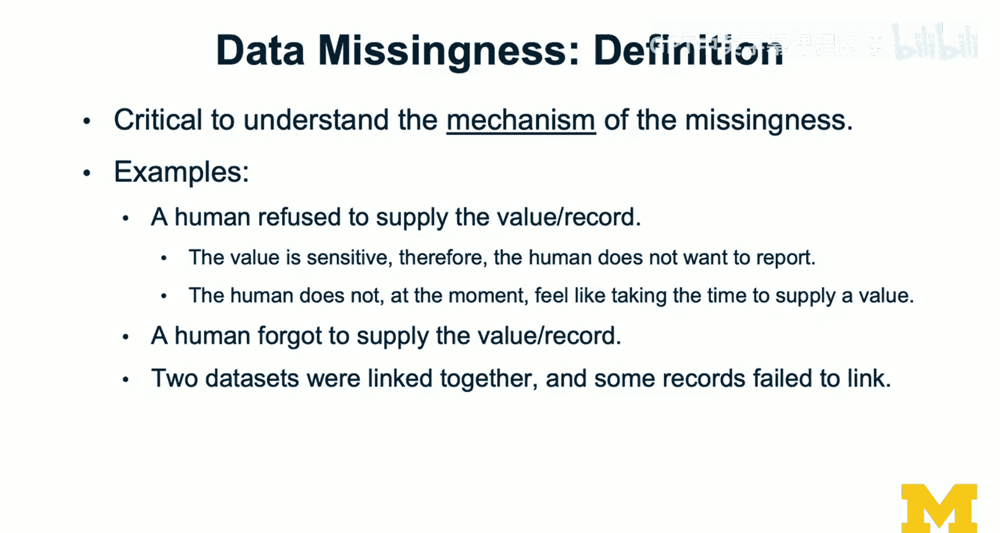
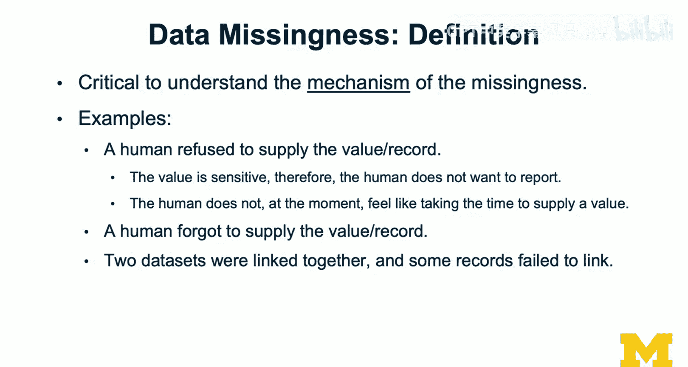
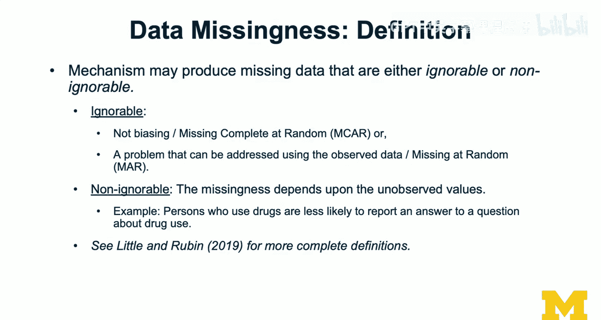
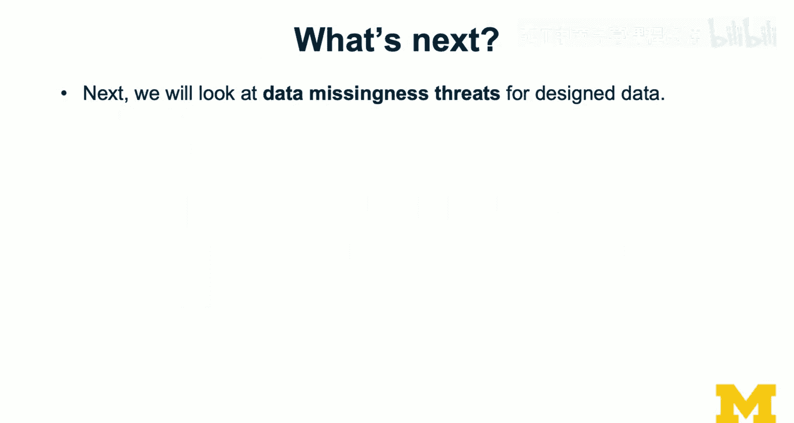

# 34：数据缺失的定义与分类 📊

在本节课中，我们将学习总体数据质量框架中的一个新误差来源：数据缺失。我们将探讨数据缺失的定义、分类、产生机制及其潜在影响。

---

## 概述

上一节我们讨论了数据表示误差。本节中，我们将开始探讨一个新的误差来源：数据缺失。当我们从可用数据中选择并检查数据时，可能会发现某些数据元素缺失。这是一种数据威胁，我们将对其进行定义并讨论其潜在后果。

---

## 数据缺失的定义

数据缺失的简单定义是：**预期存在但未被观测到的值**。这个定义看似简单，但可能具有误导性。问题的部分关键在于如何判断一个值是否“应该被预期”。我们将在后续内容中进一步讨论这一点。

---

## 数据缺失的类型

通常，我们将数据缺失分为两种类型。

### 1. 缺失值

当一个或多个变量或数据项缺失时，我们称之为缺失值。在下图的右侧图表中，一个带有问号的黄色方框代表了一个缺失值。对于该数据单元，我们拥有其他值，但该特定值缺失。

**示例**：未能完成医疗记录中的所有项目。我们将在课程后续部分使用这个例子。

### 2. 缺失记录

当整条记录都缺失时，我们称之为缺失记录，有时也称为单元缺失。在右侧图表中，这由一整行带有问号的绿色方框表示。整条记录都缺失。

**示例**：当被抽样的个人拒绝回答调查问卷时，我们从该人那里得不到任何数据，这就产生了单元无响应。

---

## 识别数据缺失

我们将讨论如何识别这些数据缺失的情况，这对于收集的数据和设计的数据有所不同。

---

## 数据缺失的机制

理解数据缺失的机制至关重要。例如，可能是人类拒绝提供某个值或某条记录。拒绝提供的原因可能各不相同。

以下是两种不同的机制示例：

*   **敏感性问题**：该值可能很敏感，因此个人不愿报告。例如，“您在上次选举中投票了吗？”可能被视为敏感问题，如果个人认为敏感，可能不愿意提供答案。
*   **时间/情境因素**：个人可能在当时没有时间提供答案。他们可能很忙，正要出门，或者碰上下雨，担心在淋湿前进屋。

这两种情况（因敏感而拒绝 vs. 因忙碌而拒绝）的机制非常不同，可能会在后续产生不同的后果。

---

## 其他缺失机制

还有其他类型的缺失机制：

*   **遗忘**：例如，在医疗记录的例子中，准备记录的人本应填写所有项目，但忘记了一项。这可能无关难度或敏感性，仅仅是忘记了。
*   **数据链接失败**：当两个数据集链接在一起时，某些记录可能链接失败。这会导致一些记录拥有链接数据，而另一些记录则缺失链接数据，从而引发相关问题。

---

## 缺失机制的分类：可忽略与非可忽略

让我们更详细地探讨这些机制。机制产生的缺失数据可分为**可忽略**和**非可忽略**两类。

*   **可忽略缺失**：这意味着缺失不会导致偏差。用统计术语来说，即**完全随机缺失**。你可以将其视为另一阶段的随机抽样。结果只是样本量变小了，可能会增加抽样误差，但不会导致估计偏差。另一种可忽略的情况是，问题可以通过已观测到的数据来解决。用统计术语，这称为**随机缺失**。我们可以使用诸如加权或插补等策略来修复缺失。我们将在后续课程中更详细地探讨这些选项。

*   **非可忽略缺失**：这是不好的类型。这种缺失取决于**未观测到的值本身**。例如，之前提到的敏感问题机制。具体来说，吸毒者可能更不愿意回答关于吸毒的问题。在这种情况下，未观测到的值（吸毒行为）会影响我是否能观测到该变量。如果吸毒降低了回答该问题的意愿，就可能导致一种偏差。这种偏差通常表现为低估人群中的吸毒数量。因此，非可忽略的缺失数据可能导致我们的估计产生偏差。

以上是概念性的解释。如果你想了解更多关于这些定义的信息，建议参考幻灯片底部的引用文献。

---

## 总结

本节课中，我们一起学习了数据缺失的基本概念。我们明确了数据缺失的定义，区分了**缺失值**和**缺失记录**两种类型。更重要的是，我们探讨了数据缺失的各种**机制**，并将其核心分为**可忽略**和**非可忽略**两类，理解了后者可能引入估计偏差的风险。

下一讲，我们将讨论设计数据中的数据缺失威胁，将今天所学的数据缺失知识应用到我们在设计数据时有时会面临的特定情境中。