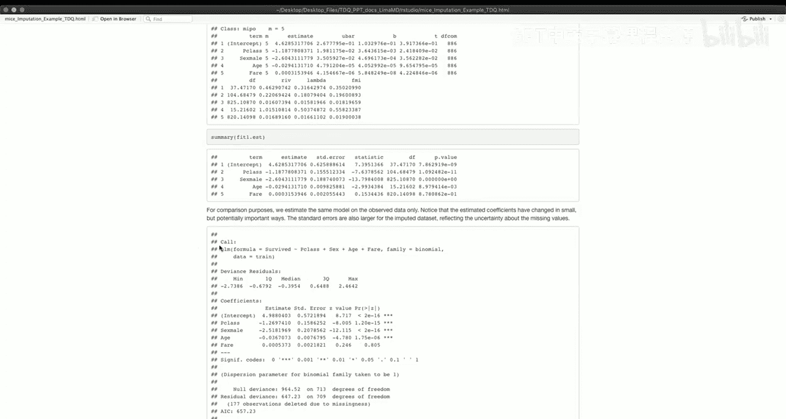
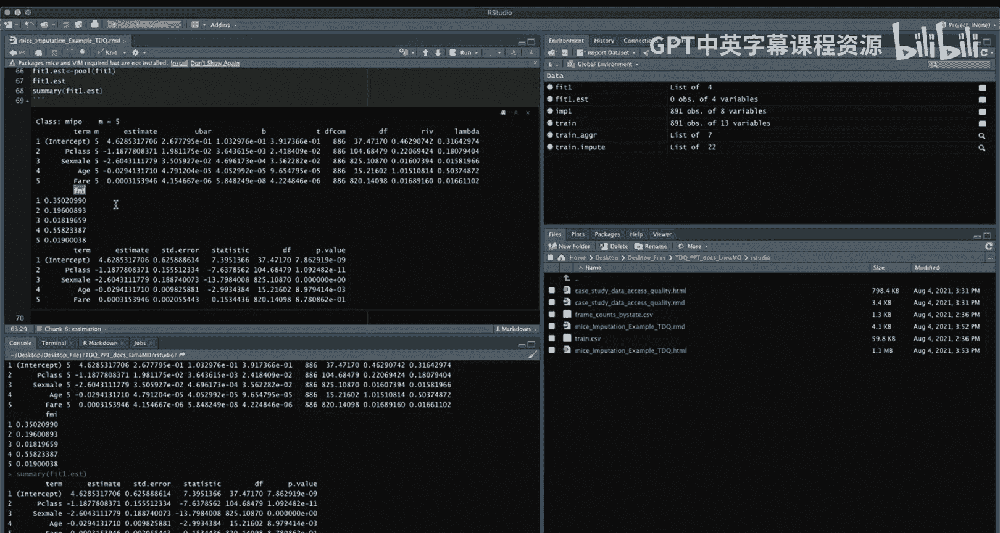
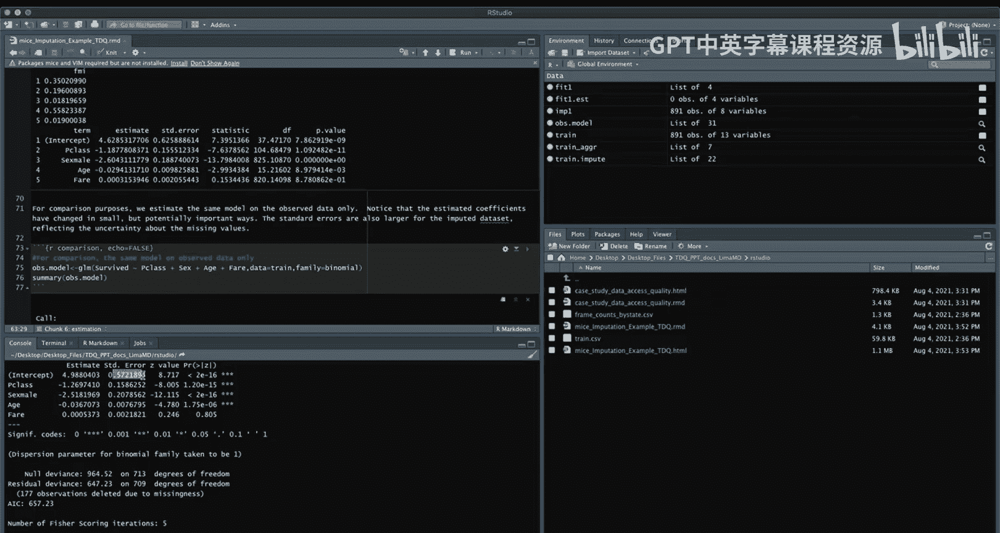

# 36：缺失值插补演示：处理前后的估计对比 📊


在本节课中，我们将学习如何处理数据集中的缺失值。缺失值，特别是与结果变量相关的缺失值，会给数据分析带来问题。我们将重点介绍一种解决方案：**插补**。插补是指为缺失值创建合理的、可能为真的替代值。我们将通过一个具体的演示，使用泰坦尼克号数据集和R语言中的`mice`包，来展示如何执行多重插补，并比较插补前后回归模型估计结果的差异。

## 数据加载与缺失模式分析 🔍


首先，我们需要加载数据并检查缺失值的模式。我们使用的是Kaggle上的泰坦尼克号训练数据集，其中部分乘客的年龄信息存在缺失。

以下是加载数据并检查缺失模式的代码：

```r
# 加载必要的包
library(mice)
library(VIM)

# 加载泰坦尼克号训练数据集
train <- read.csv('train.csv')
```

运行上述代码后，我们得到一个包含891个观测值和12个变量的数据框。通过检查，我们发现年龄变量有缺失值。

接下来，我们使用`VIM`包中的`aggr`函数来可视化缺失数据的模式。

```r
# 检查缺失数据模式
md.pattern(train)
```



分析结果显示，共有**177**个案例的年龄信息缺失，约占数据集的**20%**。其他变量则没有缺失值。了解缺失数据的范围和模式是进行有效插补的第一步。

## 使用MICE进行多重插补 🧩

在分析了缺失模式之后，我们开始进行插补。我们将使用`mice`包，它代表“通过链式方程进行多重插补”。

以下是执行插补的关键步骤和代码：

```r
# 创建一个标志变量，指示年龄是否缺失
train$age_missing <- ifelse(is.na(train$Age), 1, 0)

# 准备用于插补的数据集，移除非信息性变量（如姓名）
train_for_impute <- train[, !(names(train) %in% c('Name', 'Ticket', 'Cabin'))]

# 设置参数并执行多重插补
set.seed(123) # 设置随机种子以保证结果可复现
train_imputed <- mice(train_for_impute,
                      m = 5,          # 生成5个插补数据集
                      maxit = 50,     # 最大迭代次数
                      method = 'pmm', # 使用预测均值匹配方法
                      printFlag = FALSE)
```

**代码解释：**
*   `m = 5`：生成5个完整的插补数据集，以反映我们对缺失值的不确定性。
*   `maxit = 50`：设置插补算法的最大迭代次数。
*   `method = ‘pmm’`：指定使用“预测均值匹配”方法。对于不同类型的变量（如二分类变量），可以选择其他方法（如`‘logreg’`）。
*   `set.seed(123)`：设置随机种子，确保每次运行都能得到相同的插补结果。

## 评估插补质量 📈

创建插补值后，我们必须评估其质量，确保它们是合理的，并且没有引入奇怪的模式。

我们可以通过绘制插补后年龄的分布图，并将其与原始观测数据的分布进行比较来实现。

```r
# 绘制插补值的分布图
stripplot(train_imputed, pch = 20, cex = 1.2)
```

在生成的图表中，蓝色点代表**观测到的年龄数据**，其他颜色的点代表**5个不同数据集中插补的年龄值**。通过观察，我们发现大多数插补值集中在15至35岁之间，这与观测数据的分布趋势基本一致，没有在极高或极低年龄区间出现异常插补。这表明插补过程产生了看似合理的值。

## 基于插补数据进行建模与分析 🤖

现在，我们有了5个完整的数据集。我们可以用它们来拟合我们感兴趣的统计模型，例如一个逻辑回归模型，来预测乘客在泰坦尼克号沉没事件中的生存率。

我们将使用`with()`和`pool()`函数来分别拟合每个插补数据集上的模型，然后合并结果。

```r
# 在5个插补数据集上分别拟合逻辑回归模型
model_imputed <- with(train_imputed,
                      glm(Survived ~ Pclass + Sex + Age + Fare,
                          family = binomial))

# 合并（Pool）5个模型的结果
summary(pool(model_imputed))
```

模型汇总输出中包含了每个预测变量的合并后系数估计、标准误以及一些重要指标：
*   **估计系数**：例如，`Age`的系数约为**-0.03**，表明年龄越大，生存概率倾向于越低。
*   **标准误**：考虑了由于数据缺失和多重插补带来的不确定性。
*   **FMI（缺失信息比例）**：这个指标告诉我们，由于年龄数据的缺失，我们损失了多少信息。它不仅仅是缺失数据的百分比，更反映了信息量的损失。

## 与完整案例分析法的对比 ⚖️

为了理解插补带来的影响，我们将其与常用的默认方法——**完整案例分析法**进行对比。这种方法会直接删除任何含有缺失值的行。

我们使用原始数据（删除年龄缺失的行）拟合相同的逻辑回归模型。



```r
# 使用完整案例（删除缺失行）拟合模型
train_complete <- na.omit(train_for_impute)
model_complete <- glm(Survived ~ Pclass + Sex + Age + Fare,
                      data = train_complete,
                      family = binomial)
summary(model_complete)
```


**对比结果：**
1.  **系数估计**：在完整案例模型中，`Age`的系数约为**-0.037**，与多重插补得到的-0.03略有不同。这表明插补对点估计产生了微小影响。
2.  **标准误**：更重要的是，完整案例模型中`Age`系数的标准误**更小**。这是因为多重插补诚实地反映了我们对缺失值的不确定性，通常会**增大标准误的估计**，从而提供更可靠的统计推断。

## 总结与要点 🎯



本节课中，我们一起学习了处理缺失数据的一种重要方法——多重插补。

*   **第一步**是**分析缺失模式**，了解缺失数据的范围和结构。
*   **第二步**是使用如`mice`这样的工具进行**插补**，为缺失值创建多个合理的替代数据集。
*   **第三步**是**评估插补质量**，确保插补值符合数据本身的分布逻辑。
*   **第四步**是**基于插补数据进行建模**，并利用专门的统计方法（如`pool`）合并来自不同插补数据集的结果。
*   最后，通过**与完整案例分析法对比**，我们看到多重插补不仅能提供略有不同的点估计，更重要的是，它能更准确地量化估计中的不确定性（表现为更大的标准误），从而做出更稳健的统计推断。


记住，插补不是“无中生有”地创造数据，而是利用已有信息，以统计上合理的方式来处理缺失问题，减少偏差并更好地评估不确定性。对于想深入学习的同学，建议仔细阅读`mice`等插补包的文档，理解其背后的原理和各种方法的适用场景。