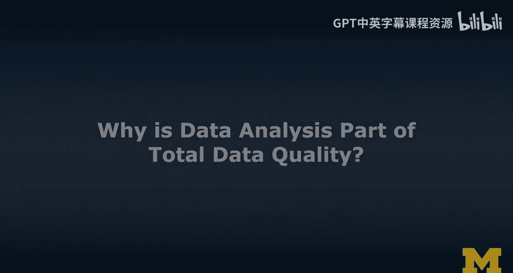
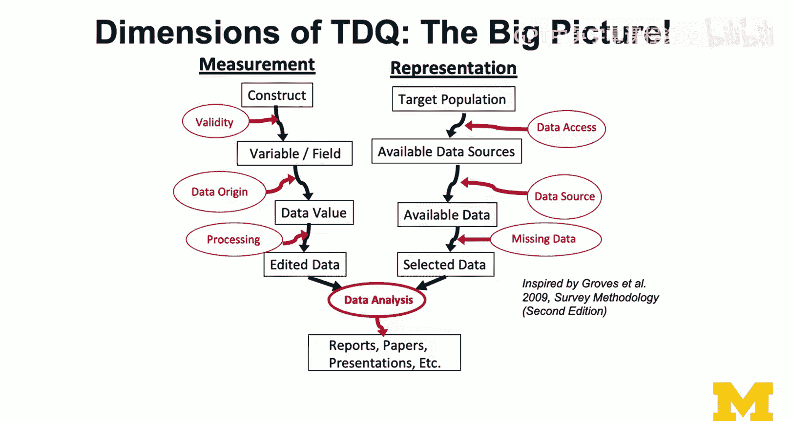
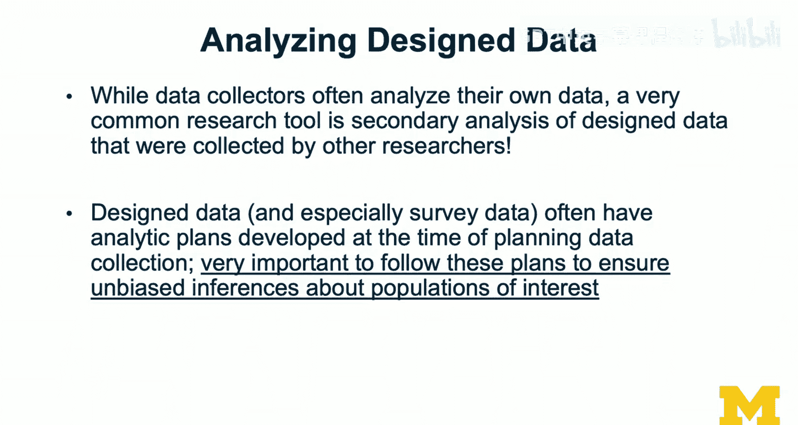
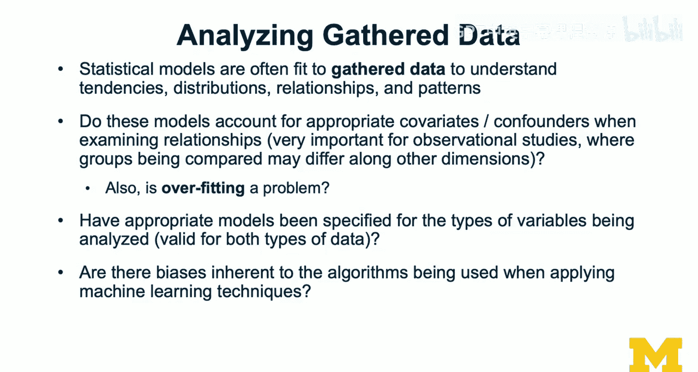
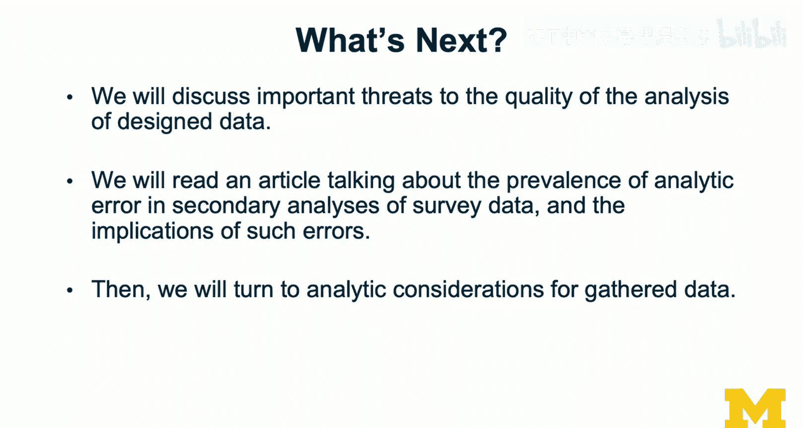

# 38：为何数据分析属于全面数据质量范畴 📊

在本节课中，我们将探讨数据分析在全面数据质量框架中的位置，并解释为何确保高质量的数据分析对于整个数据生命周期至关重要。

---

上一节我们讨论了数据表示维度的质量保障。本节中，我们来看看数据分析阶段如何成为全面数据质量框架的关键组成部分。

全面数据质量框架涵盖了多个测量维度，例如**有效性**、**数据来源**和**数据处理**。当我们完成数据清洗和编辑，得到一个准备就绪的数据集时，便进入了数据分析阶段。此阶段的目的是生成报告、论文和演示文稿。

数据分析之所以被纳入全面数据质量框架，是因为我们必须确保，不会在分析阶段犯下错误，从而抵消了之前在测量和表示维度上为优化数据质量所做的所有努力。这一点至关重要，因为公众和研究者最终消费的是我们通过数据分析得出的估计和发现。

因此，框架要求我们不仅要谨慎处理所有导致最终数据集的测量和表示维度，还要确保在数据分析阶段不犯错误。否则，之前在所有维度上的努力都将付诸东流，因为我们可能得出不正确的估计，无法准确描述数据中的关键主题。

---

那么，什么是高质量的数据分析？数据分析通常出现在全面数据质量框架的最后一步，也是研究结果发布给公众、利益相关者和读者之前的最后环节。

以下是高质量数据分析需要关注的核心方面：

**对于设计数据（如调查数据）的分析：**
设计数据，尤其是调查数据，通常在数据收集规划阶段就制定了分析计划。这些计划概述了为保持高质量，应遵循的分析步骤。对于进行**二次分析**（即分析由他人收集的数据）的研究者而言，遵循这些计划尤为重要，以确保通过分析得出关于目标人群的无偏推断。

具体注意事项包括：
*   **调查权重**：许多调查数据包含权重，用于将样本映射回总体，特别是在对某些子群进行过采样的情况下。分析时必须正确使用这些权重。公式可表示为：`估计值 = Σ(权重_i * 变量_i)`
*   **抽样设计代码**：数据中可能包含描述抽样设计特征的代码（如分层、聚类）。分析时需要纳入这些设计特征，以尊重数据表示维度。

**对于收集数据（如观测数据）的分析：**
对收集数据拟合统计模型，是为了理解趋势、分布、关系和模式。

具体注意事项包括：
*   **模型设定**：指定的统计模型是否适合所分析的变量类型？（例如，对分类变量使用线性回归可能不合适）。
*   **协变量与混杂因素**：在观察性研究中，用于检验关系的模型是否考虑了适当的协变量或混杂因素？
*   **过拟合**：应避免为特定数据集寻找“完美”模型，这可能导致模型无法推广到其他数据集。核心是平衡拟合优度与泛化能力。
*   **机器学习算法偏差**：应用机器学习技术时，需注意所使用算法本身可能存在的偏见。

---

本节课中，我们一起学习了数据分析被纳入全面数据质量框架的原因。关键在于，低质量的分析会抵消前期所有数据质量保障工作的价值。我们概述了针对设计数据和收集数据进行高质量分析时需注意的核心事项。

接下来，我们将深入探讨对设计数据分析质量构成威胁的具体因素，并检视一篇关于调查数据二次分析中错误普遍性的文章。之后，我们将转向讨论收集数据分析的注意事项。