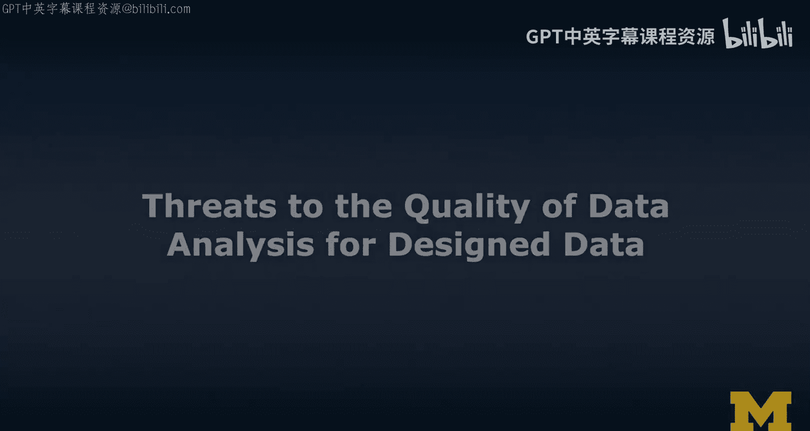
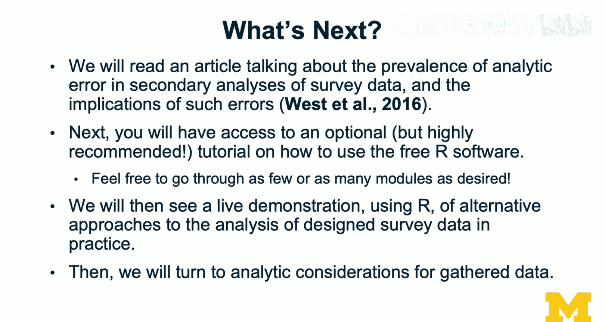
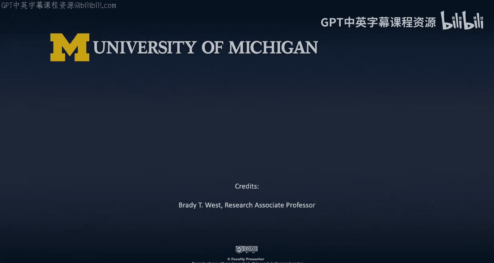

# 39：设计型数据分析的质量威胁因素 🔍




在本节课中，我们将探讨在“总体数据质量”框架下，针对**设计型数据**（如调查数据）进行分析时，可能遇到的质量威胁因素。我们将了解这些威胁如何影响分析结果，并学习如何通过正确的分析方法来确保数据质量。

---

## 概述

上一节我们介绍了数据分析在总体数据质量框架中的重要作用。本节中，我们来看看在进行设计型数据分析时，有哪些常见的威胁会损害分析质量。理解并规避这些威胁，对于确保我们最终的报告、论文和演示的可靠性至关重要。

---

## 数据分析质量的重要性

我们已经讨论了总体数据质量框架中的测量和表征维度。在完成调查设计、收集数据、处理缺失值并最终得到一个干净的数据集后，我们仍需通过数据分析来产出结果。如果数据分析环节质量低下，可能会抵消我们在之前所有维度上为提高数据质量所做的努力。因此，我们必须关注并最小化数据分析阶段的威胁。

---

## 主要威胁因素

以下是针对设计型数据分析的几个主要质量威胁。

### 1. 未使用调查权重与抽样误差代码

在分析调查数据，尤其是来自广泛人群的大型全国性样本时，一个主要威胁是**未使用调查权重和抽样误差代码**。

*   **调查权重**：用于校正因抽样和非应答（无响应）导致的**选择偏差**。它们通常代表个体被选入样本的概率。如果某些群体被过度抽样或某些子群应答可能性较低，我们的调查估计值就可能存在偏差。权重正是为了校正这类偏差而设计的工具。
*   **抽样误差代码**：用于确保我们计算出的估计值标准误，能正确反映在特定抽样设计下的预期抽样变异性。

**公式/代码示例**：在R语言中，使用 `survey` 包进行分析时，需要先通过 `svydesign()` 函数定义调查设计，其中就包括指定权重（`weights`）和分层/整群变量（`ids`, `strata`）。

```r
library(survey)
# 假设 df 是数据框，weight 是权重变量，stratum 是分层变量，cluster 是整群变量
design <- svydesign(ids = ~cluster, strata = ~stratum, weights = ~weight, data = df)
# 然后基于此设计对象进行分析，例如计算均值
svymean(~variable_of_interest, design = design)
```

**未能正确使用权重和误差代码**，会严重影响我们基于调查数据对目标人群做出的推断。

### 2. 统计模型设定不当

另一个威胁是**为所收集的数据设定了不当的统计模型**。

*   在将模型拟合到调查数据时，必须确保模型设定良好。这包括纳入对因变量的合适预测因子，并确保能正确捕捉变量间的关系。
*   对于调查数据，模型设定需要特别考虑其复杂的设计特征。

### 3. 拟合多水平模型时未使用适当权重

当对具有层次结构（如受访者嵌套于社区）的调查数据拟合**多水平模型**时，问题会更加复杂。

*   我们不仅需要用于第一水平（通常是受访者）的调查权重，还需要用于第二水平及以上（如被抽样的社区、学校）的权重。
*   如果多水平模型未能正确纳入这两个层次的权重，估计结果可能会出现偏差。

---

## 威胁的实际影响：案例研究

以下是一些实际研究中发现的、由上述威胁导致问题的例子。

### 案例一：全国大学毕业生调查（2010）

这项研究分析了“2010年全国大学毕业生调查”的数据，旨在估计**主要工作在科学与工程领域的人口百分比**。

*   **正确分析**（使用最终调查权重并考虑分层和整群抽样设计）：
    *   估计百分比：**30.4%**
    *   标准误：**0.3%**
*   **错误分析一**（仅使用权重，忽略分层和整群设计）：
    *   估计百分比：30.4%（点估计相同）
    *   标准误：**0.5%**（被高估，因为未体现分层设计带来的效率增益）。
*   **错误分析二**（完全忽略所有权重和设计特征）：
    *   估计百分比：**55.0%**（严重高估！）

**原因**：该调查有意过度抽样了从事科学与工程领域工作的人群，以便更深入地研究这个群体。**调查权重的作用正是校正这种过度抽样**，使其估计能代表整体人群。如果分析时忽略权重，就会得到严重偏离真实情况的估计。

### 案例二：其他领域的普遍性

类似的分析错误在其他领域也很常见：
*   **机构调查**（如医院、企业）：不正确的分析同样会导致错误的推断。
*   **医学领域**：分析健康调查数据或住院患者调查时，未能考虑设计特征会导致估计值及其标准误计算错误。

这些案例都强调了，在分析调查数据时，**仔细阅读数据文档并正确使用所有设计特征信息**是极其重要的。

---

## 后续内容预告

在讨论了设计型数据分析的威胁之后，我们的课程将按以下步骤深入：
1.  **阅读指定文献**：我们将研读一篇具体探讨调查数据二次分析中分析错误普遍性及其影响的文章。
2.  **可选R软件教程**：我们提供了一个高度推荐的可选教程，帮助您学习如何使用免费的R软件进行数据管理和分析，为后续的实践示例做准备。
3.  **R软件实操演示**：在录播课程中，我们将演示分析设计型调查数据的多种方法。
4.  **转向收集型数据**：最后，我们将开始讨论针对**收集型数据**的分析考量，以及如何最大化其分析质量。

---

## 总结

本节课中，我们一起学习了影响设计型数据分析质量的几个关键威胁因素：
1.  **未使用调查权重与抽样误差代码**，这会导致选择偏差校正失败和标准误计算错误。
2.  **统计模型设定不当**，无法准确捕捉数据中的关系。
3.  **在多水平模型分析中未使用适当权重**。






通过实际案例，我们看到了这些错误如何导致估计结果严重失真。确保数据分析阶段的质量，是维护整个数据科学流程可信度的最后一道关键防线。在接下来的学习中，我们将通过文献和工具实践，进一步巩固这些重要的概念。