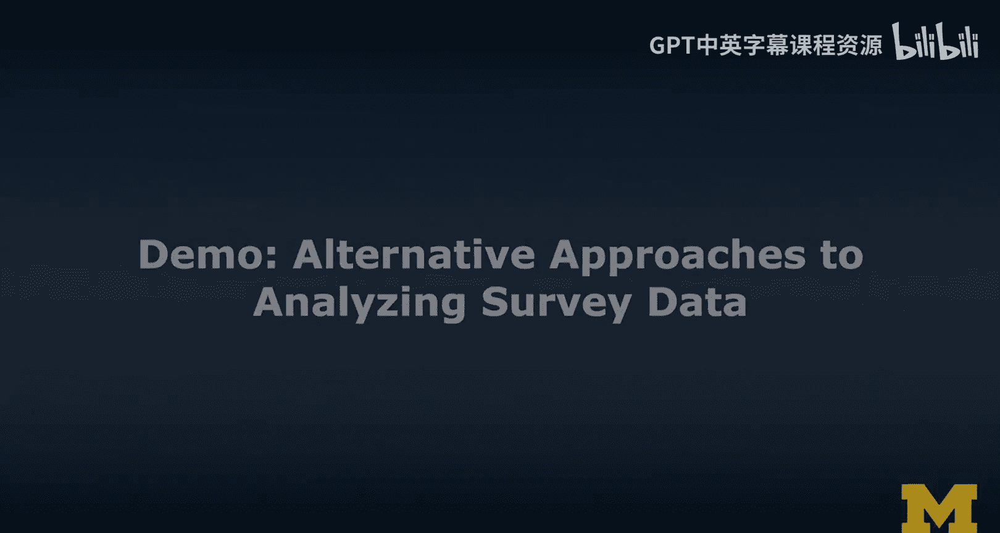
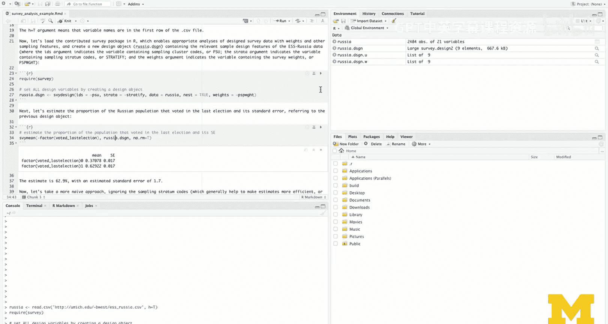
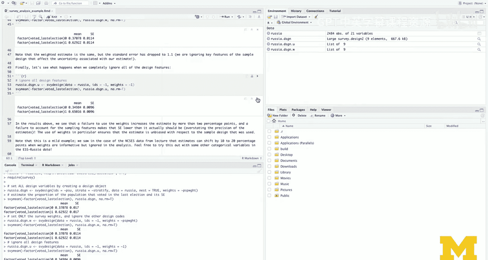
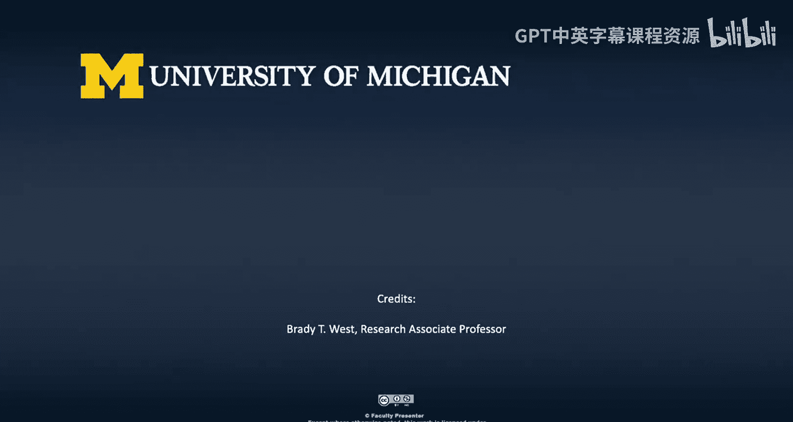

# 40：调查数据分析的替代方法 🧪




在本演示中，我们将通过一个实际案例，展示如何使用R软件分析设计调查数据。我们将以欧洲社会调查（ESS）中的俄罗斯数据集为例，进行简单的描述性分析，并重点比较处理调查数据时可能采取的不同方法。核心目标是理解如何正确考虑调查数据的关键设计特征（如抽样设计、权重等），以确保分析结果的准确性。

## 概述

上一节我们介绍了调查数据设计特征的重要性。本节中，我们将通过R软件的实际操作，演示如何加载数据、创建设计对象，并执行三种不同复杂度的分析：完全考虑设计特征、仅考虑权重、以及完全忽略所有设计特征。我们将看到不同方法如何影响估计值及其标准误。

## 数据准备与设计对象创建

首先，我们需要将欧洲社会调查的俄罗斯数据集读入R环境，并加载用于分析调查数据的专用包。

以下是具体步骤：

1.  **读取数据**：我们从在线CSV文件中读取数据，并将其保存为一个名为`russia`的数据框对象。
    ```r
    russia <- read.csv("http://website.com/ess_russia.csv", header = TRUE)
    ```

2.  **加载调查分析包**：我们加载R中的`survey`包，它提供了处理复杂抽样设计的功能。
    ```r
    library(survey)
    ```

3.  **创建设计对象**：这是最关键的一步。我们使用`svydesign`函数创建一个设计对象，该对象包含了数据的所有关键抽样设计信息。
    ```r
    russia.dsgn <- svydesign(ids = ~psu,          # 抽样群/初级抽样单位变量
                             strata = ~stratify,  # 分层变量
                             weights = ~pspwght,  # 最终调查权重变量
                             data = russia,       # 数据框
                             nest = TRUE)         # 指定群嵌套于层内
    ```
    参数说明：
    *   `ids`: 指定标识抽样群的变量（如`psu`）。
    *   `strata`: 指定标识抽样层的变量（如`stratify`）。
    *   `weights`: 指定包含最终调查权重的变量（如`pspwght`）。权重用于校正不等入选概率和无应答偏差。
    *   `nest = TRUE`: 表示抽样群是嵌套在抽样层内的，这是大型调查的常见设计。

## 分析方法比较：三种策略

创建好设计对象后，我们就可以进行分析了。我们将以估计“俄罗斯人口在上次选举中的投票比例”为例，展示三种分析方法。

### 方法一：完全考虑设计特征 ✅

这是最正确的方法。我们使用之前创建的完整设计对象`russia.dsgn`进行分析，该对象包含了权重、分层和群集信息。




我们使用`svymean`函数来计算加权比例及其标准误。
```r
svymean(~factor(voted_last_election), design = russia.dsgn, na.rm = TRUE)
```
**结果**：
*   **估计比例**: 0.629 (62.9%)
*   **标准误**: 0.017

这个标准误（0.017）真实地反映了由于分层、整群抽样和加权所带来的估计不确定性。

### 方法二：仅考虑权重，忽略分层与群集 ⚠️

这种方法只使用了权重进行加权估计，但在计算标准误时，忽略了分层和整群抽样设计。我们创建一个新的设计对象，其中`ids`设为`~1`（表示无群集），且不指定`strata`参数。
```r
russia.dsgn.weights.only <- svydesign(ids = ~1, weights = ~pspwght, data = russia)
svymean(~factor(voted_last_election), design = russia.dsgn.weights.only, na.rm = TRUE)
```
**结果**：
*   **估计比例**: 0.629 (62.9%) – 与**方法一**相同，因为权重相同。
*   **标准误**: 0.011

**关键发现**：标准误从0.017下降到了0.011。这是因为忽略了分层（通常会提高效率、降低标准误）和整群抽样（通常会因组内相似性而增加标准误）对变异性的影响。这导致我们**低估了估计的不确定性**，错误地认为结果比实际更精确。

### 方法三：完全忽略所有设计特征 ❌

这是最“天真”的方法，既不考虑权重，也不考虑分层和群集。我们创建一个所有权重都为1的设计对象。
```r
russia.dsgn.unweighted <- svydesign(ids = ~1, weights = ~1, data = russia)
svymean(~factor(voted_last_election), design = russia.dsgn.unweighted, na.rm = TRUE)
```
**结果**：
*   **估计比例**: 0.650 (65.0%)
*   **标准误**: 0.010

**关键发现**：
1.  **估计值偏差**：比例估计从62.9%上升到了65.0%。这是因为未使用权重来校正样本选择和无应答带来的偏差。
2.  **标准误进一步低估**：标准误降至0.010，对估计精度的描述更加不准确。

## 总结与建议

本节课中，我们一起学习了分析设计调查数据的三种不同策略。通过对比，我们清晰地看到：



*   **完全考虑设计特征**（方法一）能得到**无偏的估计**和**真实反映抽样变异性的标准误**，是推荐的做法。
*   **忽略分层和群集**（方法二）虽然能得到相同的加权估计，但会**严重低估标准误**，导致对结果过于自信。
*   **完全忽略所有设计特征**（方法三）不仅会因未加权而产生**有偏的估计**，还会**最大程度地低估标准误**，结论的可靠性最低。




为了在您自己的分析中避免这些错误，请务必在开始前**仔细阅读所使用调查数据的技术文档**，明确其抽样设计、权重变量、分层及群集变量。在R等统计软件中，正确创建设计对象是确保高质量分析的关键第一步。您可以尝试用本演示的数据集和代码，更换不同的变量进行分析，以加深对调查数据分析流程的理解。