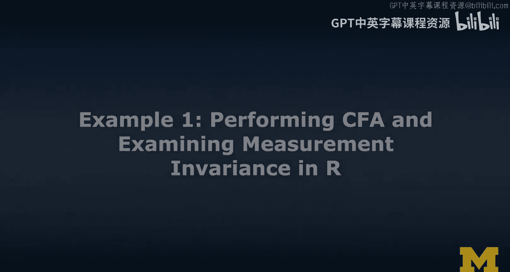
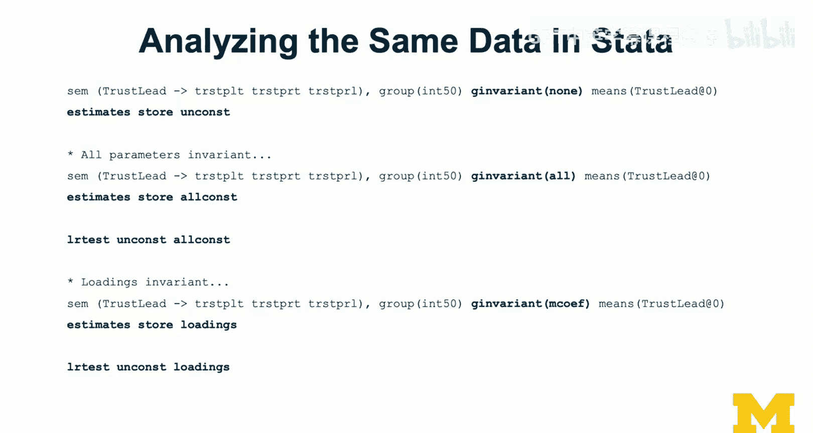

# 2：示例1：R语言中的验证性因子分析与测量等值检验 📊





在本节课中，我们将学习如何使用R软件进行验证性因子分析，并检验不同子组间的测量等值。我们将通过一个具体案例，使用欧洲社会调查的数据，来评估“对领导层的信任”这一潜在构念在不同访谈员表现组别中是否被一致地测量。

## 概述

上一节我们讨论了测量效度的不同技术和数据设计。本节我们将通过一个R软件的实际操作示例，来学习如何执行验证性因子分析并检验测量等值。我们将使用R中的`lavaan`包来完成这些分析。

## 数据准备与加载

首先，我们需要准备分析所需的数据。我们使用的是欧洲社会调查中比利时的数据，旨在检验“对领导层的信任”这一潜在构念的测量是否在访谈员应答率不同的两组受访者中保持一致。

以下是数据准备的步骤：

1.  **加载数据**：将包含ESS比利时数据的R数据文件加载到R环境中。
2.  **定义子组**：根据访谈员的应答率（是否高于50%）创建一个新的分组变量。
3.  **处理缺失值**：剔除在三个信任变量（对政客、政党、议会的信任）上存在缺失值（编码为88）的个案。
4.  **检查数据**：查看处理后数据集的维度（行数和列数）。

```r
# 加载数据（假设数据文件已下载到本地）
load("path/to/your/ESS_Belgium_data.RData")

# 定义分组变量：访谈员应答率 <=50% 为组1，>50% 为组0
ESS_Belgium$int50 <- ifelse(ESS_Belgium$int_rr <= 50, 1, 0)

# 查看分组概况
summary(ESS_Belgium$int50)

# 剔除三个信任变量上的缺失值（编码为88）
ESS_reduced <- ESS_Belgium[!(ESS_Belgium$trstplt == 88 | 
                             ESS_Belgium$trstprt == 88 | 
                             ESS_Belgium$trstprl == 88), ]

# 查看处理后数据的维度
dim(ESS_reduced)
```

## 安装与加载 lavaan 包

为了进行验证性因子分析，我们需要使用`lavaan`包。如果尚未安装，请先安装它。

```r
# 安装 lavaan 包（只需执行一次）
install.packages("lavaan")

# 加载 lavaan 包
library(lavaan)
```

## 拟合非约束模型

在测量等值检验中，我们首先拟合一个“非约束模型”。在这个模型中，我们允许两个子组（基于访谈员应答率）拥有不同的因子载荷（即潜在变量与观测指标之间的关系参数）。这相当于检验两组在测量模型上是否存在异质性。

以下是具体步骤：

1.  **定义模型**：指定潜在变量及其对应的观测指标。
2.  **拟合模型**：使用`cfa()`函数拟合模型，并指定分组变量。
3.  **查看结果**：使用`summary()`函数查看模型估计结果。

```r
# 1. 定义验证性因子分析模型
# ‘=~’ 表示‘由……测量’，trust_lead 是我们定义的潜在变量名
trust_model <- 'trust_lead =~ trstplt + trstprt + trstprl'

# 2. 拟合非约束模型，允许两组参数自由估计
fit_unconstrained <- cfa(trust_model, 
                         data = ESS_reduced, 
                         group = "int50")

# 3. 查看模型结果摘要
summary(fit_unconstrained)
```

在输出结果中，你会看到分别为组1和组2估计的因子载荷、误差方差以及观测变量的截距。默认情况下，每个因子有一个载荷被固定为1，这是为了给潜在变量设定一个度量尺度。此时，我们可以初步观察两组间的载荷是否相似。

## 拟合约束模型并检验等值

接下来，我们拟合一个“约束模型”，在这个模型中，我们强制要求两个子组的因子载荷相等。然后，我们通过比较约束模型与非约束模型的拟合优度，来检验“因子载荷跨组相等”这一假设是否成立。

以下是具体步骤：

1.  **拟合约束模型**：在`cfa()`函数中添加`group.equal = “loadings”`参数。
2.  **查看并比较结果**：查看约束模型的结果，并关注模型比较的检验统计量。

```r
# 拟合约束模型，强制两组的因子载荷相等
fit_constrained <- cfa(trust_model, 
                       data = ESS_reduced, 
                       group = "int50",
                       group.equal = "loadings")

# 查看约束模型结果摘要
summary(fit_constrained)
```

在约束模型的输出中，你会看到“Model Test User Model”部分。这里提供了一个似然比检验（卡方差异检验），其零假设是：两组具有完全相同的因子载荷。

*   **如果检验的p值显著（通常p < 0.05）**：则拒绝零假设，认为强制载荷相等会显著降低模型对数据的拟合程度。这意味着两组间的因子载荷存在显著差异，即不满足“弱等值”假设。
*   **如果检验的p值不显著**：则不能拒绝零假设，认为约束模型（载荷相等）的拟合程度没有显著变差。这支持了测量等值的假设。

在本例的输出中，我们看到了一个显著的p值。这表明，与允许载荷自由估计的非约束模型相比，强制载荷相等的约束模型对数据的拟合显著变差。因此，我们得出结论：**在这两个由访谈员应答率定义的子组中，“对领导层的信任”这一构念的测量方式存在差异**。

回顾非约束模型的载荷估计，似乎在高应答率访谈员组（组0）中，三个观测指标与潜在变量的关系更强、更一致，表明该组的测量可能更可靠。

## 其他说明与扩展

*   **分析流程**：在测量等值检验的逐步约束流程中（如进一步约束截距、残差方差等），如果任一步骤的似然比检验显著，就应停止，因为引入的约束已导致模型拟合显著变差。
*   **其他R包**：`semTools`包中的`measurementInvariance()`函数提供了更专门的测量等值检验方法。
*   **其他软件**：同样的分析也可以在Stata、Mplus等其他统计软件中完成，其逻辑和步骤是相通的。



## 总结


本节课中，我们一起学习了如何在R语言环境中使用`lavaan`包进行验证性因子分析，并检验测量等值。我们通过欧洲社会调查的数据实例，演示了从数据准备、模型定义、到拟合非约束与约束模型，最后通过似然比检验判断因子载荷是否跨组相等的完整流程。结果表明，在本案例中，不同应答率的访谈员所收集的数据，在对“领导层信任”的测量上并不具有等值性。这提醒我们，在数据质量评估中，需要关注测量工具在不同子群体中的一致性。