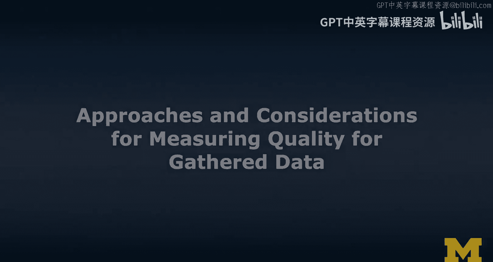
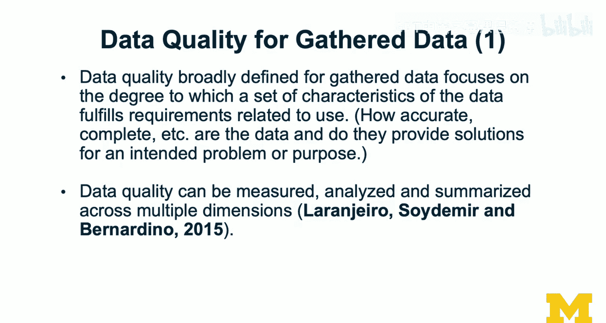
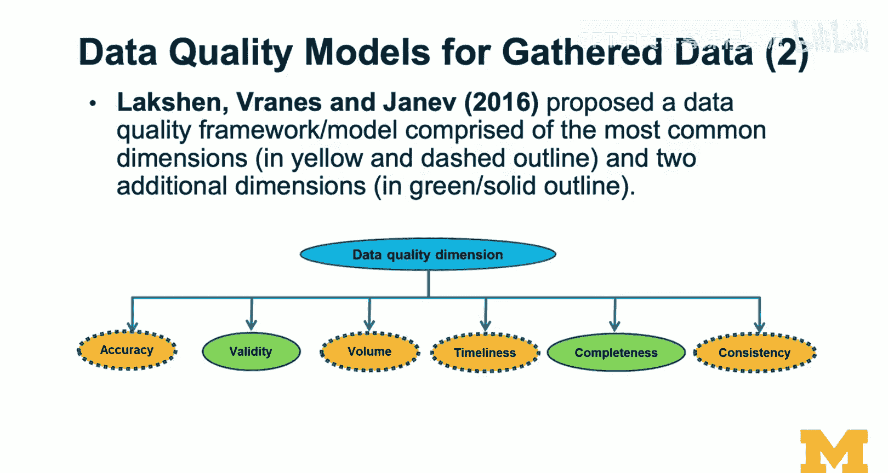
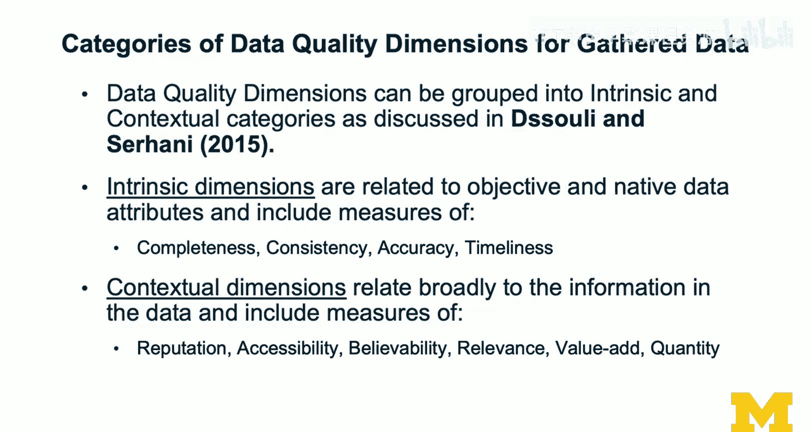
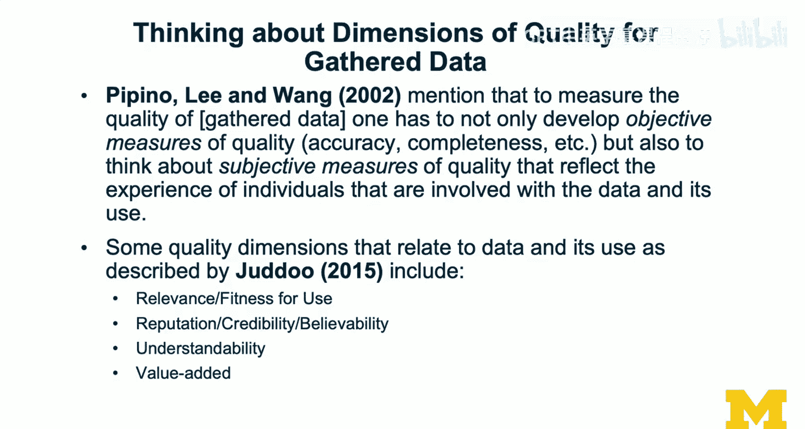
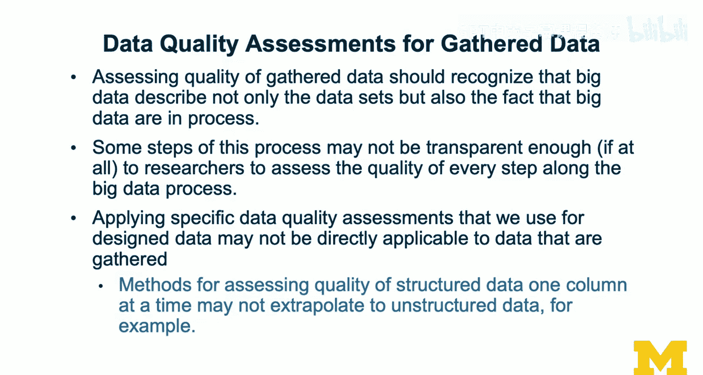
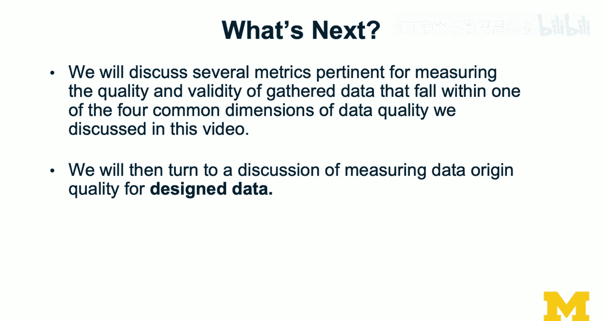

# 3：采集型数据质量测量的方法与考量 📊

在本节课中，我们将探讨如何测量采集型数据的质量，重点关注其独特属性、测量维度以及相关的考量因素。

## 概述：什么是采集型数据的质量？

数据质量广义上定义为：数据的一组特性满足其使用相关需求的程度。我们为多种不同用途收集和采集数据。因此，理解使用的背景对于评估质量至关重要。例如，我们可能会问数据有多准确或多完整，它们是否为预期的问题或目的提供了解决方案。这些问题提供了帮助我们评估采集型数据质量的背景，这与我们为设计型数据所做的非常相似。

## 数据质量维度与度量

上一节我们介绍了数据质量的定义，本节中我们来看看如何具体测量它。数据质量可以在多个维度上进行测量、分析和总结。我们将讨论这些维度及其定义。

一个**数据质量维度**指的是一个可测量的数据质量属性，它代表了数据的某个方面。这些维度被广泛用于理解和管理整个数据管道中的数据质量。请记住，许多采集型数据是动态数据，具有管道特性。因此，当我们考虑使用这些质量维度时，它有助于我们了解数据在管道中流动时其质量如何。

**数据质量度量**是为每个数据质量维度专门开发的。当你看到一个代表质量、代表采集数据质量度量的数字时，它将是某个度量的具体实现。这是我们如何将质量测量操作化的方式。

在一个给定的维度内可以使用多种度量。一个**度量**是一个为计算实际数字、分数或比率而开发的方程或公式，用以量化我们正在讨论的质量维度。对采集型数据质量的评估可以侧重于单个维度，但在实践中，通常会提出包含多个维度并为每个维度包含特定度量的数据质量模型或框架。我们需要这些度量来得出数字，以便对质量做出最终评估。

显然，这些框架中使用的维度存在一些差异。没有一个放之四海而皆准的框架，也没有一个适用于每个维度的通用度量。但根据Laction及其同事在2016年的报告，许多数据质量模型中似乎包含一组共同的维度。我们将讨论其中一些常见元素。

该文献提出了一个包含最常见维度的数据质量框架，这些维度用黄色标出：**准确性、数量、及时性、一致性**。这些是最常用的维度。还有两个额外的维度：**有效性和完整性**。我们将逐一讨论如何测量这些维度，并提供将用于实际操作这些测量的具体度量。

## 内在维度与情境维度

数据质量维度可以分为我们称之为**内在**和**情境**的类别。

*   **内在维度**与客观和固有的数据属性相关，包括**完整性、一致性、准确性、及时性**。
*   **情境维度**则广泛涉及数据的信息，包括**声誉、可访问性、可信度、相关性、增值和数量**的度量。

一个情境维度的例子可能是：我们以前使用过这些数据，并且在使用Twitter数据来估计某个感兴趣的结果方面非常成功。因此，对于那个特定目的，Twitter数据本身基于你之前的经验具有积极的声誉。这是一个可以操作化的情境维度。

一个内在维度的例子可能是：在你能够采集的100个案例中，你只拥有其中50个的完整数据。这是一个内在维度，是数据集本身客观或固有的属性。

## 主观质量考量

Pppino及其同事提到，要测量采集型数据的质量，不仅要开发我们已讨论过的客观质量度量，还要考虑反映与数据及其使用相关的个人经验的主观质量度量。这些就是我们之前讨论过的那些情境因素。

以下是Judo描述的一些与数据及其使用相关的质量维度：

*   **相关性或适用性**：这些数据对其预期用途是否有用？
*   **声誉、可信度或可信性**：这些数据具有什么样的声誉或可信度？
*   **可理解性**：数据是否易于理解？
*   **增值**：它是否为你的特定案例增加了价值？

一个关于可信度或可信性的例子：你打算给研究中的每个人佩戴传感器，并收集大量关于他们运动的信息。但如果在与这些人的咨询中，你发现人们无法将传感器戴在腰上，而是放在了鞋上。那么测量结果可能无法准确反映你试图测量的内容。在这种情况下，你从该数据中获得的结果将无法作为身体活动的可信度量，因为信号不一致，仅仅是因为人们没有正确佩戴传感器。因此，存在这种情境和可信度的因素，可能会影响你判断该数据是否具有足够质量用于预期用途。

在本课程的一些讲座中，我们将更详细地讨论其中一些因素，请继续关注更多细节和此类示例，我们将在课程讨论中逐步梳理。

## 采集型数据的独特挑战

评估采集型数据的质量应认识到，大数据不仅描述数据集，也意味着大数据处于**处理过程**中，正如我之前提到的。

这个过程的某些步骤可能对研究人员不够透明，无法评估每一步的质量。例如，你可能无法追溯到数据记录的地方，因为你无法访问记录机制，或者数据被记录的时间点对研究人员不可用。这要追溯到数据生成过程的初始阶段，而你无法控制该过程。

因此，将我们用于设计型数据的特定数据质量评估方法直接应用于采集型数据可能并不合适。例如，逐列评估结构化数据质量的方法可能无法推广到没有列的非结构化数据。因此，我们不一定有适用于采集型数据空间的、与设计型数据空间完全对等的方法。但一致的是我们测量其中许多事物的能力，而应用确切的度量或确切的测量方法可能不同。这正是我们需要为采集型数据调整这些不同框架的地方。

## 贯穿始终的总体框架

在整个专项课程中，我们部署了一个总体框架，用于识别、测量和最大化设计型数据和采集型数据的数据质量。

这两种数据类型共同之处在于测量的维度和我们关心的表征质量，如有效性、数据访问等，这类似于我在本讲座开始时展示的图表。但在这个过程中或跨这些数据类型可能变化的是这些质量维度如何被测量以及在某些方面如何被操作化。

例如，对于设计型数据，我们花费大量精力开发有效的测量工具和问卷项目，以测量我们想要测量的构念。对于采集型数据，我们可能更加强调数据在整个管道过程中被获取后是如何被处理的。

Shu及其同事在2020年指出，与设计型数据相比，研究人员对采集型数据如何生成的控制或影响力要小得多。采集型数据的生成过程通常更加**不透明**。我们通常不理解，或者无法一直追溯到采集型数据被捕获的点，因为我们不拥有或控制那个过程，或者这些数据最初就不是为研究目的而设计的。因此，它们以非常不同的方式被捕获或采集，而这些方式不一定对研究人员开放。

这种不透明性可能会影响审查或测量构念效度和内部效度的能力。采集型数据更多地依赖自动化工具来处理数据，然后将输入数据转换为对研究目的有用的数据。例如，想象一下传感器，当你测量身体活动时，传感器正在将那些运动转换为对研究人员有用的测量值。

因此，对于采集型数据，问卷中的量表或项目的概念可能被来自关键词的多个度量以及其他元数据所取代，这些元数据被组合起来间接测量构念。所以对于采集型数据，我们不一定能控制如何提问或如何捕获数据，但我们可能通过指定关键词或识别我们知道需要收集的特定元数据，对捕获什么数据有发言权。

一些感兴趣的结果可能被测量为特质，例如宗教信仰，但对于采集型数据，它们是通过测量一系列行为来操作化的，旨在尽可能好地估计这个特定特质。这些行为可能不仅受宗教信仰影响，还受特定社交媒体平台的社会规范或观念或该平台文化的影响。这些都是我们在考虑测量质量时必须考虑的因素。

采集型数据的**体量**和**速度**也可能使得使用整个数据集进行全面的质量评估非常困难。例如，我们可能没有能力捕获你所在地区一天内所有可用的推文。因此，需要能够处理实时演化的大型数据集的质量评估方法，以便进行质量评估。

Taliban及其同事开发了一个名为“大数据质量剖析模型”的框架，该框架利用多个模块来自动化估计质量度量、质量报告、元数据收集以及实时解析这些大型数据集，以便能够在采集型数据领域实现这些评估。

## 总结与预告

本节课中，我们一起学习了测量采集型数据质量的方法与考量。我们探讨了数据质量维度的概念，区分了内在维度和情境维度，并了解了采集型数据因其生成过程不透明、依赖自动化处理以及体量大、速度快等特点所带来的独特挑战。

接下来，我们将讨论适用于测量采集型数据质量和有效性的几种度量，这些度量将属于我们在本视频中已经描述的四个常见维度之一。然后，我们将转向讨论如何测量设计型数据的来源质量。感谢您的参与，请继续关注我们的下一讲。