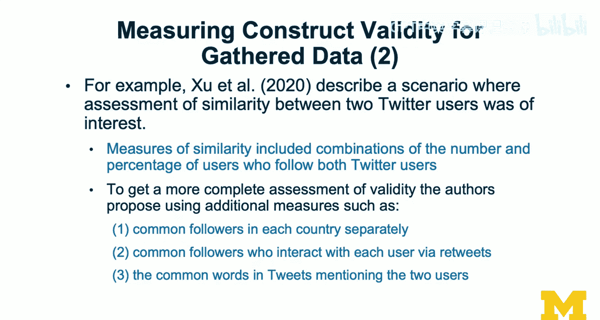
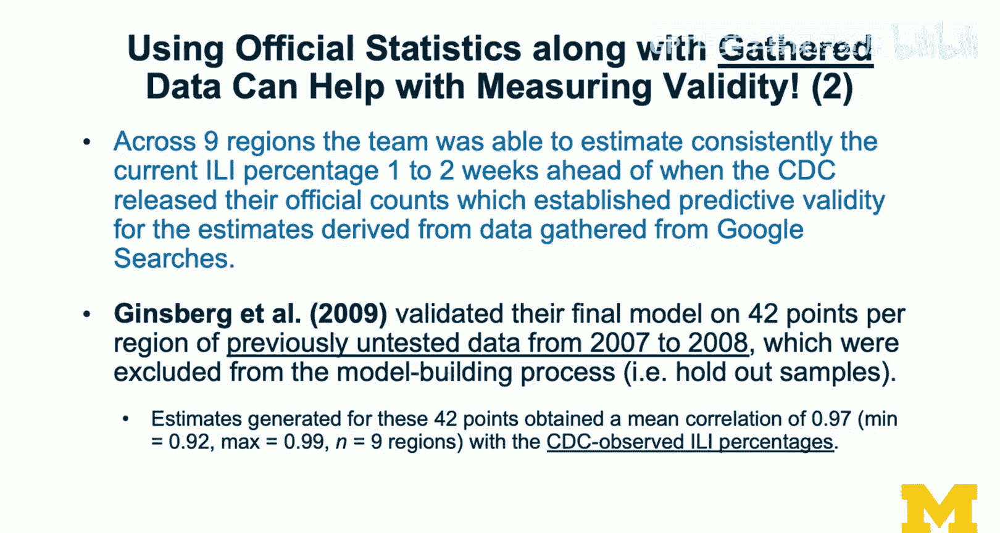
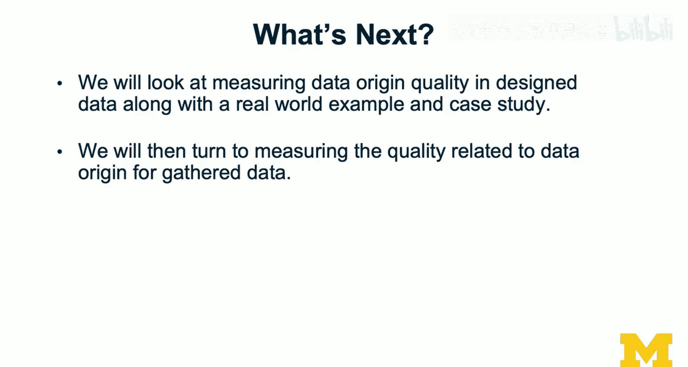

# 4：采集型数据效度测量 📊

在本节课中，我们将学习如何测量采集型数据的效度。我们将重点讨论两种效度类型：构念效度和表面效度，并通过具体案例了解其测量方法。

---

### 框架定位与效度类型

首先，我们明确本讲在总体数据质量框架中的位置。我们正处在**测量**环节，并专注于**采集型数据**的效度评估。

我们将聚焦于采集型数据的两种效度：
*   **构念效度**：我们测量的内容是否真正反映了我们想要测量的**潜在构念**。其核心问题是：我们测量的东西是我们想测的吗？
*   **表面效度**：我们声称测量的内容，**看起来**是否就是我们正在测量的东西。

其他效度类型（如外部效度、时间效度）将在本系列后续课程中讨论。

---

### 测量构念效度

对于设计型数据，多特质-多方法模型是评估构念效度的常用方法。然而，将其应用于采集型数据更具挑战性，因为研究者对数据生成过程的控制较少，且可能难以从多个数据源获取相似的测量指标。

尽管如此，评估采集型数据的构念效度仍是可能的，但需牢记其在控制和访问方面的现实局限性。例如，成熟的量表通常不适用于采集型数据，因为你无法直接与受访者互动来获取项目信息，但你可以被动地收集信息。

为了测量采集型数据的构念效度，我们将使用**概念性复现**方法，即对同一构念采用略有差异的操作化定义。多个相似测量结果之间的一致性越高，则构念效度水平越高。

以下是具体方法：

**方法一：多重测量三角验证**
此方法的核心是使用多个测量指标来“三角验证”效度。由于我们无法控制或设计特定测量来捕获目标构念，我们必须依赖能够被动测量或观察的指标。

**案例：Twitter用户相似性评估**
Shoe及其同事的研究提供了一个范例。他们希望评估两个Twitter用户之间的相似性。他们使用的相似性测量指标包括：
*   同时关注这两个用户的用户数量和百分比。
*   为了获得更全面的效度评估，作者建议使用额外的测量指标，例如：
    *   每个国家/地区分别统计的共同关注者。
    *   通过转发与每个用户互动的共同关注者。
    *   提及这两个用户的推文中的共同词汇。

**方法二：与基准数据（金标准）关联分析**
如果存在我们感兴趣的结果的基准数据（即“金标准”），我们可以分析从采集数据中操作化定义的测量指标与这些基准值本身之间的相关性。相关性足够高吗？更高的相关性表明测量更有效。

但请注意，**相关性不等于因果关系**。我们在此寻找的不是因果关系，而是我们使用采集数据进行的测量方式与可信基准之间的一致性。

然而，对于从社交媒体平台等渠道捕获的态度、观点或用户行为数据，这种方法通常难以实施。此外，使用大规模概率样本来获取金标准基准数据成本高昂，尽管这样做可以为评估采集数据的质量提供一个更严谨、更可靠的比较基准。

**案例：Google流感趋势预测**
Ginsburg及其同事在2009年的研究是一个特别有趣的例子。他们基于Google上对各种关键词的搜索来估计每周的流感样疾病发病率。

*   **金标准**：作者使用了美国疾病控制与预防中心流感哨点监测系统的历史流感样疾病病例数作为基准。
*   **模型与验证**：研究团队建立了一个模型，在2003年至2007年的四年间具有很高的预测准确性。在2007-2008年流感季，他们使用模型的初步版本生成流感样疾病估计值，并每周与CDC共享结果以评估时效性和准确性。在九个地区，该团队能够持续比CDC官方数据提前一到两周估计出当前的流感样疾病百分比，这为其使用Google搜索采集数据得出的估计值建立了一定的**预测效度**。
*   **最终验证**：Ginsburg及其同事在2007-2008年期间、每个区域42个未参与模型构建的数据点（即**留出样本**）上验证了最终模型。他们得出的估计值与CDC观察到的流感样疾病百分比之间的平均相关系数高达 **`0.97`**。

**关于构念效度的进一步说明**
Google流感趋势使用了在早期试点测试中发现的45个不同关键词的Google搜索词集合。这些关键词在试点期间整体上与流感样疾病百分比高度相关。

*   **目标构念**：流感样疾病。
*   **搜索词**：搜索词本身并不直接测量你是否患有流感（例如，一些关键词与抗生素有关，不一定直接关联流感样疾病），因此它们可能具有较低的**构念效度**。但它们被识别为结果的间接信号。
*   **操作化**：流感样疾病的估计基于简单的线性模型，该模型使用了这45个术语的Google搜索活动的综合测量。因此，采集数据被操作化为基于这些关键词搜索组合的、预测流感样疾病的单一聚合预测因子。
*   **数据预处理**：研究团队没有预先过滤任何搜索词，这使他们避免了文献中讨论的所谓“临时数据预过滤”问题。其理念是，如果进行预过滤，可能会错过一些原本有助于提高预测准确性的信号。

---

### 测量表面效度

对于许多采集型数据集，测量**表面效度**比测量构念效度更为可行，因为研究者对实际数据生成过程的控制较少。

在大数据文献中，表面效度通常被称为大数据的所谓“有效性特征”。Bardwaj和Ormand Geva在2021年提出了一个测量大数据有效性的框架，该框架包括**准确性**、**可信度**和**合规性**三个维度。

最终的质量评估由一个向量表示，该向量捕获了每个维度的度量。因此，它不是提供一个单一数字，而是提供一个与准确性、可信度和合规性相关的三个不同数字的向量，因为这三个要素对于理解大数据的整体有效性至关重要。

其质量评估向量可表示为：
`有效性向量 = [准确性得分， 可信度得分， 合规性得分]`

---

### 总结

本节课中，我们一起学习了如何测量采集型数据的效度。我们重点探讨了**构念效度**和**表面效度**。对于构念效度，我们介绍了通过**概念性复现**（使用多重测量三角验证）和与**金标准基准数据关联分析**的方法，并以Twitter用户相似性和Google流感趋势预测为例进行了说明。对于表面效度，我们介绍了大数据背景下包含准确性、可信度和合规性三个维度的评估框架。

在下一讲中，我们将探讨如何测量设计型数据的数据来源质量，并结合真实案例进行研究。之后，我们将把注意力转向测量采集型数据与数据来源相关的质量。

感谢观看，敬请期待下一讲。