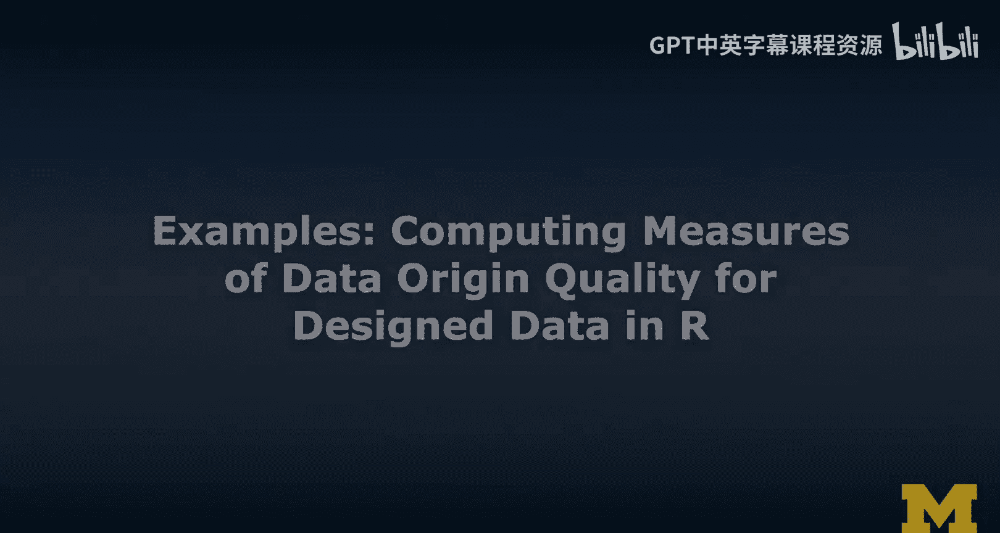
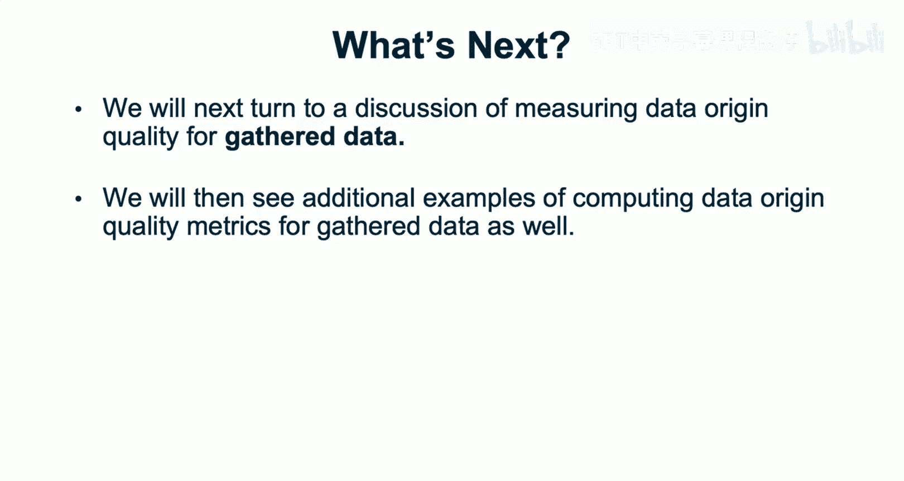

# 6：R语言中设计型数据溯源质量指标计算 📊




在本节课中，我们将学习如何使用R软件，通过具体示例来计算设计型数据的溯源质量指标。我们将重点关注数据溯源维度中的测量问题，特别是如何量化数据生成过程中可能出现的问题。

上一节我们介绍了数据溯源质量的概念性度量。本节中，我们来看看如何在R中实际计算这些度量，特别是针对设计型数据。

## 示例：调查员效应分析

设计型数据中一个首要问题是调查员效应。不同调查员在收集数据时，可能会对记录在目标变量上的测量值产生影响。我们将使用欧洲社会调查（ESS）中比利时的数据作为示例，分析受访者对“人们通常有多乐于助人”这一问题的回答。

在ESS比利时数据中，变量名为`PLHLP`（即people help）。数据集中还有一个变量`inum`，用于标识不同的调查员。在多水平建模框架中，调查员ID定义了数据结构的第二层，即受访者嵌套于调查员之下。拥有这个调查员ID变量对于估计实际的调查员效应至关重要。

该调查项目采用10分制，用于衡量受访者对“人们普遍乐于助人”的态度，10分表示最乐于助人，0分表示人们通常只关心自己。需要注意的是，该变量中值为88的条目代表缺失数据，在分析时必须正确处理。

### 准备工作与描述性分析

首先，我们需要安装并加载R中的`lme4`和`lmerTest`扩展包。

```r
# 安装包（如果尚未安装）
# install.packages("lme4")
# install.packages("lmerTest")

# 加载包
library(lme4)
library(lmerTest)
```

在分析调查员效应时，一个很好的起点是查看箱线图，它展示了不同调查员收集的目标变量的分布情况。如果每位调查员访问的是随机子样本，我们预期这些分布应大致相等。

以下是加载数据并进行初步处理的R代码：

```r
# 1. 加载ESS比利时数据
load("ESS_Belgium.RData") # 请替换为实际数据文件路径

# 2. 处理缺失值（88代表缺失）
# 创建一个新数据框，仅保留三个关键变量不为88的行
ESS_red <- ESS_Belgium[ESS_Belgium$PLHLP != 88 &
                       ESS_Belgium$TSTPLT != 88 &
                       ESS_Belgium$TSTPRT != 88, ]

# 查看处理后的数据维度
dim(ESS_red)
```

运行后，控制台会显示剩余1674名受访者和26个变量。

为了绘图清晰，我们仅保留调查员ID小于2000的个案，作为随机子样本进行观察：

```r
# 3. 为绘图创建子集（仅调查员ID < 2000）
ESS_red2 <- ESS_red[ESS_red$inum < 2000, ]
```

现在，我们可以绘制箱线图来直观感受不同调查员间回答的分布差异：

```r
# 4. 绘制箱线图：不同调查员（ID）的“乐于助人”评分分布
plot(PLHLP ~ factor(inum), data = ESS_red2,
     xlab = "调查员 ID",
     ylab = "乐于助人评分 (PLHLP)",
     main = "不同调查员收集的评分分布")
```

生成的图表会显示，不同调查员收集的“乐于助人”评分分布存在明显差异，这初步提示可能存在调查员效应。

### 拟合多水平模型与方差估计

为了量化调查员效应，我们使用多水平模型。我们将`PLHLP`视为连续因变量，并允许每位调查员拥有独特的截距（均值）。

以下是拟合模型的R代码：

```r
# 5. 使用lmer函数拟合多水平模型
# 模型设定：PLHLP为因变量，1表示仅拟合截距（总均值）
# (1 | inum) 表示允许截距随调查员（inum）随机变动
mod1 <- lmer(PLHLP ~ 1 + (1 | inum), data = ESS_red, REML = TRUE)

# 6. 查看模型摘要，获取参数估计
summary(mod1)
```

运行`summary(mod1)`后，输出结果将包含以下关键信息：
*   **固定效应（截距）**：总体均值估计值，例如 `4.76`。
*   **随机效应方差**：
    *   `inum`的方差：代表**调查员间方差**，例如 `0.21`。
    *   残差方差：代表**调查员内方差**（即受访者个体间的差异），例如 `3.76`。

### 计算与解释组内相关系数

接下来，我们需要评估调查员间方差相对于调查员内方差的大小。为此，我们计算**组内相关系数**，它表示同一调查员下任意两个观测值之间的相关性。

IIC的计算公式为：
**IIC = 调查员间方差 / (调查员间方差 + 调查员内方差)**

根据我们的估计值计算：
IIC = 0.21 / (0.21 + 3.76) ≈ 0.053

这意味着，在“乐于助人”评分的总变异中，约有5.3%可归因于调查员差异。对于面对面调查而言，这个值相对较高（通常IIC在0.005-0.01左右）。

### 显著性检验

我们可以使用`lmerTest`包中的`ranova`函数，对“调查员间方差为0”的原假设进行正式的似然比检验。

```r
# 7. 检验随机效应（调查员方差）的显著性
ranova(mod1)
```

输出结果会提供一个p值。如果p值很小（例如 `< 0.05`），并有`***`标记，则表明我们有强有力的证据拒绝原假设，即调查员间方差显著不为0。这证实了调查员效应对数据质量存在显著影响。

**结论**：在此案例中，调查员方差大于0，ESS的不同调查员在收集“乐于助人”评分时，得到的回答分布存在差异。因此，调查员是影响数据溯源质量的一个因素，是此处一个潜在的测量误差来源。后续可以尝试在模型中加入调查员层面的预测变量来解释这种变异，或深入研究那些与总体均值偏差异常的调查员。

## 其他重要的数据溯源质量指标

除了调查员效应，设计型数据还有其他关键的数据溯源质量指标。

### 重测信度

重测信度评估的是，向同一个体重复询问相同或等价问题时，得到一致回答的程度。假设ESS数据中`TSTPLT`和`TSTPRT`是两个测量政治信任度的等效题目。

我们可以通过计算这两个变量之间的皮尔逊相关系数来估计重测信度：

```r
# 8. 计算两个政治信任度变量间的相关系数（重测信度）
test_retest_cor <- cor(ESS_red$TSTPLT, ESS_red$TSTPRT, use = "complete.obs")
print(test_retest_cor)
```

运行后，例如得到相关系数约为 `0.843`。相关系数越接近1，表明信度越高。值0.843表明这两个测量具有较高的重测信度。

### 项目无回答率

项目无回答率指针对某个特定问题缺失数据的比例。较高的无回答率可能暗示问题难以理解或受访者不愿回答，是数据溯源质量低下的信号。

在删除缺失值前，我们可以检查原始数据的缺失情况：

```r
# 9. 检查两个变量的缺失值数量
summary(ESS_Belgium$TSTPLT) # 查看输出中88或NA的数量
summary(ESS_Belgium$TSTPRT)

# 计算无回答率（假设总样本量为1703）
missing_rate_tstplt <- sum(ESS_Belgium$TSTPLT == 88) / 1703
missing_rate_tstprt <- sum(ESS_Belgium$TSTPRT == 88) / 1703
print(c(missing_rate_tstplt, missing_rate_tstprt))
```

例如，计算得到的无回答率可能非常低（如0.004和0.006），说明对于这两个变量，项目无回答不是主要问题。

### 模式效应

模式效应是指不同的数据收集方式（如网络调查与邮寄问卷）会导致对同一变量得到不同的回答分布。

假设我们有一个实验，受访者被随机分配到网络或邮寄两种模式，并回答一个同意程度（不同意/中立/同意）的问题。我们可以使用卡方检验来比较两种模式下的回答分布是否独立。

以下是分析模式效应的思路：

```r
# 10. 示例：创建模拟数据并进行卡方检验
# 假设有一个数据框`mode_data`，包含变量`response`（同意程度）和`mode`（收集模式）
# table_result <- table(mode_data$response, mode_data$mode)
# chi_sq_test <- chisq.test(table_result)
# print(chi_sq_test)
```

如果卡方检验结果显著（p值小），则拒绝“模式与回答独立”的原假设，表明存在模式效应，即数据收集模式影响了回答分布，这是数据溯源质量问题。

**总结**：本节课中我们一起学习了如何在R中计算设计型数据的溯源质量指标。我们通过具体示例，逐步演示了如何分析调查员效应（包括描述性分析、多水平模型拟合、IIC计算和显著性检验），并简要介绍了重测信度、项目无回答率和模式效应的计算与评估方法。这些指标帮助我们量化数据生成过程中的潜在问题，是评估和改进总体数据质量的重要工具。




接下来，我们将转向对“收集型数据”的数据溯源质量测量的讨论。