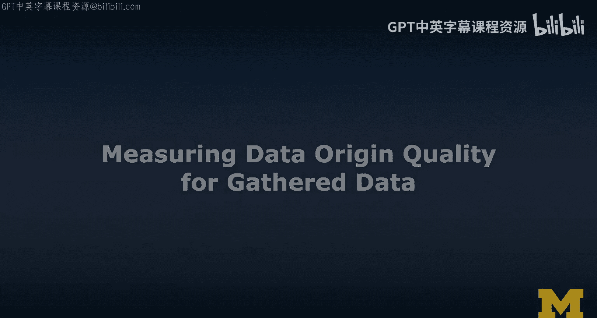
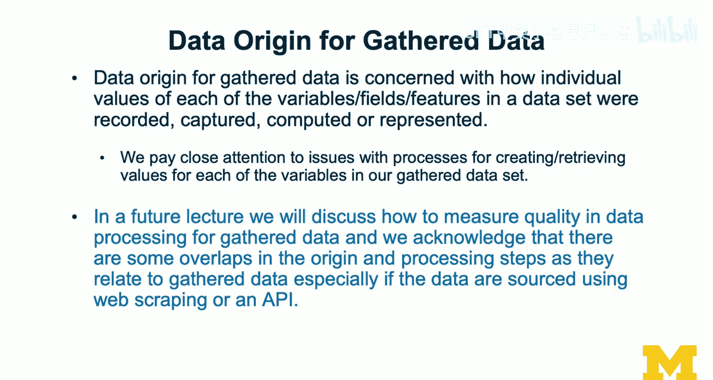
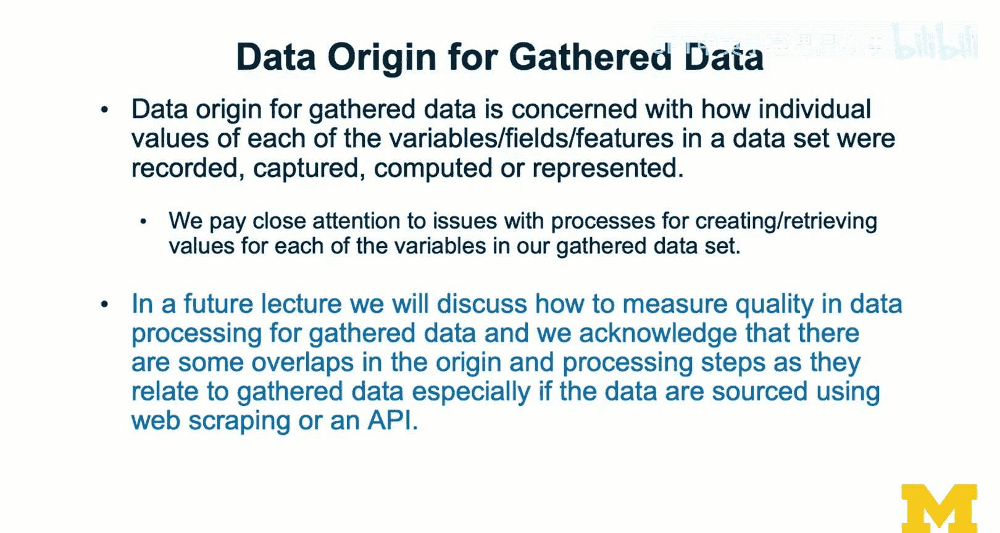
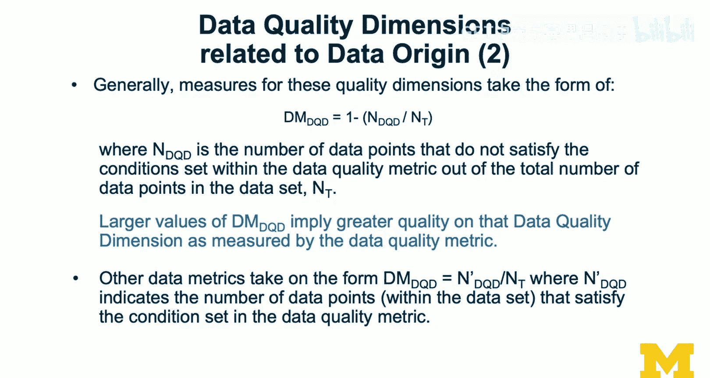
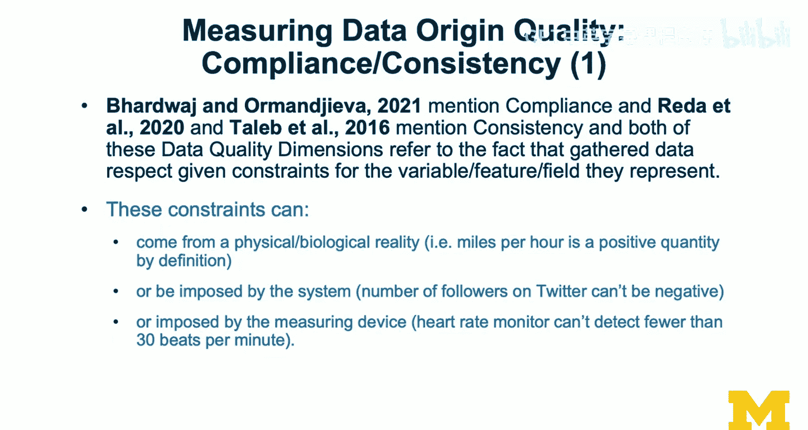
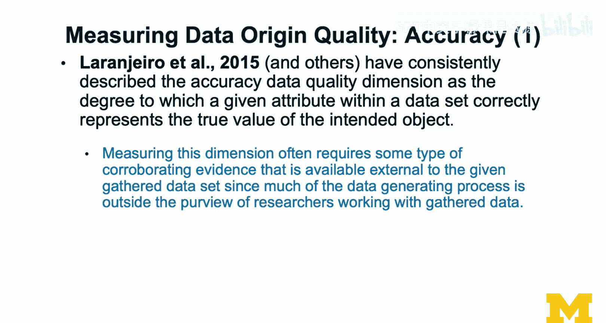
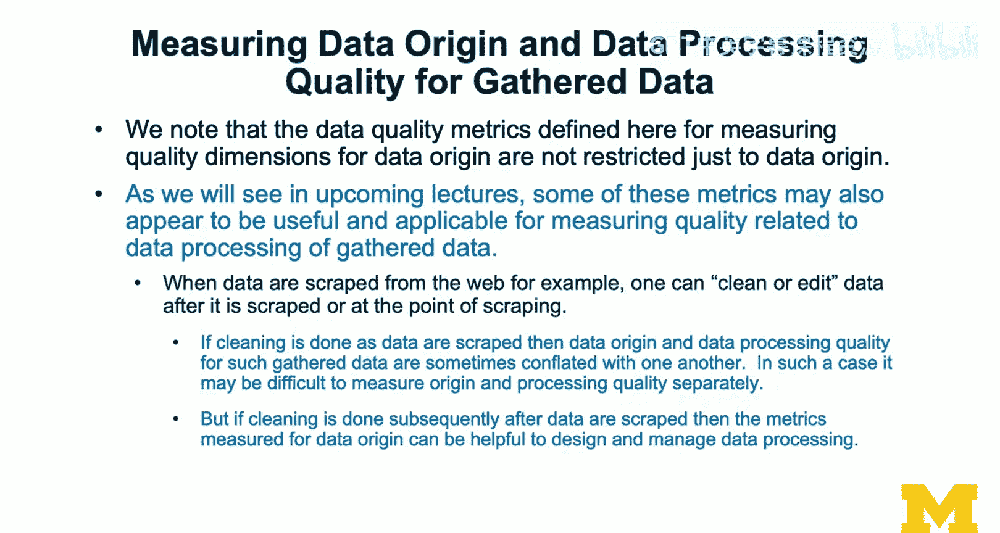
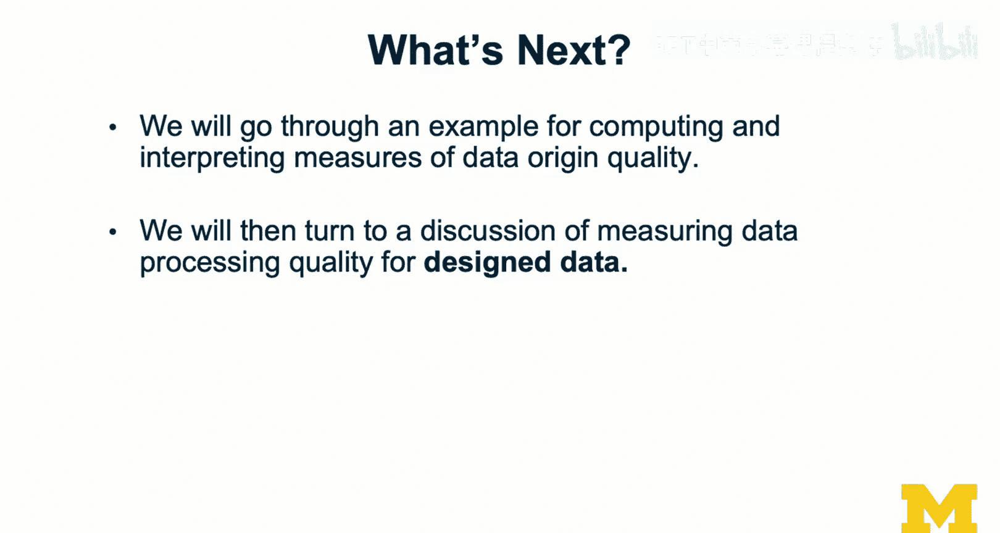

# 7：采集型数据溯源质量测量 📊

在本节课中，我们将学习如何测量采集型数据的溯源质量。我们将探讨与数据溯源相关的多个质量维度，并学习如何为每个维度定义和计算具体的质量度量指标。

---

## 课程概述

上一节我们介绍了数据质量框架的测量部分。本节中，我们将聚焦于**采集型数据**的**溯源质量**测量。数据溯源关注的是数据集中每个变量、字段或特征的单个值是如何被记录、捕获、计算或表示的。

需要说明的是，在我们的整体框架中，有测量侧和表示侧。这里提到的“表示”并非指框架的表示侧，而是指单个数据本身的格式，例如日期的长格式（月、日、四位数年份）或短格式（两位数月、日、年）。

我们将密切关注为采集数据集中的每个变量创建和检索值的过程。在未来的课程中，我们会讨论如何测量采集型数据的处理质量。我们承认，对于采集数据，溯源步骤和处理步骤存在一些重叠，尤其是在使用网络爬虫或API获取数据时。例如，在使用网络爬虫时，溯源质量和处理质量可能同时受到影响，因为数据的检索和处理几乎是同时发生的。虽然我们仍将溯源和处理错误源视为独立的，但在某些采集过程中，它们可能几乎同时发生。我们将在本讲后面部分讨论这些问题。

---

## 与数据溯源相关的质量维度

在建立如何测量数据溯源质量之前，我们需要讨论与数据溯源问题广泛相关的数据质量维度。

关于数据溯源质量的文献很多。综合这些信息后，我们发现数据溯源质量与以下几个质量维度相关：
*   合规性与一致性
*   准确性
*   一致且简洁的表示（即之前提到的格式问题）
*   及时性与时效性
*   可访问性
*   冗余性

我们将逐一讨论这些质量维度，因为它们是人们为采集型数据操作化测量数据溯源质量的方式。

通常，这些数据质量维度的度量采用以下形式：
**度量指标 = 1 - 比率**
其中，比率的分母 `n_T` 是数据集中的数据点总数，分子 `n_DqD` 是不满足我们关心的特定质量度量条件的数据点数量。

其他度量指标可能采用类似形式，但没有“1减去”的结构，它们直接测量一个比率，其中分子 `N‘_DqD` 表示满足条件的数据点数量，分母 `n_T` 同样是数据点总数。

我们在之前的课程中提到，质量度量指标是能生成数字的公式，这些数字可用于表示特定维度的质量测量。因此，我们将看到的大体是这两种格式之一：“1减去一个比率”或“比率本身”。

---

## 各维度详解与度量公式

以下是每个质量维度的具体解释及其度量公式。

### 合规性与一致性

Bardwaj 和 Ormajieva（2021年）提到了合规性，其他同事提到了一致性。这两个数据质量维度都指采集数据是否尊重其所代表的变量、特征或字段的给定约束。

这些约束可能来自物理或生物现实（例如，英里/小时按定义是正数），也可能由系统强加（例如，Twitter关注者数量可以是0，但不能为负），或者由测量设备强加（例如，心率监测器无法检测到每分钟少于30次的心跳）。换句话说，如果我们测量Twitter关注者数量，我们期望数据集具有合规性，即所有记录的数据至少为0。它们必须遵守由生物性、系统或测量设备驱动的给定约束。

对于一个数据集中的给定字段、特征或变量，我们可以使用以下质量度量来测量其一致性：

**一致性/合规性度量 = `N_con / n_T`**

*   `N_con`：指其值满足或尊重我们对该变量期望的约束的实例、行或案例的数量。
*   `n_T`：数据集中实例、行或案例的总数。

这是一个将一致性和合规性定义为同一质量维度的变量特定维度。我们按数据集中的每个变量进行测量。请记住它是按变量的，因为如果我分别测量Twitter关注者数量和推文数量，这两个变量根据系统本身可能有不同的约束或不同的期望值范围。

---

### 准确性

Laren Gerro 及其同事一直将准确性数据质量维度描述为：数据集中给定属性正确表示预期对象真实值的程度。

测量这个维度通常需要某种类型的外部确证证据，因为大部分数据生成过程超出了处理采集数据的研究人员的视野。换句话说，如果我没有外部值来确证，我就无法知道一个采集数据字段（例如你家的面积）是否准确。因此，在没有获取确证证据能力的情况下，准确性不是一个容易测量的维度。

对于这个特定的质量维度，我们使用以下形式的度量指标：

**准确性度量 = 1 - `n_error / n_T`**

*   `n_error`：指其记录值存在错误的实例、行或案例的数量。这些是真正的错误。例如，你的公寓是130平方英尺，但我记录为100平方英尺。100这个值本身是合规的，因为它落在期望的平方英尺范围内，但它不准确，因为我少算了30平方英尺。这就是 `n_error` 所指的。
*   `n_T`：数据集中实例、行或案例的总数。

需要注意的是，一个给定的数据值可能不准确但一致，这正是我们在面积例子中讨论的情况。此外，准确性度量也是变量特定的。

---

### 一致的表示

这里的“表示”一词确实指的是数据的格式化方式。Tlib 等人将一致的表示数据质量维度描述为：给定变量、特征或字段的数据以相同格式呈现或具有一致表示的程度。

对于给定的变量、字段或特征，这是一个变量特定的度量。我们使用以下质量度量来测量一致的表示：

**一致表示度量 = 1 - `n_CR / n_T`**

*   `n_CR`：指其值与该变量记录的其他值表示不一致的实例数量。
*   `n_T`：该变量数据集中实例、行或案例的数量。

---

### 可访问性

Papanino 及其同事以及其他人一直将可访问性描述为：数据可以被访问或可用于给定任务的程度，并且这些数据对于手头的任务来说是最新的或具有合适的时效性。

可访问性可以在不同层面进行测量：针对给定变量或特征，或针对数据被采集的整体平台或系统。因此，这个度量可以是变量特定的，也可以是数据源特定或平台特定的。

可访问性可能指编码问题，例如一个国家的数据由于编码原因无法在另一个国家获取（如ASCII数据无法在另一国转换为可读格式）。Cookie和Cookie违规可能是另一个导致平台可访问性值低的原因，例如，如果网络爬虫无法通过Cookie条款和条件，就可能无法访问你想要采集的大部分数据。

---

### 冗余性

Rta 及其同事指出，冗余数据质量维度指的是采集数据集中记录的唯一性程度。

冗余度量实际上是一个数据集特定的度量，它使用以下商数进行操作化：

**冗余度量 = `N_dup / n_T`**

*   `N_dup`：指数据文件中重复的行数。
*   `n_T`：该数据集中的案例总数。

需要注意的是，冗余是一个数据集特定的度量。完全有可能一个特定变量（例如“州”）的所有值对于一项关于加州Twitter用户的研究都是相同的，但该数据文件中的每个单独记录是完全唯一的。因此，冗余不是指特定变量值的重复，它真正指的是数据文件中是否存在对于我们测量的所有变量都完全相同的单独记录，从而造成冗余或重复记录。

因此，**高的冗余度量值表示我们有更多的重复记录**。这个特定的数据溯源质量度量可以帮助指导数据捕获后可能发生的数据处理步骤。例如，如果冗余度量为0，那么在处理步骤中就不一定需要删除重复项。然而，如果冗余度量很高，那么你就不能跳过删除重复项的处理步骤。我们将此度量视为一种告知处理步骤中需要发生什么的方式。

---

## 度量指标的通用性与应用场景

我们注意到，这里定义的用于测量数据溯源质量维度的数据质量度量指标并不一定仅限于数据溯源。

正如我们将在后续课程中看到的，其中一些度量指标也可能适用于测量与采集型数据处理相关的质量。

例如，当数据从网络爬取时，可以在爬取后作为一个单独的处理步骤来清理或编辑数据，也可以在数据爬取时（即溯源点）使用正则表达式进行清理。如果清理是在数据爬取时完成的，那么采集型数据的溯源质量和处理质量有时会混为一谈，因为它们确实是同时发生的。在这种情况下，可能很难单独测量溯源质量和处理质量。因此，我们可能会使用类似的度量来描述同时捕获和清理数据的整个过程。

但是，如果清理是随后进行的（即在爬取数据之后，我将其发送到与爬取过程完全分离的处理环节），那么为数据溯源测量的度量指标（如本讲中的冗余度量）有助于设计和管理数据处理步骤。

---

## 课程总结与预告

本节课中，我们一起学习了测量数据溯源质量的多个维度及其相应的度量指标。

在下一个示例中，我们将逐步演示如何使用真实数据集计算这些度量指标。之后，我们将把注意力转向讨论如何测量设计型数据的处理质量。

感谢参与，我们期待在示例中与您相见。😊