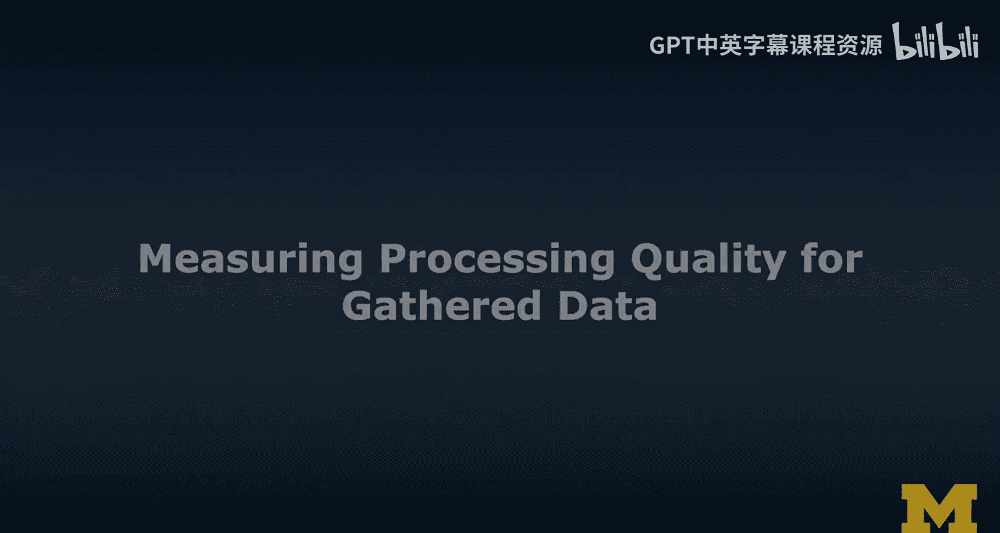
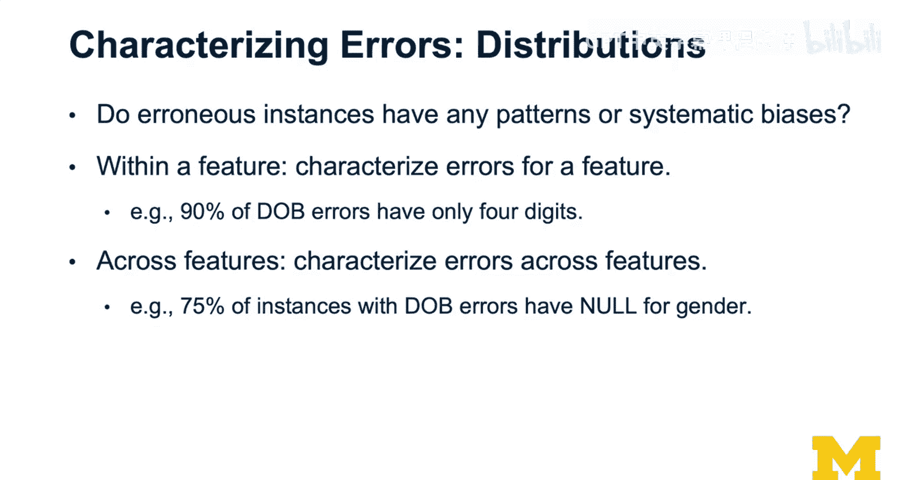
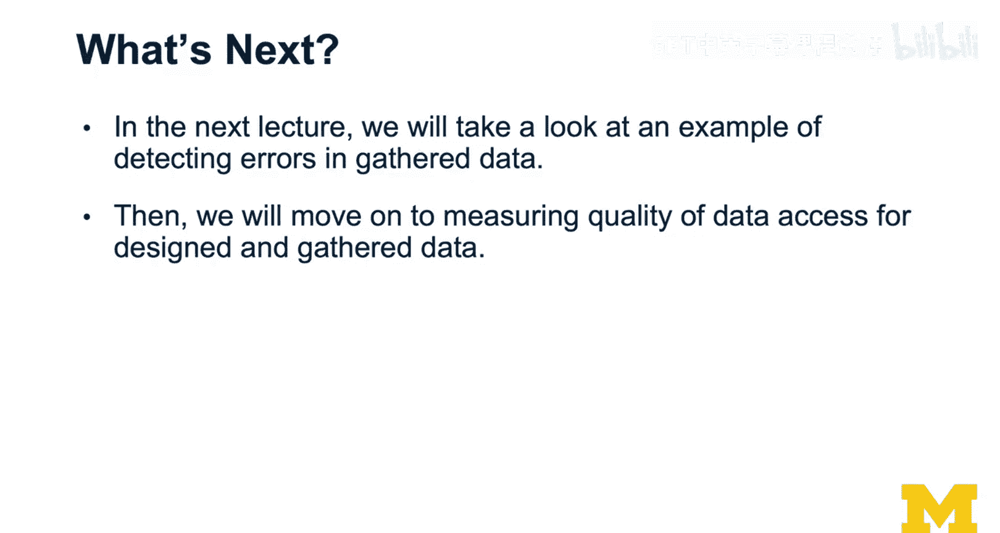

# 11：采集型数据处理质量测量 📊




在本节课中，我们将学习如何测量采集型数据的数据处理质量。我们将探讨量化处理错误的方法，以及在实际数据中识别这些错误的技术。


---

在深入探讨之前，让我们回顾一下在整个知识框架中的位置。之前的课程中，我们已经学习了如何测量数据有效性和数据来源质量。现在，我们将聚焦于测量采集型数据的数据处理质量。

## 量化数据处理错误

要测量数据处理质量，我们可以使用频率和比率来量化处理错误。以下是两种主要方法。

### 基于特征统计错误

第一种方法是统计某个特征上出现无效值的实例数量，并计算其占总实例数的比例。例如，在一个记录出生日期的数据特征中，可能有10%的实例包含无效值。

**公式表示：**
`错误比率 = (某特征无效值的实例数) / (总实例数)`

### 跨特征统计错误

第二种方法是统计在两个或更多特征上同时出现无效值的实例数量。例如，在采集的数据中，我们可能发现5%的实例在“出生日期”和“性别”这两个特征上都有无效值。

**公式表示：**
`跨特征错误比率 = (多个特征上同时存在无效值的实例数) / (总实例数)`

## 分析错误的分布模式

量化数据处理错误的另一个重要方法是分析错误的分布模式。我们需要探究错误实例是否存在特定模式或系统性偏差。

错误可能集中在某个特征的特定模式上。例如，可能发现90%的出生日期错误在格式上只有4位数字（如“MM/DD”），而不是标准的6位数字格式（如“YY/MM/DD”）。

错误也可能在多个特征间存在关联模式。例如，我们收集的数据中，75%存在出生日期错误的实例，其“性别”字段也为空值。这表明出生日期错误可能与性别特征的缺失有关。

## 识别数据处理错误的方法




了解了如何量化错误后，我们来看看如何在采集型数据中发现这些错误。以下是几种常用的方法。

### 人工检查

最直接的方法是人工逐一检查数据条目来搜索错误。这种方法虽然直观且准确，但不适用于大规模的采集型数据，因为这类数据可能包含数百万条实例和数十个特征。

### 借助领域专家

另一种方法是寻求了解数据领域的专家帮助。例如，医生和护士可以提供电子病历中常见的错误列表，而电子病历是生物医学研究中广泛使用的采集型数据。这些专家能有效帮助检测和描述其领域内采集数据的错误，但他们的专业知识可能不适用于不同领域或任务的数据。

### 基于规则的过滤

为了克服人工检查的局限性，我们可以为错误定义规则，并筛选出符合这些规则的实例。

利用名为“正则表达式”的文本处理技术，我们可以在大规模数据中检测不符合特定格式的实例。例如，我们可以过滤掉不符合“MM/DD/YY”格式的出生日期记录。

另一个例子是过滤掉不符合标准电子邮件格式（即“字母数字字符串@域名”）的错误电子邮件地址。

**代码示例（正则表达式过滤日期）：**
```python
import re

# 假设日期格式应为 MM/DD/YY
correct_pattern = re.compile(r'^\d{2}/\d{2}/\d{2}$')

def is_valid_date(date_string):
    return bool(correct_pattern.match(date_string))

# 测试
print(is_valid_date("12/25/23"))  # 输出: True
print(is_valid_date("25/12/23"))  # 输出: False (格式不符)
```

然而，这种基于规则的方法仍然需要我们预先定义错误的格式。

### 使用机器学习算法

为了克服上述限制，我们可以使用机器学习算法来检测异常实例。这种先进的方法可以在大数据中发现未知的错误模式。

但是，为监督式机器学习创建训练数据集可能成本高昂。此外，该方法仍然需要专家检查来验证结果的正确性。

---

在下一讲中，我们将看一个在采集数据中检测错误的具体实例。之后，我们将继续学习如何测量设计型数据和采集型数据的数据访问质量。



## 总结


本节课中，我们一起学习了测量采集型数据处理质量的核心方法。我们首先学习了如何使用频率和比率来量化单个特征及跨特征的处理错误。接着，我们探讨了分析错误分布模式的重要性。最后，我们介绍了从人工检查、专家咨询到基于规则的过滤，乃至机器学习等多种识别数据错误的技术及其各自的优缺点。掌握这些方法，是评估和提升数据质量的关键步骤。