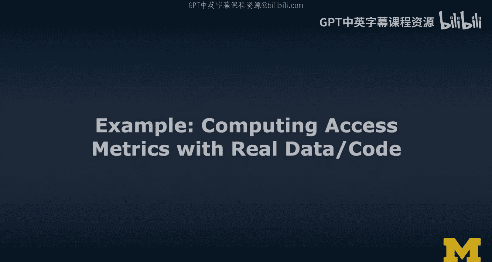
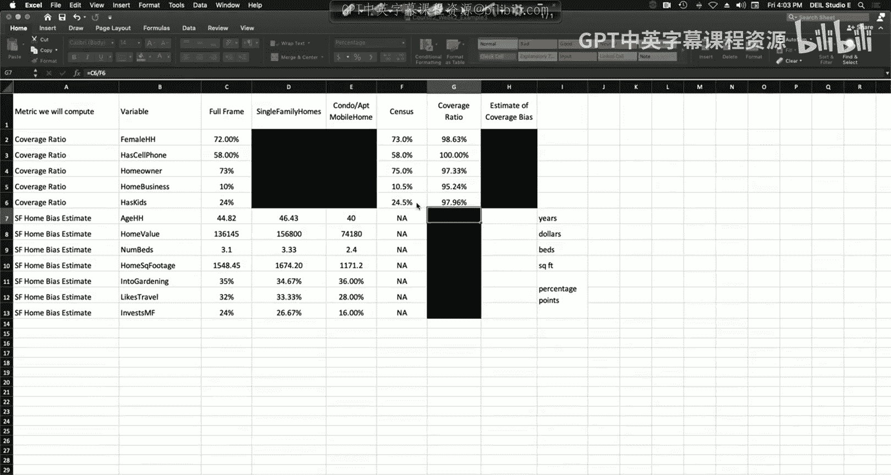
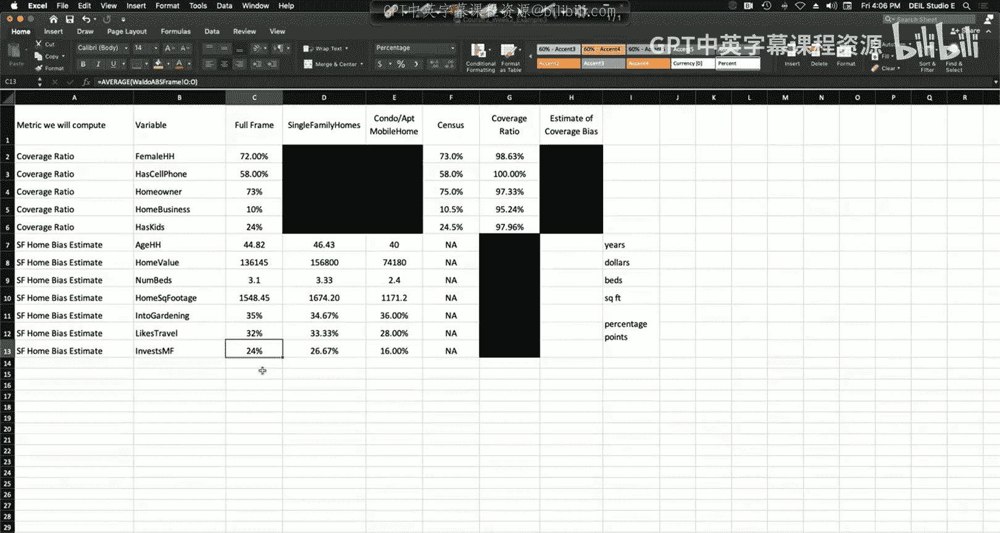
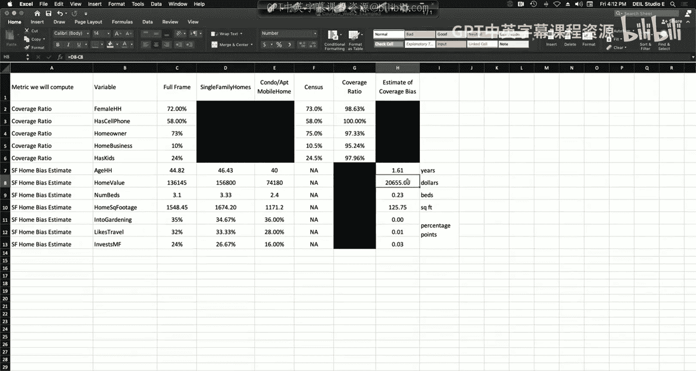

# 14：示例：读取数据与代码实现访问指标计算 📊

在本节课中，我们将通过一个具体示例，学习如何计算数据访问质量的两个核心指标：**覆盖率偏差**和**覆盖率比率**。我们将使用一个假设的地址抽样框架数据，来评估仅使用“独栋住宅”样本可能带来的偏差。

## 概述与数据介绍

上一节我们介绍了数据访问质量的概念和度量指标。本节中，我们来看看如何通过实际数据计算这些指标。

示例数据代表了佛罗里达州沃尔多市的一个假设地址抽样框架及其附加信息。本示例的关键目标是：探索仅使用独栋住宅（由变量 `SF_home = 1` 标识）的地址样本时，可能存在的覆盖率偏差。我们将重点关注用绿色标出（如下划线所示）的关键结果变量。

我们还将计算用粉色标出（同时为粗体）的变量的覆盖率比率。这些变量我们有普查信息和框架信息，因此可以专门计算它们的覆盖率比率。

本示例的所有计算都有对应的公式，位于Excel文件的“计算公式”选项卡下，你可以随时核对。

## 计算覆盖率比率

首先，我们来计算覆盖率比率。覆盖率比率衡量的是你的抽样框架在特定变量上对总体的覆盖程度，它本身不是偏差度量。

计算覆盖率比率需要两个值：一是来自完整抽样框架的变量估计值（如平均值或比例），二是来自外部黄金标准源（如人口普查）的对应值。

以下是计算步骤：

1.  **获取框架估计值**：对于想要计算覆盖率的变量，我们从完整框架数据中计算出其汇总度量（例如，对于0/1变量，计算其平均值即比例）。
2.  **获取普查值**：从外部可信源（如人口普查数据）获取对应区域的相同变量的值。
3.  **应用公式**：覆盖率比率定义为框架估计值除以普查黄金标准值，通常以百分比表示。

其核心公式为：
**覆盖率比率 = (框架估计值 / 普查值) * 100%**

覆盖率比率有可能超过100%。这可能由框架中的重复记录、归属错误（如地址城市编码错误）等原因导致。比率大于100%是一个需要调查的质量信号，可能提示存在数据准确性问题。

根据计算，对于沃尔多市的这个框架，在多个关键变量上覆盖率都接近或达到100%，表明该框架能较好地代表总体。

## 计算覆盖率偏差

接下来，我们计算覆盖率偏差。我们的目标是评估：如果仅使用“独栋住宅”这个子集作为数据来源，是否会对我们关心的结果变量产生系统性偏差。

计算覆盖率偏差也需要两个关键值：
*   **Y_bar_all**：完整框架中某个变量的平均值。
*   **Y_bar_domain**：我们关注的特定领域（本例中即“独栋住宅”子集）中该变量的平均值。

以下是具体步骤：

1.  **计算完整框架估计值 (Y_bar_all)**：对于每个关心的变量（如年龄、房屋价值），计算其在完整地址框架中的平均值。
2.  **计算领域估计值 (Y_bar_domain)**：将框架数据过滤，仅保留 `SF_home = 1` 的记录，然后计算相同变量的平均值。
3.  **应用公式**：覆盖率偏差估计值即为领域估计值与完整框架估计值之差。

其核心公式为：
**覆盖率偏差估计值 = Y_bar_domain - Y_bar_all**

根据计算结果，我们发现：
*   使用独栋住宅样本会略微高估户主年龄（约1.6岁）。
*   会显著高估房屋价值（约20，000美元）和房屋面积（约125平方英尺）。
*   在“喜欢园艺”这个变量上几乎没有偏差。
*   在“投资共同基金”的比例上略有高估（约3个百分点）。

这表明，覆盖率偏差是**变量特定**的。有些变量可能几乎没有偏差，而另一些则可能存在值得关注的偏差。如果我们仅使用独栋住宅样本来估计房屋价值或面积，可能需要考虑并调整这种覆盖率偏差。

## 总结与资源

本节课中我们一起学习了如何通过实际数据计算数据访问质量的两个重要指标。

*   **覆盖率比率**帮助我们评估框架对总体在特定特征上的覆盖充分性。
*   **覆盖率偏差**则帮助我们识别，如果仅使用某个特定子集（如独栋住宅）作为数据源，可能会对目标估计引入何种系统性误差。

这些计算是评估和改进抽样框架数据质量的基础。如果你想自行演练，所有计算细节和公式都已在本示例的“计算公式”选项卡中列出，可供参考和验证。