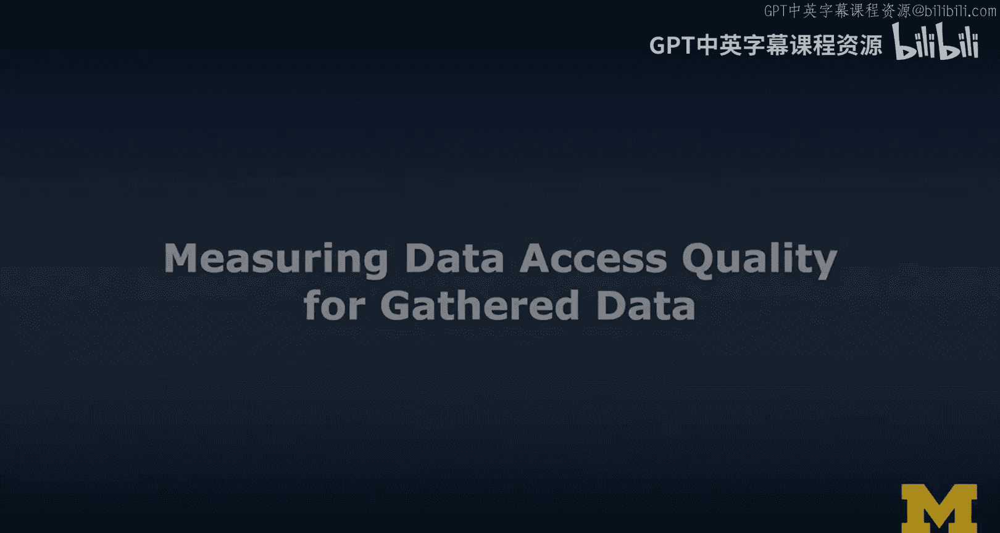
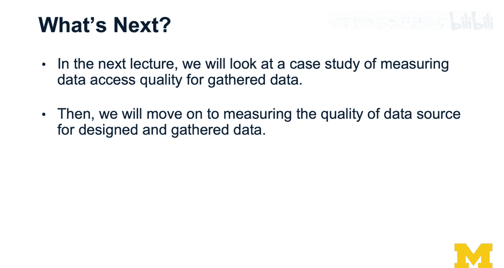

# 15：采集型数据访问质量测量 📊

在本节课中，我们将学习如何测量采集型数据的访问质量。数据访问质量关注的是用户能否获取到所需的数据，以及所获取的数据在多大程度上能代表总体数据。我们将探讨在完全开放和受限访问两种不同场景下的测量方法。

## 课程概述

上一节我们介绍了数据质量的不同维度，本节中我们来看看如何具体测量“采集型数据”的访问质量。数据访问质量的核心在于评估用户获取数据的完整性和代表性。

## 完全开放访问场景下的测量

许多开放数据平台为用户提供了对其数据的完全访问权限。例如，美国政府机构通过免费API提供对其公共数据的访问，用户可以不受太多限制地下载整个数据集的快照。

在这种完全开放的场景下，数据访问质量的测量相对直接。我们可以通过评估用户是否能完整获取必要的数据来衡量。

以下是具体的测量方法：
*   我们可以统计收集到的数据实例数量，并将其与可用的数据实例总数进行比较，得到一个比率或百分比。公式可以表示为：**数据获取率 = (采集到的数据实例数 / 可用的数据实例总数) × 100%**。

## 受限访问场景下的测量

然而，并非所有数据平台都是完全开放的。出于保护知识产权、用户隐私设置以及防止第三方应用滥用等原因，像Twitter、Facebook或YouTube这样的社交媒体平台通常对数据访问施加限制。

它们通常通过API为用户提供有限数量的信息。例如，Twitter.com只允许访问1%的推文，而YouTube.com每天只允许5000次API调用。

在这种受限访问的场景下，数据访问质量可以通过评估采集到的数据在多大程度上能代表总体数据来衡量。

一些研究者使用了排名顺序相关性来测量。例如，他们比较了在特定时间范围内，通过API采集的Twitter数据中的前100个热门话题与总体Twitter数据中的前100个热门话题之间的相关性。

## 受限访问数据的代表性问题

正如你可能怀疑的那样，通过受限访问获取的采集数据可能无法代表总体数据。Twitter.com允许用户通过API收集1%的推文样本，但样本是如何选择的并未完全公开。

一个好消息是社交媒体总体数据是可获得的，但坏消息是它们可能非常昂贵。因此，使用社交媒体数据的研究人员开发了一些方法，用于在受限访问场景下评估数据访问质量。

以下是几种常见的研究思路：

*   **与外部基准数据对比**：一些学者将采集的社交媒体数据与所有行政数据（如人口普查数据）进行对比，以回答“社交媒体用户在美国人口中是随机分布的吗？”这类问题。为此，他们比较了Twitter数据中的地理位置分布与美国人口普查数据中的人口分布。结论是，采集的推文数据并不能代表美国人口，这意味着使用Twitter数据对现实世界人口进行有效推断时需要谨慎。
*   **与付费总体数据对比**：另一组学者直接将采集的Twitter数据与一个国家的Twitter总体数据进行了比较。他们使用了Twitter FireHose（需支付高昂费用以获得对全部Twitter数据的完全访问权限）。根据他们的研究，在日本随机选择的Twitter用户能够代表日本人口。
*   **不同API采集数据间的交叉验证**：当无法获得总体数据的完全访问权限时，几位学者比较了从同一数据源通过不同访问API获得的数据集之间的重叠部分。他们计算了在不同数据规模、时间范围和主题下，重叠内容所占的比率。
*   **样本内部特征偏差估计**：其他研究者在无法访问完整Twitter数据的情况下，比较了从同一来源通过不同访问方法获得的样本数据中，特征分布（如提及、转发）和结构信息的偏差。他们发现，结构属性比特征分布更不易产生偏差，但两者的偏差都非常高。

## 总结与预告

本节课中，我们一起学习了测量采集型数据访问质量的方法。我们了解到，在完全开放访问下，可以通过计算获取比率来测量；而在受限访问下，则需要通过各种方法（如相关性分析、与基准数据对比、交叉验证等）来评估采集数据的代表性。

下一讲，我们将通过一个案例来具体看看如何测量采集型数据的访问质量。之后，我们将继续前进，学习如何为设计和采集的数据测量数据源的质量。