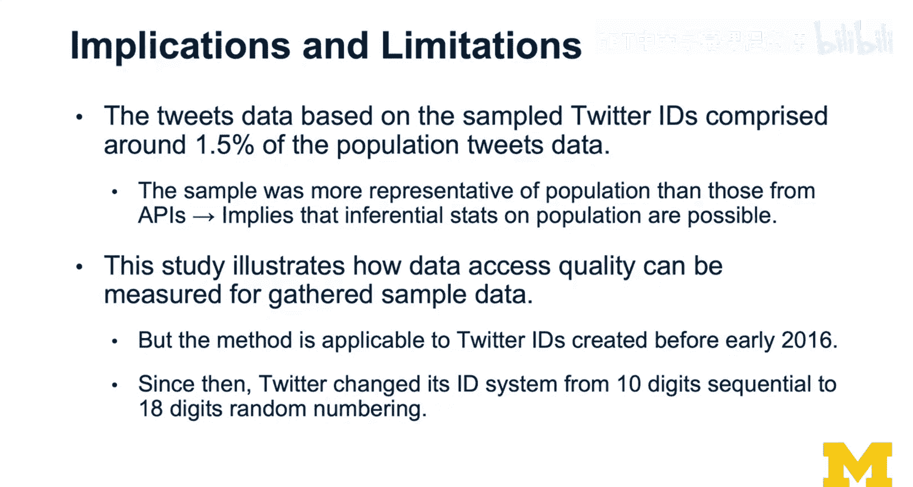

# 16：案例研究：Twitter采集数据访问质量评估 📊

在本节课中，我们将学习一个评估Twitter数据采集访问质量的案例研究。我们将探讨如何衡量通过API获取的样本数据是否能代表Twitter的总体数据，并了解一项具体研究的方法与发现。

---

上一节我们介绍了数据质量评估的总体框架，本节中我们来看看一个具体的应用案例：评估Twitter数据采集的访问质量。

我们通常通过Twitter的API来采集数据，但API提供的数据只是整个Twitter数据海洋中的一个小子集。这是因为对Twitter总体数据的访问受到限制，通常只能获取到样本数据。在大多数情况下，API仅提供特定时间范围内约1%的推文。

这里引出一个关键问题：**采集到的样本数据是否能代表总体数据？** 许多研究者认为，通过API采集的Twitter数据很可能存在偏差。

那么，研究者们是如何衡量采集数据的访问质量的呢？基本方法是比较目标总体数据与采集到的样本数据之间的特征差异。

以下是过往研究的主要方法：
*   大多数研究者使用**社交网络度量指标**（如中心性、连通性）来评估基于特定话题或关键词采样的Twitter数据的访问质量。
*   但他们发现，数据的代表性会严重受到热门关键词或事件的影响。

与上述使用网络指标的研究不同，一项近期研究采用了基于**采样用户ID**的方法来衡量数据访问质量。让我们来详细看看这项有趣的研究。

---

在2019年的一项研究中，Haino博士和Hay Fehe博士两位研究者按以下步骤收集了160万个Twitter用户ID：
1.  他们在1与2016年时最新的Twitter用户ID之间生成随机数。这在当时是可行的，因为直到2016年，Twitter的用户ID都是按顺序分配的10位数字。
2.  他们检查每个ID是否对应一个活跃账户，并且语言设置为日语。
3.  他们重复上述步骤，直到样本数量不再增加。

随后，他们使用Twitter的REST API为这些选定的用户ID采集了所有可用的推文，最终收集了总计5亿条推文。

数据采集完成后，研究者获得了一个名为Crimson Hexagon（现为Brandwatch）的商业全量推文档案库的访问权限。他们从中提取了2016年6月22日至7月25日期间，关于日本两大主要政党（自民党和民主党）的所有历史推文作为总体数据。

接着，他们比较了这部分总体数据与他们采集的样本数据之间的特征。为此，他们在两个数据集上，针对**关键词数量**和**每日Top 100话题**进行了普通最小二乘回归分析。

这项研究的主要发现是：
*   关于关键词趋势：“总体数据中的关键词趋势在样本数据中得到了非常精确的复现。”回归分析的R²值非常高，对于自民党和民主党，所有值都在0.97或0.98以上。
*   关于每日Top 100话题：“样本数据中的词汇使用模式和词语关系模式，与总体数据中的模式高度相似。”OLS回归结果再次显示出高R²值，达到0.97。这里的话题是通过LDA主题建模技术确定的，该技术的细节可在幻灯片指定的参考文献中找到。

---

那么，这个案例研究告诉我们关于Twitter数据访问质量的哪些信息呢？

根据该研究：
1.  通过采样的Twitter用户ID收集的推文，约占总体推文数据的1.5%。
2.  与通过API直接采集的样本数据相比，这种基于用户ID采样的数据对总体的**代表性更强**。
3.  这意味着，使用基于Twitter用户ID的样本数据，有可能对总体进行有效的统计推断。

这项研究展示了如何为样本数据测量数据访问质量。但需要注意的是，该方法仅适用于2016年初之前创建的Twitter用户ID。自那以后，Twitter将其ID系统从10位顺序编号改为了18位随机编号，因此该方法无法在近期数据上复现。

---

本节课中，我们一起学习了通过一个具体案例来评估Twitter数据采集访问质量的方法。我们了解到，通过比较样本数据与总体数据的特征（如关键词趋势和话题分布），并使用回归分析等统计工具，可以量化样本的代表性。尽管该案例中的具体采样方法受限于Twitter平台规则的变更，但其**“通过比较来评估代表性”**的核心思路，为衡量数据访问质量提供了有价值的参考。