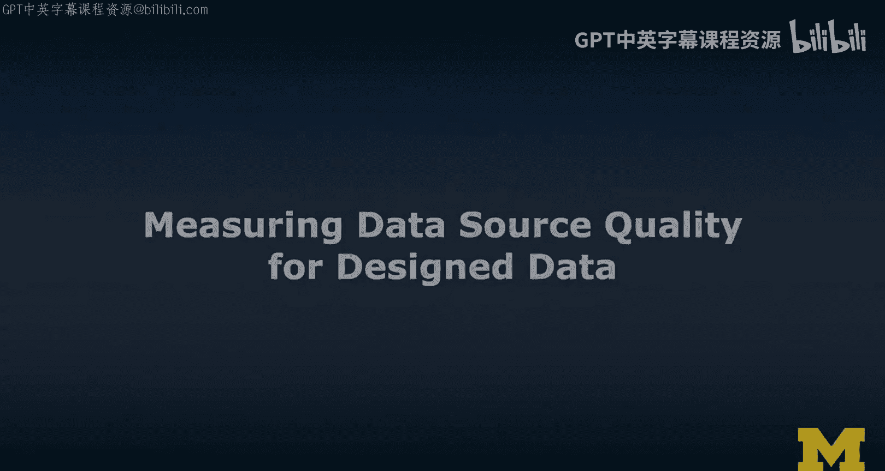
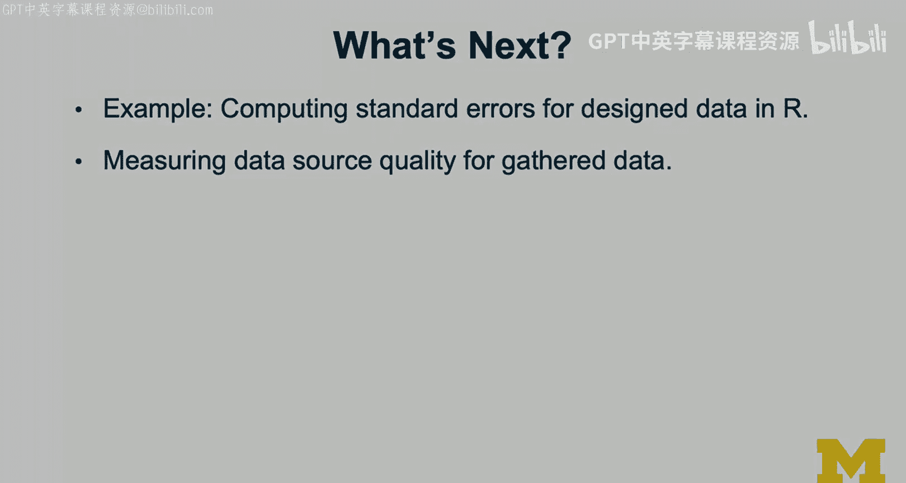

# 17：设计型数据源质量测量 📊

在本节课中，我们将要学习如何测量设计型数据源的质量，重点关注抽样误差及其度量方法。我们将探讨抽样误差的定义、影响因素，以及如何通过标准误和设计效应等指标来量化数据源的质量。

---

上一节我们介绍了数据质量框架的宏观概念，本节中我们来看看设计型数据源中可能出现的误差。这些误差主要发生在数据“表示”层面，即从抽样框中抽取样本的过程。

数据源质量的核心，在于衡量从抽样框中抽取样本这一过程的质量。最常见的度量指标是**抽样误差**。

抽样误差的定义是：由于采用随机抽样而非对全部个案进行普查，所导致的**样本估计值**与**真实总体参数**之间的差异。因此得名“抽样误差”。

为了理解抽样误差，我们可以观察假设的抽样分布，看看在同一设计下可能获得的各种估计值。

以下是一个模拟示例：我模拟了一个包含10万个单元、均值为2的总体。我知晓整个总体及其真实均值。然后，我使用三种不同设计（即不同样本量）从该总体中抽取了1000个样本，并计算了每个样本的均值。

在获得这1000个均值估计值后，我绘制了三种不同样本设计下的分布图。这三种设计的样本量分别为：较小的5，稍大的10，以及更大的50。从图中可以明显看出样本量对抽样分布的影响。

我们注意到，**更大的样本量会导致更小的抽样误差**，即分布更窄。因此，一般来说，**样本量越大，抽样误差越小**。

在调查数据的统计分析中，一个非常常见的做法是估计**标准误**，以此作为衡量抽样误差的一种方法。

**估计标准误**是估计量抽样分布的标准差的估计值。这个分布描述的是，如果我们在同一设计下抽取成千上万个概率样本，所得到的估计值会如何分布。**更小的标准误代表更精确的估计**，通常与更大的样本量相关。

除了样本量，样本设计的其他关键特征也会影响抽样误差。以下是主要影响因素：

*   **分层**
*   **整群**
*   **加权**

事实上，我们需要专门的软件来评估这些特征对标准误估计的影响。以下是三个常用的软件示例（也存在其他软件）：

1.  **Stata**：使用 `svy` 系列命令。
2.  **R**：推荐使用 `survey` 包。
3.  **SAS**：使用 `PROC SURVEY` 过程。

例如，如果我想使用Stata软件来估计一个加权调查中身体质量指数均值的标准误，我会使用屏幕上所示的这类命令。通过这种方式，我们能够估计在假设重复抽样下的抽样误差。在此案例中，我们纳入了抽样权重和分层信息，这些是设计中的关键要素，对于获得适用于该设计的标准误估计至关重要。

衡量数据源质量的另一种方法是计算**设计效应**，它是衡量样本设计统计效率的指标。

**设计效应**的计算公式为：
`设计效应 = 实际设计下统计量的方差 / 相同样本量下简单随机抽样的方差`

公式分子中的差异仅由设计中的**加权、分层和整群**引起。因此，设计效应反映了我们的设计相比于相同样本量的简单随机抽样的效率。

*   当**设计效应小于1**时，样本设计比简单随机抽样更高效。例如，分层通常能降低方差，因此如果分层效果强，我们可能得到小于1的设计效应。
*   当**设计效应大于1**时，样本设计效率低于简单随机抽样。
*   在实践中，设计效应**通常大于1**，因为样本设计常常包含整群，并且几乎总是包含不等权重。因此，我们通常预期设计效应会大于1。

接下来，我们将看一个在R中计算针对样本设计调整后的标准误的例子。然后，我们将转向测量**采集型数据**的数据源质量。

---

本节课中我们一起学习了设计型数据源的质量测量。我们明确了抽样误差是由于抽样而非普查引起的估计偏差，并了解到更大的样本量通常能减小抽样误差。我们介绍了通过估计标准误来衡量抽样误差，并认识到分层、整群和加权等设计特征会影响标准误，需要使用专业软件进行计算。最后，我们引入了设计效应的概念，它用于比较实际样本设计与简单随机抽样的统计效率，在实践中通常大于1。