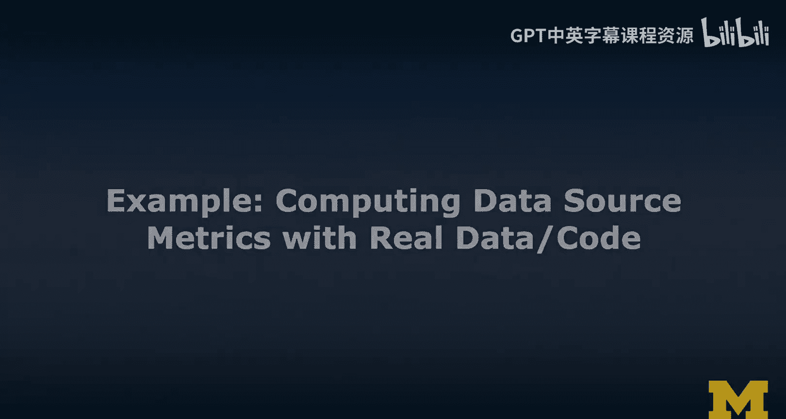
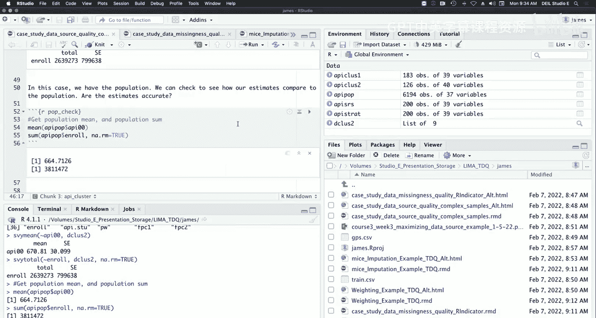
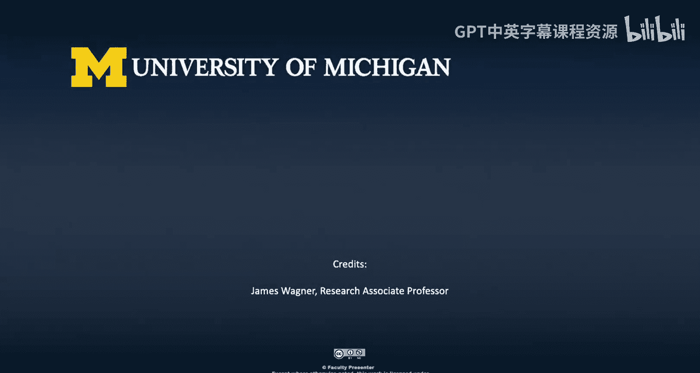

# 18：示例：真实数据与代码实现数据源指标计算 📊




在本节课中，我们将使用真实数据和R代码，来学习如何为设计数据（如调查数据）计算数据源质量指标。我们将使用R Markdown环境，通过`survey`包来分析复杂抽样设计的数据，并计算经过设计调整的估计值及其标准误。

## 概述：使用R的survey包分析复杂抽样数据

上一节我们介绍了数据质量度量的理论框架。本节中，我们来看看如何在实际操作中，使用R语言及其`survey`包来处理和分析遵循复杂抽样设计（如分层、整群抽样）的调查数据。我们将通过两个示例来演示：一个来自`survey`包自带的示例数据集，另一个则来自真实的大型全国性健康调查。

## 加载survey包与示例数据

首先，我们需要加载`survey`包并查看其自带的示例数据集。这个数据集名为`api`，它包含了加利福尼亚州所有学校的学术表现指数（API）数据。

```r
# 加载survey包
library(survey)

# 加载api数据集
data(api)

# 查看总体数据
# apipop是总体数据
dim(apipop) # 查看记录数
mean(apipop$api00) # 计算2000年API得分的总体均值
sum(apipop$enroll) # 计算总注册学生数
```

运行上述代码后，我们得到总体信息：共有6194条记录（即学校），2000年API得分的总体均值为664.71，总注册学生数约为380万。这些是“真实”的总体值，在通常的调查中我们无法获得，但在此作为示例用于后续比较。

## 分析两阶段整群抽样样本

接下来，我们将分析`api`数据集中的一个子集`apiclus2`，它代表了一个两阶段整群抽样样本：首先抽取学区（`dnum`），然后在被抽中的学区内抽取学校。

为了正确分析这种设计的数据，我们需要使用`svydesign()`函数来指定抽样设计信息。

以下是`svydesign()`函数关键参数的说明：
*   **ids**: 用于指定整群ID的公式或数据框，从最大层级到最小层级。`~0`或`~1`表示无整群。
*   **fpc**: 有限总体校正因子。当抽样比例较大时使用，可以减小方差估计。在抽样率很小时通常可忽略。
*   **data**: 要分析的数据集名称。

现在，让我们为两阶段整群样本创建调查设计对象并进行估计。

```r
# 为两阶段整群样本指定调查设计
dclus2 <- svydesign(id = ~dnum + snum, fpc = ~fpc1 + fpc2, data = apiclus2)



# 查看设计摘要
summary(dclus2)

# 使用设计对象进行估计
# 估计API得分的均值
svymean(~api00, dclus2)
# 估计总注册学生数
svytotal(~enroll, dclus2)
```

运行代码后，我们得到了样本估计的API均值及其**设计调整后的标准误**。这个标准误正确地考虑了样本的整群结构，因此比忽略设计的简单估计更准确。我们还可以将样本估计值（例如API均值约为670.40）与之前已知的总体值（664.71）进行比较，它们接近但不完全相同，这正是抽样误差的体现。

## 分析真实复杂调查：NHANES数据

现在，我们转向一个更复杂的真实调查数据——美国国家健康与营养检查调查（NHANES）。该调查采用分层、多阶段整群抽样设计，并对受访者赋予了权重。我们将分析一个具体问题：“医生是否曾告知您有高胆固醇？”

处理此类数据通常需要更多步骤，包括加载专用包、选择变量、合并数据和重新编码。

```r
# 加载NHANES数据包
library(NHANES)

# 加载所需的数据文件（示例，实际变量名需查阅文档）
# 假设我们已经加载了包含设计变量和问卷变量的数据框 ‘nhanes_design‘ 和 ‘nhanes_ques‘
# 选择需要的变量：设计变量（集群、分层、权重）和感兴趣的问卷变量
design_vars <- nhanes_design[, c("SDMVPSU", "SDMVSTRA", "WTINT2YR")]
question_vars <- nhanes_ques[, "BPQ080"] # 高胆固醇问题

# 合并数据
analysis_data <- cbind(design_vars, question_vars)

# 重新编码变量：1=是，2=否 -> 1=是，0=否，便于计算比例
analysis_data$high_chol <- ifelse(analysis_data$BPQ080 == 1, 1,
                                   ifelse(analysis_data$BPQ080 == 2, 0, NA))
```

数据准备完成后，我们再次使用`svydesign()`函数，但这次需要指定更多设计特征。

```r
# 为NHANES数据指定复杂的调查设计
nhanes_design <- svydesign(id = ~SDMVPSU,       # 集群变量（初级抽样单位）
                           strata = ~SDMVSTRA,  # 分层变量
                           weights = ~WTINT2YR, # 权重变量
                           data = analysis_data,
                           nest = TRUE)         # 指定分层内嵌套集群

# 计算高胆固醇患病率的估计值
# na.rm=TRUE 会删除缺失值（后续课程将讨论插补法）
chol_est <- svymean(~high_chol, nhanes_design, na.rm = TRUE)
chol_est

# 计算设计效应
deff(chol_est)
```

以下是运行结果的关键解读：
*   **均值估计**：约为0.314（31.4%），这是经过加权调整后估计的美国成年人中被医生告知有高胆固醇的比例。
*   **标准误**：这是一个**设计调整后的标准误**，它正确地考虑了NHANES调查的分层、整群和不等权重设计。
*   **设计效应**：约为3.98。设计效应的公式为：`设计效应 = 复杂设计下的方差 / 简单随机抽样下的方差`。这意味着，与此样本量下的简单随机样本相比，当前复杂设计的**统计效率更低**，其有效样本量约为原始样本量的 `1/3.98`。

你可能会问，既然统计效率低，为何要采用这种设计？原因是**成本与可行性**。对美国全国人口进行简单随机抽样成本极高（例如，可能需要驱车数百英里只访问一个人）。而整群抽样（例如，先抽取地理区域，再在该区域内访问多人）能大幅降低实地调查成本，使得像NHANES这样的大规模调查得以实施。这是在统计精度与调查成本/可行性之间做出的权衡。

## 查看与使用输出报告

在使用R Markdown进行分析时，生成包含代码、结果和解释的HTML或PDF报告是非常好的实践。这可以作为你分析工作的记录，也便于与他人交流结果。你应该熟悉如何解读`svymean()`等函数输出的表格，其中包含了估计值、标准误和可能的设计效应信息。

## 总结




本节课中我们一起学习了如何使用R语言的`survey`包处理复杂抽样调查数据。我们首先用内置的`api`数据集练习了如何为两阶段整群样本指定设计并计算估计值。然后，我们使用真实的NHANES数据，完整演示了从加载数据、指定分层、整群和权重变量，到最终计算经过设计调整的患病率估计和设计效应的全过程。关键点在于，对于非简单随机抽样的数据，必须使用`svydesign()`函数正确声明其设计特征，才能通过`svymean()`、`svytotal()`等函数得到有效的推断结果。设计效应量化了复杂设计对估计效率的影响，是评估调查设计优劣的重要指标。