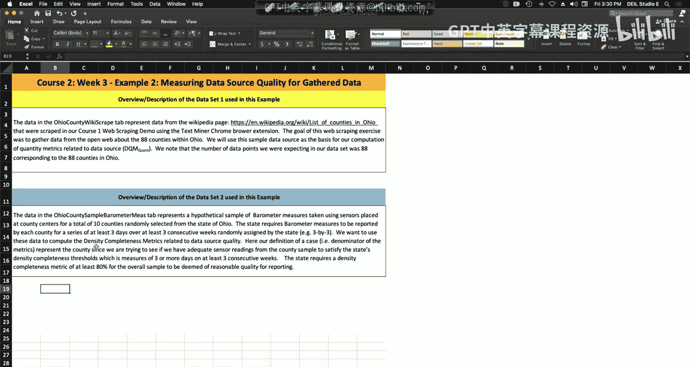
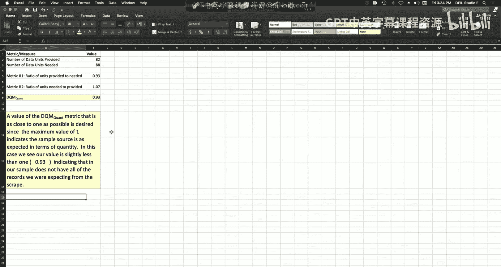

# 20：示例：真实数据与代码实现数据源质量指标 📊

在本节课中，我们将通过两个具体示例，学习如何计算和评估“采集数据”的数据源质量指标。我们将重点关注**数量**和**密度完整性**这两个维度的度量方法。

---

## 概述

上一节我们介绍了评估采集数据源质量的多种维度和指标。本节中，我们将通过两个实际数据集的例子，具体演示如何计算**数量质量指标**和**密度完整性指标**。这些计算将帮助我们量化数据源的质量，并为后续的质量改进提供反馈。

---

## 示例一：计算数量质量指标

首先，我们来看一个关于数量指标的示例。我们将使用在课程一中从俄亥俄州维基百科页面抓取的县数据。已知俄亥俄州共有88个县。

### 数据准备与观察

抓取到的数据表格共有83行。其中，第一行是表头，因此实际提供的数据单元（即县记录）为 **82** 个。而我们期望的数据单元数量是 **88** 个（即所有县）。

### 指标计算原理

数量质量指标的计算基于上一讲提到的两个比率的最小值。以下是计算步骤：

1.  **第一个比率 (R1)**： 已提供的数据单元数量与所需数据单元数量之比。
    *   **公式**: `R1 = (提供的单元数) / (需要的单元数)`
    *   在本例中: `R1 = 82 / 88 ≈ 0.932`

2.  **第二个比率 (R2)**： 所需数据单元数量与已提供数据单元数量之比（即R1的倒数）。
    *   **公式**: `R2 = (需要的单元数) / (提供的单元数)`
    *   在本例中: `R2 = 88 / 82 ≈ 1.073`

3.  **最终数量质量指标 (Q)**： 取R1和R2中的**最小值**。
    *   **公式**: `Q = min(R1, R2)`
    *   在本例中: `Q = min(0.932, 1.073) = 0.932`

### 结果解读与意义

计算得到的数量质量指标值为 **0.93**。该指标的最佳值为1，表示数据源在数量上完全符合预期。本例中0.93的值表明，我们的网络爬虫漏掉了6个县的记录。

这个指标的作用在于：
*   **质量反馈**： 它明确提示数据采集过程存在缺口。
*   **指导改进**： 它促使我们返回检查网络爬虫，找出遗漏6条记录的原因，从而在整体数据质量管理流程中形成一个改进的反馈循环。

---

## 示例二：计算密度完整性指标

接下来，我们看一个更复杂的例子——计算密度完整性指标。假设我们从俄亥俄州随机抽取的10个县收集气压计测量数据。

### 业务规则与指标定义

州政府要求数据集必须满足以下条件，才被视为具备报告所需的足够质量：
*   每个县必须至少连续报告**3周**。
*   每周内必须至少有**3天**进行了测量。

我们的目标是计算满足此密度完整性阈值（即“连续3周，每周至少3次测量”）的县所占的百分比。**案例**在此处的定义是“县”。

### 手动计算演示

以下是判断单个县是否达标的方法：

*   **艾伦县**： 检查其数据发现，连续4周，每周都有3次测量。因此，**艾伦县达标**。
*   **巴特勒县**： 第一周只有2次测量，不满足“每周至少3次”的条件。因此，**巴特勒县不达标**。

按此方法检查全部10个县，假设最终有7个县满足条件。

### 自动化计算与公式

对于大规模数据，我们可以通过编程或公式自动化这个判断过程。以下是核心计算逻辑：

1.  **计算每周达标情况**： 对每个县每周的数据，判断测量次数是否 ≥ 3。如果是，则该周标记为1，否则为0。
    *   **代码逻辑**: `weekly_pass = 1 if (count(measurements_in_week) >= 3) else 0`

2.  **计算连续达标周数**： 对每个县，检查是否存在连续至少3周，其`weekly_pass`值均为1。
    *   **代码逻辑**: 可使用滑动窗口算法遍历每周的`weekly_pass`序列。

3.  **汇总计算最终指标**：
    *   达标县数量 = 满足“连续3周达标”条件的县的数量（假设为7）。
    *   总县数 = 数据源中的县总数（本例为10）。
    *   **密度完整性指标** = (达标县数量 / 总县数) * 100%
    *   **公式**: `Density_Completeness = (Count_Qualified_Counties / Total_Counties) * 100%`
    *   在本例中: `(7 / 10) * 100% = 70%`

### 结果解读与决策

计算得到的密度完整性指标为 **70%**。由于州政府要求的最低阈值是 **80%**，因此这个采集到的数据源**未达到**最低质量标准，将被州政府拒绝用于报告。

这个例子展示了如何将一个涉及多维度（时间跨度和测量频率）的业务规则，转化为一个可量化的数据源质量指标。

---

## 总结

本节课中，我们一起学习了两个评估数据源质量的核心指标的实际计算：
1.  **数量指标**： 通过比较已获取与期望的数据单元数量，快速评估数据采集的完整性。其公式为 `Q = min(提供数/需要数， 需要数/提供数)`。
2.  **密度完整性指标**： 用于评估数据在特定维度和时间跨度上的覆盖密度，通常涉及更复杂的业务规则判断。其核心是计算满足复杂条件的“案例”所占的百分比。

通过这两个示例，我们可以看到，量化数据源质量不仅能帮助我们发现问题，更能为数据采集流程的持续优化提供明确的依据和方向。