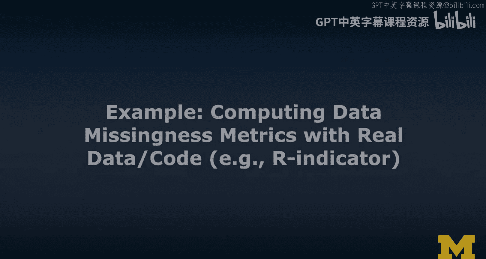
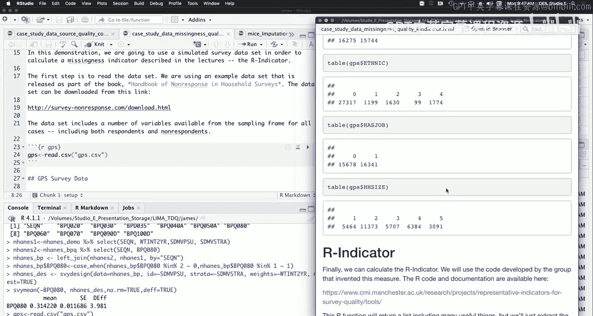

# 22：示例：真实数据与代码实现缺失率指标计算 📊




在本节课中，我们将学习如何使用真实数据和代码来计算数据缺失率指标。我们将使用R Markdown，并重点实现一个名为R指标的指标。这个指标在之前的讲座中简要介绍过，本节课我们将通过R代码来具体实施这个计算过程。

## 概述

本次演示将使用一个模拟的调查数据集来计算缺失率指标。我们将使用的指标是讲座中描述的R指标。R指标用于衡量调查样本中受访者与整体样本在特征上的平衡程度，其值介于0到1之间，1表示受访者与样本在特征上完全平衡。

## 第一步：读取数据集

首先，我们需要读取数据集。示例数据集来自《无应答与家庭调查手册》一书，可以从指定链接下载。该数据集包含抽样框中所有案例（包括受访者和未受访者）的多个变量，这正是我们计算R指标所需的条件。

以下是读取数据的第一步：加载数据。

```r
# 假设数据文件名为 'survey_data.csv'
data <- read.csv('survey_data.csv')
```

## 第二步：单变量分析

在计算R指标之前，我们先对数据进行单变量分析，以熟悉数据的基本情况。

我们知道数据集中同时包含受访者和未受访者，但我们首先需要了解平均响应率。数据集中有一个名为 `response` 的指示变量，其值为1表示受访，为0表示未受访。该变量的均值即为未加权的响应率。

```r
# 查看响应情况
table(data$response)
# 计算平均响应率
response_rate <- mean(data$response)
print(paste("响应率约为：", round(response_rate * 100, 1), "%"))
```



接下来，我们查看数据集中的其他一些变量，例如年龄、家庭中是否有儿童、种族构成、个人是否有工作以及家庭规模。这些变量来自荷兰的一个示例，其人口登记信息非常详细，可作为统计机构的抽样框。

```r
# 查看年龄分布（假设年龄变量名为 'age_category'）
table(data$age_category)
# 查看家庭中是否有儿童（假设变量名为 'has_children'）
table(data$has_children)
# 查看种族构成（假设变量名为 'ethnicity'）
table(data$ethnicity)
```

## 第三步：计算R指标

完成单变量分析后，我们开始计算R指标。我们将使用该指标的发明者团队开发的代码。R代码和文档可在指定网站获取。

该R函数将返回一个列表，其中包含许多有用的信息，但我们主要提取一个指标：未经调整的R指标。如果您对R指标的细节感兴趣，可以查阅相关文档和出版物。

模型的选择非常重要，因此需要考虑哪些变量应作为预测因子。关键不在于寻找统计上显著的预测因子，而在于识别那些可能指示估计中存在潜在偏差的预测因子。例如，如果您认为在最终数据集中代表所有年龄组很重要，则应将年龄作为预测因子纳入模型。

在本演示中，我们将使用数据集中的几个预测因子，包括年龄（13个类别）、家庭中是否有儿童、种族、性别、个人是否有工作以及家庭规模。

以下是使用R指标开发者提供的代码计算R指标的步骤。

```r
# 加载计算R指标所需的函数
source('R_indicator_functions.R')

# 指定模型
model_formula <- response ~ factor(age_category) + has_children + factor(ethnicity) + factor(gender) + has_job + household_size + factor(household_type) + household_value + marital_status + non_native_region + urban

# 运行模型并计算R指标
# 假设存在样本权重变量 'sample_weight'
r_indicator_result <- calculate_R_indicator(formula = model_formula, data = data, weights = data$sample_weight, return_partial = FALSE)

# 提取并打印未经调整的R指标
unadjusted_R <- r_indicator_result$unadjusted_R
print(paste("未经调整的R指标为：", round(unadjusted_R, 2)))
```

R指标函数计算估计响应概率的标准差，并将其转换为R指标。R指标的范围是0到1，1表示受访者与样本之间特征完全平衡。一个约为0.78的指标更接近1而非0，表明平衡性相对较好。

为了使这个指标有意义，我们需要将其与其他调查或同一调查在不同时间点的结果进行比较。

## 第四步：探索响应模式

我们可能希望进一步探索哪些类别的代表性不足。如前所述，R指标有一些功能可以实现这一点。这里，我们将查看模型中一个预测因子的各类别的响应模式，以识别是否有任何子组的响应率较低。

以下是使用R代码进行此分析的步骤。

```r
# 为变量添加清晰的标签以便绘图
data$ethnicity_label <- factor(data$ethnicity, labels = c("Group A", "Group B", "Group C", "Group D"))

# 创建种族与响应的交叉表
cross_tab <- table(data$ethnicity_label, data$response)
print(cross_tab)

# 使用卡方检验查看响应与种族类别之间是否存在关联
chi_test <- chisq.test(cross_tab)
print(chi_test)

# 生成可视化图形以展示不同种族组的响应率
# 此处假设使用关联图函数（需相应包）
# association_plot <- assocplot(cross_tab)
# plot(association_plot)
```

分析结果中，一个很小的P值表明响应与数据集中的种族变量之间存在某种关联，即某些种族组的响应率与其他组不同。生成的图形可以帮助我们识别哪些组的响应率较低。例如，第一和第二种族组的响应似乎不太平衡。利用这些信息，我们可以决定改变调查设计、针对特定子组或采取其他措施，以减少不同组之间的响应率差异。

这只是利用双变量信息来查看不同子组响应情况的一个例子。我们可以在同一数据集中探索更多变量，并利用这些信息改进未来调查的设计。

## 总结


本节课中，我们一起学习了如何计算R指标，包括如何设置模型以及如何查看和解释结果。我们使用真实数据和R代码，通过单变量分析、模型构建和响应模式探索，实践了缺失率指标的计算过程。掌握这些步骤有助于评估和改进数据收集的质量。