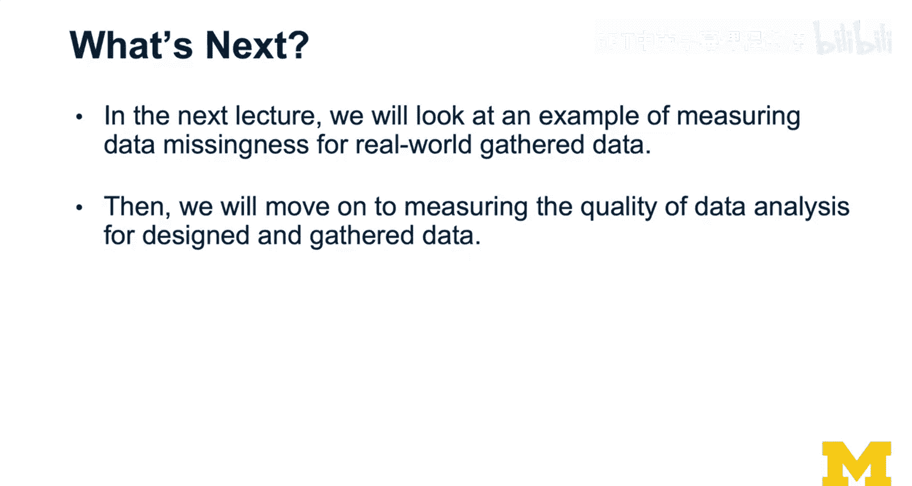

# 23：采集型数据缺失率测量 📊

在本节课中，我们将学习如何测量采集型数据的缺失率。我们将探讨不同的测量方法，这些方法与数据缺失的威胁类型密切相关，并通过具体的研究案例来加深理解。

## 课程概述

在之前的课程中，我们学习了如何测量设计型数据的缺失率。本节课程，我们将把目光转向采集型数据。根据数据缺失发生在数据源、采集还是处理环节，我们可以采用不同的方式进行测量。这些测量方法与我们在第一门课程中学到的数据缺失威胁紧密相关。

## 测量方法与缺失威胁

以下是几种常见的测量方法，它们对应着不同的数据缺失威胁：

*   **针对特定威胁的测量**：如果数据缺失是由于无响应、无分发、数据不可用或数据清洗错误造成的，我们可以通过计算缺失值的**频率、比率和分布**来进行测量。
*   **针对链接缺失的测量**：如果数据在链接过程中缺失，我们可以计算**假阴性实例**的数量。假阴性指的是本应被链接但链接失败的案例。例如，在链接包含作者和论文信息的书目数据集时，同一作者在不同数据集中使用不同格式的名字，就可能导致链接失败，产生假阴性案例。我们可以将这些假阴性案例的数量视为链接数据集的缺失值。
*   **针对群体偏见的测量**：如果我们怀疑数据缺失是由于特定群体偏见造成的，可以通过将采集到的数据与**总体或具有代表性的样本**进行比较来测量缺失率。

## 测量实例分析

为了更好地理解这些测量方法，让我们来看两个具体的研究案例。

### 实例一：电子健康记录研究

第一个例子是Hans及其同事在2016年进行的一项研究。该研究关注电子健康记录中常见的“体重”字段缺失问题。研究从一个选定的电子健康记录系统中抽取了约8000名患者的样本。研究发现，67%的患者在体重字段上有完整数据，但其余33%的患者数据缺失。该研究使用了一个字段中**缺失值数量与总实例数的比率**来衡量数据缺失率。为了纠正缺失问题，研究还对信息缺失的患者进行了电话调查，询问他们未报告体重的原因。

### 实例二：学术数据库链接研究

第二个例子是Kim博士和Smith博士在2021年进行的研究。学者们经常链接“开放研究者与贡献者身份”数据库和出版物记录，以确定谁发表了哪些论文。一种流行的链接方法是，如果两个数据库中的姓名具有相同的姓氏和名字首字母，就将它们链接起来。该研究表明，由于超过27万个姓名实例在不同数据库中以不同的姓氏和名字全称格式记录，这种方法未能成功链接它们。在这项研究中，**未能正确链接的姓名对数量**被用作衡量OID与出版物记录之间链接过程中值缺失的指标。

## 总结与预告

本节课我们一起学习了测量采集型数据缺失率的不同方法，包括计算缺失值比率、统计链接过程中的假阴性数量，以及通过与总体比较来识别群体偏见。我们还通过电子健康记录和学术数据库链接的两个具体研究案例，加深了对这些测量方法的理解。

在下一讲中，我们将看一个测量现实世界采集数据缺失率的例子。之后，我们将继续学习如何测量设计型和采集型数据的分析质量。