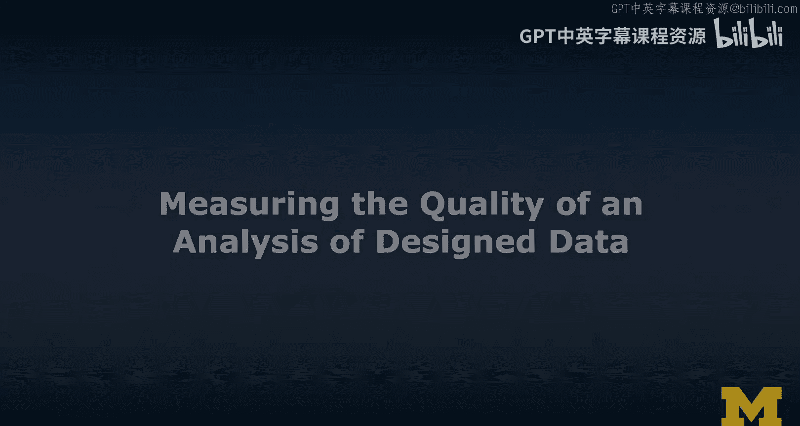
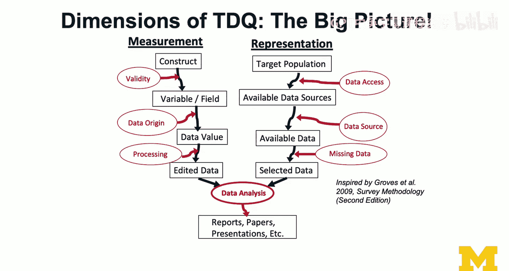
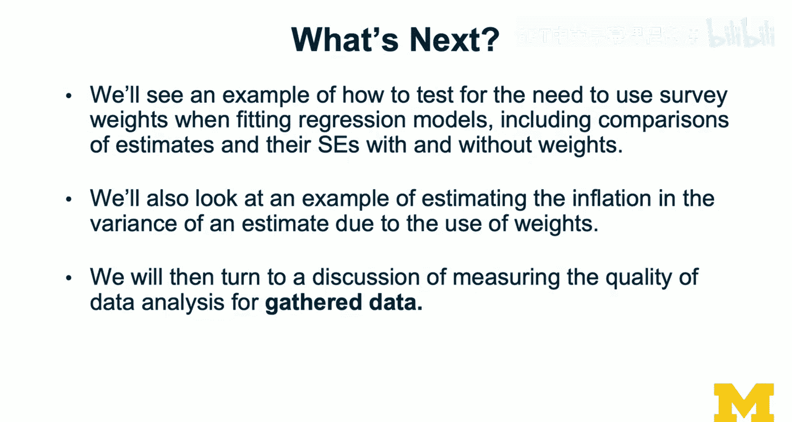

# 25：设计型数据分析质量测量 📊

在本节课中，我们将学习如何衡量针对设计型数据所进行分析的质量。我们已经讨论了在总体数据质量框架的不同维度上衡量数据质量的方法，现在我们将把注意力转向分析阶段本身。确保我们执行的数据分析是高质量的，并且有方法可以量化这种质量，这一点至关重要。

---

上一节我们介绍了数据在测量和表示层面的质量评估。本节中，我们来看看如何量化针对设计型数据所进行分析的质量。

在总体数据质量框架中，测量侧和表示侧最终共同产生了我们将要用于生成报告、论文等的数据。但在分析阶段，我们必须确保执行的是高质量的分析。有多种方法可以量化我们执行的数据分析的质量，本讲将专门讨论针对设计型数据如何做到这一点。

---

### 衡量设计型数据分析的质量

一些设计型数据集会包含**抽样集群**和**抽样层**的指示变量。这些代表了复杂概率样本的特征，在计算调查估计值的标准误时必须加以考虑。例如，在媒体报道中，你可能会听到关于“上次选举中投票给拜登的人口比例”的估计，并伴随一个“误差范围”。为了计算这个误差范围，我们需要确保将抽样计划的重要特征也考虑在内。

以下是处理设计型数据时的最佳实践：

*   **考虑设计特征**：分析数据时，应使用能完全考虑这些设计特征（如集群、分层）的分析方法。
*   **使用调查权重**：如果数据集中包含了调查权重（这些权重允许分析人员对目标总体做出代表性陈述），请确保在分析中也使用这些权重。

然而，我们也需要确保在估计中使用调查权重时，不会人为地过度膨胀估计值的标准误。复杂抽样设计（如整群抽样）本身就会预期地膨胀标准误。但如果权重本身变异性很大，且未能同时校正估计的偏差，就可能会降低我们估计的质量。

---

### 检查调查权重的有效性

当处理包含权重的设计型数据时，可以参考数据集的文档了解这些权重。一个很好的做法是，比较使用权重和不使用权重时的调查估计值及其标准误。

最终调查权重的目的是产生基本无偏的总体估计（校正抽样、无应答、样本与总体不匹配等带来的偏差）。它们应该能调整你的调查估计值，同时又不显著增加估计值的标准误。这涉及到估计质量中的**偏差-方差权衡**：我们希望权重能减少偏差，但不希望它们同时增加估计的变异性。

我们可以通过以下方式检查：

1.  **比较标准误**：比较调整权重和不调整权重时估计值的标准误。如果发现标准误显著膨胀，而点估计值（如均值、回归系数）却没有相应变化，这可能表明权重是“非信息性”的。这意味着权重与我们试图分析的变量不相关，因此未能校正基于该变量的估计偏差。
2.  **计算方差膨胀**：一个通用的工具是计算调查权重的**变异系数**：
    `CV = sd(weights) / mean(weights)`
    然后计算 `1 + CV²`。这个值代表了由于使用权重进行估计，可能导致的估计方差的最大乘性膨胀。例如，如果该值为2，意味着估计方差可能翻倍（增加100%）。关键问题是，权重在膨胀方差的同时，是否更大幅度地减少了偏差？

为了减少权重引入的不必要噪声，可以采用**Q加权**等方法。这涉及基于回归模型预测权重的期望值，然后用实际权重除以预测值，使用调整后的权重进行分析。

---

### 检验是否需要使用权重：Wald 检验

一种检查在分析包含权重的设计型数据时是否需要使用权重的方法是执行以下Wald检验（更多细节可参考相关文献）。

操作步骤如下：

1.  为你感兴趣的变量拟合一个**未加权**的回归模型。
2.  在该模型中，将**权重变量本身**以及**权重变量与模型中所有其他预测变量的双向交互项**作为额外的预测变量加入。
3.  拟合这个扩展的未加权回归模型。
4.  对**所有新加入的项**（权重变量主效应及其所有交互项）的系数执行**Wald联合检验**，检验它们是否同时等于0。

**结果解释**：
*   如果Wald检验**不显著**（即没有证据拒绝所有新增系数为0的原假设），则表明权重不改变回归系数的估计值，即权重对于感兴趣的回归系数是“非信息性”的。在这种情况下，估计这些回归系数时**不需要**使用调查权重。
*   如果Wald检验**显著**，则表明权重会改变回归系数的估计值，即权重是“信息性”的。此时，在拟合你感兴趣的回归模型时，**必须**考虑使用权重。

这种方法有助于确保分析质量：你是仅仅因为使用权重而不必要地膨胀了估计值的标准误，还是这些权重确实为你试图估计的系数提供了重要信息？

---

### 更通用的数据分析质量评估方法

除了处理权重，在更通用的层面上，我们可以通过以下方式衡量数据分析的质量：

*   **检查模型设定的敏感性**：特别是对于回归模型，这涉及到**遗漏变量偏差**问题。添加或移除预测变量是否会改变我们关于其他变量与因变量关系的推断？
*   **评估残差诊断**：仔细评估建模中的残差诊断，以检验所拟合回归模型背后的分布假设是否合理。
*   **进行拟合优度检验**：使用可用的拟合优度检验来评估模型。例如，**Hosmer-Lemeshow检验**是逻辑回归模型中常用的拟合优度检验。
*   **评估机器学习模型的稳健性**：如果使用机器学习进行分析，可以检查结果和结论是否对所选的算法或超参数调优方法敏感。

---

### 总结与预告

本节课中，我们一起学习了衡量设计型数据分析质量的方法，重点包括：
1.  理解并考虑抽样设计特征（如集群、分层）的重要性。
2.  有效使用和检查调查权重，避免不必要地膨胀方差，并通过Wald检验等方法判断其必要性。
3.  采用更通用的方法（如敏感性分析、残差诊断、拟合优度检验）来全面评估分析质量。

接下来，我们将通过一个具体示例，演示如何检验拟合回归模型时是否需要使用调查权重，并比较使用和不使用权重时的估计值及其标准误。我们还将看一个估计因使用权重而导致方差膨胀的例子。之后，我们将把讨论转向如何衡量**搜集型数据**的数据分析质量。