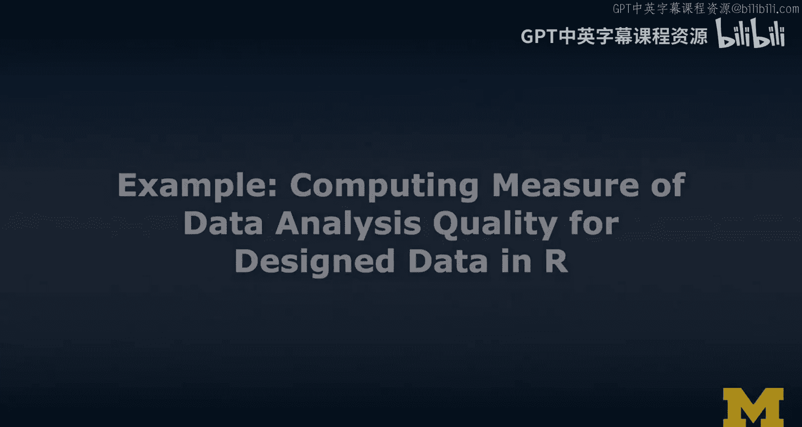
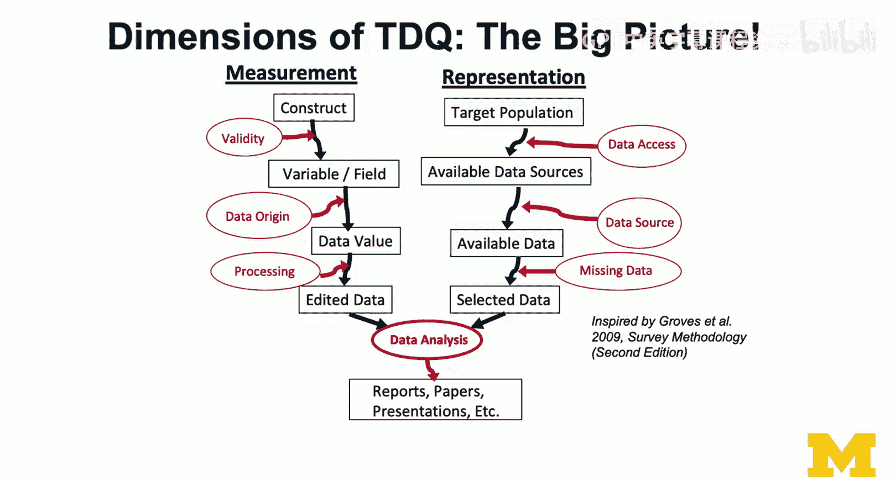
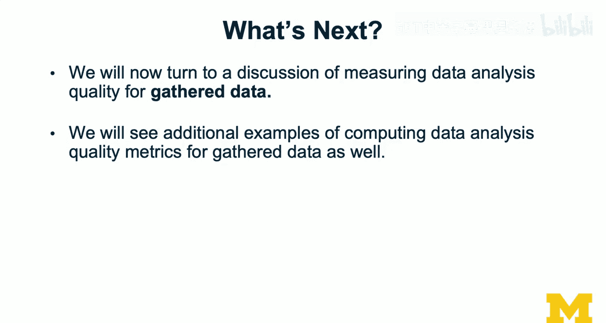

# 26：示例：R语言中设计型数据分析质量指标计算 📊






在本节课中，我们将学习如何在R软件中计算之前讨论过的、用于评估设计型数据分析质量的具体指标。我们将通过一个具体的例子，演示如何计算方差膨胀诊断指标，以及如何检验在回归模型中使用调查权重的必要性。


## 概述：设计型数据分析的质量评估

上一节我们介绍了几种评估设计型数据分析质量的技术。本节中，我们来看看如何在R软件中计算这些度量指标的具体示例。

回到我们的总体数据质量框架，当前的重点是评估数据分析阶段的质量，以确保我们为最终的报告、论文或演示所做的分析是可靠的。即使我们在数据质量的其他六个维度上都已仔细把关，也不能在数据分析环节松懈。我们将通过R语言示例，学习如何评估设计型数据的分析质量。

## 示例一：计算加权估计的方差膨胀

我们讨论过调查数据加权分析可能导致的方差膨胀概念。回忆一下，在分析设计型调查数据时，使用调查权重进行估计旨在减少因不同抽样概率、无应答等引起的估计偏差。使用权重是纠正调查数据常见偏差的最佳实践。

然而，在估计中使用权重也可能**膨胀**加权估计的方差，从而影响统计推断。权重本身的变异性越大，如果权重与关键变量不相关，那么估计值的方差膨胀就可能越严重。因此，我们可以计算上一讲提到的诊断指标，以了解在权重与关键变量相关的情况下，加权估计可能导致的**最大潜在方差膨胀**。

这个计算假设权重与感兴趣的变量**不相关**，因此我们讨论的这个诊断指标被视为估计值方差膨胀的**上界**。权重与感兴趣变量的相关性越高，方差膨胀就越小。

以下是使用欧洲社会调查俄罗斯数据文件的一个计算示例。我们提供了一个R Markdown文件，运行它可以生成展示结果的HTML文件。

以下是计算方差膨胀诊断指标的核心R代码：

```r
# 计算权重系数的变异系数（CV）
cv_weight <- sd(russia$pspwght) / mean(russia$pspwght)
# 计算方差膨胀因子（上界）
vif_upper_bound <- 1 + cv_weight^2
```

在示例输出中，该值约为1.347。我们的解释是：**最多**，在估计中使用这些调查权重会使加权估计的方差膨胀35%（即乘以1.35倍）。这是一个方差膨胀的乘性因子。

通常，这种程度的方差膨胀被认为是相对较小的，是一个相当合理的值。如果你看到“1 + 变异系数平方”的值达到5或10甚至更大，则表明权重的变异性可能压倒了因使用权重而带来的偏差减少，此时使用权重进行估计可能值得商榷。对于较大的值，我们需要仔细评估使用权重时估计值的变化程度，比较加权估计与未加权估计的结果。

## 示例二：检验回归模型中是否需要使用权重

我们讨论的另一种评估设计型数据分析质量的技术，是检验在拟合感兴趣的回归模型时是否需要使用调查权重。现在，我们来看一个正式检验的示例，当研究变量间关系时，在拟合设计型调查数据的回归模型时是否需要考虑调查权重。

我们将在R Markdown代码和HTML输出中查看这个分析的细节。首先，我们需要在数据集中创建一个总体生活满意度指数，并声明样本设计的关键特征。

以下是创建设计对象和拟合加权回归模型的核心步骤：

```r
# 1. 创建新变量：总体生活满意度指数
russia <- russia %>%
  mutate(overall_sat = stflife + stfeco + stfgov)

# 2. 声明调查设计对象（包含权重、分层、整群信息）
russia.dsgn <- svydesign(
  ids = ~psu,          # 初级抽样单位（整群）代码
  strata = ~stratify,  # 分层变量
  weights = ~pspwght,  # 最终调查权重
  data = russia,
  nest = TRUE
)

# 3. 使用设计对象拟合加权回归模型
fit_svy <- svyglm(overall_sat ~ agea + factor(marital) + male,
                  design = russia.dsgn)
summary(fit_svy)
```

这种方法产生了**设计无偏**的回归系数估计及其标准误，因为它完全考虑了抽样设计的所有特征（包括权重），这通常是最佳实践。

然而，正如在讲座中提到的，如果我们已经很好地指定了模型，并捕捉了目标群体中年龄、婚姻状况和性别之间的关系，那么在估计中使用权重可能并非必要。在这种情况下，使用权重可能只会**膨胀**我们估计系数的方差，使得检验系数显著性变得更困难，并降低统计功效。

我们可以通过声明一个忽略权重的新设计对象来检验是否需要使用权重。

以下是拟合未加权模型并进行正式检验的步骤：

```r
# 4. 声明忽略权重的设计对象（所有权重设为1）
russia.dsgn.nowgt <- svydesign(
  ids = ~psu,
  strata = ~stratify,
  weights = ~1,        # 忽略原始权重，全部设为1
  data = russia,
  nest = TRUE
)

# 5. 使用未加权设计对象拟合相同模型
fit_svy.nowgt <- svyglm(overall_sat ~ agea + factor(marital) + male,
                        design = russia.dsgn.nowgt)
summary(fit_svy.nowgt)

# 6. 在未加权模型中添加权重及其交互项作为预测变量
fit_test <- svyglm(overall_sat ~ agea + factor(marital) + male +
                     pspwght + pspwght:agea + pspwght:factor(marital) + pspwght:male,
                   design = russia.dsgn.nowgt)

# 7. 使用Wald检验检查新增的权重相关项是否显著（即权重是否必要）
regTermTest(fit_test, ~ pspwght + pspwght:agea + pspwght:factor(marital) + pspwght:male)
```

在这个具体示例中，Wald检验的p值约为0.253。这意味着我们**无法拒绝**原假设（即所有新增的权重相关项的系数都为零）。结论是：权重并没有改变我们模型中系数的估计，它们所做的只是**膨胀**了这些估计的方差。因此，在这个特定例子中，在分析中使用权重似乎**没有必要**。

如果p值非常小（例如小于0.05），则表明权重实际上调节了我们模型中的某些系数，那么我们就可能需要在估计中保留并考虑权重，因为它们对感兴趣的回归系数具有信息性。

## 总结

本节课中，我们一起学习了如何在R中计算用于评估设计型数据分析质量的具体指标。

*   我们首先通过计算 **`1 + (权重变异系数)^2`** 这个指标，评估了因使用调查权重而导致的**最大潜在方差膨胀**。该值越大，表明仅使用权重带来的方差代价可能越高。
*   接着，我们通过一个完整的示例，学习了如何**正式检验在回归模型中使用调查权重的必要性**。方法是拟合一个包含权重及其与预测变量交互项的扩展模型，然后使用Wald检验判断这些新增项是否整体显著。如果不显著，则表明在已正确设定模型的情况下，使用权重可能只会不必要地增加估计方差。




通过这些示例，我们掌握了评估数据分析阶段质量的实用工具，确保我们的分析过程既准确又高效。接下来，我们将转向对“收集型数据”的数据分析质量度量的讨论。