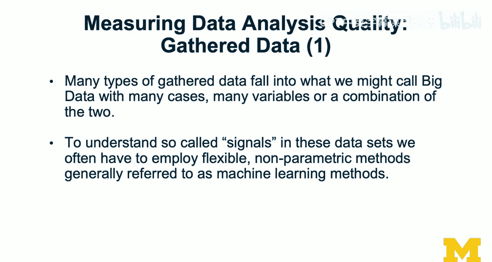
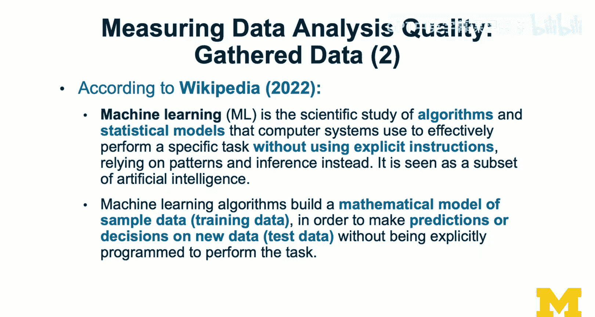
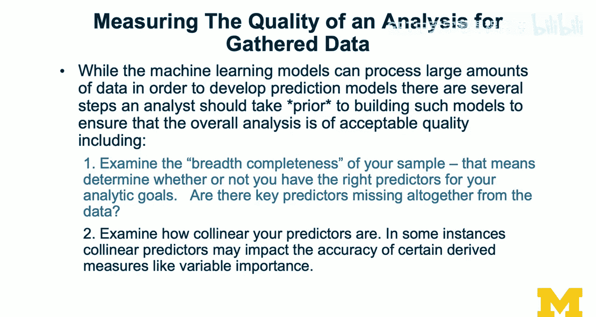
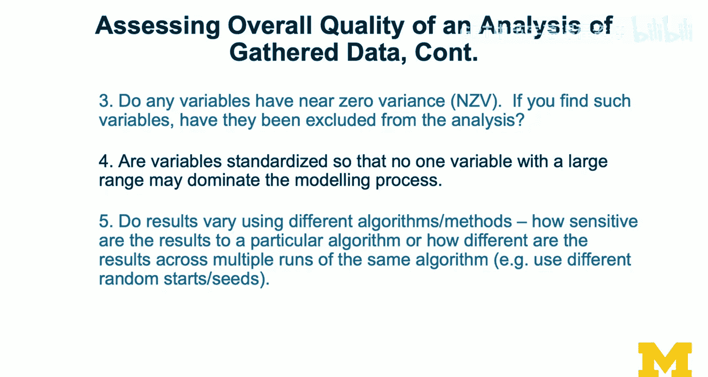
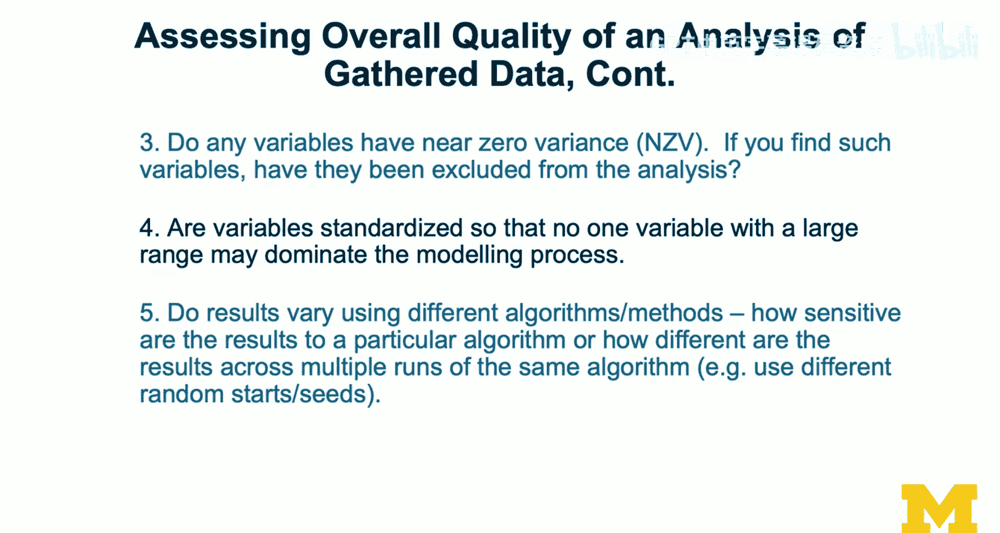
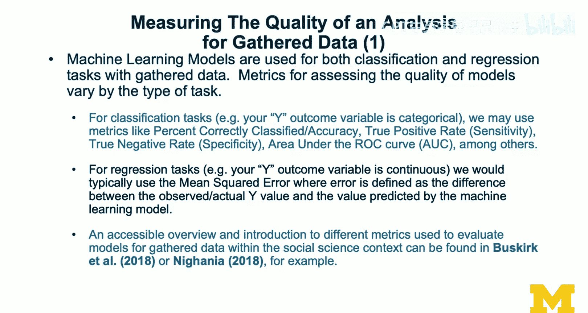
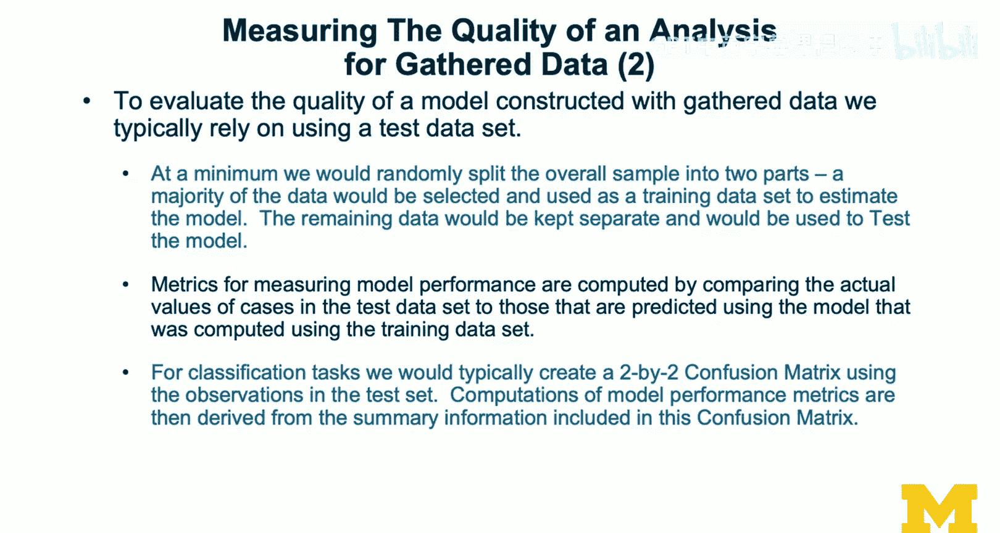
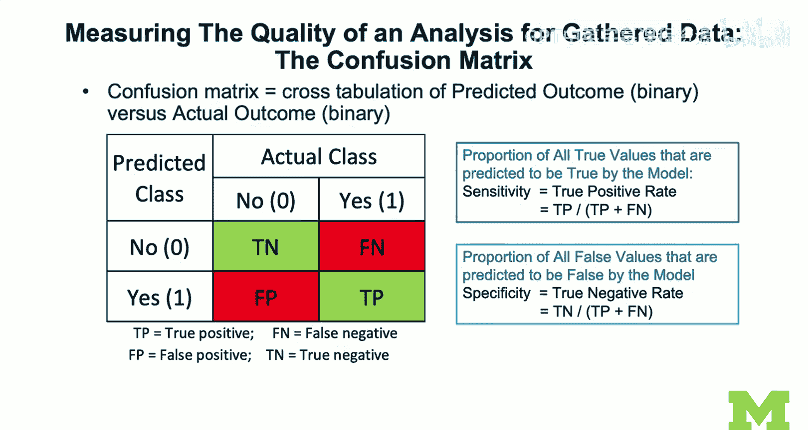
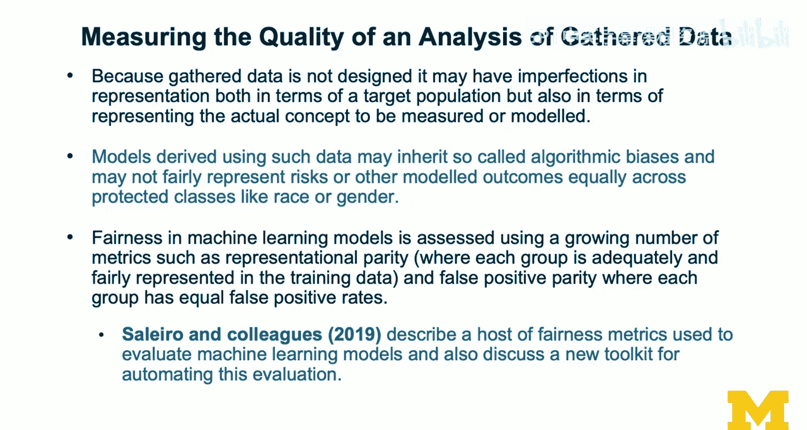
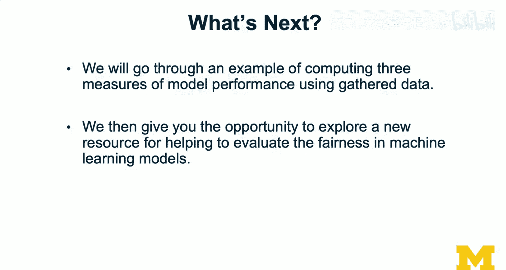

# 27：采集型数据分析质量测量 📊

在本节课中，我们将学习如何评估和分析采集型数据的质量，特别是当这些数据用于机器学习模型时。我们将探讨数据准备的关键步骤、模型性能的评估指标，以及如何考量模型的公平性。

---

上一节我们介绍了数据质量框架的总体概念，本节中我们来看看数据分析部分，特别是针对采集型数据的分析质量。许多采集型数据属于“大数据”，具有大量案例、变量或两者的组合。为了理解这些数据集中的所谓“信号”，我们通常需要采用灵活的、非参数的方法，这些方法通常被称为机器学习方法或模型。

这些机器学习方法或模型是非参数的，意味着它们在模型运行前不需要用户指定先验形式。它们也不依赖于特定的分布族，如正态分布假设或泊松分布假设等。因此，它们更具灵活性，能够适应手头数据的复杂性。

根据维基百科的定义，机器学习是算法和统计模型的科学研究，计算机系统使用这些算法和模型来有效执行特定任务，而无需使用明确的指令（即模型形式、分布假设等），而是依赖模式和推理。它被视为人工智能的一个子集。机器学习算法基于样本数据（我们称之为**训练数据**）构建数学模型，以便对新数据（我们通常称之为**测试数据**）进行预测或决策，而无需为执行该任务进行显式编程。这就是其灵活性的来源，算法能够适应，而无需预先编程或事先决定模型的形式。

虽然机器学习模型可以处理大量数据以进行预测，但在构建此类模型之前，分析应遵循几个步骤，以确保整体分析具有高质量。

以下是分析前应检查的关键步骤：

*   **检查样本的广度完整性**：确定您是否拥有适合分析目标的预测变量。是否有关键预测变量完全缺失于您的数据中？如果是，则广度完整性较低。
*   **检查预测变量的共线性**：在某些情况下，共线性的预测变量可能会影响某些衍生指标（如变量重要性）的准确性。
*   **识别近零方差变量**：检查是否有任何变量的变异性极低。例如，一个变量测量的全是0或全是1，则该变量对于结果的信号非常弱，很可能在预测模型中不重要。如果发现此类变量，应将其从分析中排除。
*   **标准化变量**：确保变量经过标准化，以防止取值范围大的变量主导建模过程。这对于使用无监督学习技术（如聚类）尤其重要。标准化主要针对连续或有序变量，而非名义变量（如性别或种族）。
*   **进行敏感性分析**：询问使用不同算法或方法时，结果是否会有很大差异。这类似于敏感性分析，用于评估结果对所选特定算法的敏感程度。如果不同算法间结果一致，则更能说明是数据中的变量和模式驱动了结果，而非算法选择本身。

机器学习模型可用于采集型数据的分类和回归任务。分类任务旨在预测一个0/1类别，例如；回归任务旨在预测某个连续结果。

对于分类任务（结果为分类变量），我们可能使用以下指标：
*   **正确分类百分比** 或 **准确率**
*   **真阳性率** 或 **灵敏度**
*   **真阴性率** 或 **特异度**
*   **受试者工作特征曲线下面积**

对于回归任务（结果为连续变量），我们通常使用**均方误差**作为模型准确性或性能的指标。

为了评估使用采集型数据构建的模型质量，我们通常至少需要使用一个测试数据集。我们会将总体采集数据样本随机分为两部分：大部分数据用作**训练数据**来创建模型；剩余数据则与建模过程分开，用作**测试数据**。通过比较测试数据集中案例的实际值与基于训练数据集计算的模型预测值，来计算模型性能指标。

对于分类任务，我们通常会使用测试集中的观测值创建一个**混淆矩阵**。模型性能指标的计算基于混淆矩阵中包含的汇总信息。

例如，假设我们有一个二元结果，混淆矩阵是预测结果与实际结果的交叉表。在此图表中，行代表预测类别（否或是，0或1），列代表实际类别。主对角线上的项目（绿色高亮）是**真阴性**和**真阳性**。

*   **真阴性** 由**特异度**（真阴性率）衡量，它是所有假值或0值中被模型正确预测为假的比例。
*   **真阳性** 由**灵敏度**（真阳性率）衡量，它是所有真值中被模型正确预测为真的比例。

因为采集型数据并非设计所得，它可能在目标人群的代表性以及所测量或建模的实际概念的代表性方面存在偏差。使用此类数据衍生的模型可能会继承所谓的**算法偏见**，并且可能无法在种族或性别等受保护类别之间公平地表示风险或其他建模结果。

机器学习模型的公平性使用越来越多的指标进行评估，例如**代表性平等**和**假阳性率平等**。重要的是要注意，模型不仅可以评估其准确性，还可以评估其是否公平或无偏见。这些是评估使用采集型数据开发或训练的机器学习模型整体质量的重要维度。

---

本节课中，我们一起学习了评估采集型数据分析质量的关键方面。我们回顾了数据准备的重要步骤，包括检查广度完整性、共线性、近零方差变量和标准化。我们介绍了用于分类和回归任务的模型性能评估指标，如准确率、灵敏度、特异度和均方误差。我们还探讨了使用测试数据集和混淆矩阵进行评估的方法。最后，我们强调了在机器学习模型中考虑公平性和算法偏见的重要性。接下来，我们将通过一个示例来计算模型性能的三个衡量指标。