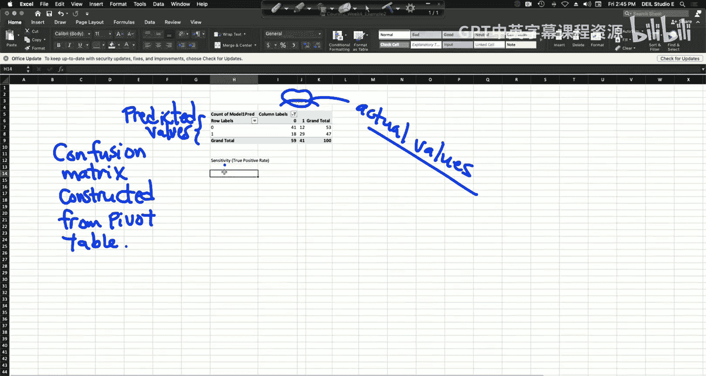

# 28：示例：采集型数据模型质量指标计算 📊

在本节课中，我们将通过一个具体示例，学习如何计算和评估基于采集数据的机器学习模型的质量。我们将使用混淆矩阵来推导**敏感度**、**特异度**和**整体准确率**等关键指标。

## 概述与数据背景

上一节我们介绍了评估采集数据分析质量的核心指标。本节中，我们来看一个预测学生课程退课率的实际案例。

我们拥有三个已训练好的机器学习模型，它们基于2000名学生的训练数据构建。这些数据包含以下变量：
*   性别
*   种族
*   年级（如大一、大二）
*   当前学分
*   累计GPA
*   专业学院
*   先前是否有退课记录
*   已完成的B或以上成绩的学时数
*   是否在校内居住

现在，我们将使用一个包含100名学生的独立测试数据集来评估这三个模型的质量。测试数据集中包含每个学生的真实退课状态（0表示未退课，1表示退课），以及三个模型对每个学生的预测结果（同样为0或1）。

## 构建混淆矩阵

为了计算质量指标，我们首先需要为每个模型构建一个混淆矩阵。混淆矩阵是一个2x2的表格，其**行**代表模型的预测值，**列**代表真实的实际值。

以下是构建Model 1混淆矩阵的步骤，你可以将此方法应用于Model 2和Model 3。

1.  **插入数据透视表**：在Excel（或类似工具）中，选择测试数据集，插入一个数据透视表。
2.  **设置行与列**：
    *   将“Model 1预测值”字段拖至“行”区域。
    *   将“实际退课状态”字段拖至“列”区域。
3.  **填充数值**：将“Model 1预测值”字段再次拖至“值”区域，并确保计算类型设置为“计数”。

完成后的混淆矩阵将类似下表：

| 预测\实际 | 实际未退课 (0) | 实际退课 (1) |
| :--- | :--- | :--- |
| **预测未退课 (0)** | A = 41 | B = 12 |
| **预测退课 (1)** | C = 18 | D = 29 |

*   **A (41)**: 模型正确预测为“未退课”的人数（真阴性）。
*   **B (12)**: 模型错误预测为“未退课”，但实际“退课”的人数（假阴性）。
*   **C (18)**: 模型错误预测为“退课”，但实际“未退课”的人数（假阳性）。
*   **D (29)**: 模型正确预测为“退课”的人数（真阳性）。

## 计算质量指标

基于混淆矩阵，我们可以计算三个核心质量指标。以下是每个指标的计算公式。

### 1. 敏感度 (真阳性率)
敏感度衡量模型正确识别出正例（本例中为退课学生）的能力。
**公式**：`敏感度 = D / (B + D)`
对于Model 1：`29 / (12 + 29) ≈ 0.707` 或 **70.7%**

### 2. 特异度 (真阴性率)
特异度衡量模型正确识别出负例（本例中为未退课学生）的能力。
**公式**：`特异度 = A / (A + C)`
对于Model 1：`41 / (41 + 18) ≈ 0.695` 或 **69.5%**

### 3. 整体准确率
整体准确率衡量模型做出正确预测（无论正负例）的整体能力。
**公式**：`准确率 = (A + D) / 总样本数`
对于Model 1：`(41 + 29) / 100 = 0.70` 或 **70%**

## 模型比较与解读

按照相同方法计算三个模型的指标后，我们得到以下结果：

| 模型 | 整体准确率 | 敏感度 (真阳性率) | 特异度 (真阴性率) |
| :--- | :--- | :--- | :--- |
| **Model 1** | 70% | 70.7% | 69.5% |
| **Model 2** | 83% | 78.3% | 86.0% |
| **Model 3** | 71% | 58.6% | 80.0% |

以下是基于这些指标的解读与决策建议：

*   **综合评估**：不应只依赖单一指标。需要同时观察准确率、敏感度和特异度。
*   **模型对比**：在所有三项指标上，**Model 2** 的表现均优于 Model 1 和 Model 3。它的整体预测最准确，同时识别退课学生和未退课学生的能力也最强。
*   **决策建议**：基于此综合评估，**Model 2** 展现了最高的分析质量，应被选为最终报告和使用的模型。
*   **指标侧重**：如果业务上更看重“找出所有可能退课的学生”（即使误报一些未退课的），则应优先选择**敏感度**最高的模型。如果更看重“确保预测退课的学生非常精准”，则应优先选择**特异度**最高的模型。本例中Model 2在两者间取得了良好平衡。

## 总结

本节课中，我们一起学习了如何通过计算混淆矩阵来评估机器学习模型的质量。我们具体实践了**敏感度**、**特异度**和**整体准确率**的计算方法，并学会了如何综合这些指标来比较不同模型，从而做出基于数据质量的最佳选择。通过这个示例，你可以将这些方法应用到自己的分类模型评估任务中。