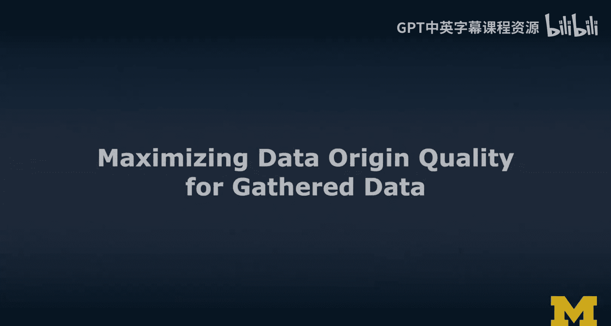
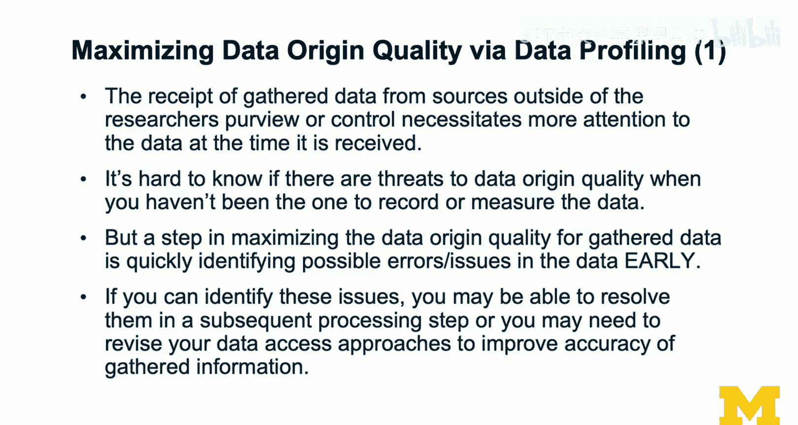
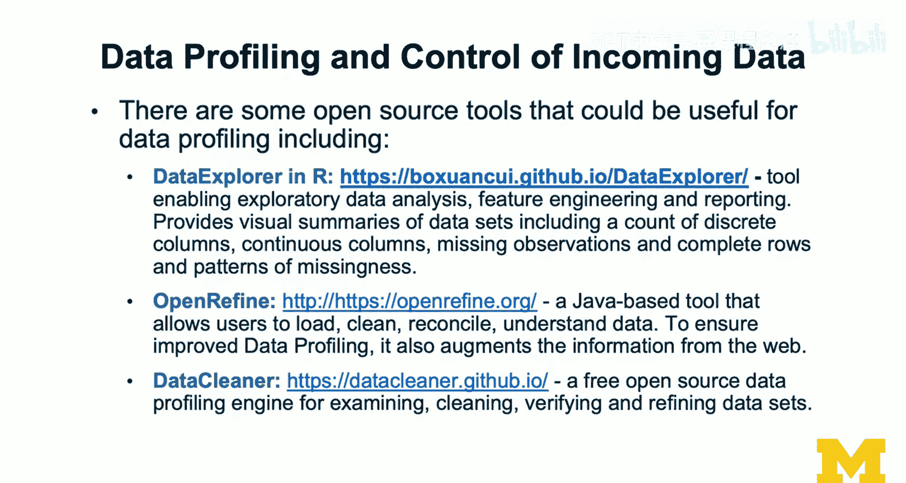
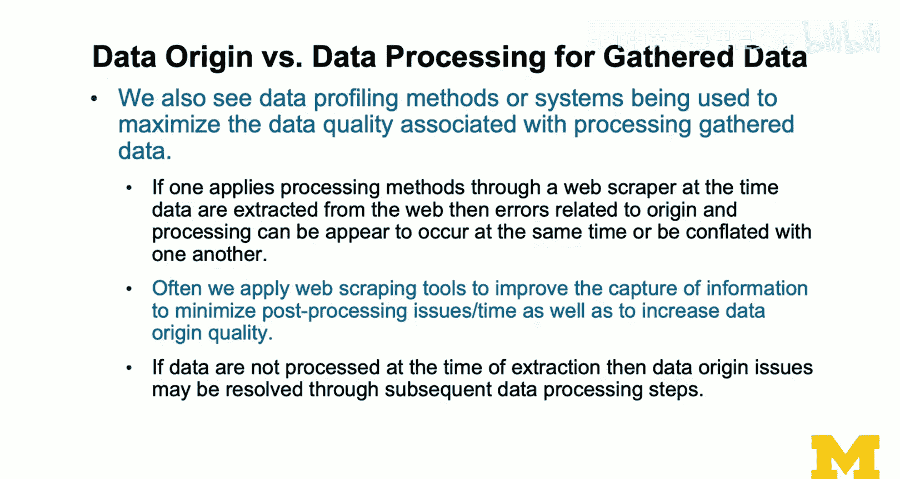
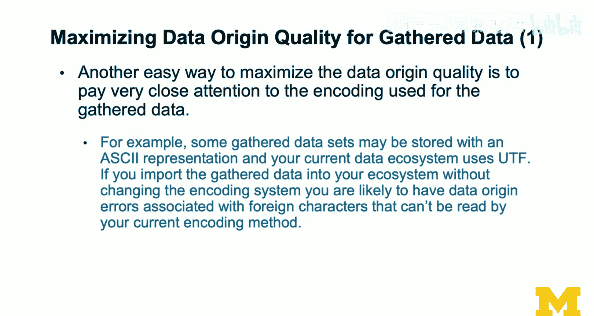
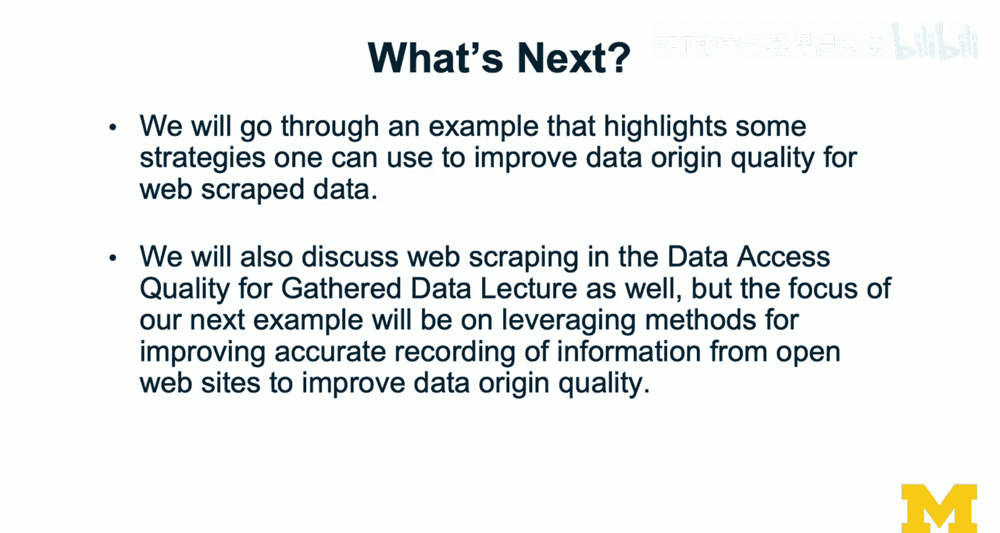

# 7：最大化采集型数据源生质量 📈

在本节课中，我们将学习如何最大化**采集型数据**的**数据源生**质量。数据源生关注的是单个数据值或数据点是如何被记录、捕获、采集、计算或表示的。对于采集型数据，其源生质量问题通常与创建、检索或记录数据集中各个字段值的过程有关。

上一节我们介绍了数据质量框架的测量部分，本节中我们来看看如何通过具体策略来提升采集数据的源生质量。

---

## 数据剖析：及早识别潜在问题 🔍

从研究者控制范围之外的来源接收采集数据时，需要在收到数据时给予更多关注。采集数据通常是研究的二手数据源，你无法控制其记录、构想甚至测量的方式。因此，及早识别潜在的错误源至关重要。

如果你能在采集数据时发现问题，就可以在捕获时、后续处理步骤中解决它们，或者修订数据访问方法以提高信息准确性。例如，如果你在抓取网页时发现网络爬虫完全漏掉了你需要的研究信息部分，你就需要在采集时修订数据抓取器，否则最终会得到一个缺少关键变量或存在遗漏错误的数据集。

以下是最大化采集数据源生质量的一种核心方法：建立或使用**数据剖析工具**。这种工具可以检查数据格式和基本模式、每个记录的数据一致性、数据值分布、可能的异常值以及数据的完整性。

### 数据剖析工具示例

以下是几个你可以自行探索的数据剖析工具示例：

*   **R语言中的DataExplorer**：该工具支持探索性数据分析、特征工程（从现有变量创建新变量）以及生成报告。它的优点在于能提供数据的可视化摘要，包括离散列的数量、连续列的数量、缺失观测值及其模式，帮助你快速评估数据是否符合预期。
*   **OpenRefine**：这是一个基于Java的工具，允许用户加载、清理、协调和理解数据。
*   **DataCleaner**：这是一个免费开源的数据剖析引擎，用于检查、清理、验证和优化数据集。

这些工具可以帮助你在数据源生阶段发现潜在错误，并允许你对数据集进行优化以纠正这些问题。

---

## 采集与处理的交织：以网络爬虫为例 🕸️

在通过网页抓取工具从网站提取数据时，如果同时应用了处理方法，那么与源生和处理相关的错误可能同时出现或相互混淆。

通常，我们使用网络爬虫工具来改进信息捕获，以最小化后处理问题或所需时间，同时提高数据源生质量。你可以在捕获信息时决定对其进行格式化（这属于数据源生范畴），也可以先采集原始信息，然后在后处理步骤中再进行格式化（这属于数据处理范畴）。

在这种情况下，最大化质量的源生技术和处理技术是分开的。但使用网络爬虫工具时，完全有可能同时进行信息处理和采集。此时，数据源生和数据处理步骤实际上被联系在一起，尽管并非有意为之，但由于从网站捕获信息的方式，它们几乎是同时发生的。

如果数据在提取时未被处理，那么数据源生问题可能需要通过一系列后续的数据处理步骤来解决，以便我们专注于这些源生问题的格式化和纠正。

---

## 关键策略：在采集点最大化质量 ⚙️

如果让我选择是在实际提取数据的源生点进行纠正，还是使用后续的数据处理步骤来最大化采集数据的源生或处理质量，我可能会倾向于在**实际采集信息时**就最大化数据源生质量。

原因在于，如果你发现采集信息的方式存在系统性错误（与数据源生部分相关），为了通过处理来修复或纠正这些问题，你可能仍然需要回到数据源（如网站）去弄清楚实际情况或数据本应是什么样子。因此，你不得不回到数据收集步骤。

如果你能在从网站采集信息时纠正这些问题并最大化源生质量，情况会好得多。处理步骤仍然可以进行，我们也可以在数据处理方面最大化质量，但在网络抓取的情况下，通常建议尝试在采集时、采集地使用技术来最大化你所采集数据的质量，即努力最大化数据源生，并在提取数据时加入一些处理，这可以带来改进。

---

## 其他实用技巧：编码与格式匹配 🔧

最大化数据源生质量的另一个简单方法是密切关注采集数据所使用的**编码**。

例如，某些采集数据集可能以ASCII编码存储，而你当前的数据生态系统使用UTF-8。如果你在不更改编码系统的情况下将采集数据导入你的生态系统，很可能会遇到与无法被当前编码方法读取的外文字符相关的数据源生错误。

这是一个非常简单的方法，但在将数据整合或导入你的生态系统之前，你必须注意这一点。只需询问：这些数据的原生格式是什么？我的生态系统期望的原生格式是什么？并确保它们匹配。这是很容易尝试的事情。

数据源生质量还可以通过确保要从另一个采集数据集追加或合并到现有数据集中的字段**事先具有正确的格式**来提高。

如果我要将信息合并到我的数据文件中，而我的整个数据集都是文本格式，我却要添加数值作为新列，并且期望将它们作为文本处理（仅仅因为我没有将新字段格式化为数值），那么我可能会在记录这些新信息或新变量时遇到问题，原因就是数据格式不正确。

这看起来显而易见且微不足道，但当你大规模工作，处理多个变量进入一个环境时，肉眼可能不容易发现。事先考虑这一点对于在合并信息到现有数据集时最大化数据质量非常重要。

---

## 标签准确性：影响模型结果的源头 🏷️

有时，数据源生质量问题不会在源生点显现。有时，直到你进行分析或完成研究过程的多个步骤后，你才会发现这些问题。

例如，当我们使用数据做决策时，比如使用基于采集数据开发的模型将图像分类为人、猫或动物，或者在使用Twitter数据建模后询问一条推文传达的是积极还是消极情绪，我们常常会发现模型的准确性不如预期，这是因为底层数据集本身在标签或我们最初使用的标签准确性方面存在问题。

就图像数据或文本数据而言，如果人工标注的标签是错误的（例如，人工标注者说这是一张猫的图片，或人工阅读推文后说这是负面情绪），而我们使用这些数据来构建模型，实际上可能会创建出不准确的模型来预测情绪或将图像分类为猫、动物等。

因此，最大化采集数据源生质量的一种方法是**专注于确保此类数据标签准确性的方法**。如果我们一开始就没有做好，最终会在模型中看到问题。

提高标签相关数据源生质量的一种方法是**训练并使用人工编码员**为图像或推文提供标签。我们计算编码者间信度，并在发布数据或将其标记为良好或最终版本之前，确保达到一定的可靠性水平。这使我们能够确保标签准确，并且与这些特定变量相关的源生问题得到最大化解决，这样当我们将它们输入模型时，实际上可以提高准确性，而无需重做整个过程。

---

## 总结 📝

本节课中，我们一起学习了最大化采集型数据源生质量的多种策略。核心要点包括：使用**数据剖析工具**及早识别问题；在**数据采集点**尽可能进行质量控制和纠正，特别是对于网络抓取数据；注意数据**编码和格式**的匹配；以及高度重视**数据标签的准确性**，因为它直接影响后续模型的效果。记住，在数据生命周期的早期投入精力解决源生问题，往往能事半功倍，避免后续分析中出现难以追溯的错误。