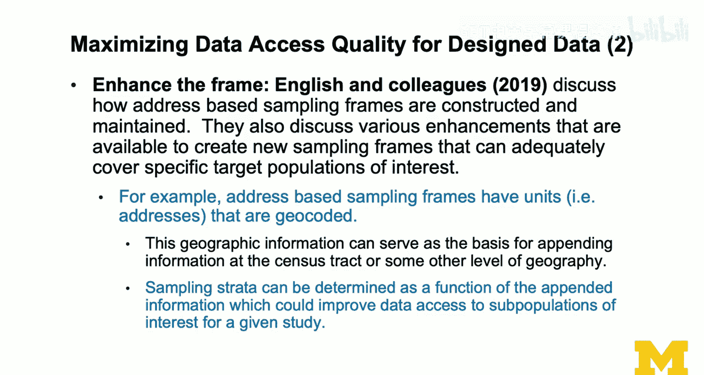
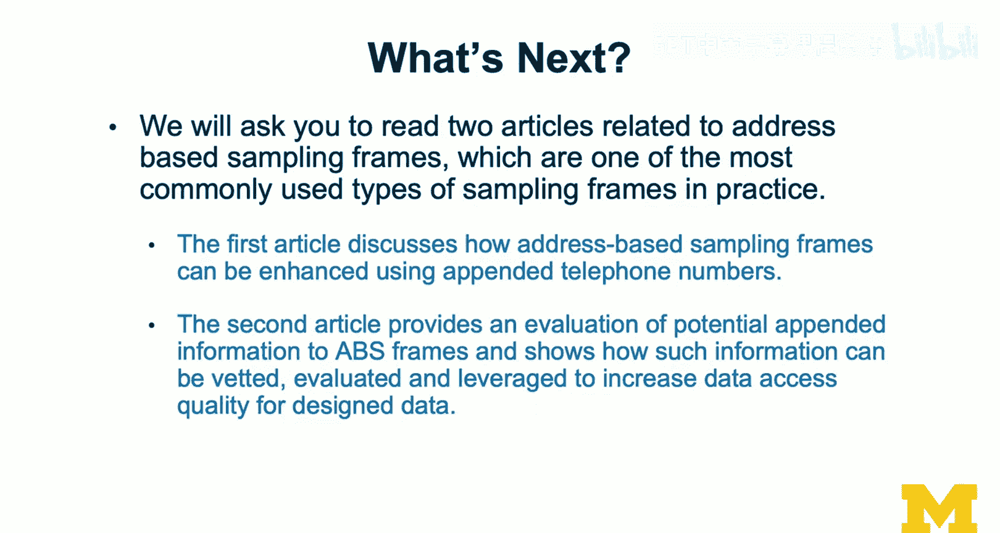

# 13：最大化设计型数据访问质量 📊

在本节课中，我们将学习如何最大化设计型数据的访问质量。数据访问是我们数据质量框架中“表示”侧的重要组成部分，它关乎我们如何获取目标总体的信息。我们将重点探讨三种主要策略：使用多重抽样框、增强抽样框信息以及应用校准调整。

## 多重抽样框 📋

上一节我们介绍了数据访问的基本概念，本节中我们来看看如何通过多重抽样框来扩大对目标总体的覆盖范围。

数据访问指的是用于获取目标总体信息的平台、存储库、方法或工具。对于设计型数据，访问通常通过**抽样框**提供。抽样框是用于选取样本的一系列信息、材料或程序。理想情况下，我们倾向于使用能让每个合格单元都有非零被选概率的抽样框，即**概率样本**。有时，我们可以通过使用多个抽样框来改善对目标总体的覆盖。

以下是多重抽样框的应用实例：
*   在钓鱼活动调查中，同时使用持有钓鱼/狩猎许可证的人员名单和普通人群的地址样本。
*   在电话调查中，同时使用固定电话和手机号码的随机拨号抽样框。

使用多重抽样框能显著提高覆盖率，但也带来了框间重叠的问题，这需要在分析和实地抽样中妥善处理。

## 增强抽样框信息 🛠️

除了使用多个框，我们还可以通过向现有抽样框添加额外信息来增强它，从而创建能更好覆盖特定目标总体的新抽样框。

例如，基于地址的抽样框本身覆盖全国，我们可以向其附加变量。这些变量信息可用于创建子抽样框。具体增强方式包括：
*   **附加特征变量**：例如，添加“是否有游泳池”变量，可以专门针对游泳池所有者进行研究。
*   **附加地理信息**：地址通常带有地理编码，可以基于此附加人口普查区等地理层级的信息（如种族构成、年龄分布），从而帮助确定抽样层，以更好地触及感兴趣的子总体。

## 应用机器学习模型 🤖

另一种最大化数据访问质量的方法是应用机器学习模型，基于辅助信息创建抽样层。

相关研究案例包括：
*   Eckkin 等人（2018）利用神经网络模型从航拍图像中识别风力发电机的位置，从而创建了带有地理坐标的抽样框。
*   Burgen 等人（2019）使用机器学习方法，基于医疗支出轨迹创建分层，用于一项医疗保健成本研究。
*   Busker 和 Kicher（2020）综述了如何利用机器学习和辅助数据源来创建或增强基于概率设计的抽样框。

## 校准调整 ⚖️

最后，我们将讨论校准调整。这是一种专门的加权技术，用于确保样本能基于已知的总体特征准确地反映总体。

这些技术（如事后分层或**拉金法**）可以修正抽样框的缺陷。校准调整的核心公式可简化为调整样本权重，使其与已知的总体边际分布一致。例如，通过迭代比例拟合过程，使样本在年龄、性别等关键变量上的分布与总体一致。

## 总结与阅读 📚

本节课中我们一起学习了最大化设计型数据访问质量的三种核心策略：使用多重抽样框以扩大覆盖、增强抽样框信息以精准定位、以及应用校准调整以修正偏差。特别是，机器学习为利用新型数据源构建抽样框提供了强大工具。

为了加深理解，请阅读以下两篇关于实践中常用抽样框——基于地址的抽样框的文：
*   第一篇讨论了如何通过附加电话号码来增强基于地址的抽样框。
*   第二篇评估了对此类抽样框附加信息的潜力，并展示了如何审查、评估和利用这些信息来提高设计型数据的访问质量。

感谢学习本讲内容。