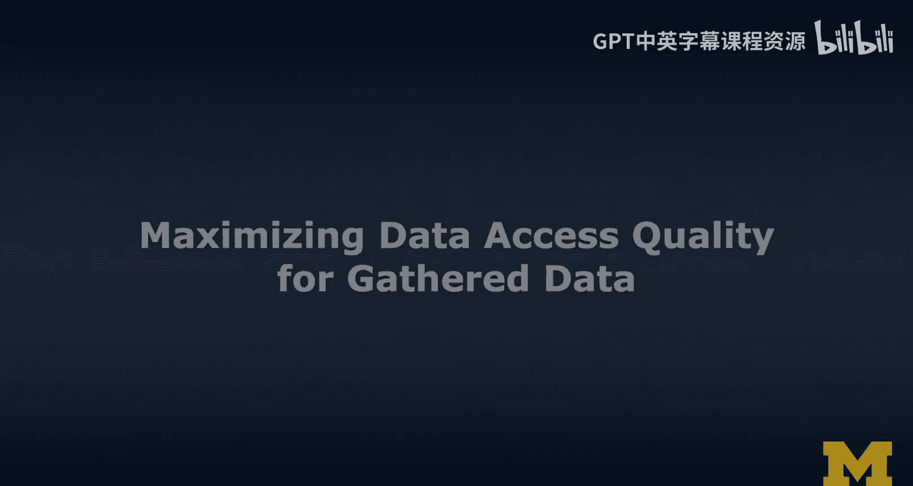
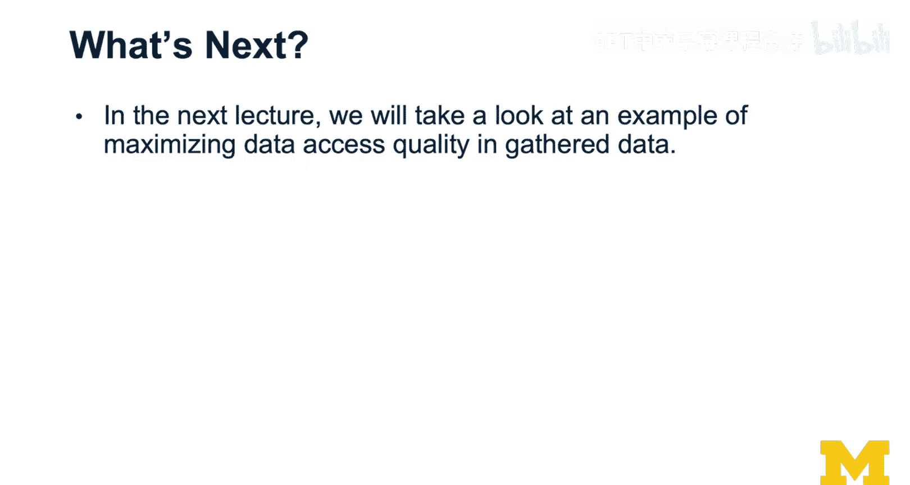

14：最大化采集型数据访问质量 📊

在本节课中，我们将学习如何最大化采集型数据的数据访问质量。数据访问是数据生命周期的起点，其质量直接影响后续所有环节。我们将探讨网络爬取、API使用以及抽样策略等关键方法，以确保我们能高效、准确地获取所需数据。

---

上一节我们介绍了数据质量框架的宏观图景，本节我们将聚焦于采集型数据的数据访问质量。

网络爬取是获取在线数据的常用方法。但如果对目标网页结构了解不足，爬取过程可能导致数据访问问题。例如，数据值可能格式错误或位置错乱，导致爬虫无法正确抓取。通常，在爬取过程中需要结合适当的数据清洗与处理技能。

好消息是，市面上有多种用户友好的网络爬取工具可供选择。以下是部分工具示例：

*   **免费工具**：Google Chrome扩展“Web Scraper”、ParseHub。
*   **商业工具**：提供免费试用和客户服务的工具，如FMiner、Octoparse、OutWit Hub。

这些工具提供了经过测试、可靠且易用的爬取方法，使得不熟悉脚本语言的用户也能获得较高质量的爬取结果。

---

然而，有时免费或商业工具可能不适用于特定爬取任务，或成本过高。此时，我们需要使用编程或脚本语言来实现更灵活的爬取。

编程语言提供了多样化的方法。例如：
*   **XPath**：一种专门用于在XML文档中定位信息的查询语言。
*   **Beautiful Soup**：一个用于网络爬取的Python库。
*   **正则表达式 (Regular Expressions)**：在爬取过程中，可用于从杂乱数据中提取匹配的特定模式，其基本匹配模式可表示为 `pattern = r"your_pattern_here"`。

这些方法能帮助我们更精确地控制爬取过程，从而最大化数据访问质量。

---

另一种最大化数据访问质量的方法是使用提供API的在线数据平台。许多社交媒体公司（如Twitter）、商业服务（如Zillow）以及政府机构都允许用户通过API访问数据。

我们可以通过为给定数据源选择正确的API和调用方式，来最大化访问质量。例如，在某些API中，逗号 `,` 表示逻辑“或”，而空格表示逻辑“与”。这要求API使用者给予特别关注。

此外，将API集成到更广泛的数据质量控制框架中，可以减少数据管理过程中的手动交接，从而提升质量。一个常见的做法是将API数据管道与正则表达式、数据清洗等处理方法结合。

使用社交媒体API时需注意，平台通常会对公开访问的数据量或时间范围进行限制。为了克服这一挑战，研究人员常采用抽样策略。

以下是两个抽样研究的例子：
1.  **Hino和Fahey (2019)** 的研究：他们基于随机抽样的Twitter用户ID构建了一个数据档案库，并收集了与这些用户ID相关的推文。
2.  **Bovski等人 (2018)** 提出的两阶段抽样：首先对Twitter用户ID进行基于概率的系统抽样并收集其推文；然后对该用户样本进行分层，并从每层中随机抽取用户。

---

最后，我们将通过一个现实世界的例子，来具体学习如何在采集型数据中最大化数据访问质量。

---

本节课中，我们一起学习了最大化采集型数据访问质量的多种策略。我们了解了使用现成爬虫工具的便利性，也探讨了在需要更灵活控制时使用脚本语言（如XPath、Beautiful Soup和正则表达式）的方法。同时，我们认识到通过API访问结构化数据是保证质量的有效途径，并学习了在API受限时如何运用抽样技术。合理选择和组合这些方法，是确保数据获取阶段高质量起点的关键。