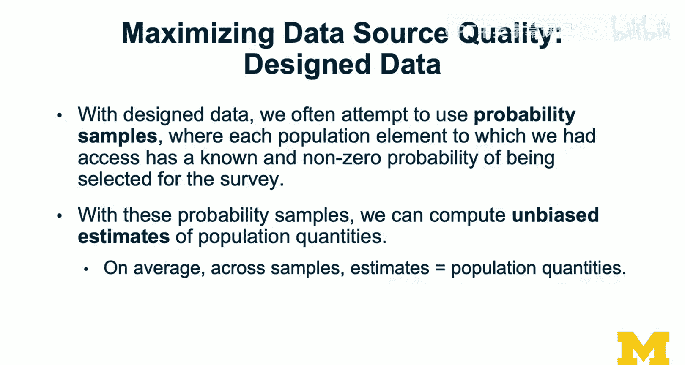
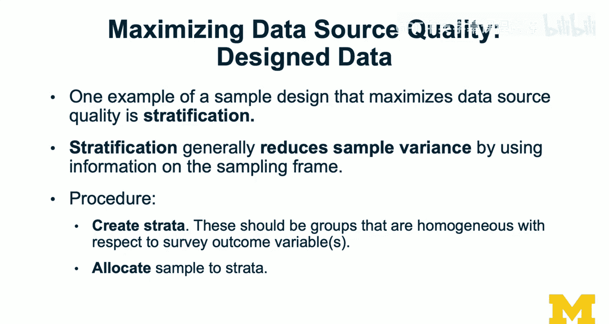
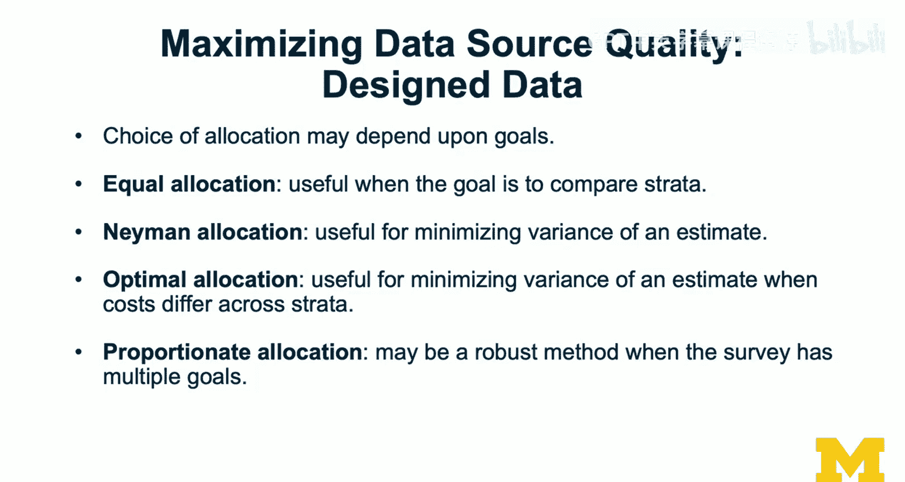
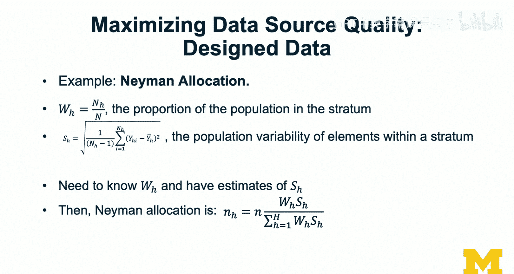
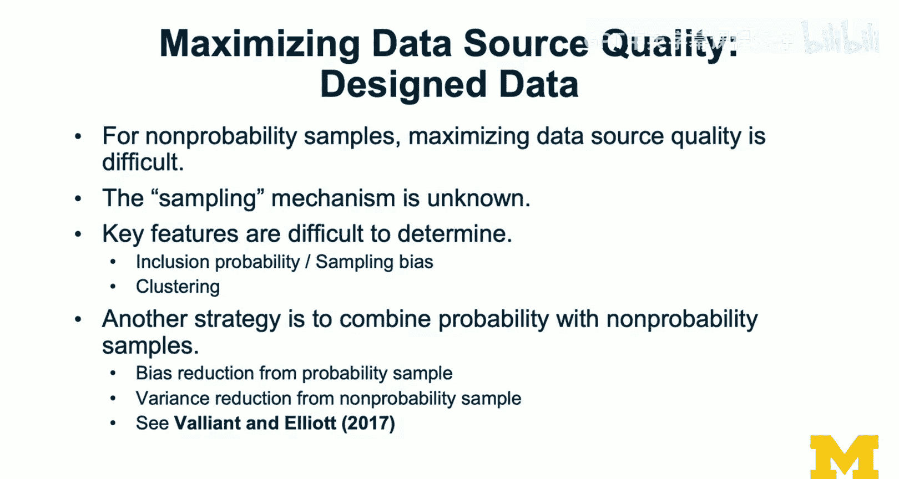
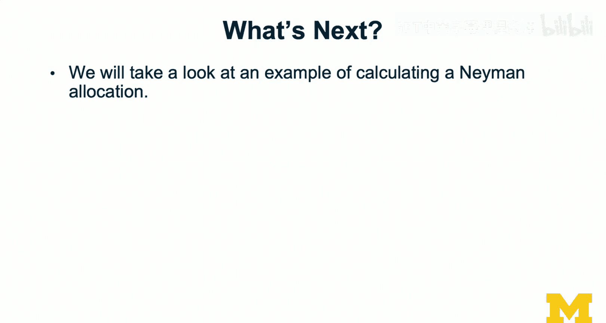

# 16：最大化设计型数据源质量 📈

在本节课中，我们将要学习如何最大化设计型数据源的质量。我们将聚焦于抽样设计，探讨如何通过优化抽样方法来最小化抽样误差，从而提高数据质量。

上一节我们介绍了数据源质量的概念，本节中我们来看看针对设计型数据，如何通过优化抽样设计来最大化其质量。

## 抽样设计与抽样误差

对于设计型数据，数据源质量主要与抽样及其伴随的误差——即抽样误差——有关。我们通常尝试使用概率样本，其中总体中每个可访问的元素都有一个已知且非零的概率被选中进入调查。使用这些概率样本，我们可以计算总体参数的无偏估计。这意味着，平均而言，我们通过多次抽样得到的估计值等于总体参数，这正是无偏估计的定义。

数据收集完成后，在评估数据源质量时，必须反映实际的抽样设计。我们在讨论测量数据源质量时曾提到过这一点。

## 优化抽样设计

最大化数据源质量发生在样本设计最优时。最优样本设计能在固定预算下最小化抽样误差。关于最优样本设计的完整描述，可以参考Leslie Kish的抽样教科书。该书详细介绍了最优样本设计技术。接下来，我们将简要介绍一些最优样本设计。

以下是几种优化抽样设计的方法：

*   **分层抽样**：分层抽样通常通过利用抽样框上的信息来减少抽样方差。其步骤是创建层（或称为“组”），这些层应在我们感兴趣的调查变量方面具有同质性。然后，我们将样本分配到各层中。样本在各层间的分配比例至关重要，不同的设计目标和目的会导致不同的分配方案。因此，分层的收益不仅取决于创建层，还取决于我们如何将样本分配到这些层中。

## 样本分配策略

根据不同的调查目标，我们可以选择不同的样本分配策略。以下是几种常见的分配方法：

*   **比例分配**：将样本按各层在总体中的大小比例进行分配。
*   **内曼分配**：以首次公开这种分配方法的人命名。这种分配与各层的大小及其内部的变异性成比例。在固定样本量且各层成本相等的假设下，这种分配能产生方差最小的估计值。
*   **最优分配**：当各层成本不同时，可以考虑最优分配。它在固定预算下，同时考虑成本和层内变异性，以产生方差最小的估计值。
*   **等额分配**：当我们的目标是比较不同层时，等额分配非常有用。

比例分配在调查有多个目标时是一种稳健的方法。因此，根据调查目标，我们可能选择不同类型的分配方案。

## 内曼分配详解

让我们更仔细地看看内曼分配。首先，我们使用幻灯片上的符号定义各层人口占总体的比例。公式为：
`W_h = N_h / N`
其中，`W_h` 表示第 `h` 层人口占总体的比例，`N_h` 是第 `h` 层的人口数，`N` 是总人口数。

其次，我们需要知道各层内元素的总体变异性，用 `S_h` 表示。其公式为：
`S_h = sqrt( Σ (y_i - ȳ_h)^2 / (N_h - 1) )`
其中，`y_i` 是层内第 `i` 个元素的值，`ȳ_h` 是第 `h` 层的均值。这个公式衡量的是层内各案例彼此之间的差异程度。

一旦我们有了 `W_h` 和 `S_h` 的估计值，内曼分配就使用以下公式计算各层的样本量 `n_h`：
`n_h = n * (W_h * S_h) / Σ(W_k * S_k)`
其中，`n` 是总样本量，`Σ(W_k * S_k)` 是所有层的 `W_k * S_k` 之和。这个公式将样本按各层的人口比例和层内变异性的乘积占总和的比例进行分配。

## 非概率样本的挑战

另一方面，对于非概率样本，最大化数据源质量可能很困难。抽样机制是未知的。元素是如何进入样本的？进入样本的概率是多少？这些量是未知的，可能难以确定甚至预测。例如，任何单位进入样本的概率可能难以预测。

如果我们错误地预测了这些概率（因为我们没有设定它们，所以必须预测），就可能导致抽样偏差。聚类在非概率样本中也难以确定。

一种策略是将概率样本与非概率样本相结合，利用概率设计中已知特征的优势，帮助我们预测非概率样本的这些特征。概率样本带来的偏差减少可能有助于改进估计，结合非概率样本带来的方差减少。这里我们提供了一个引文，其中给出了结合概率和非概率样本的策略示例。

## 计算示例

接下来，我们将看一个实际计算内曼分配的例子，这是我们今天讨论的分配方法之一。

（此处应插入计算示例的详细步骤和结果，但原文未提供具体数字，故保留此说明。）

---

本节课中我们一起学习了如何通过优化抽样设计来最大化设计型数据源的质量。我们探讨了概率样本中分层抽样的重要性，并详细介绍了比例分配、内曼分配和最优分配等不同样本分配策略及其适用场景。我们还了解了非概率样本在质量最大化方面面临的挑战，以及结合概率与非概率样本的可能策略。理解这些概念对于设计高质量的数据收集方案至关重要。