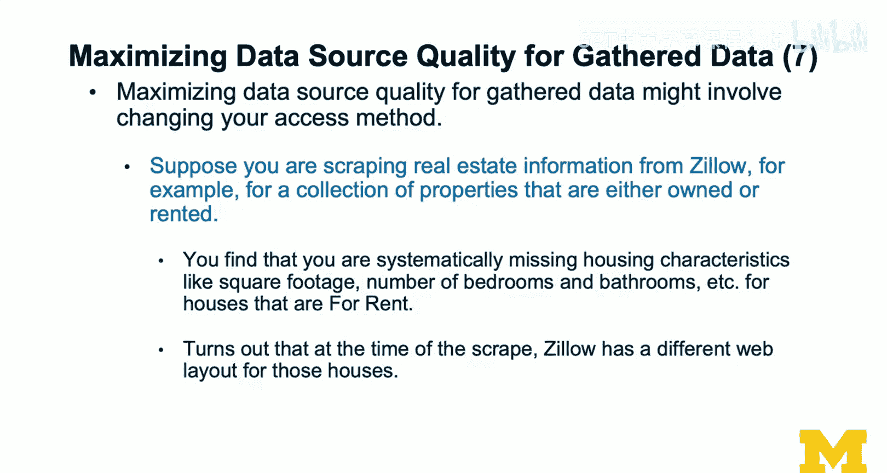
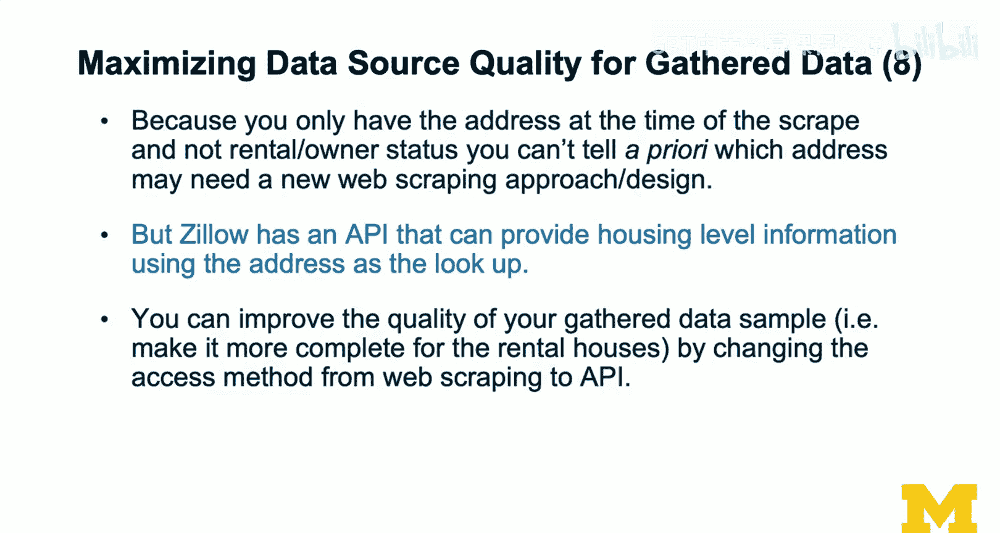
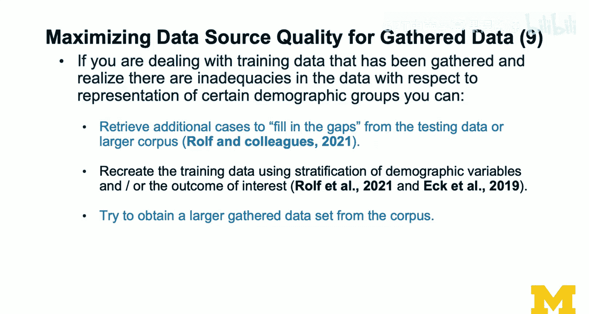
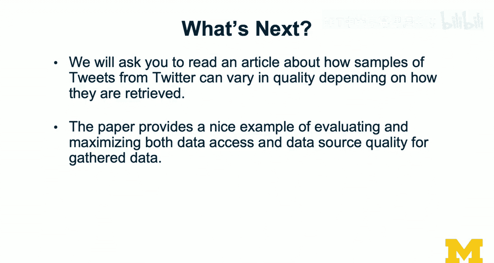

# 18：最大化采集型数据源质量 📈


在本节课中，我们将学习如何最大化**采集型数据**的数据源质量。我们将探讨采集型数据与设计型数据在数据源上的关键区别，并介绍几种提升其质量的具体策略，包括利用数据本身推断信息、改进数据访问方法以及优化训练数据集。

---

## 框架中的定位 🗺️

上一节我们讨论了数据质量的整体框架。本节中，我们来看看如何最大化**采集型数据**的数据源质量。


在框架中，数据源位于“表示”一侧。对于**设计型数据**，数据源是从抽样框中选出的样本。而对于**采集型数据**，数据源既指被提取的信息类型，也指数据起源的平台或存储库。例如，数据源可能是一组来自推特用户的推文集合，也可能是一个来自县税务评估办公室的家庭行政记录数据集。

---

## 采集型数据的误差与补偿 🔄

对于设计型数据，覆盖率、无应答等误差的影响通常可以通过加权调整或依赖辅助信息的模型来补偿。

然而，对于采集型数据，尤其是数字痕迹数据，除了数据本身的内容（如博客文章或推文的内容）外，我们几乎不了解其他辅助信息。

一个不断增长的研究领域正在探索如何预测数字痕迹数据（特别是社交媒体数据）的用户人口统计特征，这些特征可用于加权或将数字痕迹数据与目标人群进行比较。

在某些情况下，推特或脸书等平台可能提供用户资料数据。公开的个人资料页面可能包含姓名、用户名、头像、简短传记、选定的人口统计信息或其他元数据（如粉丝数、点赞数、好友数等）。不过，基于个人资料信息推断出的人口统计特征在完整性上差异很大。例如，Sloan在2010年的研究中估计，大约69%的推特用户在其个人资料中包含了简介。

Heinz和Joinsson在2018年对327篇已发表文章进行了全面综述，这些文章旨在基于数字痕迹信息推断或建模用户的各个方面。他们发现：
*   **性别**可以从数字痕迹数据中合理且一致地推断出来，观察到的准确率高达**80%**。
*   **年龄**的推断准确率稍低，但一些研究仍报告了高达**70%**的准确率。
*   **政治倾向**则更难推断，报告的准确率大约在**25%**左右。

Wang及其同事开发了一种从数字痕迹数据推断人口统计特征的综合方法，然后将其用于加权调整，以得出更准确的基于人群的估计。具体来说，他们使用了一个**多语言、多模态、多属性的深度学习系统**，仅根据用户的**头像、用户名、个人资料名称和简介**来推断其年龄、性别和账户类型等人口统计特征。他们开发了一个基于包含概率（或权重）的去偏估计框架，这些概率被建模为推断出的人口统计特征和已知人口总数的函数。

```python
# 概念性代码示例：基于推断特征进行加权调整
inferred_demographics = deep_learning_model.predict(profile_picture, username, bio)
weight = calculate_weight(inferred_demographics, known_population_totals)
adjusted_estimate = apply_weight(original_estimate, weight)
```

---

## 改进数据访问方法 🛠️

上一部分我们讨论了利用数据本身的信息进行推断和补偿。本节中，我们来看看通过改变**数据访问方法**来提升数据源质量。

假设你正在从Zillow网站上抓取一系列房产（无论是自有还是出租）的房地产信息。你发现，对于出租的房屋，你系统地缺失了房屋特征信息，如面积、卧室和浴室数量。

原因在于，在抓取时，Zillow为出租房屋和出售房屋设计了不同的网页布局。你的网络爬虫程序是为抓取出售房屋的信息而编写的，工作正常。但对于出租房屋，这些信息的格式不同，导致你的爬虫最终在这些关键字段上一无所获。由于在抓取时你只有地址信息，无法预先知道哪些地址需要采用新的网页抓取方法。

然而，Zillow提供了一个**应用程序编程接口**，可以使用地址作为查询键，提供你所需的房屋层级信息变量。

通过将访问方法从**网络抓取**改为**API调用**，你可以提高采集数据样本的质量。

```python
# 概念性对比：网络抓取 vs. API调用
# 旧方法：网络抓取（易受布局变化影响）
data_scraped = scrape_zillow_webpage(address)
# 新方法：API调用（更稳定、结构化）
data_from_api = call_zillow_api(address, api_key)
```

这种改变使你能够从出售和出租的房屋中收集到一致数量的信息。




---

## 优化训练数据集 🧠



数据源质量影响采集型数据的另一个场景是，当我们将其用作开发模型的**训练数据**时。

如果你正在处理采集来的训练数据，并发现这些数据在某些人口统计群体的代表性方面存在不足，你可以尝试以下方法来填补这些空白：

以下是几种优化训练数据集的策略：
1.  **从测试数据或更大数据集中检索额外案例**：尝试从测试集或更大的数据语料库中检索额外的案例来填补空白，正如Rolf及其同事在2021年所讨论的。
2.  **通过分层重新创建训练数据**：根据人口统计变量和/或感兴趣的结果对训练数据集进行分层抽样，使训练数据集本身更加完整。
3.  **获取更大的采集数据集**：尝试从语料库中获取更大的采集数据集，以弥补某些方面的不足。


这里的主要目标是提高输入模型的数据源的整体质量，从而提升模型后续的准确性。

---



## 研究实践中的建议 📝


越来越多的研究表明，如果研究人员集体在发表物中利用宝贵的篇幅来阐述以下几点，采集型数据的质量也能得到提升：

以下是在论文中应包含的有价值信息：
*   **数据访问或存储库的细节**：说明所使用的数据访问方法或存储库，以及在使用这些工具时必须进行的任何调整。
*   **特定样本的数据质量问题**：包含与你所采集的特定样本相关的数据质量和收集的具体问题。
*   **关键词选择与理由**：说明你使用了哪些关键词来访问信息，为什么选择这些关键词，以及为什么不选择其他关键词。
*   **样本与总体的关系**：包含更多关于所分析内容的信息，以及你采集的数据与可用完整数据语料库之间的关系。

将这些信息包含在论文的“数据”或“方法”部分非常有价值，有助于其他研究人员复现你的结果，并理解使用这些关键词对你所获取数据的影响。

---

## 总结 📚

本节课中，我们一起学习了最大化采集型数据源质量的几种核心策略：

1.  **利用数据推断信息**：通过数字痕迹数据本身（如个人资料）推断用户人口统计特征，并用于加权调整，以补偿代表性偏差。
2.  **优化访问方法**：将不稳定的网络抓取方法改为更稳定、结构化的**API调用**，以确保数据获取的一致性和完整性。
3.  **完善训练数据**：通过补充案例、分层抽样或扩大数据集来优化用于模型训练的采集数据，提升其代表性。
4.  **促进研究透明度**：在学术发表中详细记录数据访问方法、关键词选择和质量问题，以利于复现和知识积累。




理解并应用这些策略，对于确保基于采集型数据的研究和分析结果的可靠性与有效性至关重要。接下来，你将阅读一篇关于推特样本质量如何因检索方式不同而变化的文章，这将是一个评估和最大化采集型数据访问及数据源质量的绝佳案例。