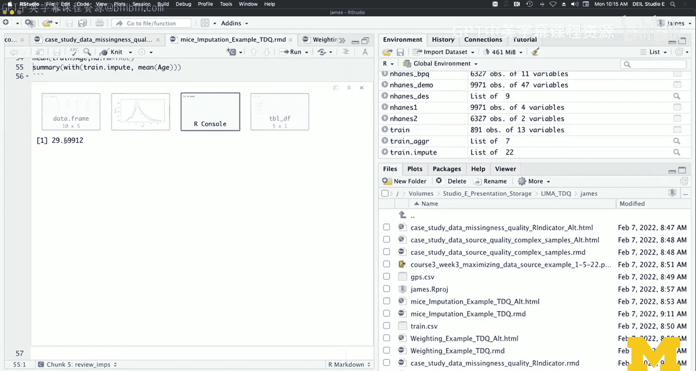
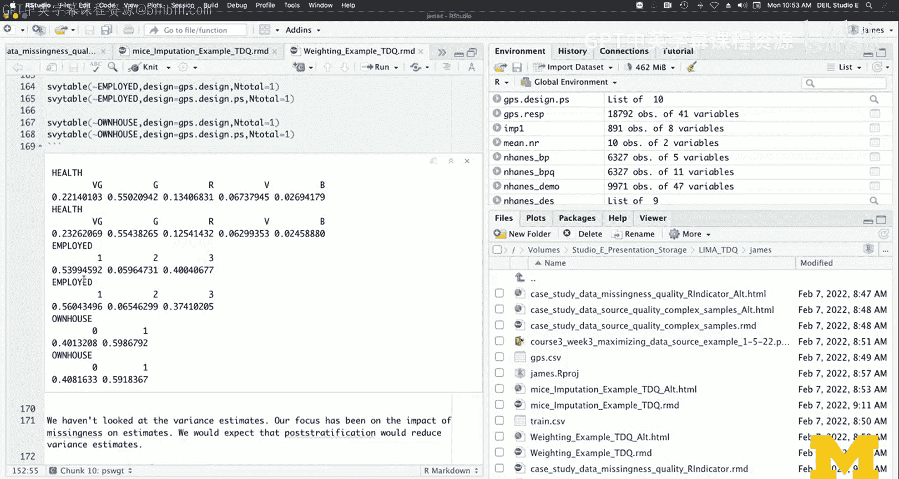

# 20：示例：插补与加权调整技术 🛠️


在本节课中，我们将通过真实数据和代码，学习处理设计数据中缺失值的两种核心方法：多重插补和加权调整。我们将使用R语言中的`mice`和`survey`等包，以泰坦尼克号数据集和一项荷兰家庭调查数据为例，演示如何实施这些技术并评估其效果。

## 加载必要的R包与数据

首先，我们需要加载分析所需的R包。对于插补部分，我们将使用`mice`包。对于可视化缺失模式，`VIM`包很有帮助。对于加权调整，我们将使用`survey`和`PracTools`包。

```r
# 加载用于插补和加权的包
library(mice)    # 用于多重插补
library(VIM)     # 用于可视化缺失数据模式
library(survey)  # 用于复杂调查数据的加权与分析
library(PracTools) # 用于创建加权调整
```

## 第一部分：使用多重插补处理缺失数据

上一节我们介绍了处理缺失数据的一般框架，本节中我们来看看具体的插补技术。我们将以著名的泰坦尼克号数据集为例，该数据集常被用于预测乘客生存概率，但其中“年龄”变量存在缺失。

### 检查缺失数据模式

处理任何设计数据中的缺失值时，第一步都是检查缺失模式。对于像泰坦尼克号这样相对较小的数据集，`mice`包提供了一个函数来绘制缺失情况。

```r
# 从Kaggle加载泰坦尼克号训练数据集
titanic_url <- "https://raw.githubusercontent.com/.../titanic_train.csv" # 示例URL
titanic_data <- read.csv(titanic_url)

# 使用mice包的md.pattern函数查看缺失模式
md.pattern(titanic_data, plot = TRUE)
```
运行上述代码后，我们会看到一张图。红色条形表示存在缺失值的位置。在这个数据集中，所有缺失值都来自“年龄”变量。右侧信息显示，年龄值的完整率为80%，缺失率为20%。如果其他变量也有缺失值，信息也会在此显示。由此我们首先了解到：年龄是唯一有缺失值的变量，20%的年龄值缺失。

### 执行多重插补

`mice`包用于创建插补值。我们将移除一些与插补无关的变量（如乘客姓名），将插补数量设置为5（这是一个较小的数字，适合演示。通常，缺失率越高，使用的插补数应越多。在现代计算条件下，插补100个值通常是可行的）。我们还将最大迭代次数设为50，并使用**预测均值匹配**作为插补方法。设置随机种子以确保结果可重现，并关闭控制台更新打印。

```r
# 准备数据：移除无关变量
vars_to_keep <- c("Survived", "Pclass", "Sex", "Age", "SibSp", "Parch", "Fare", "Embarked")
titanic_for_impute <- titanic_data[, vars_to_keep]

# 设置插补参数
imp <- mice(titanic_for_impute,
            m = 5,              # 生成5个插补数据集
            maxit = 50,         # 最大迭代次数为50
            method = "pmm",     # 方法：预测均值匹配
            seed = 12345,       # 设置随机种子
            printFlag = FALSE)  # 不打印迭代过程
```

### 检查插补结果

创建插补值后，必须进行检查，以确保插补效果良好，没有因建模方法不当而产生问题。这是一个重要的质量控制步骤。



以下是检查插补值的代码：

```r
# 1. 查看前10个案例的插补值
head(complete(imp, 1), 10) # 查看第一个插补数据集的前10行

# 2. 绘制年龄的密度图，比较原始缺失数据和5个插补数据集
densityplot(imp, ~Age)

# 3. 计算并比较插补前后的年龄均值
# 原始数据（含缺失）的年龄均值
mean_original <- mean(titanic_for_impute$Age, na.rm = TRUE)
cat("原始数据（含缺失）年龄均值：", mean_original, "\n")

# 5个插补数据集的年龄均值
imp_means <- sapply(1:5, function(i) mean(complete(imp, i)$Age))
cat("5个插补数据集的年龄均值：", imp_means, "\n")
```
运行代码后，我们首先看到前10个案例的插补值。你会注意到，对于同一个缺失元素，每次插补的值并不相同。这是因为我们的模型对预测存在不确定性，插补不同的值是将这种不确定性编码到分析中的一种方式。

接着，密度图显示了未插补数据的年龄分布（蓝线）以及每个插补数据集年龄均值的分布。许多插补值集中在20岁左右，这表明模型预测大部分年龄缺失的乘客大约是这个年龄。

最后，我们看到插补前后的年龄均值变化不大。未插补数据的均值约为29.4，而五个完全插补数据集的均值在28.7到29.5之间，范围相对较小。

### 使用插补数据进行建模分析

现在我们有了插补数据集，可以进行描述性统计或建模分析。在这个数据集中，我们通常使用逻辑回归来估计乘客在泰坦尼克号沉没事件中的生存概率。多重插补估计将返回与插补相关的信息，以及围绕这些插补值的不确定性。


```r
# 对5个插补数据集分别拟合逻辑回归模型，并池化结果
model_fit <- with(imp, glm(Survived ~ Pclass + Sex + Age + SibSp + Parch + Fare, family = binomial))
pooled_model <- pool(model_fit)
summary(pooled_model)
```
多重插补估计返回了几个关键指标：
*   **`ubar`**：平均组内方差。即五个逻辑回归模型中截距（或系数）方差的平均值。
*   **`b`**：组间插补方差。即五个不同截距（或系数）之间的变异性。
*   **`t`**：总方差，由`ubar`和`b`组合而成。
*   **`riv`**：由于缺失数据导致的方差相对增加量。
*   **`lambda`**：由于缺失数据导致的方差比例。
*   **`fmi`**：缺失信息比例。

这些指标告诉我们缺失数据在分析中造成了多少低效性。这个汇总结果提供了适当的估计值和标准误，使我们能够评估缺失数据的影响。

### 与仅使用观测数据的模型比较

为了对比，我们可以在仅使用观测数据（即忽略20%的年龄缺失案例）的情况下估计相同的模型。

```r
# 仅使用无缺失年龄的观测数据拟合模型
titanic_complete <- titanic_for_impute[complete.cases(titanic_for_impute$Age), ]
model_obs <- glm(Survived ~ Pclass + Sex + Age + SibSp + Parch + Fare,
                 data = titanic_complete,
                 family = binomial)
summary(model_obs)
```
比较两个模型的输出，我们重点关注年龄的估计值。在插补后，年龄的影响约为-0.03，表明在这个模型中，年龄越大，生存可能性越低（注：根据上下文，此处原视频描述可能有误，实际系数符号需以运行结果为准）。而在仅使用观测数据的模型中，估计值约为-0.04，比使用插补数据的模型估计值略大。标准误也存在差异。

在这个案例中，插补可能没有显著改变我们的结论，但如果不执行这个程序，我们就无法知道这一点。因此，遵循我们概述的质量控制步骤（即检查数据、准备插补模型、审查插补结果然后进行分析）始终是重要的。如果我们遵循这些步骤，就能尽最大努力解决设计数据问题中的缺失数据。

## 第二部分：使用加权调整处理缺失数据

上一部分我们介绍了插补技术，本节中我们来看看处理设计数据中缺失值的另一种方法：加权调整。我们将使用一项模拟的荷兰家庭调查数据，该数据包含受访者和未受访者的信息，这是校正无回答偏误所必需的。

### 加载与探索数据

我们首先加载数据集，并熟悉其结构。理想情况下，我们需要寻找既能预测无回答，又与调查结果变量相关的预测变量。在这种情况下，使用这些特征进行加权最有可能减少无回答偏误。

```r
# 加载家庭调查数据（示例URL）
survey_url <- "https://.../nonresponse_data.csv"
survey_data <- read.csv(survey_url)

# 查看数据结构与关键变量
str(survey_data)
# 我们关注四个关键结果变量：general_health, politics, employed, own_house
# 以及抽样框中可用于所有案例的预测变量，如 gender, urban, age_cat, region, has_job, married, children
```

### 分析预测变量与结果变量的关系

在构建任何无回答调整模型之前，我们应该花时间了解数据集。我们需要检查抽样框上的变量与我们感兴趣的关键调查变量之间的双变量关系。

例如，我们可以查看自我报告的健康状况与城市化程度之间的关联：

```r
# 双变量分析示例：健康状况 vs. 城市化程度
chisq.test(table(survey_data$general_health, survey_data$urban))
# 可视化关联
mosaicplot(table(survey_data$general_health, survey_data$urban), main = "Health by Urbanicity")
```
卡方检验的小p值表明健康与城市化程度存在某种关联。从马赛克图中，我们可以看到“健康状况差”的群体与城市化程度有较强的关联。这告诉我们这是一个有用的预测变量。

我们应对数据集中的许多变量重复此类分析，以了解双变量关系。完成这些分析后，我们可以转向多元分析。

### 建立无回答模型

下一步是建立无回答模型。我们希望关注那些在预测关键调查变量时有用的变量。

首先，我们建立一个逻辑回归模型，预测一个关键结果变量（如`own_house`）与抽样框中多个预测变量的关系。

```r
# 多元分析：预测 own_house
model_outcome <- glm(own_house ~ gender + urban + age_cat + region + has_job + married + children,
                     data = survey_data[survey_data$respondent == 1, ], # 仅受访者
                     family = binomial)
summary(model_outcome)
```
看起来所有这些变量都与是否拥有房屋有一定关系。因此，如果它们也与回答行为相关，就可能帮助我们解决调查中因缺失数据（无回答）而产生的任何偏误。

我们对四个关键结果变量都应进行此类多元模型分析。接下来，我们建立无回答模型，将上述分析中显著的预测变量纳入，用于预测回答概率。

```r
# 无回答模型：预测回答状态 (respondent)
model_nonresponse <- glm(respondent ~ gender + urban + age_cat + region + has_job + married + children,
                         data = survey_data, # 使用全部样本（含未回答者）
                         family = binomial)
summary(model_nonresponse)
```
从结果看，性别、部分城市化类别、地区、是否有工作、婚姻状况和子女数量都是回答的显著预测因素。年龄类别虽然统计上不显著，但我们仍将其保留在模型中，因为年龄通常与回答概率相关。

### 创建基于响应倾向的加权调整

估计出的回答倾向可能受到模型设定误差和抽样误差的影响。为了平滑这些误差，我们通常根据估计的倾向得分创建层，然后使用每层中回答率的倒数作为无回答调整权重。

`PracTools`包中的`pclass`函数可以完成这项工作。

```r
# 使用pclass函数基于倾向得分创建10个层
survey_data$pclass <- pclass(formula = respondent ~ gender + urban + age_cat + region + has_job + married + children,
                             data = survey_data,
                             type = "unweighted",
                             link = "logit",
                             g = 10,          # 创建10个层
                             out = "class")   # 仅输出分类变量

# 计算每层的平均回答率，并生成逆权重
library(dplyr)
stratum_rates <- survey_data %>%
  filter(respondent == 1) %>% # 仅计算回答者
  group_by(pclass) %>%
  summarise(response_rate = n() / nrow(survey_data[survey_data$pclass == first(pclass), ]))

# 将回答率合并回数据集，并计算逆权重
survey_data <- left_join(survey_data, stratum_rates, by = "pclass")
survey_data$nonresp_weight <- ifelse(survey_data$respondent == 1,
                                      1 / survey_data$response_rate,
                                      NA) # 未回答者无权重
```

### 检查加权调整结果

与插补或其他程序一样，我们需要进行一些质量检查。

```r
# 检查权重的分布和总和
# 1. 查看10个不同权重的值
unique(survey_data$nonresp_weight[!is.na(survey_data$nonresp_weight)])

# 2. 绘制权重直方图
hist(survey_data$nonresp_weight[!is.na(survey_data$nonresp_weight)],
     main = "Distribution of Non-response Weights",
     xlab = "Weight")

# 3. 检查回答者权重的总和是否接近总样本量
total_sample_size <- nrow(survey_data)
sum_weights <- sum(survey_data$nonresp_weight, na.rm = TRUE)
cat("总样本量：", total_sample_size, "\n")
cat("回答者权重总和：", sum_weights, "\n")
```
我们应该看到大约10个不同的权重，范围可能在1.38到2.7之间。直方图显示其中一个权重可能有点异常值，可能需要调查该组为何有如此低的回答率，以至于需要赋予约2.7的权重。最后，检查确认这些权重的总和等于（或非常接近）总样本量。

### 使用权重进行分析并比较

现在，我们使用刚刚开发的权重进行分析，看看它们有什么影响。我们将查看选定的四个关键结果变量，首先看未加权表格作为比较，然后看经过无回答调整的表格。

```r
# 创建仅包含回答者的数据集
resp_data <- survey_data[survey_data$respondent == 1, ]

# 1. 未加权分析（例如，健康状况）
table_unweighted <- prop.table(table(resp_data$general_health))
print("未加权健康状况分布：")
print(table_unweighted)

# 2. 加权分析
# 首先，指定调查设计，包含权重
survey_design_nonresp <- svydesign(ids = ~1, # 简单随机抽样假设
                                   weights = ~nonresp_weight,
                                   data = resp_data)
# 获取加权的调查表格
table_weighted <- svymean(~general_health, survey_design_nonresp)
print("无回答加权后的健康状况分布：")
print(table_weighted)
```
我们对`employed`（就业状况）和`own_house`（是否拥有房屋）变量重复上述过程。

比较结果发现：
*   **健康状况**：加权和未加权的分布看起来非常相似，无回答权重对结果影响不大。
*   **就业状况**：发生了显著变化。这是因为抽样框中的`has_job`变量与回答行为和调查中的`employed`变量都强烈相关，因此无回答调整导致了估计值的显著改变。
*   **是否拥有房屋**：差异不如就业状况那么剧烈，但仍然相当可观。

由此可见，无回答调整并未对自我报告的健康状况估计产生太大影响，但对另外两个变量有显著改变。这凸显了进行分析时执行这些调整的重要性。

### 事后分层调整

我们之前提到过两种调整。无回答调整是使回答者看起来像他们来自的样本。现在我们将看第二种调整：**事后分层**。事后分层使用关于总体的信息，可以减小方差估计，如果所用变量与调查变量相关，还能减少偏误。

其机制与无回答调整类似：我们想要使用那些既能预测回答又能预测调查变量的预测因子。但这里我们使用的是**总体数值**，而非样本数值。

在这个例子中，为简化问题，我们仅使用年龄信息进行事后分层。我们需要获得总体中三个年龄类别人口数量的数据。

```r
# 假设已知总体中三个年龄类别的人口数量（单位：百万）
population_totals <- data.frame(
  age_cat = c("18-34", "35-54", "55+"),
  Freq = c(5.0, 4.0, 3.0) * 1e6 # 转换为实际数量
)

# 设置包含无回答权重的调查设计
survey_design <- svydesign(ids = ~1,
                           weights = ~nonresp_weight,
                           data = resp_data)

# 应用事后分层，使样本的年龄分布与总体匹配
survey_design_poststrat <- postStratify(survey_design,
                                        strata = ~age_cat,
                                        population = population_totals)

# 验证事后分层是否成功：加权后的年龄分布应匹配总体
svytable(~age_cat, survey_design_poststrat)
```
运行代码验证后，加权总数与总体分布相匹配，确认事后分层按预期工作。

现在，让我们回到刚才使用无回答调整查看的三个变量，使用事后分层估计量再次查看。

```r
# 比较无回答调整权重和事后分层调整后的估计
# 健康状况
svymean(~general_health, survey_design) # 仅无回答调整
svymean(~general_health, survey_design_poststrat) # 加上事后分层

# 就业状况
svymean(~employed, survey_design)
svymean(~employed, survey_design_poststrat)

# 是否拥有房屋
svymean(~own_house, survey_design)
svymean(~own_house, survey_design_poststrat)
```
比较发现：
*   **健康状况**：事后分层带来了微小变化。
*   **就业状况**：存在一些调整，虽然不如无回答调整那么剧烈，但纳入事后分层仍然有影响。
*   **是否拥有房屋**：情况类似。



我们的重点一直是缺失对点估计（本例中的比例、分布）的影响。我们预计事后分层会减小方差估计。我们观察到，对于一些估计，无回答调整和事后分层确实产生了影响。特别是，无回答调整对我们根据调查回答得出的当前就业状况估计产生了强烈影响。

理解为何发生这种情况很重要。首先，它提供了一个有用的质量控制步骤，以确保加权方法是合理的。其次，在规划未来的调查数据收集时，了解样本的哪些维度因无回答而代表性不足，将使我们能够预先计划，尝试减少这些维度的无回答，从而提高调查估计的质量，减少对此类调整因子的依赖。

## 总结

本节课中我们一起学习了处理设计数据中缺失值的两种实用技术：**多重插补**和**加权调整**。

*   **多重插补**通过构建模型预测缺失值，并创建多个完整数据集来捕捉不确定性，最后通过池化结果得到总体估计。关键步骤包括检查缺失模式、执行插补、验证插补质量以及使用适当方法分析池化数据。
*   **加权调整**（特别是无回答调整和事后分层）通过为回答者赋予权重，使他们在某些特征上的分布与样本或总体保持一致，从而纠正因缺失导致的偏误。关键步骤包括识别与回答和关键结果变量都相关的预测因子、建立回答模型、基于倾向得分创建调整权重，并进行严格的质量检查。


这两种方法都需要谨慎执行，并在每一步进行仔细审查。我们在演示中简化了一些步骤，在实际应用中，应利用所有可用数据，完整执行每个步骤，以尽可能减少无回答偏误。通过本教程，你应该对如何实施这些步骤来解决设计数据中的缺失问题有了一个全面的了解。