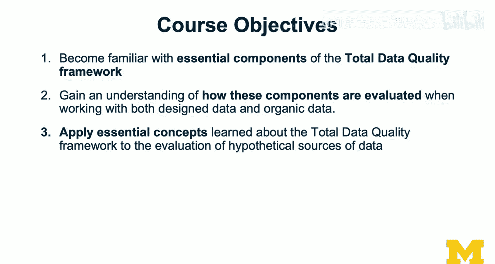

# 密歇根大学《总体数据质量（框架、度量、设计策略）total data quality》 p02 1_课程1导论：全数据质量框架体系.zh_en -BV1Jn4y1X7uS_p2-

Welcome to this introduction to course 1。 This is just a short lecture。

 We're going to talk about the objectives of this course。 And we have three main objectives。

 The first is to become familiar with the essential components of the total data quality framework。

 So that means we're going to spend some time looking at concepts and definitions。

The second objective is to gain an understanding of how these components are evaluated when working with both designed and organic data。

So that involves how do we measure the quality of the different dimensions of the framework？

The last objective is to apply these essential concepts to the evaluation of hypothetical sources of data。

 So we're going to have some applications， real world applications where we take those concepts and apply them in a very practical way。

So those are the main objectives of this course， we're excited to have you here and we're ready to get started。

