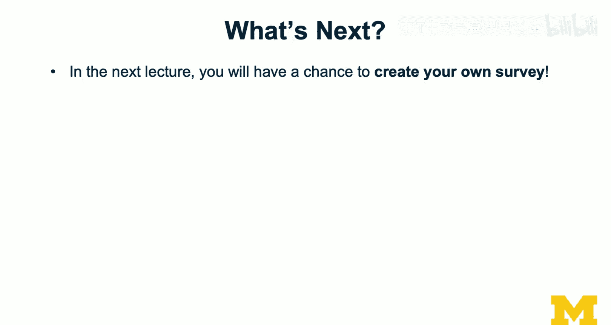

# 密歇根大学《总体数据质量（框架、度量、设计策略）total data quality》 p03 2_什么是设计型数据.zh_en -BV1Jn4y1X7uS_p3-

Welcome to this lecture on design data， and we're going to define what we mean by design data。

What are design data？There's four elements that we're going to emphasize in our definition of design data。

 The first and perhaps most important is that they are designed for an analyst or researcher。

 That means that the analyst has the opportunity to be sure that the data are those most suitable for answering their particular question。

A second aspect is that the data are collected from persons or establishments。

 and we do our best job to make sure that those， the population of persons or establishments we're interested in are well represented。

A third aspect of design data is that we're asking scientifically designed questions。

 Why do we emphasize that term scientifically designed。

 Because we want to make sure that the answers， the responses to the questions correspond to the target concepts we're trying to measure。

And we have a rigorous process for designing questions。

We know that the form of the question can influence the response。

 And so we want to be sure that the responses to those questions actually match the target concepts we're trying to measure。

We'll spend more time looking at the process of scientifically designing questions in a later lecture。

The fourth aspect of design data is that they're collected through different modes。

 And here we'll emphasize that some of those modes include an interviewer。

 whether that's in person or over a video connection or via telephone。

But there are also self administered modes for surveys。

 a survey can be mailed to you a paper form that you then complete。

 It can be sent to you via text message or S， M S， short message service。

 or you can complete a survey over the Internet using a web form。

So those are the four aspects of designed data。Now just thinking about the design data process。

 we generally think of design data as having three phases。The first phase is that design phase。

 reusing that word again， design。 And this is where the scientist， the analyst， the researcher。

 has the opportunity to shape how the data are going to look like， what they're going to look like。

 So what type of data are you going to collect， qualitative or quantitative。

 How will you collect those data。 What form will the measurement take。

 including the design of the questions。And what will the data elements look like once the data collection is complete？

So a researcher needs to have a plan for all of those elements。

Then we can start the data collection process。 That's the second phase shown in the figure。

 And we usually start with sampling of some form， whether it's probability sampling or non probability sampling。

 What are the sample sizes， How do we access those persons。

 All of those are questions that we'll look at in later lectures。Once we have a sample。

 we need to recruit those persons or establishments to participate in our data collection。

 We want them to participate because it helps us ensure good representation of the population of persons or establishments we're interested in。

Once we've had them recruited， then we collect the data。

 And this involves usually a respondent answering questions。

The last phase is data processing and analysis now similar to use of organic data。

Processing is an important step for design data。There's cleaning， consistency checks， coding。

Dealing with missing values and other steps that need to be taken to ensure that the quality of the data is the best that it can be。

Again， we'll spend significantly more time on this part of the data collection process in later lectures。

Other steps include weighting and calibration， which aim to improve the representation of our sample with respect to the population。

 we want our。The persons who've decided to participate in our survey to best represent the population of interest。

And the last step in this phase is analysis。 Once we have all of the data collected。

 we want to do an analysis that reflects the design that we've used。 Again。

 we'll spend more time talking about this part of the process in later lectures。Now。

 let's take a look at some。Types of data that may be designed。

 but are not designed data in the sense that we mean it。For example。

 administrative records are designed。But they're not designed in the way we've been defining it here。

 That is， they're not designed for analysis。 They're designed for administration。So， for example。

 unemployment insurance payments are important for the administration of unemployment payments。

But they're not really designed for analysis。And one of the implications of that distinction。

 those administrative records may not measure the concept of interest to the analyst。

So using that same example， unemployment insurance payments record reported income。

 but not other types of income。 So if someone one has other sources of income that are not reported。

Than those would not be included in administrative records。And then that way。

 those administrative records may not actually measure the concept of interest to the analyst。

A second example of a type of data that may seem to be designed is machine learning often uses labels for gathered data。

And then the question is， are those labels designed。The answer is yes。

 but not in the same sense that we mean it。 Gaed data are not designed for analysts。

 The labels might be designed for the analyst， but they're often grafted onto data that are not。

Nevertheless， principles of design often apply to the labeling process。

 So how do we develop those labels and what is the quality of the labels that we've developed， So。

 for example， human centric labels often include measurement error When we ask human beings to describe a photograph。

 They may give us different responses depending upon their own backgrounds。And other factors。

 And as a result， there can be measurement error in those labels。

 That's a concept that we'll return to in later lectures。So in summary。

 design data have several important components。 First， they're intended for analysis。

 They're designed by researchers who have particular questions。

 and that design allows them to match the data to the target concept。

These data are most frequently collected via a survey。

The data generation is specified by a research plan。 Again， a research plan designed by the analyst。

And they follow scientific principles in their design。This approach allows us to get。Valid results。

The principles of design are also relevant for gathered data and will return to that idea in several of the lectures in this course。

What's next in the next lecture， you'll have a chance to create your own survey。

 so we'll look forward to seeing you there。😊。

