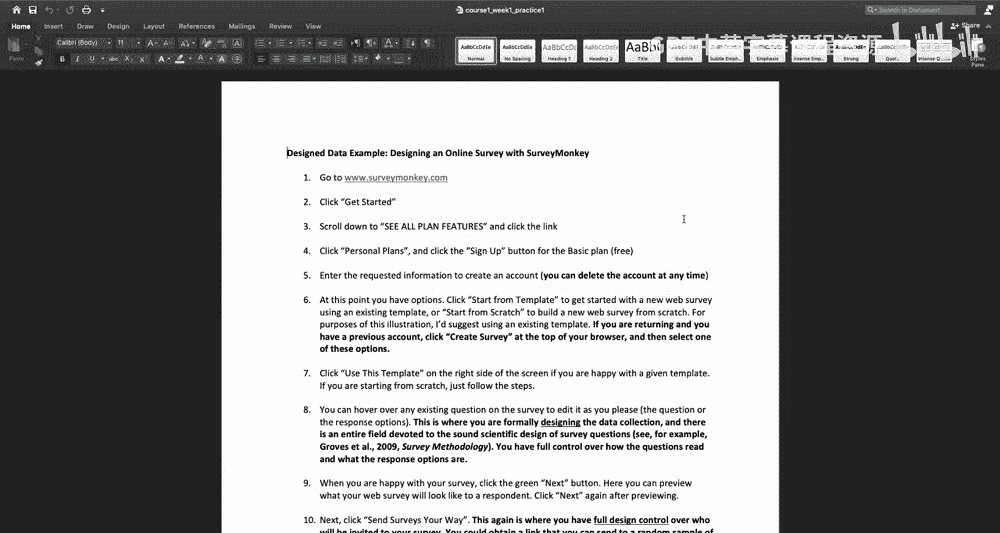
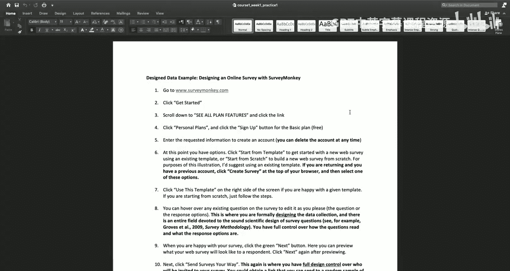
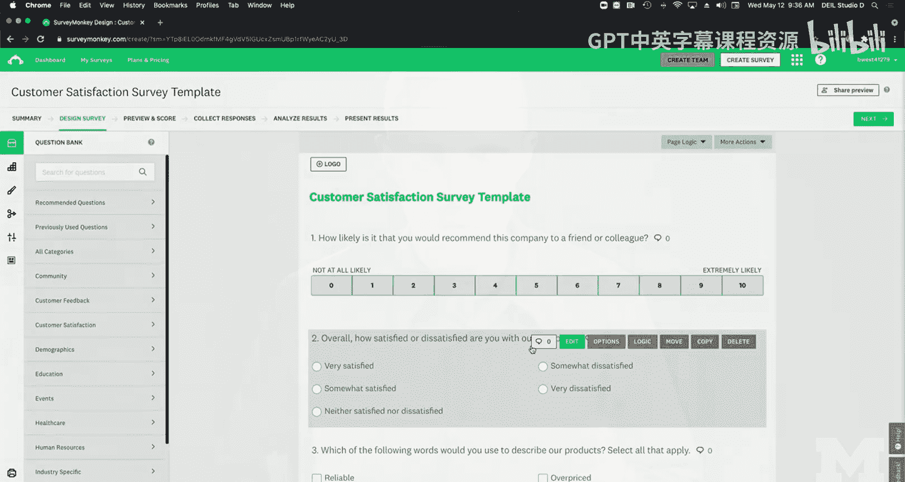
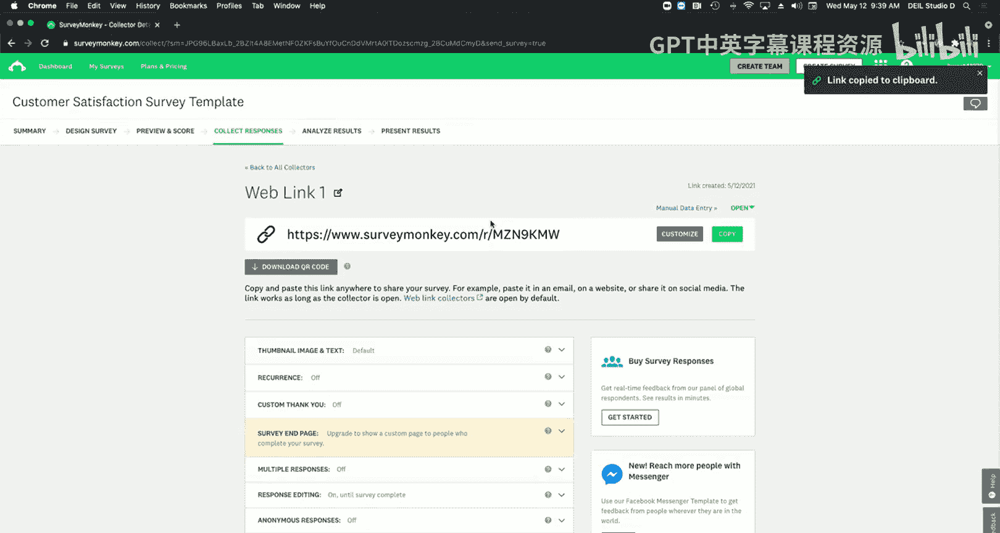
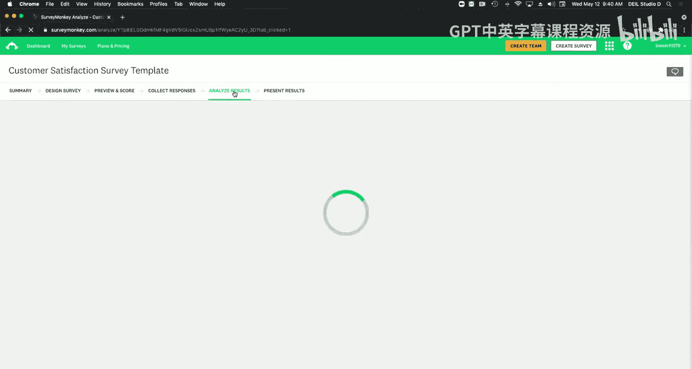
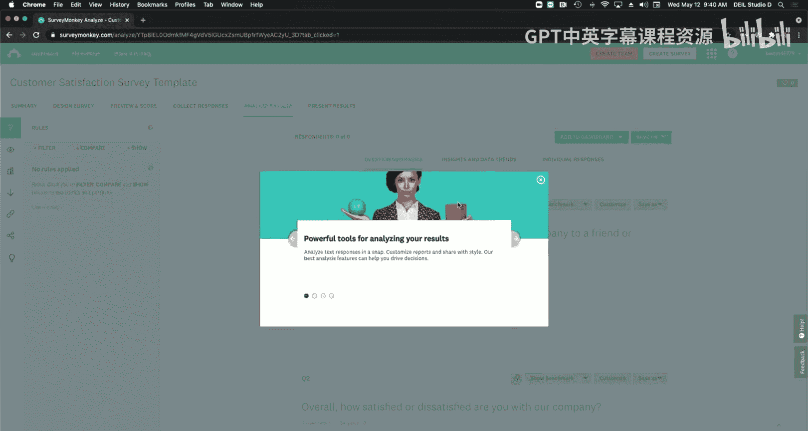
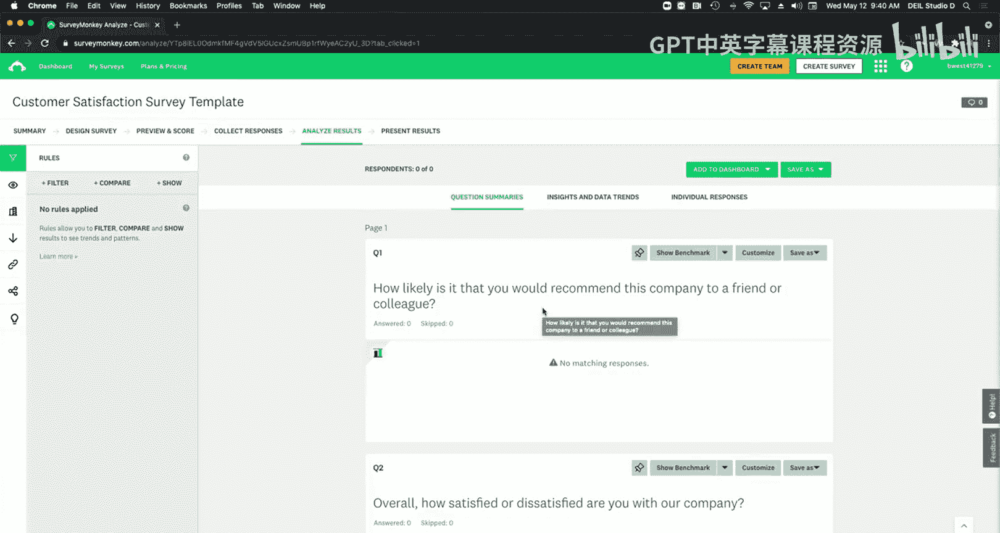
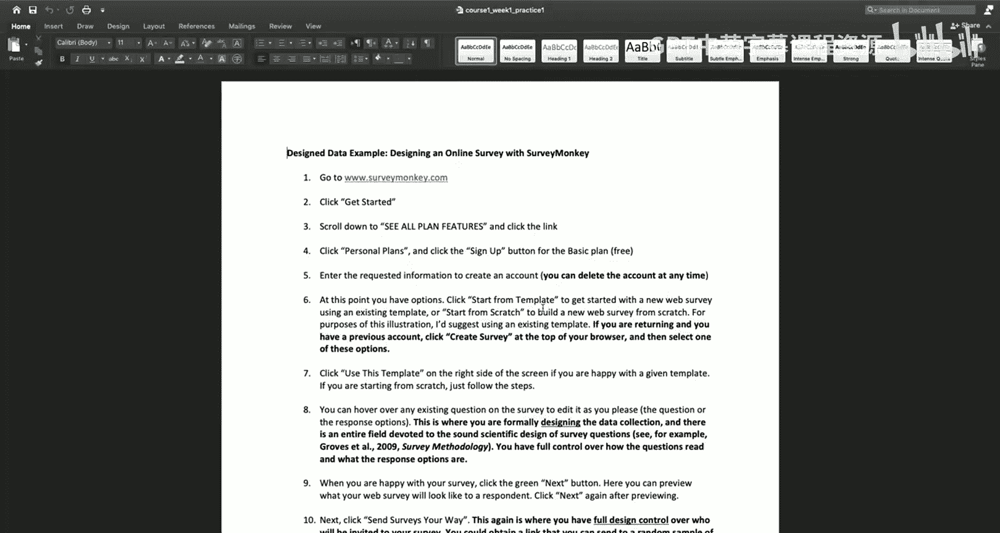
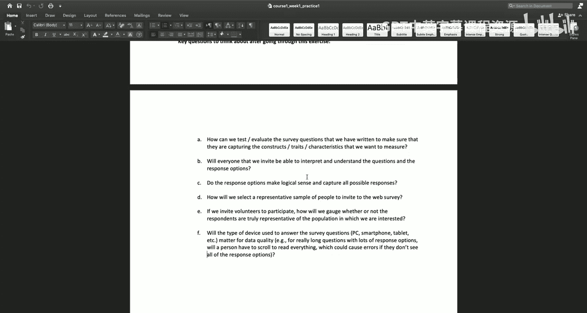

# 密歇根大学《总体数据质量（框架、度量、设计策略）total data quality》 p04 3_示例：使用SurveyMonkey开发在线问卷.zh_en -BV1Jn4y1X7uS_p4-

Okay， hello everyone， in this demonstration we're going to look at an example of how to create design data by designing an online survey with Survey Monkey。

 so this is a very popular online tool for designing web surveys and we're going to go through a demonstration of how to set up your own survey and then start to collect some responses as an example of collecting design data。

So this word document that you see for this demonstration today shows the steps that are required to start an accountant survey monkey and then start to design your own questions and collect your own data。

 so our hope was that you'd be able to play around and follow these steps and create one of your own surveys and then maybe try to share it with some of your friends or some people for whom you have email addresses just to get an example and get a feel for how you might collect design data via an online survey。

Okay， so we're going to go through these steps， The first thing is to go to www。surveymonkey。com。

 So I've done that here， and when you get to this screen。

 you see this green button that says get started when you go to Sury Monkey。

 so I'm just going to click here。

And then you see a variety of different possible plans that you might have。

 depending on whether you're a business or whether you want to start your own personal surveys。

 you can click on these different plans， we're just going to sign up for the basic plan so if you go to this button at the top right here that says sign up that will allow you to start your own account and I'm just going to make up a fake account here for the time being with a temporary password。

And a temporary email。And then just use my temporary name here just to create the account。Okay。

 so after your account gets processed you can then get started with kind of the basics of the free plan and you see this page here that says how would you like to get started。

 start from template start from scratch So you could click start from scratch to really build your own survey from scratch。

 which is perfectly fine。 You're welcome to do that。

 We're gonna just demonstrate how to start from a template just so you can get a feel for what these different surveys look like and you see when you click start from template you have a variety of these different templates here。

 you could do a customer satisfaction survey like here's a coronavirus leadership check in。

 they have these kind of preset templates and you can always go back to start from scratch to if you would like What I'm going to do at this point is switch to a version of survey monkey where I've logged in under my own account and not a free account if you try with if you start with your own free account。

 you have to validate the account via email and so forth。

 so I'm not going go through those steps right now。

 but let's again go back to the same screen here under my own person。countWhere again。

 I could choose to start from a particular template if I wanted to。 So just for demonstration。

 I'm going to start with the customer satisfaction survey template。

Okay so after a second if you click on this option。

 you'll see an example of what this survey would look like and again。

 these are all kind of preset questions when you start from a template If I like this template。

 I can then go to the lower right here and click use this template。Okay so I'm happy with this。

 and then after a second， I'll get to the design window where I can actually start modifying these different questions that are part of the template and Sury monkeykey makes it very easy to either write your own question or modify the existing question。

 So for example， if I click on this first question。

 I can choose to edit that first question and change anything really that I want about the nature of that question and once I'm happy with that question。

 I can just click to save any changes that I make。Okay。

 and that'll save that as part of the overall survey instrument。

 Now I could go to the second question， choose edit。And I could change multiple choice options。

 I could change the question wording itself by clicking on this edit link here。 You see。

 I can now go in and change any of the response options。 the question wording itself。 And again。

 as soon as I am happy with the edits that I've made。

 I can again click save and that question will be committed to the overall survey。

 So you could go through this change the style of the questions change the wording。

 This is where there's an entire science behind question design。

 So the best ways to ask questions in a web survey。

 the best wording to use the best response options to provide there's an entire science behind this process。

 So we're going talk more about that within within the course here。

 But this is where that that magic kind of happens where the science of questionnaire design plays a role and you're formally designing these different questions that you want to ask in your survey。

 So let's suppose that I'm happy with all of my edits。 and I'm happy with how this survey looks。

 So Surve Monkey then let。

You go to the next step and you can click on the next button here in the upper right and the next step in the process is to allow you to preview this survey。

 So if you were an actual respondent， you could go through and provide all the different respondents that a hypothetical respondent might provide。

 So for example， how likely is it you recommend this company a friend or colleague S I click 7 then I go to the next question overall how satisfied or dissatisfied are you somewhatwhat dissatisfied and so forth and so on。

So I could answer all these questions just to get a sense。

Of the feel of answering the survey for a typical web survey respondent。

 make sure that we're happy with how this looks， how this feels， the question wording and so forth。

 So this is what a typical web survey respondent would do to generate this kind of design data for you when they're going through and answering the survey。

 So just entering hypothetical responses and then I can click done。

 and that will finish with the preview step， and I could preview again if I wanted to or whatever I'd like to do next in terms of editing。

 and you can always go back in the process and redesign some questions。

 If I'm happy with the preview， I can click next。😊。

And at that point you're going to see different options for collecting survey responses。

 so now that you have your survey you know generated looking the way that you want you have these options。

 so we recommend clicking sendend surveys your way。And at this point。

 you see you have a wide variety of options you can send the survey by email where you enter manually different emails that you want to send the survey to。

 you could share a survey link， so this is a great way where you could distribute the survey link to a random sample of individuals or to an entire email group or if you wanted to include that survey link in a letter that you're going to mail to a sample of individuals inviting them to participate in your survey。

 you could do this that way， so you could send a text message if you wanted to you could post on social media I'm going choose the option to share a survey link。

And after a second， Surve Monkey will generate the web link that you can choose to share via email or via a letter or whatever format you're going to use to distribute that link。

 I can then click copypy。And then that link will be copied to my clipboard and I could pasteed into a letter。

 I could paste it into an email， whichever approach I'd like。

 so suppose then that you distribute this web link you know via one of those different mechanisms。

 a random sample of addresses to you're including this in a letter or you send it via email one of those different mechanisms And then when people click on that link。

 they can then participate in the survey and respond to the different questions and surveymonkey will keep a collection of all those survey responses and Surmonkey will also update you as to when more and more responses are coming in so you can see how many responses you have your sample size will grow and Surmonkey will keep you updated as to how your survey is doing。

 So when all the survey responses come in then you can click analyze results。

And of course we don't have any responses here yet， but when you do have survey responses。

 the nice thing about Survey Monkey is that it will provide you with an analysis of responses to each of the questions so you can see we haven't generated any responses yet。

 but here Sur monkey would provide you with graphs and frequency tables。

 you can also download the data if you want to do your own analysis later on and then there's different options for presenting the results as well。

So that's pretty much it。 and again， these these steps are all captured in the word document。

 but that's a design data collection from start to finish。

 Now a lot of time goes into the questionnaire design and again。

 designing those questions so that they're easy to understand so they have good response options and they're measuring what you want them to measure。

 but that's really how this works via the survey monkey tool And again。

 that's one of many options for web surveys， but it's a very popular option that makes it pretty easy to design your own web surveys。

 So at the end of this word document， we just have a couple of additional questions for you to think about after you go through this exercise and think about a web survey that you might want to distribute。

 So first of all， how can we test or evaluate the survey questions that we've written to make sure that they're capturing the constructs traits and characteristics that we want to measure So this is related to validity in terms of the total data quality framework。

Second， will everyone that we invite to the survey be able to interpret and understand the questions and the response options。

 So that's where questionnaire design is so important in making sure that theres no there are no problems at the origin of the data。

 the survey respondents， so they can easily comprehend and respond to the different questions。Third。

 do the response options make logical sense and capture all the possible responses that a person might provide Fourth。

 how will we select a representative sample of people to invite to the web survey。

 So this has to do with data access and data source。

 which we'll be talking about in this first course。Fifth， if we invite volunteers to participate。

 how will we gauge whether or not the respondents are truly representative of the population in which we're interested in okay。

 so again， thinking about issues related to data source and data access and representation so are the people who are responding truly representative of the population that we're interested in。

And then finally，6， will the type of device used to answer the survey questions， PC， smartphone。

 tablet， etc cetera， matter for data quality。 So if a person responds to your survey Mon survey on their smartphone I that going introduce a different experience than a person responding on their PC。

 These are all issues that we think about in terms of data origin。

 So are there are there different device features that may introduce measurement error in terms of the responses that you're trying to collect。

 So again， we're thinking about we've designed the Web survey。

 but we want to think about the total data quality perspective and all these different pieces of the overall data collection。

 So it'd be a good idea just to give some thought to these different questions。

 but definitely you can use this word document to play around and try to create your own survey。

 again， maybe distributed to some friends， some peers， some colleagues collect some responses。

 look at the distribution of those responses， and that will give you the full experience of going through this type of design data collection。

 So thank you。😊。

