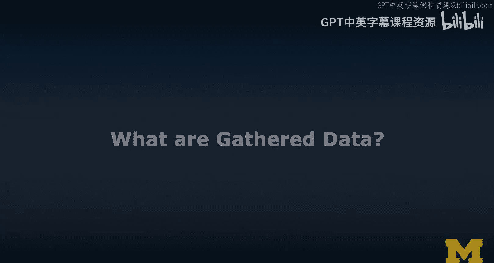
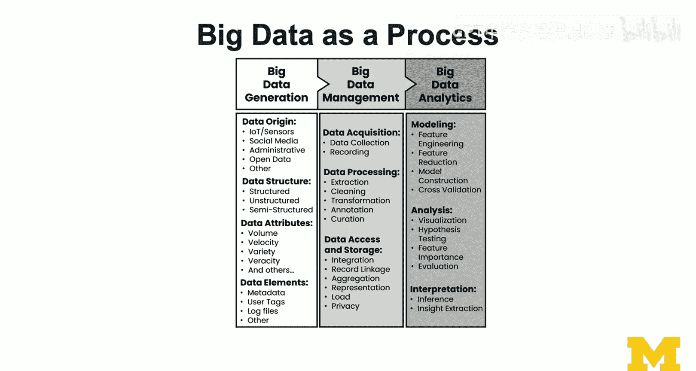
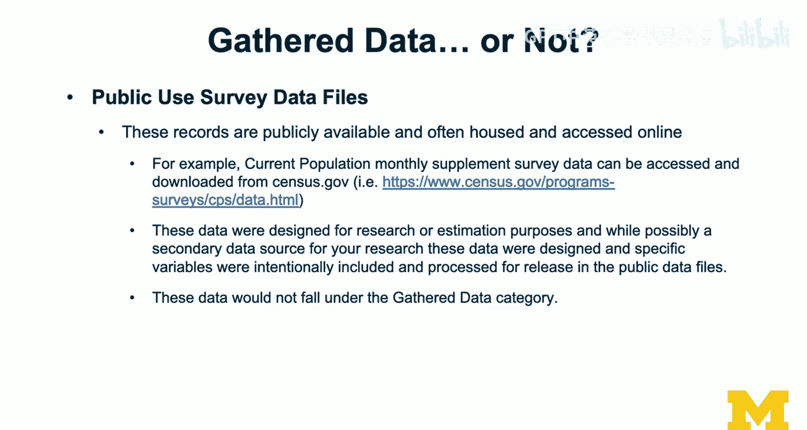
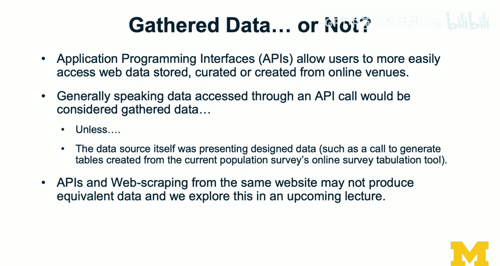
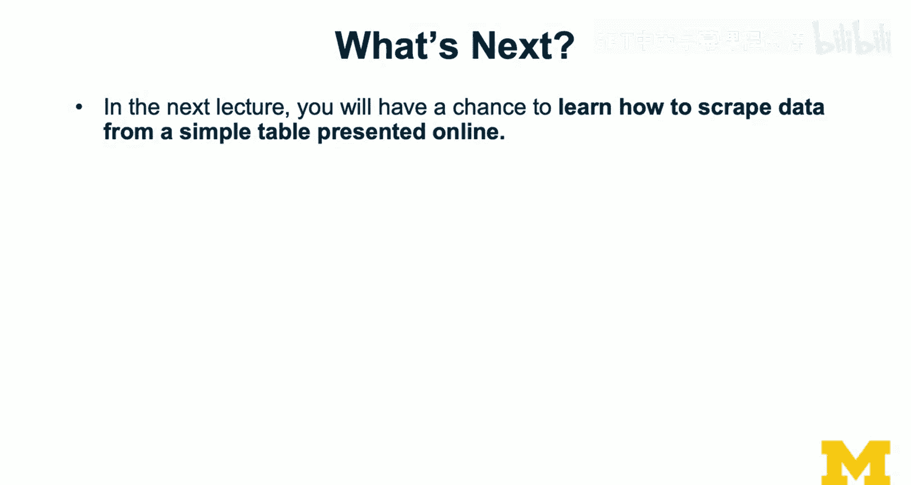
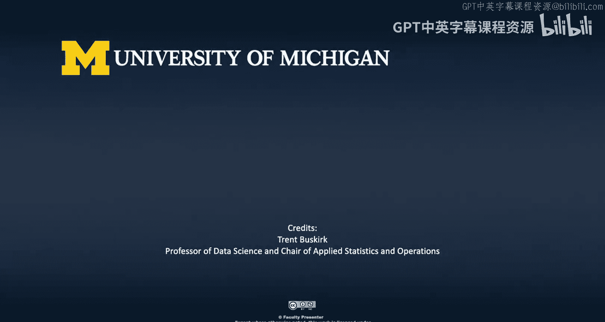

# 密歇根大学《总体数据质量（框架、度量、设计策略）total data quality》 p05 4_什么是采集型数据.zh_en -BV1Jn4y1X7uS_p5-

Hello， welcome。 today， we're going to be talking about weather gathered data。 I'm Trenmp Buskirk。

 and I'm happy to have you here。 Let's get started。😊。

So I'm going to talk to you a little bit about gather data。

 we've talked a little bit about design data already， so in contrast I'd like to discuss gather data。

We are going to define gather data for the purposes of this course as data obtained from an existing source。

 most likely not designed for research purposes or for distribution as such。

Some of these data can be generated from an external procedure， a tool， a meter or a sensor。

 or a smartphone or other kind of device， These are often referred to as organic data。

 some people refer to them as big data we'll talk more about that in a minute。

AndThen you also have specific kinds of data like social media data， sensor data， web scrappe data。

 open data as what we might call， we're going to explore some of these throughout the course and hopefully your understanding of the differences here will become more clear as we talk about it further on。

I like to think about big data as a process more than anything else。

 You see that there are basically three parts to this process。

 moving from big data generation to big data management to big data analytics。

 There's been a lot of work in the big data sphere， talking about quantifying big data。

 more of more of more as a process as opposed to the size of a data set or particular source of a data set。

 You can see under the big data generation tab in this slide。

 that there are several places that this data can originate from。 We got sensor data。

 social media data， administrative data， et cetera。

You also see that this data is has different kinds of structures than you might already be used to。

 If you do any kind of research at all， you might be used to a rectangular structure in your data file。

 where you have rows that are typically cases and columns that are typically variables。

 That's really what we refer to as a structured data set。 But big data can take other forms as well。

 including unstructured and semistructured， which we'll talk about more as we get into it。

There are also attributes of big data that are pretty typical and have been discussed wholeheartedly in the literature。

They include things like volume， velocity， variety， veracity。

 These are the Vs that describe big data you might have heard of the three V's or the four V's。

 There's an everex list of Vs that describe big data。

 There are also things like elements to the data， like metadata user tags， etc cetera。

 that come along for the ride in a data set similar to how labels might come along in a research data file。

 They aren't particularly the main source of data， but they are useful for describing the contents of the data or for allowing us to understand what。

 what exactly the data mean。

There's also a part of big data that thinks about management。

 how we actually can move large masses of data from one source to another。

 how we can actually access that data in order to be able to analyze it for our purposes。And then。

 of course， there's the modeling piece or analytics piece， where this works。

 regardless of if you have big data or small data， we're always thinking about modeling and creating inference from our data。

 but big data creates some challenges with respect to the volume and the nature of it that we're going to be talking about throughout this course relative to threats to a quality that might be of interest to us as we begin to explore big data and its utility。

I'm going to go through a series of examples here where I'm going to ask the question。

 I this gathered data or not， And we're going to talk through sort of why we might think this is gather data or design data in order to help you better understand the differences between the two。

So we're going to start with public use survey data files。

 These are records that are publicly available and often housed in accessed online。 For example。

 the current population monthly supplement survey data can be accessed through a download from the census website。

 These data were designed for research purposes。 and they are they are a secondary data source for particular research purposes。

 but they ultimate design was for the use of research。

 they may not contain every variable that you want or the variables that they do contain may not be the way that the questions are asked in a way that you might find extremely helpful for your research。

 But regardless， the main purpose of these data or designed for research。 They were thought of。

 They were designed。 They were generated for research purposes in mind。 So in that situation。

 we would think of these data as design data。 and they wouldn't fall under the。

Other data category。Let's talk about administrative records and see whether or not these are gathered data。

Well， data designs can leverage information housed within administrative records and so by administrative records。

 I mean things like a population register or auxiliary variables that might be useful from consumer database。

 for example。These data designs can leverage information。

 you can certainly leverage information inside of these administrative records for your purposes。

 we do it all the time in the sampling world where we want to take random samples of let's say。

 households and we append information about those households that we source from an administrative database or population register。

These data are structured。 They will often come with rows and columns organized like a regular data file that you might be used to using。

 but we generally would consider these big data。 And the reason why we would consider them big data is that they are structured。

 as I mentioned earlier， but they were likely not created or generated for research purposes a priori。

 there is another reason why administrative data are generated。

 and while we can use them for research purposes。 And while they are organized。

 they're often not generated or created for research purposes in mind。

There's also a considerable variety in the types of administrative records that are available and also how they're accessed。

 some administrative records can be scraped from the web， others can be downloaded as a file。

 others can be accessed through an API or some other type of interface application program interface。

So， for example， you might have housing sales data for a given county that is available from a county assessor's office。

 and you can pull that data down from an application programming interface。 Now。

 that data was not generated for research purposes。

 but rather for tracking and for probably legal reasons for transactional housing sales。

 but we often find utility in those data， and we could use it as such。

 but not the primary purpose of their existence is not for research， but for something else。

 but we can access it。 So in this case， we would consider administrative records。

 gather data and many administrative records fall under the category of big data in particular。

Application programming interfaces， as I mentioned earlier。

 allow users to more easily access web data that are stored。

 curated or created online from various venues， generally speaking data access through these API calls would be considered gathered data。

Unless， of course， the data source itself was design data， for example。

 the current population survey has an online survey tabulation tool that allows you to pull information from the survey in and create calculations on the fly or to download certain kinds of data that are available from that data source through an API call。

That is really just another way to represent or access survey data or design data and not really in the spirit of web or open data。

 so we would not consider that kind of data a gather data。

 but rather it's just an extension of the design data that we've already been talking about。

But web scraping is another way to access information from the web and it represents another way to source gather data。

 but keep in mind that while APIs and web scraping can be used on the same website in many cases。

 they may not produce equivalent information for various reasons。

 and we'll talk a little bit about that as the course continues。

So just to summarize what we've talked about here in this brief introduction to gather data。

 we remember that gather data are generated for a purpose other than analysis or research。

 They can be sourced from many different places like sensors， meters， web pages， social media。

Online transactions， digital footprints， and the list goes on。

Data are opportunistically used for researcher estimation purposes。

 but they weren't intended for that initially， and they also weren't designed for that。

 in particular。And so while gathered data are not designed for research。

 they do present a viable auxiliary source of information for investigating issues of interest to researchers and practitioners for many different domains。

 and that's what's really exciting about gather data and why I really like to dwell on it a little bit longer here and why we're going to cover it in this sequence。

 of courses， because it really represents a great opportunity for us to leverage additional information that may not have been thought of。

 designed or curated for research purposes， but is available for us nonetheless。

 so really being able to understand how to harness that potential but also being mindful of the threats to the quality that that data present for our research questions is really pivotal for us to move forward。

I'd like to just give you a heads up on what's coming in the next lecture we're going to have a chance to learn how to scrape some data using a simple table that is presented in an online resource。

 we'll use a simple tool to do this and you'll start to begin to understand what I mean by web sourced or open data and actually how to source that data for yourself。

Until next time， thanks for joining us。

