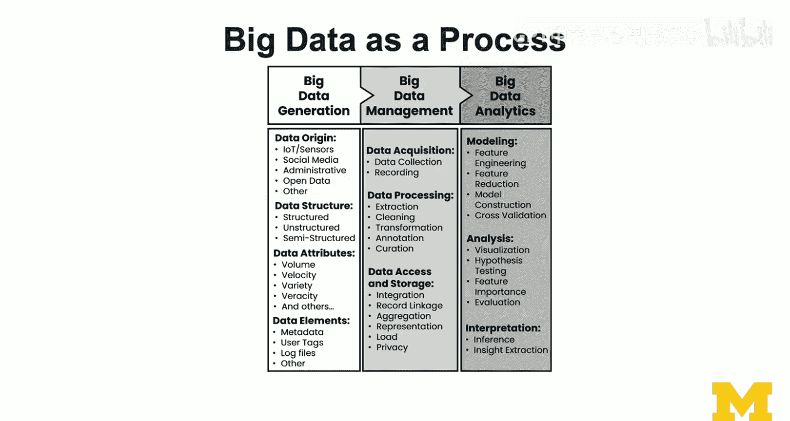
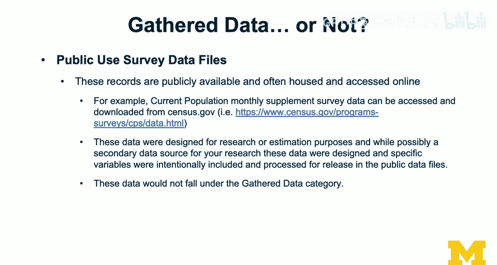
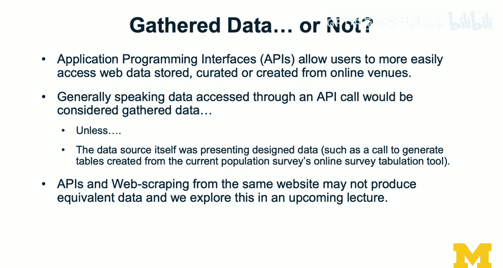

# 总体数据质量：P05：什么是采集型数据 📊

在本节课中，我们将学习“采集型数据”的概念。我们将探讨其定义、来源、特点，并将其与“设计型数据”进行对比，以帮助您理解两者之间的核心区别。

---

## 概述

采集型数据是指从现有来源获取的数据，这些数据最初并非为研究目的或特定分发而设计。它们可能来自传感器、社交媒体、行政记录或网络抓取等多种渠道。理解这类数据的特性对于有效利用它们进行高质量研究至关重要。

上一节我们介绍了设计型数据，本节中我们来看看与之相对的采集型数据。

## 采集型数据的定义

我们将采集型数据定义为：**从现有来源获取的数据，这些数据很可能并非为研究目的或作为此类数据分发而设计**。

这些数据可能由外部程序、工具、仪表、传感器、智能手机或其他设备生成。它们通常被称为**有机数据**，有时也被称为**大数据**。

以下是采集型数据的一些具体类型：
*   **社交媒体数据**
*   **传感器数据**
*   **网络抓取数据**
*   **开放数据**

我们将在课程中进一步探讨这些类型，随着学习的深入，您对它们之间差异的理解会更加清晰。

## 大数据：一种过程视角

我更倾向于将大数据视为一个**过程**，而非仅仅是数据集的大小。

这个过程主要包含三个部分：
1.  **大数据生成**
2.  **大数据管理**
3.  **大数据分析**

在学术界，有很多工作致力于将大数据**量化**为一个过程，而不仅仅是关注数据集的规模或特定来源。

从本幻灯片中的“大数据生成”部分可以看到，这些数据可以源自多个地方，例如传感器数据、社交媒体数据、行政数据等。

同时，这些数据的结构可能与您习惯的不同。如果您从事过任何研究，可能习惯于数据文件中的矩形结构，即行代表案例，列代表变量。我们称之为**结构化数据集**。但大数据还可以采用其他形式，包括**非结构化**和**半结构化**数据，我们将在后续课程中详细讨论。

大数据还具有一些典型的、在文献中被广泛讨论的属性。它们通常用多个“V”来描述：
*   **Volume**（体量）
*   **Velocity**（速度）
*   **Variety**（多样性）
*   **Veracity**（真实性）

您可能听说过“3V”或“4V”，实际上描述大数据的“V”列表还在不断增加。数据中还包含一些元素，如**元数据**、**用户标签**等，它们类似于研究数据文件中的标签，虽然不是数据的主要来源，但对于描述数据内容或帮助我们理解数据的准确含义非常有用。

大数据管理涉及如何将海量数据从一处移动到另一处，以及如何实际访问这些数据以便进行分析。

当然，还有**建模**或**分析**环节。无论您处理的是大数据还是小数据，我们始终在思考如何从数据中建模和推断。但大数据在体量和性质上带来了一些挑战，这些挑战关系到数据质量，我们将在本课程中结合大数据及其效用进行探讨。

## 示例辨析：是采集型数据吗？

接下来，我将通过一系列示例提出问题：**这是采集型数据吗？** 我们将讨论为什么认为它是采集型数据或设计型数据，以帮助您更好地理解两者之间的区别。

### 示例一：公共用途调查数据文件

这些是公开可用的记录，通常在线存储和访问。例如，当前人口月度补充调查数据可以从人口普查网站下载。

这些数据是**为研究目的而设计的**。对于特定的研究目的而言，它们是二手数据源，但其最终设计是为了研究用途。它们可能不包含您想要的每一个变量，或者其包含的变量提问方式可能对您的研究并非最理想。但无论如何，这些数据的主要目的是为研究而设计、构思和生成的。

因此，在这种情况下，我们认为这些数据是**设计型数据**，不属于采集型数据类别。

### 示例二：行政记录

数据设计可以利用行政记录中包含的信息。行政记录指的是诸如人口登记册或来自消费者数据库的可能有用的辅助变量等。

数据设计当然可以利用这些行政记录中的信息。在抽样领域我们经常这样做，例如，当我们想对家庭进行随机抽样时，我们会从行政数据库或人口登记册中获取这些家庭的附加信息。

这些数据是**结构化的**，通常以您可能习惯使用的常规数据文件的行列形式组织。但我们通常认为它们属于**大数据**。原因在于，虽然它们是结构化的，但很可能最初并非为研究目的而创建或生成。行政数据的生成另有原因，尽管我们可以将其用于研究目的，并且它们是有组织的，但其初衷通常并非研究。

行政记录的类型和访问方式也存在相当大的多样性。一些行政记录可以从网络抓取，另一些可以作为文件下载，还有一些可以通过**API**（应用程序编程接口）或其他类型的界面访问。

例如，您可能拥有某个县的房屋销售数据，这些数据来自县评估员办公室，您可以通过应用程序编程接口获取。这些数据并非为研究目的而生成，而是为了跟踪记录，可能出于法律原因用于房屋销售交易。但我们经常发现这些数据的效用，可以这样使用它。然而，其存在的主要目的不是研究，而是其他用途，只是我们可以访问它。

因此，在这种情况下，我们认为行政记录是**采集型数据**，并且许多行政记录属于**大数据**的范畴。

### 示例三：应用程序编程接口

如前所述，API 允许用户更轻松地访问存储、管理或在线创建的各种网络数据。通常，通过此类 API 调用访问的数据被视为**采集型数据**。

当然，除非数据源本身就是设计型数据。例如，当前人口调查有一个在线调查制表工具，允许您通过 API 调用从调查中提取信息、实时创建计算或下载该数据源提供的某些类型的数据。这实际上只是表示或访问调查数据（设计型数据）的另一种方式，并不符合网络数据或开放数据的精神。因此，我们不会将此类数据视为采集型数据，而应将其视为我们已经讨论过的设计型数据的延伸。

### 示例四：网络抓取

网络抓取是访问网络信息的另一种方式，也代表了获取采集型数据的一种来源。但请注意，尽管在许多情况下 API 和网络抓取可以用于同一网站，但由于各种原因，它们可能不会产生等效的信息，我们将在课程继续中稍作讨论。

## 总结

本节课中我们一起学习了采集型数据。我们来总结一下要点：

*   采集型数据是**为分析或研究以外的目的而生成**的。
*   它们可以源自许多不同的地方，如传感器、仪表、网页、社交媒体、在线交易、数字足迹等。
*   数据被**机会主义地**用于研究者的估计目的，但它们最初并非为此而设计。
*   尽管采集型数据并非为研究而设计，但它们确实为研究人员和实践者调查各个领域感兴趣的问题提供了可行的辅助信息来源。这正是采集型数据的激动人心之处，也是我们在此多花时间讨论并在本系列课程中涵盖它的原因。因为它确实代表了一个巨大的机会，让我们能够利用那些可能并非为研究目的而构思、设计或管理，但对我们仍然可用的额外信息。

因此，真正理解如何挖掘这种潜力，同时警惕这些数据对我们的研究问题可能带来的质量威胁，对我们向前发展至关重要。

在下一讲中，我们将有机会学习如何使用在线资源中呈现的简单表格来抓取一些数据。我们将使用一个简单的工具来完成，您将开始理解我所说的网络来源数据或开放数据，以及如何为自己获取这些数据。

下次见，感谢参与。